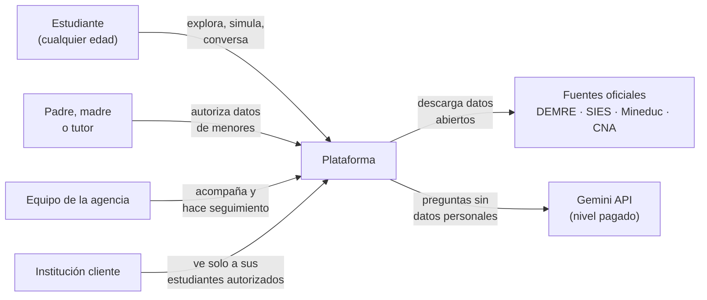
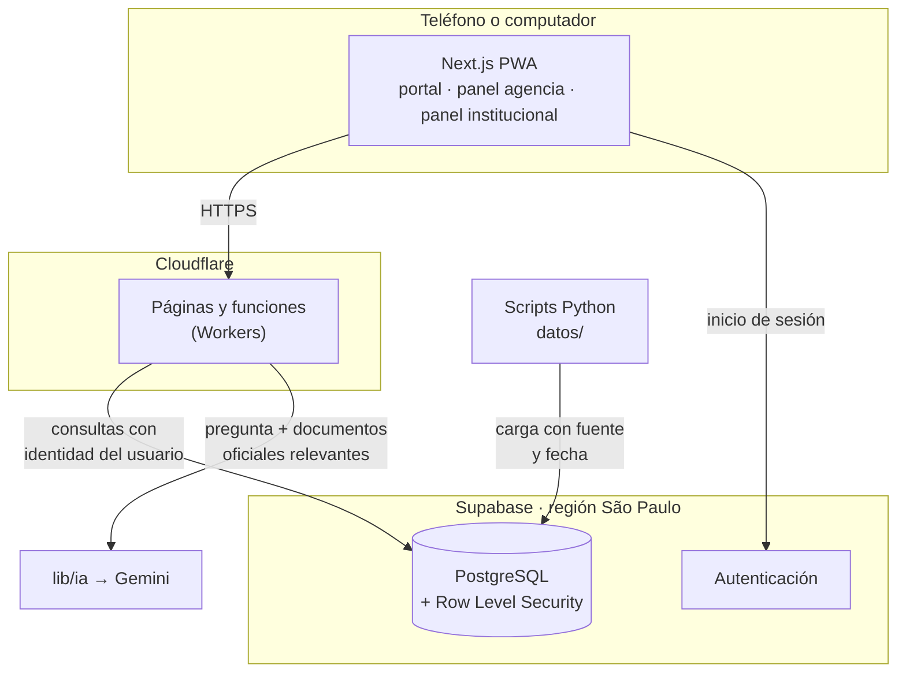
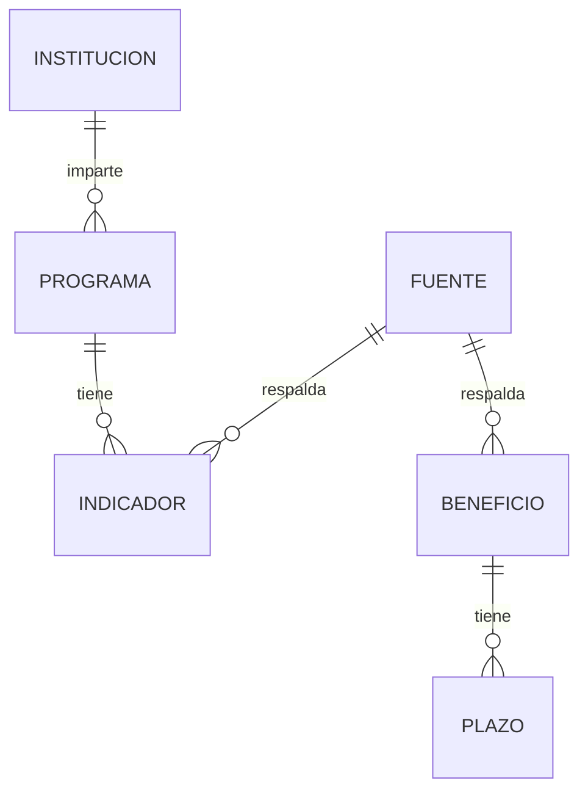
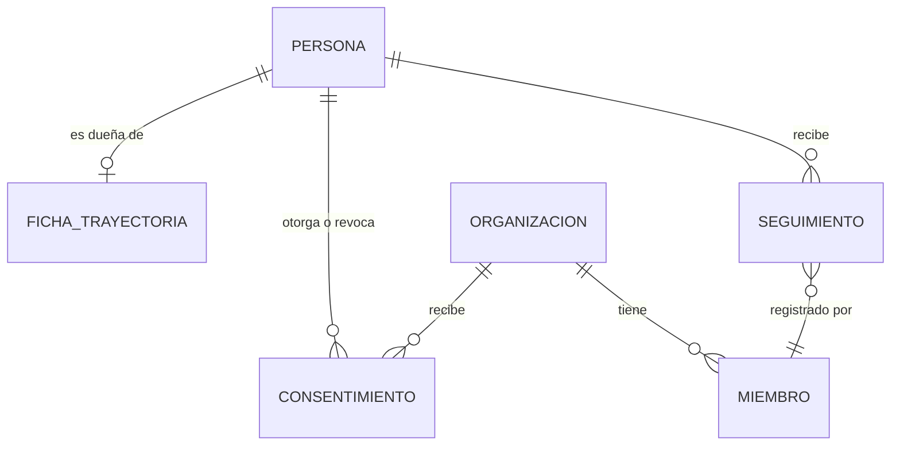
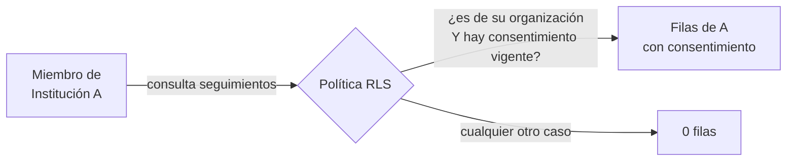
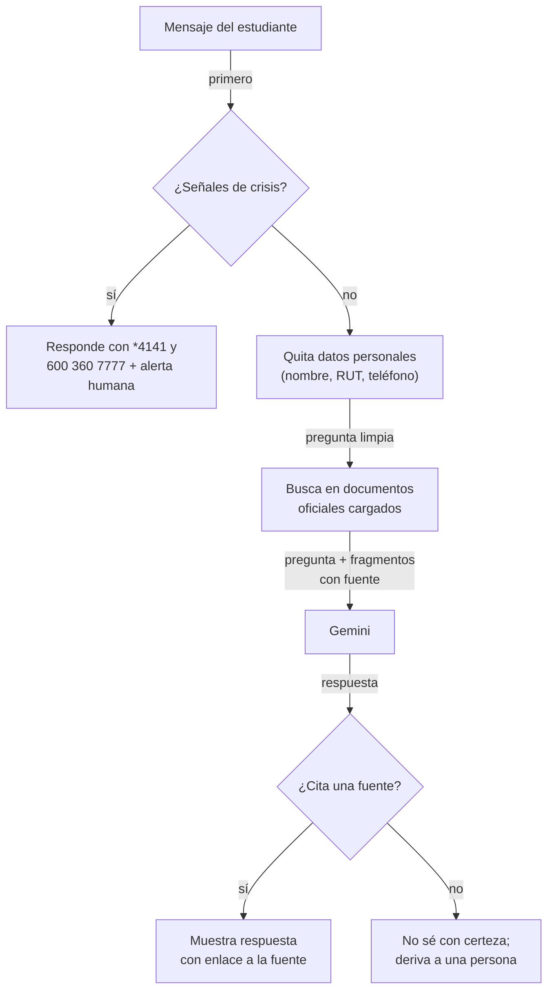
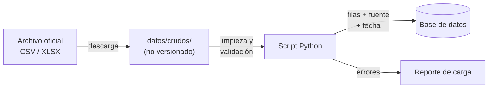

# Arquitectura

Una sola aplicación web (PWA) sobre una sola base de datos, con los datos de cada institución aislados por la propia base de datos. Esa decisión es la que permite empezar con tres personas y crecer a muchas instituciones sin reescribir.

Cada decisión de esta página tiene su registro en [`docs/decisiones/`](decisiones/). Los diagramas usan Mermaid y GitHub los dibuja solo.

---

## 1. Contexto: quién usa qué

---

## 2. Componentes

| Componente | Responsabilidad | Carpeta |
|---|---|---|
| Portal | Explorador de carreras, comparador, simulador, beneficios, asistente | `app/(portal)/` |
| Panel agencia | Casos, seguimiento, alertas | `app/(agencia)/` |
| Panel institucional | Cohortes de la institución, solo estudiantes que autorizaron | `app/(institucion)/` |
| Cálculos | Puntaje ponderado, ranking, elegibilidad | `lib/calculos/` |
| Asistente IA | Interfaz única hacia el proveedor, protocolo de crisis | `lib/ia/` |
| Carga de datos | Descarga y limpieza de datos oficiales | `datos/` |
| Esquema | Tablas, políticas de seguridad, migraciones | `supabase/migrations/` |

**Páginas de carreras pre-generadas:** las fichas de carrera son públicas y cambian pocas veces al año. Se generan como páginas estáticas: cargan rápido con poca señal, cuestan casi nada servir y aparecen en Google.

---

## 3. Modelo de datos

Dos mundos separados: **datos públicos oficiales** (sin datos personales) y **datos de personas** (protegidos).

| Tabla | Qué guarda | Regla clave |
|---|---|---|
| `fuente` | Organismo, URL, fecha de descarga, licencia | Todo dato público apunta a una fuente |
| `institucion`, `programa` | Oferta académica | Código oficial como identificador |
| `indicador` | Un valor medido: empleabilidad 1.er año, ingreso 4.º año, arancel, puntaje de corte, retención | Siempre con `tipo`, `periodo`, `fuente_id`; sin dato → `null` + motivo, nunca 0 |
| `beneficio`, `plazo` | Gratuidad, becas, créditos y sus fechas | Vigencia con fecha de inicio y término |
| `persona` | Datos mínimos de quien se registra | Fecha de nacimiento → define si requiere tutor |
| `ficha_trayectoria` | Intereses, simulaciones guardadas, beneficios postulados | Le pertenece a la persona |
| `consentimiento` | Qué comparte, con qué organización, cuándo, revocado o no | Sin consentimiento vigente, la institución no ve nada |
| `organizacion`, `miembro` | La agencia y cada institución cliente; sus usuarios y roles | Base del aislamiento |
| `seguimiento` | Notas y señales de alerta | Dato sensible: cifrado y con registro de acceso |
| `registro_acceso` | Quién vio qué dato sensible y cuándo | Solo se agrega, nunca se borra |

---

## 4. Aislamiento entre instituciones

La regla vive **en la base de datos**, no en el código de la página. Aunque el frontend tenga un error, PostgreSQL no entrega filas de otra institución.

Cada política tiene su prueba automatizada en `supabase/tests/`: un usuario de A no ve datos de B; una institución no ve a un estudiante que revocó su consentimiento.

---

## 5. Asistente IA

Reglas:

- **La detección de crisis corre antes que todo y no depende del proveedor de IA.** Si Gemini no responde, el protocolo igual funciona.
- La IA no recibe datos personales. Gemini en nivel pagado no usa los datos para mejorar sus productos, pero igual minimizamos.
- Toda llamada pasa por `lib/ia/proveedor.ts`. Cambiar de proveedor = cambiar un archivo.
- Las respuestas sin fuente no se muestran como hechos.

---

## 6. Flujo de datos oficiales

- Cada carga es **repetible**: correrla dos veces deja el mismo resultado.
- Cada script valida tipos, rangos (una empleabilidad no puede ser 140%) y nulos antes de escribir.
- El catálogo de fuentes, sus URL y términos de uso está en [`docs/fuentes.md`](fuentes.md).

---

## 7. Seguridad (resumen)

| Medida | Dónde |
|---|---|
| HTTPS en todo | Cloudflare |
| Aislamiento por institución | Políticas RLS en PostgreSQL |
| Datos sensibles cifrados | Columnas cifradas en `seguimiento` |
| Registro de accesos a datos sensibles | Tabla `registro_acceso` |
| Secretos fuera del código | Variables de entorno; `.env` ignorado por git |
| Revisión obligatoria | CODEOWNERS + rama `main` protegida |
| Dependencias revisadas | Justificación en cada PR que agregue una |

Detalle de tratamiento de datos personales: [`docs/privacidad.md`](privacidad.md).

---

## 8. Cómo escala

| Etapa | Cambio necesario |
|---|---|
| 1 institución piloto | Ninguno: crear su `organizacion` y miembros |
| 10 instituciones | Ninguno en código; quizás pasar Supabase a plan pagado |
| Tráfico alto en admisión (enero) | Las fichas son estáticas: Cloudflare las sirve desde caché |
| Otro proveedor de IA | Cambiar `lib/ia/proveedor.ts` |
| App en tiendas | La PWA puede empaquetarse sin reescribir; solo si los usuarios lo piden |
