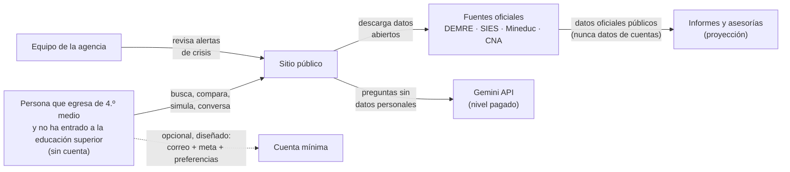
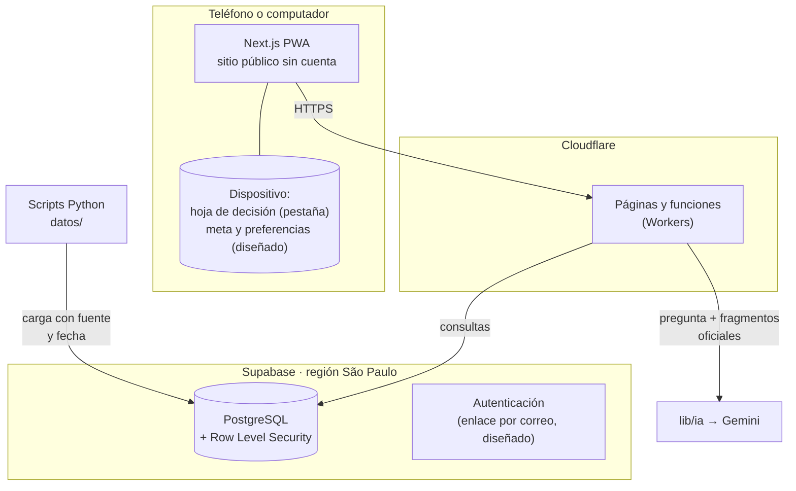
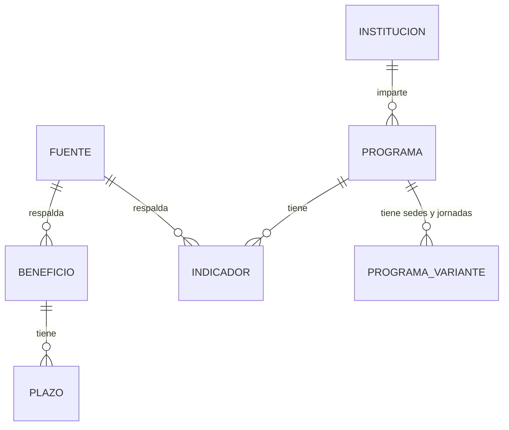
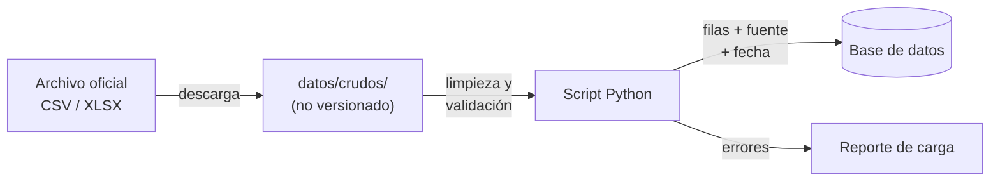

# Arquitectura

> Actualizado el 13 de noviembre de 2026 según el [ADR 0032](decisiones/0032-agencia-independiente-y-publico-egresado.md) (agencia independiente, público egresado, alcance nacional) y el [ADR 0033](decisiones/0033-cuenta-con-correo-sin-edad.md) (cuenta mínima). Ambos están en estado «propuesta».

Una sola aplicación web (PWA) sobre una sola base de datos. **Todo lo público funciona sin cuenta.** Lo que se guarda de una persona (solo si crea una cuenta, que está diseñada y no se construye antes del 19 de diciembre de 2026) está aislado **por persona** en la propia base de datos. El aislamiento por institución cliente, que era el eje hasta el ADR 0031, quedó sin uso.

Cada decisión de esta página tiene su registro en [`docs/decisiones/`](decisiones/). Los diagramas usan Mermaid y GitHub los dibuja solo.

## Cómo leer los estados

Cada pieza de esta página tiene uno de tres estados:

- **Existe**: está en el código de `main` o de esta rama.
- **Diseñado**: tiene decisión escrita, pero no código.
- **Sin uso**: existe en el código o en la base, pero ninguna decisión vigente lo necesita. No se borró; se retira en una migración aparte.

---

## 1. Contexto: quién usa qué

- **Persona usuaria (existe):** usa el sitio sin cuenta. Su hoja de decisión vive solo en la pestaña (`sessionStorage`) y no viaja a ningún servidor.
- **Cuenta mínima (diseñada, [ADR 0033](decisiones/0033-cuenta-con-correo-sin-edad.md)):** guarda correo, si estudia o ya estudió, institución de una lista oficial, meta, tres preferencias y el registro del consentimiento. Quien tiene menos de 14 años no crea cuenta.
- **Equipo de la agencia (existe en la base):** recibe las alertas de crisis y las derivaciones ([ADR 0019](decisiones/0019-alertas-de-crisis-y-derivacion.md)).
- **Quien encarga un informe (proyección):** recibe elaboraciones hechas solo con datos oficiales públicos. Ningún dato de una cuenta se le entrega.
- **Retirado:** colegio cliente, padre, madre o tutor, y la Ficha de Trayectoria compartida con instituciones. Ya no hay panel de colegios.

---

## 2. Componentes

| Componente | Responsabilidad | Carpeta | Estado |
|---|---|---|---|
| Sitio público | Explorador de carreras, ficha por carrera, comparador, simulador de puntaje, beneficios, guía del FUAS (Formulario Único de Acreditación Socioeconómica), hoja de decisión, guía de componentes | `app/(portal)/` | Existe |
| Asistente (ruta) | Recibe la pregunta y responde con fuentes | `app/api/asistente/` | Existe; su apertura al público depende de la decisión del 20 de noviembre ([`asistente-con-fuentes.md`](asistente-con-fuentes.md)) |
| Cálculos | Puntaje ponderado, puntaje ranking, simulador de admisión 2027 | `lib/calculos/2027/` | Existe |
| Acceso a los datos oficiales | Consultas, búsqueda, comparador, hoja, fuentes y fechas | `lib/datos/` | Existe |
| Asistente IA | Interfaz única hacia el proveedor, protocolo de crisis, quita de datos personales, búsqueda de fragmentos | `lib/ia/` | Existe |
| Carga de datos | Descarga, limpieza y validación de datos oficiales; pronósticos | `datos/` | Existe |
| Esquema | Tablas, políticas de seguridad, migraciones y sus pruebas | `supabase/` | Existe |
| Cuenta mínima | Guardar meta y preferencias entre dispositivos | — | Diseñado ([ADR 0033](decisiones/0033-cuenta-con-correo-sin-edad.md)); no se construye antes del 19-dic-2026 |
| Meta y tres preferencias en el dispositivo | Conservarlas sin cuenta | — | Diseñado; hoy el código solo guarda las anotaciones de la hoja de decisión en la pestaña |
| Tablero de transparencia | Mostrar cómo se procesan los datos oficiales (fuente, pasos, normalización, fecha), sin atribuirse los datos | — | Idea ([`propuesta-portal-de-transparencia.md`](propuesta-portal-de-transparencia.md)); fuera del alcance del 19-dic-2026 |
| Informes y asesorías | Elaboraciones con datos oficiales públicos para quien las encargue | — | Proyección; es una hipótesis sin validar ([ADR 0032](decisiones/0032-agencia-independiente-y-publico-egresado.md)) |
| Panel de agencia | Casos y seguimiento | `app/(agencia)/` | **No existe en el código.** Lo que hay es la base de alertas y derivaciones (sección 3) |
| Panel de seguimiento para colegios | — | `app/(institucion)/` | **Retirado** ([ADR 0032](decisiones/0032-agencia-independiente-y-publico-egresado.md)). La carpeta nunca llegó a existir |

**Datos que muestra el sitio:** cada cifra oficial lleva fuente, URL y fecha. Lo que la agencia calcula (por ejemplo, una comparación entre carreras o la estimación de un puntaje) se rotula «elaboración propia» y dice con qué datos y qué fórmula se hizo. No se mezclan indicadores de distinta definición en una misma comparación.

**Páginas de carreras pre-generadas:** las fichas de carrera son públicas y cambian pocas veces al año. Se generan como páginas estáticas: cargan rápido con poca señal, cuestan casi nada servir y aparecen en Google.

---

## 3. Modelo de datos

Dos mundos separados: **datos públicos oficiales** (sin datos personales) y **datos de personas** (protegidos).

### 3.1 Datos públicos oficiales (existen, en uso)

| Tabla | Qué guarda | Regla clave |
|---|---|---|
| `fuente` | Organismo, URL, fecha de descarga, licencia | Todo dato público apunta a una fuente |
| `institucion`, `programa`, `programa_variante` | Oferta académica: el programa es carrera + institución; cada variante es una sede y jornada con su código SIES ([ADR 0011](decisiones/0011-comparacion-de-programas.md)) | Código oficial como identificador |
| `indicador` | Un valor medido: empleabilidad 1.er año, ingreso 4.º año, arancel, puntaje de corte, retención | Siempre con `tipo`, `periodo`, `fuente_id`; sin dato → `null` + motivo, nunca 0. Con `variante_id` si la fuente lo publica por sede y jornada |
| `beneficio`, `plazo` | Gratuidad, becas, créditos y sus fechas | Vigencia con fecha de inicio y término |
| `programa_generico`, `arancel_variante`, `tramo_ingreso_sies`, `requisito_admision`, `vacante_admision`, `acreditacion_institucion` | Datos oficiales de la migración `20261105000000_datos_oficiales_completos.sql` | Lectura pública; escritura solo con la clave de servicio |

### 3.2 Alertas de crisis y derechos del titular (existen, en uso)

| Tabla o función | Qué hace | Regla clave |
|---|---|---|
| `alerta_crisis`, `derivacion`, `registro_acceso_alerta` | Alertas del protocolo de crisis, derivaciones y registro de cada acción ([ADR 0019](decisiones/0019-alertas-de-crisis-y-derivacion.md)) | La alerta lleva solo el tipo de señal y la hora, nunca el texto del mensaje. Sin permisos directos: todo pasa por funciones que verifican el rol |
| `solicitud_derecho`, `solicitar_derecho()`, `exportar_mis_datos()`, `ver_solicitudes_abiertas()`, `resolver_solicitud()` | Derechos del titular ([ADR 0020](decisiones/0020-derechos-del-titular.md)) | La exportación entrega los datos de la persona sin identificar al autor de notas |
| `organizacion`, `miembro`, `es_equipo_de_acompanamiento()` | La agencia y su equipo. Las funciones de alertas verifican con ellos el rol del equipo | Se conservan para el equipo de la agencia |

### 3.3 Tablas de personas del esquema base: sin uso desde los ADR 0032 y 0033

El esquema base (`20261103000000_esquema_base.sql`) se diseñó para el panel institucional. **Siguen existiendo en la base, con sus políticas y pruebas.** Ninguna decisión vigente las usa y se retiran en una migración aparte, que todavía no existe (el [ADR 0033](decisiones/0033-cuenta-con-correo-sin-edad.md) la ubica al construir la cuenta).

| Tabla o función | Para qué se hizo | Estado |
|---|---|---|
| `consentimiento`, `tiene_consentimiento()`, `organizacion_autorizada()` | Compartir con una institución, por finalidad | Sin uso (ADR 0032). El consentimiento de la cuenta mínima es otro: registro de fecha, hora y versión del texto aceptado, y se diseñará con la cuenta |
| `autorizacion_tutor`, `soy_menor_de_edad()`, `tengo_autorizacion_tutor()` y la política `consentimiento_otorgar` | Autorización de madre, padre o tutor de menores de 18 | Sin uso (ADR 0033 reemplaza al 0022). La migración `20261109100000_autorizacion_tutor_no_autodeclarada.sql` ya la dejaba solo de lectura para la persona |
| `ficha_trayectoria` | Intereses, simulaciones y beneficios postulados, para compartir | Sin uso como Ficha compartida. La cuenta guardará meta y preferencias, que se diseñarán aparte |
| `seguimiento`, `registro_acceso`, `ver_seguimientos()` | Notas del equipo sobre una persona y registro de quién las leyó | Ligadas al panel de seguimiento. **No hay decisión escrita** que diga si se conservan o se retiran: queda por decidir |

**Desajuste con la cuenta diseñada:** la tabla `persona` del esquema base exige `nombre` y `fecha_nacimiento` (`not null`) y guarda `region`. El ADR 0033 dice que la cuenta no guarda nombre, edad ni fecha de nacimiento. Al construir la cuenta hay que migrar `persona` (o crear otra tabla) y la función `exportar_mis_datos()`, que hoy incluye ficha, consentimientos y seguimientos.

---

## 4. Aislamiento

La regla vive **en la base de datos**, no en el código de la página. Aunque el frontend tenga un error, PostgreSQL no entrega filas que no corresponden.

- **Datos públicos:** lectura para todos; nadie los modifica desde la página. Solo los scripts de carga, con la clave de servicio.
- **Datos de una persona:** cada persona ve y edita solo lo suyo (Row Level Security por `auth.uid()`). **Este es el aislamiento que se mantiene.**
- **Alertas y derivaciones:** sin permisos directos; solo el equipo de la agencia, a través de funciones que dejan registro.
- **Aislamiento por institución cliente:** las políticas existen y se prueban (`organizacion_autorizada()` y el consentimiento por organización), pero quedaron **sin uso**: ya no hay instituciones clientes que lean datos de personas.

Cada política tiene su prueba automatizada en `supabase/tests/pruebas_rls.sql` (11 secciones), que corre en cada PR. Las secciones 3, 4, 5 y 6 prueban reglas del panel retirado y se retiran junto con él. Detalle en [`supabase/README.md`](../supabase/README.md).

---

## 5. Asistente IA

Reglas (existen en el código):

- **La detección de crisis corre antes que todo y no depende del proveedor de IA.** Si Gemini no responde, el protocolo igual funciona.
  Está en `lib/ia/crisis.ts`, no importa ningún otro módulo y sus pruebas (`tests/ia/crisis.test.ts`) corren en cada PR. La alerta para el equipo lleva solo el tipo de señal y la hora, nunca el texto del mensaje.
- La IA no recibe datos personales. Gemini en nivel pagado no usa los datos para mejorar sus productos, pero igual minimizamos.
- Toda llamada pasa por `lib/ia/proveedor.ts`. Cambiar de proveedor = cambiar un archivo.
  El orden completo vive en `lib/ia/asistente.ts` (`responder()`), y la limpieza en `lib/ia/datos-personales.ts`. La IA debe devolver los `id` de los fragmentos que usó; si no devuelve ninguno de los que se le entregaron, la respuesta no se muestra.
  Límite conocido: esto asegura que la respuesta cite un fragmento real, pero no que diga lo mismo que ese fragmento. Si alguien manipula a la IA con su mensaje, podría obtener una respuesta inventada que igual cite un fragmento. Por eso la interfaz debe mostrar el fragmento citado junto a la respuesta, y el asistente nunca responde montos ni plazos que no vengan del fragmento.
- Las respuestas sin fuente no se muestran como hechos.
- **El asistente no escribe en la cuenta** ([ADR 0033](decisiones/0033-cuenta-con-correo-sin-edad.md), regla 8).

---

## 6. Flujo de datos oficiales

- Cada carga es **repetible**: correrla dos veces deja el mismo resultado.
- Cada script valida tipos, rangos (una empleabilidad no puede ser 140%) y nulos antes de escribir.
- El catálogo de fuentes, sus URL y términos de uso está en [`docs/fuentes.md`](fuentes.md).
- Los informes para clientes (proyección) se construyen sobre estos mismos datos oficiales públicos y sobre elaboraciones propias rotuladas como tales. Nunca con datos de cuentas.

---

## 7. Seguridad (resumen)

| Medida | Dónde | Estado |
|---|---|---|
| HTTPS en todo | Cloudflare | Existe |
| Aislamiento por persona | Políticas RLS en PostgreSQL | Existe |
| Permisos mínimos por rol (segunda capa, además de RLS) | Migración `20261104010000_quita_permisos_de_mas.sql` | Existe |
| Registro de acciones sobre alertas | Tabla `registro_acceso_alerta` | Existe |
| Datos sensibles cifrados | Cifrado de columna de `seguimiento` ([ADR 0007](decisiones/0007-cifrado-del-seguimiento.md)) | Pendiente; la cuenta mínima no guarda datos sensibles |
| Secretos fuera del código | Variables de entorno; `.env` ignorado por git | Existe |
| Revisión obligatoria | CODEOWNERS + rama `main` protegida | Existe |
| Dependencias revisadas | Justificación en cada PR que agregue una | Existe |

Detalle de tratamiento de datos personales: [`docs/privacidad.md`](privacidad.md).

---

## 8. Cómo escala

| Etapa | Cambio necesario |
|---|---|
| Lanzamiento del sitio público (sin cuenta) | Ninguno: son páginas estáticas y consultas de lectura |
| Abrir la cuenta mínima | Migrar `persona` según el ADR 0033, construir el ingreso por enlace al correo y el registro del consentimiento, y retirar las tablas sin uso |
| Tráfico alto en admisión (enero) | Las fichas son estáticas: Cloudflare las sirve desde caché |
| Otro proveedor de IA | Cambiar `lib/ia/proveedor.ts` |
| App en tiendas | La PWA puede empaquetarse sin reescribir; solo si los usuarios lo piden |
