# ENTREGABLE: PARTE II

**Agencia de Enlace & Seguimiento Estudiantil**

Proyecto de Especialidad Profesional (PEP801) · Ingeniería de Ejecución en Informática, mención Desarrollo de Sistemas · AIEP, sede San Fernando

Integrantes: Rafael Jaque, Alejandro Tapia y Cristóbal Rojas · Entrega: 19 de diciembre de 2026

Este documento continúa el Entregable Parte I. Las tablas, figuras y citas de la Parte I se mencionan como «Parte I» seguidas de su número. Lo que depende de la medición con personas (30 de noviembre al 4 de diciembre de 2026) o de una firma se marca `[COMPLETAR]` hasta tenerlo.

### Siglas

Cada sigla se explica además la primera vez que aparece en el texto.

**Tabla S.1.** Siglas usadas en este documento.

| Sigla | Significado |
|---|---|
| AIEP | Instituto Profesional AIEP |
| API | Interfaz de programación de aplicaciones (*Application Programming Interface*) |
| CI | Integración continua (*Continuous Integration*): verificaciones automáticas en cada cambio |
| CNED | Consejo Nacional de Educación |
| CORFO | Corporación de Fomento de la Producción |
| DEMRE | Departamento de Evaluación, Medición y Registro Educacional |
| FUAS | Formulario Único de Acreditación Socioeconómica |
| IA | Inteligencia artificial |
| IVA | Impuesto al valor agregado |
| KPI | Indicador clave de desempeño (*Key Performance Indicator*) |
| MER | Modelo entidad-relación |
| Mineduc | Ministerio de Educación |
| MoSCoW | Técnica de priorización: debe (*Must*), debería (*Should*), podría (*Could*) y no tendrá (*Won't*) |
| OCDE | Organización para la Cooperación y el Desarrollo Económicos |
| ODS | Objetivos de Desarrollo Sostenible |
| PAES | Prueba de Acceso a la Educación Superior |
| PESTLE | Análisis del entorno político, económico, social, tecnológico, legal y ecológico |
| PWA | Aplicación web progresiva (*Progressive Web App*) |
| RACI | Matriz de responsabilidades: responsable, quien aprueba, consultado e informado |
| RLS | Seguridad a nivel de fila (*Row Level Security*) de la base de datos |
| SERNAC | Servicio Nacional del Consumidor |
| SHA-256 | Algoritmo que calcula la huella de un archivo (*Secure Hash Algorithm* de 256 bits) |
| SIES | Servicio de Información de Educación Superior |
| SII | Servicio de Impuestos Internos |
| SLEP | Servicio Local de Educación Pública |
| SpA | Sociedad por acciones |
| SUBDERE | Subsecretaría de Desarrollo Regional y Administrativo |
| Subtel | Subsecretaría de Telecomunicaciones |
| TRL | Nivel de madurez tecnológica (*Technology Readiness Level*) |
| UF | Unidad de Fomento |
| UML | Lenguaje unificado de modelado (*Unified Modeling Language*) |
| UTM | Unidad Tributaria Mensual |
| WCAG | Pautas de accesibilidad para el contenido web (*Web Content Accessibility Guidelines*) |

---

## 8. Plan de ejecución

La Parte I dejó formulado qué problema se resuelve, para quién y con qué recursos. Este capítulo organiza cómo se ejecuta. El problema que el plan debe resolver es concreto: el equipo tiene hasta el 19 de diciembre de 2026 para medir con 10 personas si una persona que egresó de 4.º medio reúne y compara los datos de una carrera en menos tiempo, y la medición solo ocurre del 30 de noviembre al 4 de diciembre. Cualquier atraso en datos, en funciones o en la convocatoria de participantes deja el proyecto sin evidencia. Por eso el plan dice quién hace qué, cómo circula la información, cuándo se revisa y con qué números. Después de esa fecha, el mismo plan sostiene la puesta en marcha pública proyectada para 2027, de dos meses (Parte I, punto 10).

Las decisiones de este capítulo se apoyan en lo ya escrito: los cargos salen de la matriz de responsabilidades RACI (responsable, quien aprueba, consultado e informado; Parte I, Tabla 3.8), la segmentación de los puntos 1.1 y 5, la Carta Gantt de la Tabla 3.7 y las suposiciones críticas de la Tabla 3.12. Se distinguen dos cosas que no se mezclan. Una suposición crítica es una condición que debe cumplirse para que el proyecto tenga sentido; un factor de riesgo es un evento de la ejecución que se gestiona. Y un indicador de logro mide el efecto del proyecto (I-OG, I-OE1a, I-OE1b, I-OE2, I-OE3a, I-OE3b, validados en los capítulos 10 y 11); un indicador de gestión mide si la operación funciona. Aquí solo se definen los segundos, que se elevan a indicadores clave de desempeño (KPI, por su sigla en inglés).

### 8.1 Áreas afectadas por el proyecto

Quien usa el servicio no es una organización que lo reciba y cambie su trabajo: la agencia es el equipo mismo y, a futuro, una sociedad por acciones (SpA) que se constituiría en 2027. Por eso las áreas afectadas son las de la propia agencia.

**Tabla 8.1.** Áreas afectadas.

| Área | Qué hace hoy | Qué cambia con la puesta en marcha | Qué necesita |
|---|---|---|---|
| Operaciones | Tres integrantes construyen y miden un prototipo, con tareas repartidas en un tablero | Pasa a actualizar datos cada mes y a mantener un sitio abierto al público | Calendario de cargas de datos y horas registradas por integrante |
| Administración y finanzas | Sin entidad legal ni ingresos; gasto en dinero casi nulo por planes gratuitos | Facturar, contratar proveedores y controlar el gasto mensual | Constituir la SpA, contabilidad y cotizaciones (Parte I, punto 10) |
| Tecnología | Sitio desplegado en Cloudflare con base de datos en Supabase, en planes gratuitos | Planes de pago, vigilancia del consumo y registro de cada carga de datos | Cuenta de proveedor con medios de pago y alertas de uso |
| Comunicaciones | Sin canal propio con el público; las piezas se publican desde el sitio | Publicar método, tablero de transparencia y análisis; recibir consultas | Piezas gráficas con la imagen corporativa y una casilla de correo |
| Dirección | La jefatura decide con el docente tutor como contraparte académica | La SpA exige estatutos, pacto de accionistas y decisiones registradas | Asesoría legal y acuerdo de los tres socios |

### 8.2 Organización del equipo

#### 8.2.1 Organigrama del proyecto

Es el organigrama real: tres cargos con tres personas, más las contrapartes externas. Los organismos fuente son el Ministerio de Educación (Mineduc), el Servicio de Información de Educación Superior (SIES) y el Departamento de Evaluación, Medición y Registro Educacional (DEMRE). La línea continua indica dependencia y la punteada, coordinación o asesoría. Las herramientas de inteligencia artificial (IA) que el equipo declaró usar, Claude y Codex, son apoyo de quien las usa y nunca un cargo.

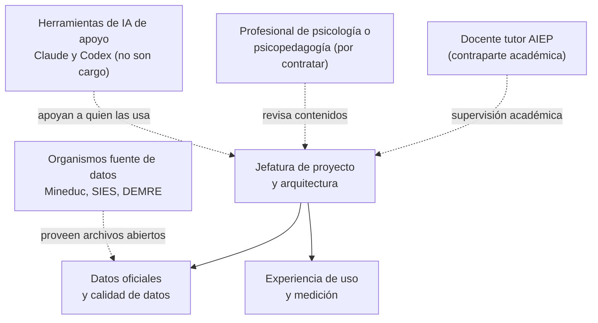

*Figura 8.1.* Organigrama del proyecto (elaboración propia).

**Tabla 8.2.** Cargos y personas. Una persona ocupa un solo cargo; el cargo de jefatura incluye la arquitectura y la protección de datos personales.

| Cargo | Ocupado por | Depende de | Foco |
|---|---|---|---|
| Jefatura de proyecto y arquitectura | Rafael Jaque | Docente tutor (contraparte académica) | Planificación, arquitectura, protección de datos personales, revisión y fusión de cambios, informe |
| Datos oficiales y calidad de datos | Cristóbal Rojas | Jefatura | Carga y verificación de datos (vista de carrera, puntaje ponderado, calendario, preguntas frecuentes) |
| Experiencia de uso y medición | Alejandro Tapia | Jefatura | Comparador, meta y alternativas, medición con personas |

Si el proyecto creciera, el primer cargo que se desdoblaría es el de jefatura: la arquitectura y la protección de datos personales pasarían a una persona distinta de quien planifica y fusiona cambios. Hoy ambas funciones recaen en una sola persona, lo que concentra la dependencia (ver R6 en el capítulo 9).

#### 8.2.2 Descriptores de cargo

Hay un descriptor por cada cargo del organigrama. Los indicadores de desempeño son medibles a propósito: el capítulo 9 exige que el equipo se autoevalúe contra ellos. La dedicación de 10 horas semanales por integrante es la que usa el presupuesto de la Parte I (punto 10); es un supuesto del equipo y las horas reales quedan en el tablero.

**Tabla 8.3.** Descriptor de cargo: Jefatura de proyecto y arquitectura.

| Campo | Contenido |
|---|---|
| Cargo | Jefatura de proyecto y arquitectura |
| Ocupado por | Rafael Jaque |
| Depende de | Docente tutor (contraparte académica) |
| Objetivo del cargo | Asegurar que el proyecto avance según el plan y que todo cambio integrado cumpla la pauta de revisión y la protección de datos personales |
| Funciones | Planificar el cronograma y repartir las tareas con encargo escrito · Definir la arquitectura y registrar las decisiones · Resguardar la protección de datos personales en el diseño · Revisar cada pull request con la pauta escrita y fusionarlo tras confirmarlo · Mantener el tablero y el repositorio al día · Convocar y registrar la reunión semanal · Redactar el informe y coordinar con el docente tutor |
| Responsabilidades | Responde ante el docente tutor por el cumplimiento del cronograma y la entrega del 19 de diciembre; ante el equipo, por que ningún cambio llegue a la rama principal sin revisión |
| Atribuciones | Aprobar o rechazar una fusión; decretar el congelamiento de funciones; replanificar o reducir el alcance cuando K1 esté bajo la meta; decidir la arquitectura tras consultar al equipo |
| Competencias requeridas | Gestión de proyectos informáticos, arquitectura web y bases de datos, control de versiones y revisión de código, seguridad de la información (AIEP, s. f.) |
| Indicadores de desempeño | K1 Cumplimiento del cronograma (≥ 90 %) · K3 Tiempo de revisión de cambios (≤ 2 días) · K5 Ejecución presupuestaria (90 % a 110 %) · G1 Cambios fusionados con revisión escrita (100 %) |
| Dedicación semanal | 10 horas (supuesto del equipo); horas reales: `[COMPLETAR: horas registradas en el tablero, las trae Rafael]` |

**Tabla 8.4.** Descriptor de cargo: Datos oficiales y calidad de datos.

| Campo | Contenido |
|---|---|
| Cargo | Datos oficiales y calidad de datos |
| Ocupado por | Cristóbal Rojas |
| Depende de | Jefatura |
| Objetivo del cargo | Asegurar que cada dato publicado venga de una fuente oficial vigente, con su fuente, enlace y fecha |
| Funciones | Descargar y limpiar los archivos abiertos de los organismos oficiales · Registrar cada carga con fuente, período, fecha y huella SHA-256 (algoritmo que identifica un archivo con 256 bits) del archivo · Verificar cada dato de la vista de carrera, el puntaje ponderado, el calendario y las preguntas frecuentes contra su fuente · Validar la estructura de los archivos en cada carga · Rotular «elaboración propia» las cifras que el equipo calcula, con su método · Avisar a la jefatura cuando un organismo cambie un archivo o un calendario |
| Responsabilidades | Responde ante la jefatura por la vigencia y la trazabilidad de los datos publicados |
| Atribuciones | Retirar de publicación un dato que no pueda verificarse en una fuente oficial; rechazar un archivo cuya estructura cambió hasta validarlo |
| Competencias requeridas | Procesamiento de datos con Python, modelado de datos con fuentes de nombres y períodos distintos, lectura crítica de metodologías oficiales (AIEP, s. f.) |
| Indicadores de desempeño | K4 Vigencia de los datos (100 %) · G2 Cargas con registro completo (100 %) |
| Dedicación semanal | 10 horas (supuesto del equipo); horas reales: `[COMPLETAR: horas registradas en el tablero, las trae Cristóbal]` |

**Tabla 8.5.** Descriptor de cargo: Experiencia de uso y medición.

| Campo | Contenido |
|---|---|
| Cargo | Experiencia de uso y medición |
| Ocupado por | Alejandro Tapia |
| Depende de | Jefatura |
| Objetivo del cargo | Asegurar que una persona que egresó use el comparador y la meta sin ayuda, y medir con personas si lo logra |
| Funciones | Construir el comparador, la meta y las alternativas con lenguaje claro y accesibilidad · Convocar a las 10 personas de 18 años o más y obtener su consentimiento informado · Aplicar la prueba de usabilidad con tareas y cronómetro · Registrar tareas, tiempos y defectos de uso · Redactar los hallazgos para la reunión semanal · Proponer correcciones leves después de la medición |
| Responsabilidades | Responde ante la jefatura por que la medición se haga en la fecha y con el método comprometidos |
| Atribuciones | Suspender una sesión si falta el consentimiento; observar un texto de interfaz que no cumpla el lenguaje claro |
| Competencias requeridas | Diseño centrado en el usuario, pruebas de usabilidad, accesibilidad (pautas WCAG, *Web Content Accessibility Guidelines*, versión 2.2 nivel AA), registro y análisis de datos de una medición (AIEP, s. f.) |
| Indicadores de desempeño | K2 Defectos por versión (≤ 3) · sesiones de medición completas (10 de 10; mínimo 6, según la Tabla 3.12 de la Parte I) · G3 Horas registradas en la semana |
| Dedicación semanal | 10 horas (supuesto del equipo); horas reales: `[COMPLETAR: horas registradas en el tablero, las trae Alejandro]` |

**Tabla 8.6.** Contrapartes externas (línea punteada en el organigrama).

| Contraparte | Función en la puesta en marcha | Estado |
|---|---|---|
| Docente tutor (AIEP) | Supervisión académica; recibe cada avance y valida el cumplimiento del perfil de egreso | En ejercicio |
| Profesional de psicología o psicopedagogía | Revisa los contenidos de orientación antes de publicarlos | Por contratar; sin monto, por cotizar (Parte I, punto 10) |
| Organismos fuente de datos (Mineduc, SIES, DEMRE) | Publican los archivos abiertos que alimentan el sitio | Sin convenio; se citan como fuente |

#### 8.2.3 Flujograma de procesos y comunicación

El proceso que define al proyecto es el flujo de un cambio: desde la decisión de qué se hace hasta su despliegue y su medición con personas. Se dibuja en carriles, uno por cargo y uno para las contrapartes externas. Cada flecha de comunicación lleva el código de la fila correspondiente en el plan de comunicación (Tabla 8.7).

El liderazgo es participativo: la jefatura decide, pero después de consultar, y lo decidido vuelve a consultarse con datos. Se evidencia en cuatro rasgos del flujograma. Primero, la decisión consultada (rombo de acuerdo): las prioridades se resuelven en la reunión semanal, donde los tres opinan, y si no hay acuerdo se vuelve a la reunión con datos antes de decidir. Segundo, la retroalimentación en dos sentidos (flechas de retorno): la revisión devuelve el cambio con comentarios y los hallazgos de la medición vuelven a la planificación. Tercero, la participación del usuario: las 10 personas condicionan lo que se corrige. Cuarto, la transparencia: todos los cambios y tareas viven en el mismo repositorio y tablero.

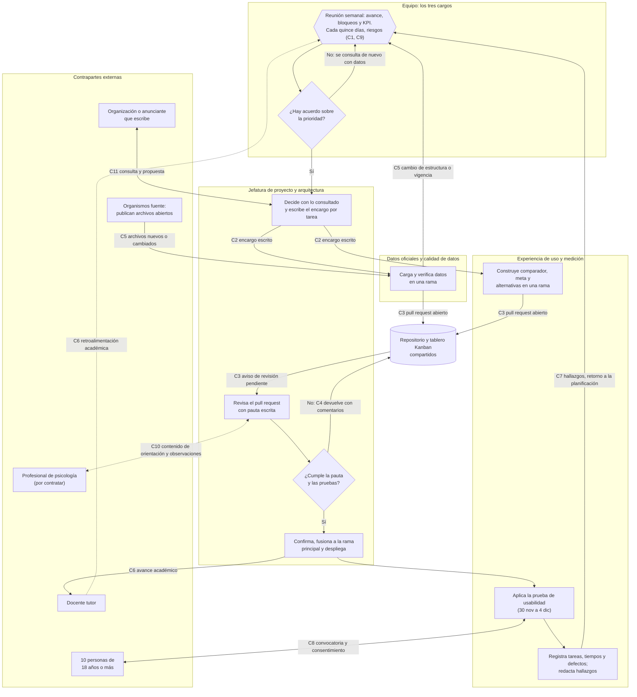

*Figura 8.2.* Flujograma en carriles del proceso de cambio y su medición, con la comunicación entre unidades (elaboración propia). Rombo: decisión. Cilindro: repositorio. Línea punteada: contraparte externa.

#### 8.2.4 Plan de comunicación

Cada fila se rastrea en el flujograma por su código. Las comunicaciones con la jefatura y con el docente quedan por escrito, por si hay que reconstruir una decisión.

**Tabla 8.7.** Plan de comunicación.

| Código | Qué se comunica | A quién | Cada cuánto | Canal | Responsable |
|---|---|---|---|---|---|
| C1 | Avance de tareas, bloqueos y valores de KPI; el acuerdo o desacuerdo sobre la prioridad | Los tres cargos | Semanal | Reunión del equipo (acta breve en el tablero) | Jefatura |
| C2 | Encargo escrito de cada tarea, con qué se espera y para cuándo | Datos; Experiencia | Al asignar cada tarea | Tablero Kanban y mensaje | Jefatura |
| C3 | Pull request listo para revisión | Jefatura | Por cada cambio | Repositorio | Quien abre el cambio |
| C4 | Resultado de la revisión (comentarios o confirmación) | Quien abrió el cambio | Por cada pull request, en 2 días o menos | Repositorio | Jefatura |
| C5 | Cambio de estructura o de calendario en un archivo oficial; vigencia de los conjuntos de datos | Jefatura y equipo | Mensual y cuando ocurra | Registro de cargas y tablero | Datos |
| C6 | Avance académico; retroalimentación del docente | Docente tutor | Según el calendario del curso | Aula virtual y entregas | Jefatura |
| C7 | Hallazgos de la medición, con tareas, tiempos y defectos | Equipo | Al cierre de la medición (4 de diciembre) | Registro de la medición e informe de hallazgos | Experiencia |
| C8 | Convocatoria, consentimiento informado y resultados de cada sesión | Participantes de 18 años o más | Del 30 de noviembre al 4 de diciembre | Mensaje y documento de consentimiento | Experiencia |
| C9 | Revisión de la matriz de riesgos y de los KPI | Los tres cargos | Quincenal (riesgos) y mensual (K4 y K5) | Reunión del equipo y tablero | Jefatura |
| C10 | Contenido de orientación para revisar, y observaciones | Profesional de psicología o psicopedagogía | Antes de publicar cada contenido | Documento revisado por escrito | Jefatura |
| C11 | Consulta de una organización o de un anunciante, y propuesta de respuesta | Quien escribió | Cuando llegue una consulta (desde 2027) | Correo | Jefatura |

### 8.3 Segmentación, imagen corporativa y proceso de ventas

#### 8.3.1 Segmentación

No se rehace la segmentación de la Parte I (puntos 1.1 y 5). Se retoman sus tres segmentos, uno que usa gratis y dos que pagan, y se agrega lo que el plan de ejecución necesita: su tamaño con fuente, cuál va primero y qué se exige para entrar. El perfil demográfico, psicográfico, conductual y geográfico de las personas y de las organizaciones está en las Tablas 5.1 y 5.2 de la Parte I.

**Tabla 8.8.** Segmentos, tamaño y criterio de entrada.

| Segmento | Qué retoma de la Parte I | Tamaño | Cuál va primero y por qué | Criterio de entrada |
|---|---|---|---|---|
| Personas que egresan (usan gratis) | Tabla 5.1: egresaron de 4.º medio y no han ingresado, o están por egresar; alcance nacional | 276.509 egresaron en 2025; 137.237 (49,6 %) no ingresaron en 2026 (SIES, 2026a). 300.678 se inscribieron a la Prueba de Acceso a la Educación Superior (PAES) Regular 2026, y 26,1 % ya había egresado: 78.477 personas (Ministerio de Educación, 2026c; elaboración propia) | Primero, las personas de 18 años o más que egresaron en los últimos cinco años: es la ventana que sigue el SIES y quienes pueden dar un consentimiento propio en la medición | Para la medición: 18 años o más, haber egresado en los últimos cinco años, consentimiento informado. Para el sitio: ninguno, es abierto |
| Organizaciones que encargan informes | Tabla 5.2: organizaciones que necesitan un análisis de datos de educación superior; llegan por iniciativa propia | 557: 345 municipalidades (Subsecretaría de Desarrollo Regional y Administrativo [SUBDERE], s. f.), 70 Servicios Locales de Educación Pública (Ley 21.040; 36 funcionaban al 1 de enero de 2026, Ministerio de Educación, 2026b), 16 gobiernos regionales (Ley 21.033, 2017) y 126 instituciones de educación superior (Fiscalía Nacional Económica, 2025). No hay dato de cuántas compran estudios cada año | Primero, los 431 organismos públicos (557 menos las 126 instituciones; elaboración propia), porque el informe de 10,4 Unidades Tributarias Mensuales (UTM) con impuesto al valor agregado (IVA) cabe en la Compra Ágil | Que el encargo se pueda hacer con datos oficiales públicos y que no pida posición ni mención en el sitio |
| Anunciantes (servicios educativos que no son instituciones de educación superior) | Fichas 3 y 4.2 de la Parte I: preuniversitarios y afines; sin rastreo | 138 empresas en el rubro «Enseñanza preuniversitaria» en 2025; las 10 medianas y grandes concentran cerca del 81 % de sus ventas de 1.635.415 Unidades de Fomento (UF) (Servicio de Impuestos Internos [SII], 2026b; cifras preliminares; elaboración propia) | Primero, las que quieran llegar a quienes preparan la PAES: la temporada de preparación concentra los meses activos (Parte I, Tabla 9.1b). Hay solo tres espacios | No ser una institución de educación superior ni pertenecer a una; aceptar las reglas de avisos |

El segmento prioritario de las organizaciones no significa salir a buscarlas. El equipo no vende: la agencia se da a conocer con lo que publica, y quien necesita un análisis llega por iniciativa propia. Tampoco hay un segmento «preferido» entre las instituciones de educación superior: a quien encargue un informe no se le da posición ni trato distinto en el sitio.

#### 8.3.2 Imagen corporativa

La imagen corporativa existe para decir dos cosas antes de leer: que esto es un servicio independiente, y que cada cifra se puede leer sin ayuda. No imita a un organismo del Estado, porque no lo es.

**Tabla 8.9.** Imagen corporativa.

| Elemento | Decisión | Justificación |
|---|---|---|
| Nombre | Agencia de Enlace & Seguimiento Estudiantil | «Enlace» es lo que hace: conecta los datos que el Estado publica por separado. «Seguimiento» conserva la promesa de acompañar a la persona en los pasos hasta su meta, sin predecir su trayectoria. Limitación: el nombre es descriptivo y podría rechazarse como marca (Parte I, punto 4.4) |
| Logotipo | Un enlace y una flecha: el enlace es la conexión de la información y la flecha, avanzar. Existe en versión horizontal, solo símbolo y para fondo oscuro. Tamaño mínimo del horizontal: 160 px de ancho; bajo eso se usa el símbolo | Identidad. Funciona en pantalla pequeña y se redibujó como imagen vectorial. En fondo oscuro se usa su versión clara, porque el azul marino sobre negro tiene un contraste de 1,6:1 |
| Colores | Azul marino `#0D325F`, coral `#F46E52`, blanco `#FFFFFF` y tinta `#1C1B19`. El azul marino se usa para la línea y los encabezados y el coral, solo para la acción principal de cada pantalla | Salen de medir el logo original, no de una teoría del color. La investigación sobre color y funcionamiento psicológico está en una etapa incipiente y se recomienda prudencia al aplicarla (Elliot, 2015), por eso la «psicología del color» no es justificación. Contrastes medidos (W3C, 2023, criterio 1.4.3): azul marino sobre blanco 12,82:1; tinta sobre blanco 17,21:1; el coral sobre blanco da 2,92:1 y por eso no se usa como texto (para texto se usa `#A93A22`, 6,33:1); el texto del botón, tinta sobre coral, 5,90:1. Azul y coral siguen separados con daltonismo (diferencia de color ΔE 68, 91 y 96 en protanopía, deuteranopía y tritanopía; Machado et al., 2009). La verificación automática del proyecto da 44 de 44 pares de color que cumplen, en modo claro y oscuro |
| Tipografía | Atkinson Hyperlegible Next para el texto y Atkinson Hyperlegible Mono para las cifras, alojadas en el proyecto | Fue diseñada por el Braille Institute (s. f.) para lectores con baja visión y distingue letras que suelen confundirse. Mono alinea puntajes y aranceles para compararlos de un vistazo. Dos familias y dos pesos bastan; alojarlas evita avisar a un tercero de la visita y descargas extra en un teléfono con datos limitados. Licencia abierta SIL |
| Tono de comunicación | Español de Chile, tuteo, frases cortas, sin siglas sin explicar. Los botones dicen verbo y resultado («Comparar carreras»). Nunca etiqueta ni culpa a la persona | Comprensión: quien decide sin orientador necesita entender sin ayuda. La confianza se gana mostrando la fuente, no con adjetivos |
| Aplicación | Sitio: cabecera azul marino con el logo y una sola acción coral por pantalla. Informes: portada con el logo horizontal, las mismas tipografías, método y fuentes a la vista. Presentaciones: fondo blanco o azul marino con el logo correspondiente. Los avisos van rotulados «Publicidad» y no usan los colores de acción ni imitan una ficha | Coherencia en todos los puntos de contacto y separación visible entre contenido del sitio y aviso |
| En qué se diferencia de Acceso Mineduc y Elige Carrera | Cada cifra muestra su fuente, su fecha y qué mide; lo calculado por el equipo se rotula «elaboración propia»; la marca declara independencia y no usa la identidad de ningún organismo oficial | Según la Parte I (punto 4.7), los portales del Mineduc están repartidos en tres sitios y en Elige Carrera, versión beta, no se observó información de beneficios ni la explicación de qué mide cada indicador. La diferencia es de contenido y de método, no de adorno. El aspecto gráfico de esos portales no se relevó, por eso aquí no se compara |

**Convivencia con otras marcas.** La agencia usa datos de organismos del Estado y los cita siempre; no usa sus logotipos ni sugiere respaldo. En 2027, una organización que encargue un informe aparece solo en el informe que contrató, no en el sitio.

#### 8.3.3 Proceso de ventas

Hay dos procesos porque hay dos productos con lógicas distintas: el informe a pedido y el espacio publicitario. En ambos, el equipo no sale a vender: la persona u organización llega por lo que la agencia publica. Las duraciones son supuestos del equipo, porque no ha habido ningún encargo ni aviso.

**Tabla 8.10.** Proceso de ventas del informe a pedido ($632.000 + IVA por un informe de 24 horas; $26.333 + IVA por hora en encargos mayores).

| Etapa | Qué ocurre | Quién (rol) | Evidencia que queda | Duración (supuesto) |
|---|---|---|---|---|
| 1. Contacto | La organización conoce el sitio, el tablero de transparencia o un análisis publicado y escribe por iniciativa propia. Si es un organismo público, puede publicar una solicitud de Compra Ágil en Mercado Público | Jefatura | Correo o solicitud recibida, con fecha | Sin duración: no la controla el equipo |
| 2. Diagnóstico | Se pregunta qué decisión quiere respaldar, con qué datos oficiales y para cuándo. Califica si el análisis se hace con datos oficiales públicos y si no pide posición ni mención en el sitio. Si pide eso, el proceso termina | Jefatura y Datos | Ficha de diagnóstico con la decisión de aceptar o no | 2 días hábiles |
| 3. Propuesta | Se presenta el alcance, el método, las fuentes y el precio: $632.000 + IVA ($752.080) por un informe de 24 horas, o $26.333 + IVA por hora en un encargo mayor. El informe con IVA equivale a 10,4 UTM, bajo el tope de 100 UTM de la Compra Ágil (ChileCompra, 2024) | Jefatura | Propuesta escrita | 3 días hábiles |
| 4. Cierre | Una organización privada contrata directamente, con contrato y factura. Un organismo público compra por Mercado Público, con orden de compra, y el proveedor debe estar inscrito y activo en el Registro de Proveedores (ChileCompra, 2024). Antes hay que constituir la SpA | Jefatura | Contrato u orden de compra; factura | 3 días hábiles |
| 5. Entrega e incorporación | Se elabora el informe con método y fuentes a la vista y se entrega. No se incorpora nada del cliente al sitio público | Datos (elaboración) y Jefatura (entrega) | Informe entregado; registro de horas reales | 24 horas de trabajo (Parte I, 9.1.1) |
| 6. Seguimiento | Se consulta si el informe respondió la decisión y se recalcula el precio con las horas reales. No hay renovación automática | Jefatura | Registro de la consulta y de horas reales | 1 semana |

**Tabla 8.11.** Proceso de ventas del espacio publicitario ($200.000 + IVA por espacio al mes, es decir, $238.000 con IVA).

| Etapa | Qué ocurre | Quién (rol) | Evidencia que queda | Duración (supuesto) |
|---|---|---|---|---|
| 1. Contacto | El sitio publica el espacio disponible, su tarifa y sus reglas; el anunciante interesado escribe. El equipo no lo busca | Jefatura | Correo recibido | Sin duración: no la controla el equipo |
| 2. Diagnóstico | Se verifica que no sea una institución de educación superior ni pertenezca a una, que acepte las reglas y que el aviso no imite contenido del sitio | Jefatura | Lista de verificación de las reglas | 2 días hábiles |
| 3. Propuesta | Se ofrece un aviso por página, solo en la portada, el calendario y beneficios, y las preguntas frecuentes (tres espacios en total); rotulado «Publicidad»; sin rastreo; con el conteo agregado de veces que se mostró | Jefatura | Propuesta escrita con tarifa y reglas | 2 días hábiles |
| 4. Cierre | Contrato de publicidad por mes, con registro de quién compró cada aviso, porque la Ley 19.496 permite exigir al medio la identificación del anunciante en 48 horas | Jefatura | Contrato y factura; registro del anunciante | 3 días hábiles |
| 5. Entrega e incorporación | Se revisa el aviso, solo contra las reglas, y se publica. El anunciante no revisa contenido del sitio | Jefatura y Experiencia | Aviso publicado y su revisión | 1 día hábil |
| 6. Seguimiento | Se entrega el conteo agregado mensual sin identificar a nadie y se ofrece renovar. La tarifa se ajusta con ese dato | Jefatura | Conteo mensual entregado | Mensual |

El ingreso máximo por avisos, con tres espacios todo el año, es de $7.200.000 al año (Parte I, 9.1.3). Un anunciante que presione por un trato distinto se trata como el riesgo R5.

### 8.4 Factores de riesgo de la puesta en marcha

Los riesgos se identifican recorriendo el flujograma (¿qué pasa si este paso no ocurre?) y el análisis del entorno de 8.7, cuyos puntos críticos los originan. Se califican por probabilidad (P) e impacto (I), de 1 a 5; la exposición es P × I. Bajo 1 a 6, medio 8 a 12, alto 15 a 25. Las probabilidades y los impactos son estimaciones del equipo. El tratamiento completo, con planes de contingencia, corresponde al capítulo 9.

**Tabla 8.12.** Matriz de factores de riesgo.

| N.° | Factor de riesgo | Origen | P | I | Exp. | Nivel |
|---|---|---|---|---|---|---|
| R1 | No se consiguen las 10 personas para la medición | Suposición crítica de la Parte I | 3 | 4 | 12 | Medio |
| R2 | Un organismo cambia la estructura o el calendario de sus archivos abiertos y un dato queda desactualizado | Amenaza A2 y suposición crítica | 3 | 5 | 15 | Alto |
| R3 | El consumo de la base de datos supera el plan contratado (ya ocurrió: tráfico de salida de Supabase sobre el límite del plan gratuito en noviembre de 2026, corregido el 24 de noviembre) | Operación | 3 | 4 | 12 | Medio |
| R4 | Ninguna organización encarga un informe ni ningún anunciante compra un espacio | Amenaza A5 | 4 | 3 | 12 | Medio |
| R5 | Un aviso se confunde con contenido del sitio o un anunciante presiona por un trato distinto | Decisión de admitir avisos | 2 | 5 | 10 | Medio |

*Nota.* La Tabla 8.12 recoge los riesgos identificados antes de ejecutar. El capítulo 9, con la experiencia del piloto, identifica además R6 dependencia de una sola persona para revisar y fusionar (exposición 15), R7 fuente oficial no disponible (12) y R8 dato distinto de la fuente (15), y sube R2 a probabilidad 4 (exposición 20). Dos puntos críticos de esta matriz ya los anticipaban: PC2 (proveedores únicos de datos) para R7, y la concentración de la revisión en la jefatura, que 8.2.1 señala y K3 por autor hace visible, para R6. R8 no estaba anticipado por ningún punto crítico del entorno.

**Tabla 8.13.** Respuesta esbozada y punto crítico de origen. El número del punto crítico remite a la Tabla 8.21.

| N.° | Respuesta esbozada | Puntos críticos de origen |
|---|---|---|
| R1 | Invitar a más de 10; si se consiguen menos, medir con un mínimo de 6 y declararlo (Parte I, Tabla 3.12) | PC4 |
| R2 | Validar la estructura de cada archivo en cada carga (K4); si falla, cargar a mano de 5 a 10 carreras reales con su fuente y rotular el último proceso vigente como tal. Plan de contingencia obligatorio por ser un riesgo alto | PC1, PC2 |
| R3 | Vigilar el consumo en el panel del proveedor y pasar a plan de pago desde la puesta en marcha; páginas livianas. Umbral de alerta: 4 GB en el ciclo (80 % del límite de 5 GB, RNF-09); `[COMPLETAR: confirmar el umbral con el panel de Supabase, lo hace Rafael]` | PC3, PC10 |
| R4 | El sitio gratuito no depende de ventas: su gasto en dinero es de $29.491 al mes y lo cubren los socios; publicar un informe de muestra y postular a fondos públicos | PC5, PC6, PC8 |
| R5 | Reglas escritas, un aviso por página, rótulo «Publicidad», revisión de cada aviso solo contra las reglas y ninguna posición ni trato a cambio; el contrato lo dice | PC7 |

### 8.5 Cronograma, Carta Gantt y medidas de control

#### 8.5.1 Carta Gantt

Parte de la Tabla 3.7 de la Parte I y del calendario real: congelamiento de funciones el 27 de noviembre, medición del 30 de noviembre al 4 de diciembre, correcciones leves del 7 al 17 de diciembre y entrega el 19 de diciembre. Agrega lo que la pauta de evaluación exige (Instituto Profesional AIEP [AIEP], 2025): la periodicidad y las medidas de control, y los hitos de decisión. Los controles de la semana se marcan el último día hábil de cada semana, que es un supuesto del equipo.

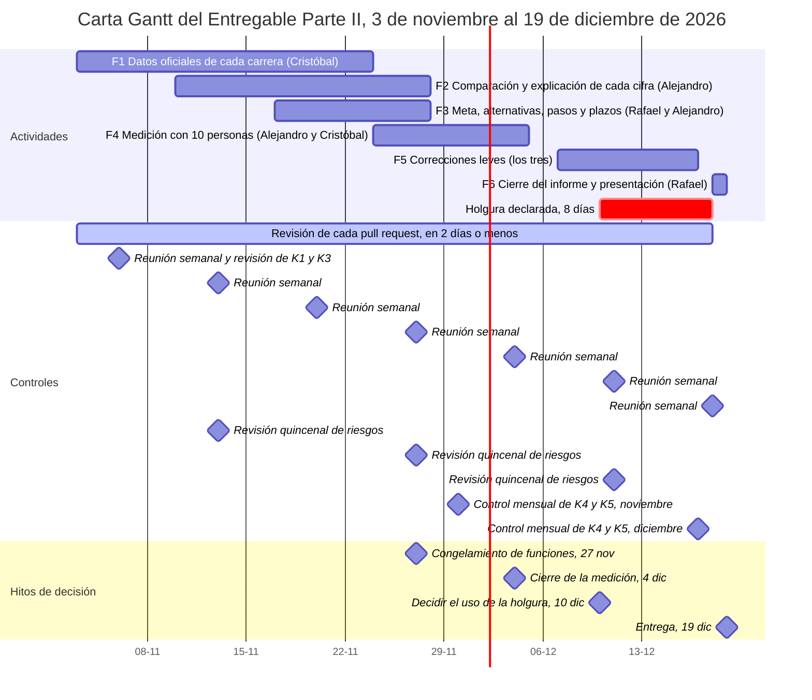

*Figura 8.3.* Carta Gantt con banda de controles e hitos de decisión (elaboración propia a partir de la Tabla 3.7 de la Parte I).

Lo que se decide en cada hito:

- **Congelamiento de funciones, 27 de noviembre.** La jefatura decide, consultado el equipo, qué funciones entran en la medición. Lo que no esté listo queda como proyección y no se agrega. Si K1 está bajo 90 %, se reduce el alcance.
- **Cierre de la medición, 4 de diciembre.** Con los hallazgos (C7) se decide cuáles se corrigen en la ventana leve y cuáles se declaran como limitación.
- **Decidir el uso de la holgura, 10 de diciembre.** Si las correcciones terminaron, la holgura se dedica al informe; si no, se usa en corregir.
- **Entrega, 19 de diciembre.** Cierre del informe y la presentación.

**Holgura.** Se reservan 8 días corridos, del 10 al 17 de diciembre, de los 47 que van del 3 de noviembre al 19 de diciembre: 17 % del tiempo (elaboración propia), dentro del 15 % a 20 % que se recomienda. Las correcciones leves se planifican para el 7 al 9 de diciembre y el resto de la ventana oficial queda como reserva declarada. F5 y F6 siguen las fechas de la Parte I (correcciones del 7 al 17 de diciembre; cierre del 18 al 19), y la holgura queda dentro de la ventana de F5.

**Tabla 8.14.** Actividades, responsables, horas y costo. Las horas son planificadas y son un supuesto del equipo (10 horas semanales por integrante, unas 200 horas hasta el 19 de diciembre, repartidas por actividad); los controles de la semana están dentro de cada actividad. Costo = horas × $13.120, el costo hora de la Parte I (punto 9.1.1). Son aportes en horas valorizadas, no dinero.

| Actividad | Responsable (A) y ejecutores (R) | Depende de | Horas | Costo | Hito |
|---|---|---|---|---|---|
| F1 Datos oficiales de cada carrera, con fuente | A Rafael; R Cristóbal | Ninguna | 45 | $590.400 | Datos de carrera con fuente y fecha |
| F2 Comparación de carreras y explicación de cada cifra | A Rafael; R Alejandro; C Cristóbal | F1 | 40 | $524.800 | Comparación disponible |
| F3 Meta, alternativas, pasos y plazos | A y R Rafael; R Alejandro | F1 y F2 | 35 | $459.200 | Calendario y alternativas disponibles, con congelamiento el 27 de noviembre |
| F4 Medición con 10 personas: tareas, tiempos y entrevistas | A Rafael; R Alejandro y Cristóbal | Congelamiento del 27 de noviembre | 25 | $328.000 | Registro de la medición |
| F5 Correcciones y mejoras leves, sin funciones nuevas | A Rafael; R los tres | F4 | 20 | $262.400 | Correcciones de los hallazgos |
| F6 Informe y presentación | A y R Rafael; R Alejandro y Cristóbal | F5 | 35 | $459.200 | Entrega el 19 de diciembre |
| **Total** | | | **200** | **$2.624.000** | |

Las horas reales por integrante y por actividad se registran en el tablero; `[COMPLETAR: horas reales hasta la fecha, las trae cada integrante]`.

#### 8.5.2 Medidas de control

La medida de control es el acto de revisar y decidir; el indicador solo mide. La Tabla 8.15 dice qué se revisa, cada cuánto, quién y qué se hace si está fuera de rango.

**Tabla 8.15.** Medidas de control.

| Qué se controla | Medida de control | Periodicidad | Quién | Si está fuera de rango (semáforo de la Tabla 8.18b) |
|---|---|---|---|---|
| Avance del cronograma | Tareas cerradas en plazo contra planificadas (K1) en la reunión semanal | Semanal | Jefatura | Replanificar o reducir alcance; el 27 de noviembre, decidir qué queda fuera |
| Calidad de cada cambio | Revisión de cada pull request con pauta escrita y pruebas; tiempo de revisión (K3) | Por cada pull request | Jefatura | Un cambio que no cumple la pauta no se fusiona |
| Defectos por versión | Recuento de defectos de las incidencias y del registro de despliegues (K2) | Por versión | Experiencia | No se despliega la versión hasta corregir los críticos |
| Vigencia de los datos | Comparar cada conjunto publicado con la publicación oficial vigente (K4) | Mensual y en cada carga | Datos | Rotular el último proceso vigente y activar el plan de R2 |
| Uso del presupuesto | Comparar el gasto real con el presupuestado (K5) | Mensual | Jefatura | Ajustar el plan o los recursos; revisar R3 |
| Riesgos | Revisar la matriz de riesgos y el estado de cada respuesta | Quincenal | Los tres cargos | Activar el plan de contingencia del riesgo que subió |
| Participantes de la medición | Contar las personas confirmadas contra las 10 requeridas | Diaria del 24 de noviembre al 4 de diciembre | Experiencia | Invitar a más; medir con un mínimo de 6 y declararlo (R1) |
| Avance académico | Entrega y retroalimentación del docente | Según el calendario del curso | Jefatura | Corregir lo observado antes de la siguiente entrega |

#### 8.5.3 Plan de ejecución de la puesta en marcha 2027

La puesta en marcha son dos meses, ocho semanas, con el sitio abierto al público, dos análisis publicados y un primer informe de muestra (Parte I, punto 10). Se planifica con los mismos controles y con las horas y los costos del presupuesto de la Parte I (Tabla 10.1): 280 horas, $3.673.600 en horas valorizadas, y $75.777 en dinero, es decir, $3.749.377 en total. La fecha de inicio depende de constituir la SpA: `[COMPLETAR: fecha de inicio de 2027, la fija Rafael cuando se firme la constitución]`.

**Tabla 8.16.** Semanas de la puesta en marcha 2027.

| Semanas | Actividad | Responsable | Control asociado |
|---|---|---|---|
| S1 | Abrir el sitio al público con los planes de pago, el dominio y los datos vigentes | Jefatura y Datos | K4 y K5 (primera medición mensual, al final de S4) |
| S2 | Actualización de datos y medición del consumo del proveedor | Datos y Jefatura | R3: revisión del consumo |
| S3 a S4 | Primer análisis publicado (8 horas) | Datos y Experiencia | Revisión de cada pull request; K1 semanal |
| S5 a S6 | Segundo análisis publicado (8 horas) | Datos y Experiencia | K4 y K5 (segunda medición mensual, al final de S8) |
| S7 | Primer informe de muestra (24 horas) | Los tres cargos | Revisión de método y fuentes antes de publicar |
| S8 | Holgura: 1 de 8 semanas, 12,5 % | Los tres cargos | Decidir si se usa o se cierra |

La reserva de 12,5 % queda por debajo del 15 % que se recomienda; es una proyección que se reajusta al fijar la fecha real.

### 8.6 Indicadores de gestión y KPI

#### 8.6.1 Indicadores de gestión

Un indicador de gestión mide si la operación funciona. Estos no repiten ningún indicador de logro de la Parte I: aquellos miden el efecto en las personas; estos miden cómo trabaja el equipo. Los cinco primeros (K1 a K5) son los que se elevan a KPI en 8.6.2; G1 a G4 complementan.

**Tabla 8.17.** Fichas de los indicadores de gestión.

| Código y nombre | Qué mide | Cómo se mide (fuente y frecuencia) | Por qué importa (decisión que gatilla) | Unidad | Meta | Responsable |
|---|---|---|---|---|---|---|
| K1 Cumplimiento del cronograma | Si el equipo cierra lo que planificó, a tiempo | Tablero y pull requests fusionados; semanal | Si baja de 90 %, se replanifica o se reduce el alcance antes del congelamiento | Porcentaje | ≥ 90 % | Jefatura |
| K2 Defectos por versión | La calidad de cada versión desplegada | Incidencias del repositorio con la etiqueta «defecto» y su severidad (el registro empieza el 27 de noviembre) y registro de despliegues; por versión | Si supera 3, no se despliega hasta corregir | Cantidad por versión | ≤ 3 | Experiencia |
| K3 Tiempo de revisión de cambios | Cuánto demora un cambio entre abrirse y fusionarse | Historial de pull requests, leído también por autor; semanal | Si algún cargo pasa de 2 días, la revisión es un cuello de botella y hay que reasignar quién revisa | Días | ≤ 2 días | Jefatura |
| K4 Vigencia de los datos | Si lo publicado coincide con la publicación oficial vigente | Registro de cargas de datos (fuente, período, fecha, huella SHA-256); mensual | Si baja de 100 %, se rotula el dato como del último proceso vigente y se actualiza | Porcentaje | 100 % | Datos |
| K5 Ejecución presupuestaria | Si el gasto sigue lo presupuestado | Facturación de los proveedores; mensual. En 2026, gasto real frente a $0 presupuestado | Cualquier gasto no previsto en 2026, o salir de la banda en 2027, ajusta el plan o revisa el consumo | Porcentaje | 90 % a 110 % desde 2027; en 2026, gasto en pesos frente a $0 | Jefatura |
| G1 Cambios fusionados con revisión escrita | Si se cumple la regla de que ningún cambio llega sin revisión | (cambios fusionados con revisión con pauta escrita ÷ cambios fusionados) × 100; por semana, del historial de pull requests | Si baja de 100 %, hay un cambio sin revisión y se revisa a posteriori | Porcentaje | 100 % | Jefatura |
| G2 Cargas con registro completo | Si cada carga deja fuente, período, fecha y huella | (cargas con los cuatro campos ÷ cargas realizadas) × 100; por carga | Si baja de 100 %, la carga no es trazable y se repite el registro | Porcentaje | 100 % | Datos |
| G3 Horas registradas en la semana | Si cada integrante registra sus horas | (integrantes con horas registradas ÷ 3) × 100; semanal, del tablero | Las horas determinan la participación en la SpA y el costo real de cada actividad | Porcentaje | 100 % | Jefatura |
| G4 Riesgos revisados | Si cada riesgo vigente se revisó en la quincena | (riesgos revisados ÷ riesgos vigentes) × 100; quincenal | Si baja de 100 %, un riesgo se movió sin que nadie lo mirara | Porcentaje | 100 % | Jefatura |

#### 8.6.2 KPI

Son cinco: los pocos que, si se desvían, obligan a hacer algo distinto. Cada uno tiene numerador, denominador y período.

**Tabla 8.18.** KPI de operación.

| Código | KPI | Fórmula | Meta | Período | Dato registrado en | Por qué es clave |
|---|---|---|---|---|---|---|
| K1 | Cumplimiento del cronograma | (tareas cerradas en plazo ÷ tareas planificadas para el período) × 100 | ≥ 90 % | Semanal | Tablero y pull requests fusionados | La medición con 10 personas solo ocurre del 30 de noviembre al 4 de diciembre: un atraso no se recupera |
| K2 | Defectos por versión | defectos registrados ÷ versiones desplegadas | ≤ 3 | Por versión | Incidencias del repositorio y registro de despliegues | Un defecto en la versión que ven los participantes contamina el tiempo medido |
| K3 | Tiempo de revisión de cambios | Σ días entre apertura y fusión ÷ pull requests fusionados | ≤ 2 días | Semanal | Historial de pull requests | Ningún cambio llega sin revisión, así que la revisión es el paso que más puede frenar el flujo |
| K4 | Vigencia de los datos | (conjuntos de datos con la publicación oficial vigente ÷ conjuntos publicados) × 100 | 100 % | Mensual | Registro de cargas de datos (fuente, período, fecha, huella SHA-256 del archivo) | Un dato desactualizado es el riesgo R2, y el sitio se apoya en que cada cifra es verificable |
| K5 | Ejecución presupuestaria | (gasto real ÷ presupuesto del período) × 100 | 90 % a 110 % | Mensual | Facturación de los proveedores | Detecta antes el desborde de consumo (R3) y mide el aporte en dinero de los socios |

**Umbrales y semáforo (se definen una sola vez).** Las metas son las de la Tabla 8.17. El estado de cada KPI se lee con un semáforo único: verde es cumplir la meta; amarillo es quedar hasta 10 % fuera de la meta; rojo es quedar más de 10 % fuera. Este es un criterio del equipo. La Tabla 9.6 del capítulo 9 y la Tabla 8.15 usan estos umbrales y no los repiten.

**Tabla 8.18b.** Umbrales de los KPI y semáforo.

| KPI | Meta (verde) | Amarillo (hasta 10 % fuera de la meta) | Rojo (más de 10 % fuera) |
|---|---|---|---|
| K1 | ≥ 90 % | 81 % a menos de 90 % | Menos de 81 % |
| K2 | ≤ 3 defectos por versión | Más de 3 y hasta 3,3 | Más de 3,3; cualquier defecto crítico abierto detiene el despliegue |
| K3 | ≤ 2 días, por cargo | Más de 2 y hasta 2,2 días | Más de 2,2 días |
| K4 | 100 % | 90 % a menos de 100 % | Menos de 90 % |
| K5 | Desde 2027, 90 % a 110 %. En 2026, gasto de $0 | Desde 2027, 81 % a menos de 90 %, o más de 110 % y hasta 121 %. En 2026 no se aplica porcentaje | Desde 2027, fuera de 81 % a 121 %. En 2026, cualquier gasto sobre $0 es alerta y se informa en pesos |

**Cómo se leen K2, K3 y K5 en la práctica.**

- **K5.** Durante 2026 el presupuesto en dinero del prototipo es $0 por los planes gratuitos (Parte I, punto 10), y una división por cero no mide nada. Por eso, en 2026 se informa el gasto real en pesos frente a $0 presupuestado, y cualquier gasto no previsto es una alerta (por ejemplo, el exceso de tráfico de salida de Supabase de noviembre, R3). Desde la puesta en marcha de 2027 rige la fórmula con la banda de 90 % a 110 % sobre el presupuesto del punto 10 de la Parte I ($75.777 en dinero).
- **K3.** El promedio simple lo dominan los cambios de la jefatura, que se fusionan casi al abrirse (84 % de los pull requests). Por eso K3 se lee además por autor: se calcula el promedio de cada cargo por separado y la meta de 2 días o menos se aplica a cada uno. Un promedio global bajo con un cargo sobre 2 días no cumple.
- **K2.** Se usa siempre la etiqueta «defecto», y quien responde por el KPI es Experiencia de uso y medición (Tabla 8.17). El denominador son las versiones desplegadas, que el capítulo 13 reconstruye en la Tabla 13.4 (el repositorio no tiene etiquetas de versión). Hasta hoy las incidencias del repositorio no tienen una etiqueta de defecto. El registro de K2 empieza el 27 de noviembre, con la etiqueta «defecto» y su severidad en cada incidencia; antes de esa fecha no hay serie para calcularlo.

Los valores observados de K1 a K5 se informan en el capítulo 9: `[COMPLETAR: valores observados de K1 a K5 al 4 de diciembre, y gasto real de noviembre y diciembre de 2026 según la facturación de los proveedores, los trae Rafael]`.

### 8.7 Análisis del entorno

Cada dimensión lleva al menos un dato con fuente oficial o primaria y una conclusión para el proyecto. No se usa prensa como fuente.

#### 8.7.1 Macroentorno: PESTLE (factores políticos, económicos, sociales, tecnológicos, legales y ecológicos)

**Tabla 8.19.** PESTLE.

| Dimensión | Factor identificado | Dato y fuente | Implicancia para el proyecto | ¿Oportunidad o amenaza? |
|---|---|---|---|---|
| Político | El Sistema de Educación Pública crea Servicios Locales de Educación Pública (SLEP) que se vuelven compradores públicos nuevos | La Ley 21.040 crea 70 SLEP; 36 funcionaban al 1 de enero de 2026 (Ministerio de Educación, 2026b) | Amplía el segmento de organizaciones que pueden encargar un informe. Es un comprador con procedimientos de compra, no uno al que se busque | Oportunidad |
| Económico | La inflación de octubre de 2026 y los costos en dólares presionan el gasto de la agencia y de sus clientes | El IPC subió 4,5 % en los últimos doce meses a octubre de 2026 (Instituto Nacional de Estadísticas [INE], 2026). Supabase Pro cuesta US$ 25 al mes (Supabase, s. f.) | Sube el costo en pesos de los proveedores y puede reducir el gasto en estudios. Se controla con K5 y con un tipo de cambio que se reemplaza por el dólar observado (Parte I, 9.1.1) | Amenaza |
| Social | La mitad de quienes egresan no ingresa al año siguiente | 49,6 % (137.237 de 276.509 personas) no ingresó en 2026 (SIES, 2026a) | Hay una población grande que necesita información. No prueba que la información sea la causa, y el proyecto no lo afirma | Oportunidad |
| Tecnológico | Quien tiene entre 16 y 29 años accede casi siempre desde el teléfono | 99,3 % usa un teléfono inteligente a diario (Subsecretaría de Telecomunicaciones [Subtel], 2025) | Obliga a diseñar primero para teléfono (360 px), con páginas livianas y sin descarga obligatoria | Oportunidad |
| Legal | La ley de datos personales rige más tarde, pero la compra pública y la publicidad ya tienen reglas | La Ley 21.855 (23 de noviembre de 2026) posterga la Ley 21.719 al 15 de octubre de 2027. La Compra Ágil sube a 100 UTM desde el 12 de diciembre de 2024 y exige proveedor inscrito y activo (ChileCompra, 2024). La Ley 19.496 sanciona la publicidad que induce a error | Se diseña para cumplir la ley de datos desde ya: sin cuenta, sin edad, avisos sin rastreo. El informe de 10,4 UTM cabe en la Compra Ágil, pero exige la SpA y la inscripción. Los avisos van rotulados | Oportunidad (compras) y amenaza (avisos y SpA) |
| Ecológico | El consumo eléctrico de los centros de datos crece y la agencia usa nube | Los centros de datos consumieron unos 415 TWh en 2024, cerca del 1,5 % de la electricidad mundial, y el escenario base de la Agencia Internacional de Energía los lleva a unos 945 TWh en 2030 (International Energy Agency [IEA], 2025). No se encontró un dato oficial chileno que permita atribuir un consumo al sitio, y el peso de página es una meta por medir (Parte I, Tabla 3.5) | La agencia no opera servidores propios. El impacto es indirecto y pequeño, pero justifica páginas livianas y guardar solo los datos necesarios, lo que además reduce el tráfico (R3) | Amenaza baja, sin presión normativa específica |

#### 8.7.2 Microentorno: cinco fuerzas

Es una herramienta distinta de la cadena de valor de la Parte I (punto 8.3), que no se repite.

**Tabla 8.20.** Cinco fuerzas (Porter, 2008).

| Fuerza | Análisis en este proyecto | Intensidad |
|---|---|---|
| Rivalidad | Portales públicos gratuitos con los mismos datos: Mi Futuro, Acceso, Beneficios Estudiantiles, Elige Carrera (beta) y la base del SIES; una fundación de orientación presencial (Parte I, 4.7). Para las personas, el rival más fuerte es la búsqueda por cuenta propia, que no cuesta. La agencia compite en reunir, explicar y comparar, no en tener los datos | Alta |
| Nuevos entrantes | Los archivos oficiales son abiertos y el código es copiable; la barrera es el trabajo de limpiar, trazar y mantener los datos, y la credibilidad que se construye publicando. Los centros de estudio que ya publican análisis podrían llegar al mismo cliente (supuesto del equipo) | Media |
| Poder de los clientes | Los organismos públicos compran por Compra Ágil o licitación y comparan por precio: ocho estudios adjudicados por menos de 100 UTM van de $2.000.000 a $5.400.005, con una mediana de $3.695.000 (ChileCompra, 2026a; Parte I, Tabla 9.1a). Los anunciantes grandes concentran las ventas (10 empresas, cerca del 81 %), pero el sitio tiene solo tres espacios | Alta (informes); media (avisos) |
| Poder de los proveedores | Cloudflare y Supabase cobran en dólares y fijan límites de uso: ya ocurrió con Supabase (R3). Los organismos fuente de datos son proveedores únicos de sus archivos, sin convenio, y cada uno fija sus condiciones de uso (Parte I, Tabla 4.3) | Alta |
| Sustitutos | Un estudio por licitación, que cuesta desde $2.000.000. La orientación vocacional que compra un Servicio Local de Educación Pública: el SLEP Chinchorro adjudicó una evaluación y orientación en línea para 522 estudiantes por $2.787.480 (código 1110404-87-L126; ChileCompra, 2026a), es decir, $5.340 por estudiante (elaboración propia). La orientación presencial gratuita de una fundación | Media |

#### 8.7.3 Puntos críticos

Un punto crítico es un hallazgo del entorno que obliga a hacer algo y que origina un riesgo. No todos lo son: el dato de que la jornada laboral bajó a 42 horas, por ejemplo, ya está en el costo hora y no origina un riesgo nuevo.

**Tabla 8.21.** Puntos críticos y riesgos que originan.

| N.° | Hallazgo del entorno | ¿Por qué es crítico? | Riesgo asociado |
|---|---|---|---|
| PC1 | Los organismos publican sus archivos y calendarios por su cuenta y sin convenio, y los plazos cambian cada año (Ministerio de Educación, 2026a) | Un cambio de estructura o de fecha deja un dato desactualizado sin aviso; el sitio vale por la vigencia de sus datos | R2 |
| PC2 | Los organismos fuente son proveedores únicos y cada uno fija sus condiciones de uso (poder de proveedores) | No hay otra fuente oficial a la cual cambiarse; la carga manual es el plan B | R2 |
| PC3 | Cloudflare y Supabase cobran en dólares y limitan el consumo; la inflación anual fue 4,5 % en octubre (INE, 2026) | El gasto en pesos sube y el consumo puede superar el plan contratado, como ya ocurrió | R3 |
| PC4 | Las personas que egresaron y no ingresaron son muchas (137.237), pero la medición exige 10 de 18 años o más que egresaron en los últimos cinco años y consientan | La muestra es chica y depende de que acepten participar en una semana | R1 |
| PC5 | Compra Ágil exige proveedor inscrito y activo, y la SpA se constituye en 2027 | Hasta constituir la sociedad ningún organismo público puede comprar un informe, aunque el precio quepa | R4 |
| PC6 | Los organismos públicos compran estudios por licitación desde $2.000.000 y servicios de orientación por estudiante (poder de clientes y sustitutos) | Un informe de $632.000 + IVA compite con alternativas conocidas por quien compra; la demanda propia no está validada | R4 |
| PC7 | Pocas empresas concentran las ventas de preuniversitarios (10 de 138, cerca del 81 %), y la Ley 19.496 y la circular del Servicio Nacional del Consumidor (SERNAC) exigen que la publicidad se identifique como tal | Un anunciante grande puede presionar por visibilidad, y un aviso que no se distingue del sitio puede inducir a error | R5 |
| PC8 | Portales públicos gratuitos con los mismos datos (rivalidad) | Una organización puede preferir lo oficial y gratuito antes que un informe pagado | R4 |
| PC9 | La Ley 21.855 posterga la Ley 21.719 al 15 de octubre de 2027 | No origina un riesgo de esta matriz: el sitio no pide cuenta ni datos personales y los avisos no rastrean. Se vuelve crítico en 2027, si se crea la cuenta | Ninguno por ahora |
| PC10 | El consumo de los centros de datos crece (IEA, 2025) | No origina un riesgo propio, pero refuerza el requisito de páginas livianas, que también baja el tráfico de salida | Refuerza el control de R3 |

### 8.8 Verificación contra la pauta

La pauta es la de evaluación del Entregable II (AIEP, 2025).

**Tabla 8.22.** Dónde está cada elemento de la pauta.

| Indicador | Elemento | Dónde |
|---|---|---|
| 1 | a) Organigrama | 8.2.1, Figura 8.1 y Tabla 8.2 |
| 1 | b) Descriptores de cargo | 8.2.2, Tablas 8.3 a 8.6 |
| 1 | c) Flujograma con liderazgo participativo y comunicación entre unidades | 8.2.3 y 8.2.4, Figura 8.2 y Tabla 8.7 |
| 2 | a) Segmentación, imagen corporativa y proceso de ventas | 8.3, Tablas 8.8 a 8.11 |
| 2 | b) Factores de riesgo | 8.4, Tablas 8.12 y 8.13 |
| 3 | a) Carta Gantt con periodicidad y controles | 8.5, Figura 8.3 y Tablas 8.14 y 8.15 |
| 3 | b) Indicadores de gestión | 8.6.1, Tabla 8.17 |
| 3 | c) KPI con fórmula | 8.6.2, Tabla 8.18 |
| 4 | a) Macroentorno y microentorno | 8.7.1 y 8.7.2, Tablas 8.19 y 8.20 |
| 4 | b) Puntos críticos que llevan a los riesgos | 8.7.3, Tabla 8.21 |

Coherencia: cada fila del plan de comunicación aparece como flecha en el flujograma; cada riesgo de la Tabla 8.12 tiene al menos un punto crítico en la Tabla 8.21; y los KPI miden la operación, no el efecto.

---

## 9. Puesta en marcha y gestión de riesgos

Este capítulo cuenta lo que ocurrió, no lo que se planificó. En el Capítulo 8 se definieron los cargos, el flujograma de cambios, los indicadores clave (KPI) y la matriz de riesgos. Aquí se muestra cómo operó todo eso entre el 3 de noviembre y el 25 de noviembre de 2026, con los registros que lo respaldan. La medición con 10 personas (30 de noviembre al 4 de diciembre) todavía no ocurre: lo que depende de ella queda marcado con `[COMPLETAR]`.

**Alcance de la puesta en marcha de este período.** Es el prototipo publicado en Cloudflare, abierto y sin cuenta, que reúne los datos oficiales de más de 11.000 variantes de carrera (11.364 en la última exportación completa), y su operación supervisada por el equipo. No es todavía la puesta en marcha pública con usuarios reales, que se proyecta para 2027 (dos meses, Punto 10 de la Parte I). Es una operación a pequeña escala, con el propio equipo y, desde el 30 de noviembre, con 10 personas de 18 años o más. Se declara así para que ningún dato de este capítulo se lea como resultado de uso público.

**Fuentes de los registros.** Tres registros respaldan lo que sigue: el *registro de supervisión del equipo* (entradas fechadas de cada sesión de trabajo, Anexo 9.A), el *historial de pull requests* del repositorio (301 solicitudes de cambio fusionadas entre el 3 y el 25 de noviembre; cálculo del autor con los datos de GitHub, elaboración propia) y los paneles de los proveedores (Supabase y Cloudflare). Todas las horas del historial vienen en tiempo universal (UTC): las fechas de fusión de los pull requests se contaron en UTC y los commits, en hora de Chile.

---

### 9.1 Descripción de la puesta en marcha (indicador 5a)

#### 9.1.1 Qué se puso en marcha, cuándo y con qué preparación

| Elemento | Descripción |
|---|---|
| Qué | Sitio público instalable (aplicación web progresiva, PWA) con vista de carrera y sus comparaciones, comparador, simulación del puntaje ponderado, meta con tres preferencias guardada en el dispositivo, calendario de admisión, preguntas frecuentes y «Quiénes somos» |
| Dónde | Cloudflare Workers (alojamiento) y Supabase PostgreSQL, región São Paulo (base de datos) |
| Cuándo | Preparación y operación supervisada: 3 al 25 de noviembre (S1 a S4). Congelamiento de funciones: 27 de noviembre. Medición: 30 de noviembre al 4 de diciembre. Correcciones leves: 7 al 17 de diciembre |
| Con quién | Equipo de tres personas (Tabla 9.2). Con las personas de la medición, desde el 30 de noviembre: `[COMPLETAR: cuántas personas se confirmaron, de dónde sale, quién lo trae (Alejandro Tapia)]` |
| Preparación | Esquema de datos y primera carga oficial (S1); carga de 15 lotes de datos oficiales (hasta el 17 de noviembre); pruebas automáticas de accesibilidad y de navegación en la integración continua; protocolo, hoja de registro y texto de consentimiento de la medición |

**Tabla 9.1.** Qué se preparó antes de operar.

#### 9.1.2 Roles y funciones en la operación

Los cargos son los del organigrama del Capítulo 8. Ninguna herramienta de inteligencia artificial figura como cargo: Claude y Codex se declararon como apoyo (Claude escribe y revisa código; Codex revisa en solo lectura), y la responsabilidad de lo que se publica es de las personas.

**Tabla 9.2.** Roles y funciones durante la operación.

| Cargo | Ocupado por | Qué hizo en la operación |
|---|---|---|
| Jefatura de proyecto y arquitectura | Rafael Jaque | Planificó las semanas y las sesiones; revisó y fusionó los cambios con la pauta escrita; aplicó las cargas de datos en la base; vigiló el consumo de los servicios; protegió los datos personales (la meta y las preferencias no salen del dispositivo); llevó el registro de supervisión |
| Datos oficiales y calidad de datos | Cristóbal Rojas | Cargó y verificó vacantes, arancel, empleabilidad, calendario de admisión y preguntas frecuentes, cada dato con fuente, URL y fecha; calculó las comparaciones con el método rotulado «elaboración propia»; fijó la lista de carreras de la medición |
| Experiencia de uso y medición | Alejandro Tapia | Corrigió la accesibilidad (200 %, 360 px) de comparador, hoja de decisión, beneficios y mapa; preparó el protocolo y la hoja de registro de la medición; reúne a las personas participantes |

#### 9.1.3 Mecanismos operativos

La operación se rige por dos rutinas: el flujo de un cambio de código y el flujo de una carga de datos. Ambas coinciden con el flujograma del Capítulo 8 (rama por tarea, pull request, revisión con pauta escrita, confirmación de la jefatura y fusión).

**Tabla 9.3.** Mecanismo operativo 1: flujo de un cambio.

| Paso | Qué ocurre | Quién (rol) | Plazo comprometido |
|---|---|---|---|
| 1 | La tarea sale del tablero Kanban según el rol; las decisiones de alcance se resuelven en la reunión semanal | Jefatura | Semanal |
| 2 | Se crea una rama por tarea (con prefijo según el tipo de tarea: funcionalidad, corrección o datos) y se escribe el cambio con sus pruebas | Autor del cambio (cualquier cargo) | Según la tarea |
| 3 | Se abre el pull request con su plantilla, que declara la IA usada | Autor | Al terminar |
| 4 | La integración continua (CI) corre siete trabajos automáticos: la detección de cambios y seis verificaciones (entre ellas tipos, estilo, pruebas, accesibilidad y seguridad por filas) | Automático | Minutos |
| 5 | Revisión con la pauta escrita. Si el autor es Claude, la jefatura revisa además lo subjetivo (aspecto, textos) | Jefatura, con apoyo de Claude y Codex como revisores | ≤ 2 días (K3) |
| 6 | La jefatura confirma y fusiona a la rama principal (un solo commit por pull request) | Jefatura | Al aprobar |
| 7 | Cloudflare compila y publica solo; se verifican las rutas principales en producción y a 360 px | Automático y jefatura | ≈ 2 a 4 minutos |
| 8 | Se anota en el registro de supervisión; el historial queda como registro de K1, K2 y K3 | Jefatura | Al cerrar la sesión |

**Tabla 9.4.** Mecanismo operativo 2: flujo de una carga de datos oficiales.

| Paso | Qué ocurre | Quién (rol) | Plazo comprometido |
|---|---|---|---|
| 1 | Se descarga el archivo oficial y se registra fuente, período, fecha y huella SHA-256 | Datos oficiales | Al descargar |
| 2 | Un script de Python limpia y genera el lote; si el dato es calculado, lo rotula «elaboración propia» | Datos oficiales | Según el lote |
| 3 | Otra persona contrasta una muestra contra la fuente (revisión independiente); si la fuente no está disponible, el dato no se publica | Jefatura u otro cargo distinto del autor | Antes de fusionar |
| 4 | El lote corre dentro de una transacción con un freno: se deshace si una carrera queda con dos períodos del mismo dato (desde el 25 de noviembre) | Automático | Al cargar |
| 5 | La jefatura aplica el lote en la base de producción y verifica el sitio publicado | Jefatura | El mismo día |

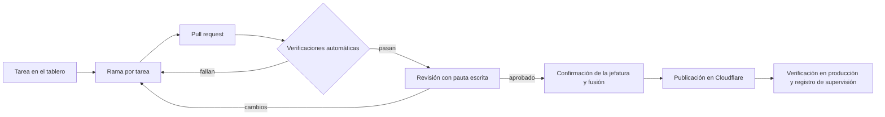

**Figura 9.1.** Flujo operativo de un cambio. Corresponde, paso por paso, al flujograma del Capítulo 8.

---

### 9.2 Supervisión operativa y su registro (indicador 5b)

Supervisar es verificar, mientras ocurre, que el trabajo se hace como se definió. Se supervisaron cuatro objetos: el cumplimiento del flujo de cambios (cada pull request pasó por la revisión con pauta), los plazos de revisión (K3), la calidad del dato publicado (fuente, URL y fecha) y la operación del sitio (rutas, 360 px, consumo de los proveedores). La frecuencia fue por sesión de trabajo y, para el consumo de los proveedores, cada vez que se detectó una alerta.

**Tabla 9.5.** Registro de supervisión (extracto de 12 entradas; el registro completo va en el Anexo 9.A). Las fechas son las de la sesión.

| Fecha | Qué se revisó | Hallazgo | Acción tomada | Rol |
|---|---|---|---|---|
| 17-nov | Ponderaciones de una carrera en un pull request propio | Se atribuyó a una universidad la fila de otra (códigos 12xxx son de otra universidad). La cifra de vacantes también estaba mal y se había descrito como un cambio del DEMRE | Se corrigió la muestra y las pruebas, se corrigió la descripción del pull request y se fijó la regla: un código se atribuye a una institución solo después de leer el encabezado de su sección | Jefatura |
| 19-nov | Sitio publicado a 360 px, con datos reales | La búsqueda con tilde devolvía 0 resultados («enfermería» 0, «enfermeria» 455); 974 de 1.447 variantes de un instituto no tenían datos del SIES (el SIES las publica bajo el nombre anterior de la institución); página 404 en inglés | Se corrigió la búsqueda y la página 404. Para el traspaso de institución se decidió usar las cifras de la institución anterior con una nota visible y rotuladas «elaboración propia» | Jefatura |
| 20-nov | Dos pull requests de Datos oficiales (cálculo y plazo de retracto) | Faltaban casos reales en las pruebas del cálculo; el plazo de retracto no se pudo verificar porque el portal de Acceso Mineduc estaba caído | Se pidieron cambios. El 22 de noviembre se contrastó el cálculo (0 diferencias) y el plazo se respaldó con el artículo 3 ter de la Ley 19.496 | Jefatura, Datos oficiales |
| 20-nov | Texto de consentimiento de la medición | Decía «Nadie verá tus respuestas», pero el equipo sí las ve | Se corrigió antes de usarlo. La aprobación del texto por la jefatura se registró el 24 de noviembre | Jefatura |
| 20-nov | Buscador nuevo, revisión con Codex | La normalización en la base fallaba con ciertos caracteres; el panel de Supabase ya marcaba la organización sobre el límite del plan | Se corrigió la normalización. Se anotó la revisión del consumo antes de la medición | Jefatura |
| 21-nov | Paginación del buscador contra la base | Pedir una página más allá del total devolvía el error 416 (habría roto desde la página 126 de una búsqueda) | La consulta trata ese error como página vacía | Jefatura |
| 22-nov | Siete pull requests de Experiencia de uso y Datos oficiales | En uno, un día de la fuente sin respaldo («19 de enero de 2026»); en otro, una celda faltante en la tabla de la hoja de registro; en el del retracto, el plazo sin verificar | Tres pull requests aprobados y fusionados; los demás devueltos con el cambio exacto pedido | Jefatura |
| 22-nov | Consumo de Supabase (panel Usage) | Tráfico de salida en 5,61 GB de 5 GB (112 %); el equipo no sabía la causa | Se abrió un diagnóstico con los registros de la base. Se decidió arreglarlo el viernes 27 y, finalmente, se adelantó al 23 de noviembre | Jefatura |
| 23-nov | Producción, página de alternativas por área | Un cambio dejó todas las áreas con error 502: la tabla de carreras genéricas tiene una fila por institución y la consulta superó el límite de 50 subconsultas por petición del alojamiento | Se reemplazó por otra consulta; las 10 áreas respondieron 200 en producción | Jefatura |
| 24-nov | Tráfico de salida de Supabase: 7,63 GB (153 %) | Se atribuyó a las compilaciones del sitio y no a las visitas: 14 exportaciones completas de la base (≈ 33 MB cada una, unos 0,46 GB en total) en dos horas. Esa cuenta no explica por sí sola un aumento de unos 2 GB (de 5,61 GB el 22-nov a 7,63 GB el 24-nov). Causa completa: `[COMPLETAR: desglose del panel de Supabase, lo trae Rafael Jaque]` | Se cambió el comando de compilación (y un ajuste en el panel de Cloudflare). La compilación bajó de 65 a 17 segundos y los registros dejaron de mostrar exportaciones | Jefatura |
| 24-nov | Recorrido de 15 páginas a 360 px | Ilustración que ocupaba casi una pantalla antes de la herramienta; tarjetas vacías antes de las que traen datos; etapas del indicador sin nombre | Se corrigió en un solo cambio (ilustración solo desde 48 rem, tarjetas con dato primero, texto de etapas completo) | Jefatura |
| 25-nov | Carga de datos: riesgo de dos períodos del mismo dato | Todo el sitio toma el primer dato de cada tipo sin mirar el período; cargar un período nuevo dejaría dos filas y mostraría una al azar | Se agregó el freno de período a los lotes y se verificó sobre producción. El arreglo de fondo se decidió para después del 19 de diciembre | Jefatura |

**Lectura del registro de supervisión.** De las 12 entradas, 11 son hallazgos negativos con su corrección y una (25-nov) es una prevención decidida a partir de un riesgo detectado. El error de la entrada del 17 de noviembre fue del propio autor del cambio y se descubrió al contrastar con otra fuente, no al revisar su pull request. Por eso la regla de revisión independiente de los datos quedó escrita desde el 22 de noviembre.

---

### 9.3 Monitoreo y control (indicador 5c)

#### 9.3.1 Esquemas de control

Un esquema de control fija, para cada variable, el valor esperado, el rango aceptable y la acción si se sale del rango. Los cinco primeros salen de las metas y los umbrales de los KPI del Capítulo 8 (Tabla 8.18b). La sexta es una variable de apoyo, agregada durante la operación por el caso del tráfico de salida (ver 9.5).

**Tabla 9.6.** Esquemas de control.

| Variable | Verde, amarillo y rojo | Acción si está en rojo | Frecuencia |
|---|---|---|---|
| K1 Cumplimiento del cronograma | Los de la Tabla 8.18b (verde: ≥ 90 %) | Replanificar o reducir el alcance en la reunión semanal | Semanal |
| K2 Defectos por versión | Los de la Tabla 8.18b (verde: ≤ 3 por versión) | Detener los despliegues hasta corregir; cualquier defecto crítico abierto también los detiene | Por versión |
| K3 Tiempo de revisión | Los de la Tabla 8.18b (verde: ≤ 2 días, por cargo) | Redistribuir la revisión (ver plan R6) | Semanal |
| K4 Vigencia de los datos | Los de la Tabla 8.18b (verde: 100 %) | Rotular el dato como no vigente o retirarlo hasta cargar la publicación vigente | Semanal durante las cargas; mensual después |
| K5 Ejecución presupuestaria | Los de la Tabla 8.18b (verde: 90 % a 110 % desde 2027; en 2026, $0) | Ajustar o pedir reasignación; en 2026, explicar cualquier gasto sobre $0 | Mensual |
| Tráfico de salida de Supabase (variable de apoyo, no es KPI; meta de RNF-09) | Verde: hasta 4 GB en el ciclo (80 % de 5 GB). Amarillo: más de 4 y hasta 5 GB. Rojo: más de 5 GB | Diagnosticar la causa en los registros el mismo día | Semanal |

**Criterio del estado (cuadro de mando).** Se usa el semáforo definido una sola vez en 8.6.2 (Tabla 8.18b): verde cumple la meta, amarillo queda hasta 10 % fuera y rojo más de 10 % fuera. Para que el estado no dependa solo del color, cada celda lo dice con palabra.

#### 9.3.2 Fichas de recogida de datos

**Tabla 9.7.** Ficha de recogida de datos del K1.

| Campo | Contenido |
|---|---|
| Indicador | K1 Cumplimiento del cronograma |
| Parámetro o meta | ≥ 90 % |
| Fuente del dato | Tablero Kanban y fecha de fusión del pull request de cada tarea |
| Método | Manual: se compara la fecha de vencimiento del plan con la fecha de fusión (tarea cerrada = pull request fusionado) |
| Frecuencia | Semanal |
| Responsable | Experiencia de uso y medición |
| Dónde se guarda la serie | Tablero y historial de pull requests |

**Tabla 9.8.** Ficha de recogida de datos del K2.

| Campo | Contenido |
|---|---|
| Indicador | K2 Defectos por versión |
| Parámetro o meta | ≤ 3 |
| Fuente del dato | Incidencias del repositorio con etiqueta «defecto» y registro de despliegues; denominador: versiones de la Tabla 13.4 |
| Método | Manual para las incidencias; automático para los despliegues (cada fusión publica una versión) |
| Frecuencia | Por versión |
| Responsable | Jefatura |
| Dónde se guarda la serie | Incidencias del repositorio. **Hasta el 25 de noviembre no existió ese registro** (ver 9.3.3 y 9.5) |

**Tabla 9.9.** Ficha de recogida de datos del K3.

| Campo | Contenido |
|---|---|
| Indicador | K3 Tiempo de revisión de cambios |
| Parámetro o meta | ≤ 2 días |
| Fuente del dato | Historial de pull requests: fecha de apertura y fecha de fusión |
| Método | Automático: lo guarda la plataforma, se calcula con la consulta a su interfaz |
| Frecuencia | Semanal (por semana de fusión) |
| Responsable | Jefatura |
| Dónde se guarda la serie | Historial de pull requests |

**Tabla 9.10.** Ficha de recogida de datos del K4.

| Campo | Contenido |
|---|---|
| Indicador | K4 Vigencia de los datos |
| Parámetro o meta | 100 % |
| Fuente del dato | Registro de cargas de datos: fuente, período, fecha y huella SHA-256 de cada archivo, contrastado con la publicación oficial vigente |
| Método | Manual: se compara el período cargado con el último publicado por el organismo |
| Frecuencia | Mensual (ajustada a semanal durante las cargas, ver 9.5) |
| Responsable | Datos oficiales |
| Dónde se guarda la serie | Registro de cargas de datos |

**Tabla 9.11.** Ficha de recogida de datos del K5.

| Campo | Contenido |
|---|---|
| Indicador | K5 Ejecución presupuestaria |
| Parámetro o meta | 90 % a 110 % |
| Fuente del dato | Facturación de los proveedores (Cloudflare, Supabase, dominio) |
| Método | Manual: se leen las facturas del período |
| Frecuencia | Mensual |
| Responsable | Jefatura |
| Dónde se guarda la serie | Facturas de los proveedores |

#### 9.3.3 Lo que el sistema de registro no tenía

El Capítulo 8 pidió revisar que cada KPI tuviera su dato. El resultado de la revisión es mixto, y se declara sin adornos:

- **K3 y K1 (parcial)** sí tienen su dato en el sistema: la plataforma guarda las fechas de apertura y fusión de cada pull request.
- **K2 no tuvo sistema de registro.** El repositorio tiene dos incidencias abiertas (dos), ambas son encargos de trabajo, ninguna es un defecto etiquetado como defecto. Los defectos se corrigieron por pull request, sin incidencia previa. Esto significa que, para K2, el dato primario no existe.
- **K4 no tuvo cuadro de cargas con la lectura de vigencia.** Existe el registro de cargas, pero la huella SHA-256 figura solo en 1 de sus 12 entradas, y nadie comparó cada conjunto con la publicación oficial vigente en una fecha fija.
- **K5 no se midió.** Faltan las facturas. Además, el presupuesto pecuniario de este período fue cero (ver 9.5).

Esto es un hallazgo de este capítulo y se corrige en el Capítulo 12 (que asegura que el sistema guarde el dato) y en el plan de la semana 6.

#### 9.3.4 Cuadro de mando

El cuadro de mando sigue la lógica de Kaplan y Norton (1996): pocos indicadores, cada uno con su meta y con la acción que gatilla.

**Tabla 9.12.** Cuadro de mando de los KPI. Las lecturas son semanas de fusión: L1 = S1 (cierra el 9-nov), L2 = S2 (16-nov), L3 = S3 (23-nov), L4 = S4 hasta el 25-nov (semana incompleta).

| KPI | Meta | L1 (9-nov) | L2 (16-nov) | L3 (23-nov) | L4 (25-nov) | Estado (L4) | Tendencia |
|---|---|---|---|---|---|---|---|
| K1 Cumplimiento del cronograma | ≥ 90 % | `[COMPLETAR: sin captura del tablero]` | `[COMPLETAR]` | 57 % (4 de 7) | 100 % (5 de 5); acumulado 75 % (9 de 12). Sin la reasignación de N9 a N11, L4 sería 40 % (2 de 5; supuesto del equipo: Experiencia de uso no las habría cerrado en plazo) | Verde en L4 con la reasignación; rojo en el acumulado y en L4 sin ella | Mejora |
| K2 Defectos por versión | ≤ 3 | Sin registro de incidencias | Sin registro | Sin registro | Sin registro de defectos. Aproximación con los «fix» por versión de la Tabla 13.4: 5, 6, 15 o 16, 14, 10 y 8 (versiones 0.1.0 a 0.6.0) | Sin dato; la aproximación no cumple la meta (rojo) | Sin dato fiable |
| K3 Tiempo de revisión (días) | ≤ 2 | 0,32 (88 PR) | 0,21 (124 PR) | 0,26 (68 PR) | 0,19 (21 PR) | Verde | Estable |
| K4 Vigencia de los datos | 100 % | `[COMPLETAR]` | `[COMPLETAR]` | `[COMPLETAR]` | `[COMPLETAR: Cristóbal Rojas compara los conjuntos cargados con la publicación oficial vigente]` | Sin dato | — |
| K5 Ejecución presupuestaria | 90 % a 110 % | `[COMPLETAR]` | `[COMPLETAR]` | `[COMPLETAR]` | `[COMPLETAR: facturas de los proveedores, Rafael Jaque]` | Sin dato | — |

**Cómo se calculó cada cifra (elaboración propia).**

- **K1.** Se contaron las tareas del plan (N1 a N19) con vencimiento en el período y se marcó como cerrada en plazo la que tenía su pull request fusionado en la fecha o antes. Vencían entre el 17 y el 23 de noviembre siete: N1, N2, N3, N6, N7, N8 y N17; cuatro se cerraron en plazo (N2, N6, N7, N17). Del 24 al 26 de noviembre vencían cinco: N4, N9, N10, N11 y N18, todas cerradas en plazo. El acumulado de las dos semanas es 9 de 12. Esta reconstrucción se hizo con el historial de pull requests y el plan; la captura fechada del tablero se debe adjuntar en el Anexo 9.B `[COMPLETAR: captura fechada del tablero, Alejandro Tapia]`. Para S1 y S2 las tareas con vencimiento propio no estaban fijadas en el plan: no se inventa la lectura.
- **K2 (aproximación, no es el KPI).** Se contaron los pull requests cuyo título empieza con «fix» (58 en total; 59 si se cuenta uno escrito «Fix» con mayúscula) y se dividieron por las versiones desplegadas de la Tabla 13.4: 5, 6, 15 o 16, 14, 10 y 8 correcciones por versión, todas sobre la meta de 3. Mide correcciones hechas, no defectos registrados: incluye ajustes de aspecto y no cuenta defectos corregidos sin pull request. No sustituye al K2. Como dato complementario, la lectura semanal (11, 23, 16 y 8 «fix» sobre 88, 124, 68 y 21 fusiones: 0,13; 0,19; 0,24 y 0,38) muestra la tendencia, pero no es el KPI, porque una fusión no es una versión de la Tabla 13.4.
- **K3.** Σ días entre apertura y fusión ÷ pull requests fusionados, por semana de fusión. Mediana de cada semana: 0,01; 0,00; 0,00 y 0,00 días. El detalle por autor está en 9.3.5.

**Análisis por indicador que salió del rango o no pudo medirse.**

*K1 (rojo en L3 y en el acumulado).* En S3 se cerraron en plazo 4 de 7 tareas. Las dos tareas del cálculo de empleabilidad (N1) y del calendario de admisión (N3) se cerraron con 2 y 3 días de atraso. Las causas están en el registro de supervisión: N1 esperó una decisión de la jefatura sobre la licencia de reutilización de los datos de un portal del SIES, y N3 esperó que volviera el portal de Acceso Mineduc para verificar un plazo, que estuvo caído el 20 y el 22 de noviembre. La encuesta (N8) no estaba publicada el 23 de noviembre porque exige el permiso de los autores de la escala, que se solicita por correo y no depende del equipo. Se decidió, en la sesión del 22 de noviembre, pasar N9, N10 y N11 de Alejandro Tapia a la jefatura, con sesiones de 18:00 a 21:00, y esas tres se cerraron antes de su vencimiento. La lectura L4 (100 %) está así sostenida por esa reasignación: sin ella sería 40 % (2 de 5, supuesto del equipo). Además es parcial: faltan las tareas que vencen el 27 de noviembre. Cada tarea se cuenta una sola vez, con el cargo que la tenía al cierre; el mismo universo de 12 tareas se usa en la Tabla 9.17 y en el capítulo 13.

*K2 (sin dato).* No hay lectura del KPI porque no existía el registro. Con la aproximación por versión (Tabla 13.4) las seis versiones quedan sobre la meta de 3, pero esa aproximación incluye ajustes de aspecto y no cuenta defectos corregidos sin pull request, así que no permite concluir cuántos defectos hubo ni si subieron o bajaron. La lectura semanal complementaria sube de 0,13 a 0,38 correcciones por fusión. Se decidió registrar desde el 27 de noviembre cada defecto de la medición como incidencia con etiqueta «defecto» (ver 9.5).

*K4 y K5 (sin dato).* Ninguno se midió en este período. En K4 hay evidencia parcial: el 25 de noviembre, los ocho lotes con período pasaron el freno en producción, es decir, cada carrera tiene un solo período por dato. Eso no prueba que ese período sea el último publicado por el organismo, así que no se informa como K4. En K5, el presupuesto pecuniario del período fue cero (ver 9.5).

#### 9.3.5 Tiempo de revisión por autor (apoyo de K3)

**Tabla 9.13.** Pull requests fusionados del 3 al 25 de noviembre, por autoría (elaboración propia con el historial de pull requests).

| Autoría | Pull requests | Promedio de días de apertura a fusión | Con más de 2 días |
|---|---|---|---|
| Jefatura (Rafael Jaque, con Claude como apoyo) | 253 (84 %) | 0,07 | 2 |
| Datos oficiales (Cristóbal Rojas) | 26 (9 %) | 1,42 | 6 |
| Experiencia de uso (Alejandro Tapia) | 22 (7 %) | 0,89 | 2 |
| **Total** | **301** | **0,25** | **10** |

Por semana, el promedio de los cambios del equipo distinto de la jefatura fue 0,99 días (19 pull requests) en S1; 1,51 (14) en S2 y 1,11 (15) en S3. En S4, hasta el 25 de noviembre, no se fusionó ninguno: la lectura no existe. Los pull requests con más de 2 días fueron 10 de 301; de los 48 del equipo distinto de la jefatura, 8 (17 %) superaron los 2 días.

---

### 9.4 Cadena de suministro

Cada proveedor es un punto de falla y, por tanto, un riesgo. La tabla dice qué se contrató, con qué límite real y qué pasa si falla. Los precios del plan de pago, usados en el presupuesto de 2027, están en la Parte I (Punto 9).

**Tabla 9.14.** Cadena de suministro.

| Eslabón | Proveedor o servicio | Condiciones y límites | Qué pasa si falla |
|---|---|---|---|
| Infraestructura: alojamiento | Cloudflare Workers, plan gratuito | Uso comercial permitido; límite de 50 subconsultas por petición (se alcanzó el 23-nov, ver 9.2); límites diarios de uso que se verifican antes de público real (Cloudflare, s. f.) | El sitio no responde. Mitigación: el código está en el repositorio y se puede publicar en otro proveedor, porque el acceso a datos está aislado |
| Infraestructura: base de datos | Supabase PostgreSQL, plan gratuito, región São Paulo | 5 GB de tráfico de salida por ciclo (se superó: 7,665 GB el 25-nov, ciclo del 3-nov al 3-dic); base de 60 MB, 13 % del límite; el plan gratuito pausa proyectos inactivos siete días; con gracia hasta el 21-dic, después la organización sobre la cuota puede recibir error 402 (Supabase, s. f.) | Las páginas con datos en vivo no cargan. Mitigación: caché de consultas y plan de pago al abrir al público (Parte I) |
| Herramientas de desarrollo | GitHub (repositorio, pull requests, integración continua) | Plan gratuito del repositorio; regla de la rama principal con 1 verificación obligatoria (contraste de colores) y 1 aprobación; la integración continua corre siete trabajos en cada pull request | Se detienen las fusiones. Mitigación: el repositorio local contiene todo el historial |
| Datos | DEMRE (oferta definitiva 2027, 24-sept; calendario de admisión), SIES y mifuturo.cl (empleabilidad, duración real, arancel, vacantes), Mineduc (matrícula, beneficios) | Datos abiertos descargables; el portal de Acceso Mineduc estuvo en mantenimiento el 16, el 20 y el 22-nov, mifuturo.cl estuvo caído el 22-nov y el portal de beneficios estudiantiles el 22 y el 23-nov | Un dato queda desactualizado o sin contrastar. Regla: si no se puede verificar en la fuente, no se publica (riesgos R2 y R7) |
| Datos de ocupaciones | O\*NET 31.0 (licencia CC BY 4.0) | Atribución obligatoria | Se retira la pantalla de ocupaciones; no afecta el núcleo |
| Herramientas de IA | Claude (escribe y revisa código), Codex (revisión en solo lectura) | Servicios de terceros bajo sus términos; sin datos personales de personas | Se pierde velocidad de revisión; la revisión con pauta la hace la jefatura |
| Soporte humano | Equipo del proyecto | Sin atención a público en el prototipo; los hallazgos de las personas de la medición los recoge Alejandro Tapia | Sin canal de soporte. Se define para 2027 |

---

### 9.5 Ajuste de parámetros (indicador 6a)

Se ajustó un parámetro solo cuando la operación mostró que estaba mal calibrado, y se dejó sin ajustar cuando los datos no lo justificaron.

**Tabla 9.15.** Ajuste de parámetros.

| Parámetro | Valor original | Nuevo valor | Justificación con datos |
|---|---|---|---|
| Forma de lectura de K3 | Un promedio semanal único | Promedio semanal total, más promedio de los cambios del equipo distinto de la jefatura y porcentaje de cambios con más de 2 días. La meta (≤ 2 días) no cambia | El promedio total es 0,25 días porque 253 de 301 cambios (84 %) son de la jefatura y se fusionan casi al abrirse (0,07 días). Eso oculta que el equipo distinto de la jefatura tuvo 1,42 (Datos oficiales) y 0,89 días (Experiencia de uso) y que 8 de 48 de sus cambios (17 %) superaron los 2 días |
| Frecuencia de K4 | Mensual | Semanal mientras haya cargas de datos | Entre el 16 y el 17 de noviembre se cargaron los lotes 12 a 15 y el 25 de noviembre apareció el riesgo de dos períodos del mismo dato; una lectura mensual no los habría detectado dentro del período |
| Registro de K2 | Incidencias con etiqueta «defecto» (no se usaron) | Cada defecto, desde el 27 de noviembre, se abre como incidencia con la etiqueta «defecto», con fecha de apertura y de cierre. La meta (≤ 3) no cambia | La revisión de 9.3.3 mostró 0 incidencias etiquetadas frente a 58 correcciones fusionadas |
| K5 durante el prototipo | Gasto real ÷ presupuesto, 90 % a 110 % | Se informa el gasto real en pesos y se compara con el presupuesto pecuniario del período, que es $0 (planes gratuitos, alternativa A de la Parte I). La banda de 90 % a 110 % se aplica desde la puesta en marcha de 2027, con el presupuesto de la Parte I | Con presupuesto cero la fórmula divide por cero. `[COMPLETAR: facturas de noviembre de Cloudflare, Supabase y dominio, para confirmar que el gasto fue $0; Rafael Jaque]` |
| Variable de apoyo: tráfico de salida de Supabase | No existía | Lectura semanal, verde hasta 4 GB (80 % de 5 GB), rojo sobre 5 GB | Tres lecturas en cuatro días: 5,61 GB (22-nov), 7,13 (23-nov), 7,63 (24-nov) |
| Meta de K1 (≥ 90 %) | ≥ 90 % | Sin ajuste | La meta no es inalcanzable: S4 llegó a 100 % con la reasignación. Los atrasos de S3 tuvieron causas externas puntuales (portales caídos, permiso de los autores, decisión pendiente), que se tratan como riesgo y no como motivo para bajar la meta |
| Metas de K3 (≤ 2 días) y K4 (100 %) | ≤ 2 días y 100 % | Sin ajuste | K3 estuvo en verde las cuatro semanas (0,19 a 0,32 días) y su sesgo se corrige con la lectura desagregada, no con la meta. K4 no tiene lectura: no hay datos para recalibrarlo |

---

### 9.6 Riesgos potenciales (indicador 6b)

La gestión sigue el ciclo de identificar, calificar y responder a cada riesgo (Project Management Institute [PMI], 2021). Se revisan los cinco riesgos del Capítulo 8 con lo que el prototipo mostró, y se agregan tres que salieron de la operación. Escala de 1 a 5; exposición = probabilidad (P) × impacto (I); baja de 1 a 6, media de 8 a 12, alta de 15 a 25.

**Tabla 9.16.** Riesgos potenciales con los datos de la operación.

| N° | Factor de riesgo | Origen | P | I | Exp. | Cambio frente al Capítulo 8 y dato que lo respalda |
|---|---|---|---|---|---|---|
| R1 | No se consiguen las 10 personas para la medición | Suposición crítica de la Parte I | 3 | 4 | 12 (media) | Sin cambio. El plan registró el 22-nov que no había registro de las 10 personas confirmadas; el 25-nov se asignó la tarea a Alejandro Tapia (incidencia abierta). `[COMPLETAR: cuántas personas hay confirmadas al 27-nov]` |
| R2 | Un organismo cambia la estructura o el calendario de sus archivos abiertos y un dato queda desactualizado | Amenaza A2 y suposición crítica | **4** (antes 3) | 5 | **20** (antes 15) (alta) | **P sube de 3 a 4.** Ya ocurrió en pequeño: 974 de 1.447 variantes de un instituto no tenían datos del SIES por un traspaso de institución (19-nov); 4.065 de 11.364 variantes no tenían datos del SIES al 19-nov, y bajarían a 3.416 al cargar las cifras de la institución anterior, ya decididas `[COMPLETAR: confirmar si esa carga ya está en producción]`; el sitio toma el primer dato sin mirar el período (25-nov) |
| R3 | El consumo de la base de datos supera el plan contratado | Operación | 3 | 4 | 12 (media) | **Sin cambio.** Ocurrió (5,61, 7,13 y 7,63 GB entre el 22 y el 24-nov) y se corrigió el 24-nov; el 25-nov el consumo diario ya no mostraba exportaciones. Sigue en 3 porque el ciclo del 3-nov al 3-dic ya superó los 5 GB y no se revierte; cuenta si el ciclo que parte el 3-dic queda en 4 GB o menos (80 % de 5 GB, la meta de RNF-09) `[COMPLETAR: lectura de Usage al 4-dic]` |
| R4 | Ninguna organización encarga un informe ni ningún anunciante compra un espacio | Amenaza A5 | 4 | 3 | 12 (media) | Sin cambio. No se midió disposición a pagar (hipótesis H5, Capítulo 10) |
| R5 | Un aviso se confunde con contenido del sitio o un anunciante presiona por un trato distinto | Decisión de admitir avisos | 2 | 5 | 10 (media) | Sin cambio. El prototipo no muestra avisos: el riesgo no se pudo observar (supuesto del equipo) |
| R6 | La revisión y la fusión dependen de una sola persona | Hallazgo del registro de supervisión | 3 | 5 | **15** (alta) | **Nuevo.** La jefatura fue autora de 253 de 301 cambios (84 %) y es quien confirma y fusiona todos. Si falta una semana, se detiene la fusión y el sitio queda sin correcciones |
| R7 | La fuente oficial no está disponible cuando se contrasta un dato | Hallazgo del registro de supervisión | 4 | 3 | 12 (media) | **Nuevo.** Acceso Mineduc caído el 16, el 20 y el 22-nov, mifuturo.cl el 22-nov y el portal de beneficios el 22 y 23-nov; el contraste de las cuatro respuestas de beneficios se aplazó |
| R8 | Se publica un dato distinto de su fuente oficial | Hallazgo del registro de supervisión | 3 | 5 | **15** (alta) | **Nuevo.** Ya ocurrió una vez en un pull request propio (17-nov, ponderaciones de otra universidad) y se detectó solo por contraste con una tercera página. Contradice la regla de la agencia: nada sin fuente verificada |

Los riesgos de exposición alta son R2 (20), R6 (15) y R8 (15); tienen plan de contingencia (9.8). Los de exposición media (R1, R3, R4, R5, R7) llevan una acción de mitigación, aceptación u omisión, y se monitorean.

---

### 9.7 Autoevaluación del desempeño (indicador 6c)

Cada cargo se evalúa con el indicador de su descriptor del Capítulo 8, ligado a un KPI. Lo que no tiene dato queda marcado.

**Tabla 9.17.** Autoevaluación del desempeño contra los descriptores de cargo.

| Cargo | Indicador del descriptor | Meta | Resultado (3-nov al 26-nov) | Cumple | Causa y medida |
|---|---|---|---|---|---|
| Jefatura de proyecto y arquitectura | Tareas del plan a su cargo cerradas en plazo (K1) | ≥ 90 % | 86 % (6 de 7: N6, N7, N9, N10, N11 y N17 sí; N8 no). N9 a N11 se cuentan aquí y solo aquí | Parcial | N8 exige el permiso de los autores de la escala, que no depende de la jefatura. Medida: se abrió una incidencia y se escribió el seguimiento. N9 a N11 fueron reasignadas desde Experiencia de uso (22-nov) y se cerraron en plazo |
| Jefatura de proyecto y arquitectura | Tiempo de revisión de los cambios del equipo (K3, desagregado) | ≤ 2 días | 1,42 días en los de Datos oficiales y 0,89 en los de Experiencia de uso | Sí | 8 de 48 cambios del equipo superaron los 2 días (4 de ellos, del 14 al 16-nov, eran pull requests apilados que hubo que reconstruir; otros 2 esperaron decisiones de la jefatura sobre la fuente). Medida: se pidió no apilar cambios y dividir los grandes |
| Datos oficiales y calidad de datos | Tareas de datos cerradas en plazo (K1) | ≥ 90 % | 60 % (3 de 5: N2, N4 y N18 sí; N1 y N3 no) | No | N1 esperó una decisión de la jefatura sobre la licencia de un portal del SIES; N3 esperó la vuelta de Acceso Mineduc para el plazo de retracto. Medida: se respaldó el plazo con el artículo 3 ter de la Ley 19.496 (22-nov). N18 la cerró la jefatura el 14-nov, por lo que la cifra favorece al cargo |
| Datos oficiales y calidad de datos | Vigencia de los datos publicados (K4) | 100 % | `[COMPLETAR: lectura de K4 con el registro de cargas, Cristóbal Rojas]` | `[COMPLETAR]` | Sin dato: no se hizo la comparación con la publicación vigente |
| Experiencia de uso y medición | Tareas de su rol cerradas en plazo (K1) | ≥ 90 % | Sin tareas con vencimiento a su cargo tras la reasignación del 22-nov (N9, N10 y N11 se cuentan en la jefatura). Antes de reasignarlas, 0 de 3 estaban cerradas | No evaluable | N9 dependía de N1, que se fusionó el 22-nov; no se había iniciado. Medida: reasignación del 22-nov. Alejandro Tapia fusionó en cambio 22 pull requests de corrección y documentación (0,89 días de revisión promedio) |
| Experiencia de uso y medición | Personas confirmadas para la medición | 10 | `[COMPLETAR: Alejandro Tapia, al 27-nov]` | `[COMPLETAR]` | Sin dato al 26-nov |
| Todos | Gasto del período (K5) | 90 % a 110 % | `[COMPLETAR: facturas]` | `[COMPLETAR]` | Ver 9.5 |

Universo de la Tabla 9.17: las 12 tareas con vencimiento del 17 al 26 de noviembre, contadas una vez (7 en la jefatura, 5 en Datos oficiales, 0 en Experiencia de uso), con 9 cerradas en plazo, igual que el acumulado de la Tabla 9.12.

Lo que la autoevaluación dice de fondo: el equipo cumple bien lo que controla (revisión de cambios, correcciones de accesibilidad) y se atrasa donde depende de terceros (portales oficiales, permisos, decisiones). Esto confirma R6 y R7 y explica por qué el cargo de datos no llega a 90 %.

---

### 9.8 Manejo de riesgos y planes de contingencia (indicador 6d)

#### 9.8.1 Las cuatro respuestas

| Respuesta | Qué significa | Dónde se usó |
|---|---|---|
| Aceptación | Se asume el riesgo y se monitorea | R4 y R7 |
| Omisión | Se elimina la causa dejando de hacer la actividad | R5 (en el prototipo no se publican avisos) y los datos personales (no hay cuentas en el núcleo, así que no hay filtración posible de ellos) |
| Mitigación | Se reduce la probabilidad o el impacto | R1, R2, R6 y R8 |
| Transferencia | Un tercero mejor preparado asume el riesgo | R3: al abrir al público se contrata el plan de pago del proveedor, que asume los límites de consumo (presupuesto de la Parte I) |

**Tabla 9.18.** Matriz de manejo de riesgos.

| N° | Riesgo | P | I | Exp. | Respuesta | Acción concreta | Rol | Señal de alerta |
|---|---|---|---|---|---|---|---|---|
| R1 | No se consiguen las 10 personas | 3 | 4 | 12 | Mitigación | Convocar a 14 personas para llegar a 10 con las ausencias (supuesto del equipo); reservas con agenda del 30-nov al 4-dic | Experiencia de uso | Menos de 10 personas confirmadas al 27-nov |
| R2 | Un dato queda desactualizado por cambio de la fuente | 4 | 5 | 20 | Mitigación | Registro de cargas con huella; freno de período; contraste con la publicación vigente cada semana de carga | Datos oficiales | El freno se activa; el archivo oficial cambia de columnas; el organismo publica un período nuevo |
| R3 | Consumo sobre el plan | 3 | 4 | 12 | Transferencia (con mitigación) | Caché de consultas (hecha); compilación sin exportar la base (hecha); plan de pago al abrir al público | Jefatura | Más de 4 GB en el ciclo, o 100 MB de salida en un día sin visitas que lo expliquen |
| R4 | Nadie encarga ni compra | 4 | 3 | 12 | Aceptación | Se monitorea con datos secundarios (H5); no se sale a buscar clientes | Jefatura | `[COMPLETAR: sin encargos al cierre de 2026]` |
| R5 | Confusión del aviso o presión de un anunciante | 2 | 5 | 10 | Omisión (en el prototipo) | No se publican avisos hasta tener las reglas de rotulado, ubicación y no rastreo implementadas | Jefatura | Un anunciante pide posición o mención |
| R6 | Dependencia de una persona | 3 | 5 | 15 | Mitigación | Plan de contingencia 2; Cristóbal Rojas y Alejandro Tapia conocen el flujo de cambios y cada integrante revisa con la pauta | Jefatura | Cualquier cambio sin revisar por más de 3 días hábiles |
| R7 | Fuente no disponible al contrastar | 4 | 3 | 12 | Aceptación | Se aplaza el contraste y el dato no se publica hasta verificarlo; se anota en el registro de supervisión | Datos oficiales | Portal caído más de 2 días |
| R8 | Dato distinto de su fuente | 3 | 5 | 15 | Mitigación | Plan de contingencia 3; contraste independiente; pruebas con casos verificados | Datos oficiales | Una persona o una revisión encuentra una cifra distinta de la fuente |

#### 9.8.2 Medidas correctivas aplicadas (pasado)

Se aplicaron durante la operación, y están en el registro de supervisión (Tabla 9.5): corrección de la atribución de las ponderaciones (17-nov); corrección de la búsqueda con tilde y de la página 404 (19-nov); reasignación de N9, N10 y N11 (22-nov); cambio de consulta tras el error 502 (23-nov); cambio del comando de compilación para frenar el consumo (24-nov); freno de período en las cargas (25-nov).

#### 9.8.3 Planes de contingencia (condicional)

**Tabla 9.19.** Plan de contingencia 1, riesgo R2 (dato desactualizado por cambio de la fuente).

| Campo | Contenido |
|---|---|
| Riesgo que cubre | R2 (exposición 20) |
| Señal de activación | Un organismo publica un archivo con otra estructura o un período nuevo, o el freno de período detiene una carga |
| Quién activa | Datos oficiales (Cristóbal Rojas) declara la contingencia; la jefatura la confirma |
| Pasos | 1. No fusionar ni aplicar la carga que falló. 2. Anotar en el registro de cargas la fuente, el período y la fecha. 3. Rotular el dato en el sitio como «en actualización» o retirarlo si no se puede verificar. 4. Descargar el archivo nuevo y comparar su estructura con la anterior. 5. Ajustar el script de carga con sus pruebas y contrastar una muestra contra la fuente con una segunda persona. 6. Cargar el lote nuevo dentro de la transacción con freno. 7. Verificar el sitio publicado. 8. Anotar en el registro de supervisión |
| Recursos | Registro de cargas con huellas; script de carga con sus pruebas; acceso a la base de la jefatura |
| A quién se comunica | Jefatura y docente tutor; si afecta a la medición, a Experiencia de uso, para anotarlo en la hoja de registro |
| Criterio de retorno | El dato vuelve a mostrarse cuando coincide con la publicación vigente y tiene fuente, URL y fecha |
| Dónde se registra | Registro de supervisión y registro de cargas |

**Tabla 9.20.** Plan de contingencia 2, riesgo R6 (dependencia de una sola persona).

| Campo | Contenido |
|---|---|
| Riesgo que cubre | R6 (exposición 15) |
| Señal de activación | La jefatura no responde ni fusiona durante 3 días hábiles, o anuncia una ausencia mayor a una semana |
| Quién activa | Cualquier integrante, con aviso al docente tutor |
| Pasos | 1. Congelar el sitio: no se fusionan cambios nuevos salvo urgencias. 2. Avisar al docente tutor. 3. Cristóbal Rojas y Alejandro Tapia revisan en pareja con la pauta escrita los cambios urgentes (error en producción o dato incorrecto). 4. Esos cambios se dejan en la rama sin fusionar hasta que la jefatura confirme; solo si el docente tutor lo autoriza por escrito se otorga temporalmente el permiso de fusión. 5. Si falla el sitio, restaurar la versión publicada anterior desde Cloudflare. 6. Registrar quién decidió qué |
| Recursos | Pauta de revisión escrita; permisos de la plataforma; contacto del docente tutor |
| A quién se comunica | Docente tutor y equipo |
| Criterio de retorno | La jefatura vuelve y revisa lo decidido en su ausencia |
| Dónde se registra | Pull requests y registro de supervisión |

**Tabla 9.21.** Plan de contingencia 3, riesgo R8 (dato distinto de su fuente).

| Campo | Contenido |
|---|---|
| Riesgo que cubre | R8 (exposición 15) |
| Señal de activación | Una revisión, una persona de la medición o el contraste de una muestra encuentra una cifra, una fecha o una cita distinta de la fuente oficial |
| Quién activa | Quien lo detecta avisa; Datos oficiales confirma y la jefatura declara la contingencia |
| Pasos | 1. Reproducir el hallazgo contra la fuente. 2. Si se confirma, retirar el dato de la pantalla con un cambio que se revisa y fusiona el mismo día (o revertir el cambio que lo introdujo). 3. Buscar si el mismo error está en otros datos del mismo lote. 4. Corregir y contrastar con una segunda persona. 5. Volver a publicar. 6. Si el dato lo vio una persona de la medición, anotarlo en la hoja de registro. 7. Anotar la causa y la regla nueva en el registro de supervisión |
| Recursos | Fuente oficial; historial de cambios; pruebas con casos verificados |
| A quién se comunica | Jefatura y Experiencia de uso; si el dato se publicó por más de un día, una nota visible en el sitio |
| Criterio de retorno | El dato coincide con la fuente y la revisión independiente quedó escrita |
| Dónde se registra | Registro de supervisión y pull request |

---

### 9.9 Cierre de la operación supervisada y lo que falta

Hechos al 26 de noviembre: operación y supervisión de las semanas S1 a S4, con 301 cambios fusionados y 12 entradas del registro de supervisión, cuadro de mando con cuatro lecturas (K3), dos más un acumulado (K1) y ninguna (K2, K4, K5), cinco ajustes de parámetros con su dato y tres planes de contingencia.

Pendiente, con responsable: lecturas de K1 desde la captura del tablero, K4 y K5 (Anexo 9.B); lectura de K1, K2, K3 y K4 de la medición del 30 de noviembre al 4 de diciembre; autoevaluación final con los resultados de la medición `[COMPLETAR: Alejandro Tapia y Cristóbal Rojas, hasta el 4-dic]`; consumo de Supabase al cierre del ciclo (3 de diciembre) `[COMPLETAR: Rafael Jaque]`.

---

### Anexos de este capítulo

- **Anexo 9.A.** Registro de supervisión completo (entradas fechadas desde el 3 de noviembre).
- **Anexo 9.B.** Capturas fechadas del tablero Kanban y del historial de pull requests `[COMPLETAR: Alejandro Tapia]`.

---

## 10. Validación y Elevator Pitch

Este capítulo responde una pregunta distinta de la del capítulo 13. Las pruebas del capítulo 13 verifican que el sitio esté bien construido: que cumpla lo que se especificó. Aquí se valida que sea el sitio correcto: que las suposiciones sobre las que se armó el proyecto resistan el contraste con personas reales. Un sistema puede pasar todas sus pruebas y fallar la validación. Si eso ocurre, se reporta como hallazgo.

**Estado de los resultados.** El diseño de la validación (hipótesis, criterios, método e instrumentos) quedó escrito en noviembre de 2026, antes de medir. La medición con personas se aplica del 30 de noviembre al 4 de diciembre de 2026. Todo lo que depende de ella aparece como `[COMPLETAR]` y se llena con el registro de la medición. Este capítulo no informa ningún resultado que aún no exista.

### 10.1 Hipótesis validadas

Una hipótesis es una afirmación de la que depende el proyecto y que todavía no se ha comprobado. Se formularon con la estructura «Creemos que… Lo sabremos cuando…» y su criterio de éxito se fijó en la Parte I (puntos 3.2, 3.3 y Anexo 3.A), antes de aplicar cualquier instrumento. Si el criterio se hubiera fijado después de ver los datos, habría justificación y no validación.

**Tabla 10.1.** Hipótesis, tipo y criterio de éxito.

| N.º | Hipótesis (Creemos que… lo sabremos cuando…) | Tipo | Criterio de éxito | Indicador de la Parte I | Fecha en que se definió |
|---|---|---|---|---|---|
| H1 | Creemos que las personas que egresaron completan sin ayuda las cuatro tareas centrales. Lo sabremos cuando al menos 32 de 40 tareas se completen sin ayuda | Solución / usuario | ≥ 32 de 40 | I-OG | Noviembre de 2026 (Parte I) |
| H2 | Creemos que con el prototipo reúnen y comparan los datos de una carrera en menos tiempo. Lo sabremos cuando la mediana baje al menos 50 % frente a los sitios oficiales | Valor | ≥ 50 % | I-OE2 | Noviembre de 2026 (Parte I) |
| H3 | Creemos que entienden qué mide cada cifra. Lo sabremos cuando al menos 8 de 10 identifiquen los cuatro datos y expliquen la empleabilidad | Problema / solución | ≥ 8 de 10 | I-OE1b | Noviembre de 2026 (Parte I) |
| H4 | Creemos que saben qué paso y plazo sigue para su meta. Lo sabremos cuando al menos 8 de 10 identifiquen su próximo plazo y una alternativa | Solución | ≥ 8 de 10 | I-OE3a | Noviembre de 2026 (Parte I) |
| H5 | Creemos que existe gasto de organizaciones en estudios de datos educativos y de preuniversitarios en llegar a quien prepara la PAES. Se contrasta con datos secundarios (compras públicas, SII); no se midió disposición a pagar con clientes reales | Modelo | Evidencia secundaria, declarada como limitación | Suposición crítica «Alguna organización se interesa» (Parte I, 3.9) | Noviembre de 2026 (Parte I) |

PAES: Prueba de Acceso a la Educación Superior. SII: Servicio de Impuestos Internos.

**Por qué estas cinco y no otras.** Se validan primero las hipótesis que se pueden contrastar con evidencia real dentro del plazo del módulo. Las cuatro primeras tocan al usuario, a la solución y al valor, que es donde suele estar el riesgo de un producto de información (Ries, 2011). La suposición más riesgosa del proyecto es otra: que la falta de información sea una de las causas del no ingreso (Parte I, 3.9). Con 10 personas y una sola sesión no se puede probar, y la encuesta oficial de hogares no la pregunta (Ministerio de Desarrollo Social y Familia, 2026). Por eso se declara como límite y no como hipótesis validada. Lo que el proyecto promete es acortar el camino hacia información verificable, y eso sí es contrastable. No promete que las personas ingresen a la educación superior.

**Relación con las suposiciones críticas de la Parte I (Tabla 3.12).** H1 a H4 convierten en prueba la suposición de que se consiguen 10 personas y de que la tarea de laboratorio se parece a la búsqueda real (Tabla 3.B.1 del marco lógico). H5 corresponde a la suposición de que alguna organización se interesa en informes o asesorías, que la Parte I califica con probabilidad alta de no cumplirse.

### 10.2 Método de la validación

#### 10.2.1 Elección del método

El método se elige según la hipótesis, no al revés. Tres hipótesis (H1, H3, H4) preguntan si una persona puede usar el sitio y entenderlo, y una (H2) si le ahorra tiempo. La pregunta común es qué hace una persona frente al sitio. Para eso sirve una **prueba de usabilidad**: se observa a cada persona intentando completar tareas reales, sin ayuda, con cronómetro y registro de dónde duda. Se combina con **diseño intra-sujeto contrabalanceado** para H2: cada persona hace la misma tarea dos veces, una en los sitios oficiales y otra con el sitio de la agencia, con la mitad empezando por cada condición.

**Tabla 10.2.** Hipótesis, método y pertinencia.

| Hipótesis | Método | Por qué es pertinente a este proyecto y a la especialidad |
|---|---|---|
| H1, H3, H4 | Prueba de usabilidad con tareas centrales T1 a T4 y observación | Mide comportamiento, no opiniones. La pericia de la especialidad (análisis y diseño de sistemas con visión de usuario) exige comprobar que lo construido se pueda usar. Pocos participantes bastan para detectar la mayoría de los problemas de uso, pero no para estimar proporciones de la población (Nielsen y Landauer, 1993) |
| H2 | Tarea cronometrada, intra-sujeto contrabalanceado, con el mismo participante en las dos condiciones | La causa 2 del problema es que reunir y comparar toma tiempo, y no existe cifra oficial. Medir a la misma persona en ambas condiciones controla las diferencias entre personas, lo que importa con una muestra de 10 (Hernández-Sampieri y Mendoza, 2018) |
| H5 | Análisis de datos secundarios: compras públicas, estadísticas del SII, matrícula PAES, precios publicados | Aún no hay interesados ni sociedad constituida para firmar. Se contrasta si existe gasto antes de pedir un compromiso. Es el método más débil de los cinco y se declara así |
| Conjunto | Ciclo construir–medir–aprender (Ries, 2011) | El sitio funciona como producto mínimo viable: la versión suficiente para responder las preguntas anteriores. La medición es el «medir» y las reglas de decisión de la sección 10.8 son el «aprender» |

**Método descartado para H5: pitch con compromisos.** Presentar la propuesta a posibles clientes y medir compromisos (una reunión, una demostración, un contrato) habría sido el método pertinente para el modelo de negocio. No se hizo por una decisión del proyecto: la agencia no sale a buscar clientes, para no poner en duda su independencia (Parte I, 8.1), y no hay sociedad constituida con la cual comprometerse. Se declara como limitación y como paso de la etapa 4 de la estrategia de evolución (10.10).

#### 10.2.2 Diseño del sometimiento a validación

**Tabla 10.3.** Diseño de la validación.

| Campo | Contenido |
|---|---|
| Hipótesis que prueba | H1 a H4 con personas; H5 con datos secundarios |
| Método elegido | Prueba de usabilidad con tareas y cronómetro, intra-sujeto contrabalanceado; análisis de datos secundarios para H5 |
| Participantes | 10 personas de 18 años o más que egresaron de 4.º medio en los últimos cinco años, hayan ingresado o no a la educación superior. Plan B de la Parte I (3.9): si no se consiguen 10, se mide con las que lleguen, con un mínimo de 6, y se declara. Con 6 personas (24 tareas) los umbrales proporcionales, fijados ahora y antes de medir, son: H1 al menos 80 % de las tareas (20 de 24); H3 y H4 al menos 80 % de las personas (5 de 6); H2 sigue en 50 % o más |
| Instrumento | Consentimiento informado, tarea cronometrada, tareas centrales T1 a T4, pregunta de entrada, cierre de seis preguntas y hoja de registro (Anexo 10.A) |
| Criterio de éxito | Los de la Tabla 10.1, fijados antes de medir |
| Fecha de aplicación | Del 30 de noviembre al 4 de diciembre de 2026 |
| Responsable | Alejandro Tapia (experiencia de uso y medición) convoca a las personas y aplica la prueba con Cristóbal Rojas (R); Rafael Jaque aprueba el protocolo y la convocatoria (A) y atiende cualquier señal de riesgo |

El sometimiento tiene cuatro momentos, y los cuatro quedan registrados:

1. **Diseño** (noviembre de 2026, antes de medir): hipótesis, criterios, método, instrumentos. Es lo que contiene este capítulo.
2. **Aplicación** (30 de noviembre a 4 de diciembre): fecha, dispositivo y navegador de cada sesión, y qué ocurrió.
3. **Resultados** (hasta el 4 de diciembre): los datos obtenidos, sin interpretar.
4. **Conclusión** (7 a 17 de diciembre): hipótesis confirmada, refutada o parcial, y decisión.

#### 10.2.3 Procedimiento

Cada sesión dura cerca de una hora por persona (supuesto del equipo, que se ajusta con un ensayo previo cuyos tiempos no cuentan). Se prueba el sitio, no a la persona: no se evalúan sus conocimientos ni sus decisiones.

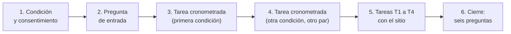

*Figura 10.1.* Secuencia de una sesión de validación.

1. **Condición y consentimiento.** Se confirma con una sola pregunta que la persona tiene 18 años o más y egresó de 4.º medio en los últimos cinco años. Si no, se agradece y se termina, sin anotar nada. No se pregunta ni se registra la edad exacta. El texto de consentimiento (Anexo 10.A) se lee completo y se espera una respuesta clara. Sin un sí no se avanza.
2. **Pregunta de entrada.** «Piensa en una carrera que te interese. ¿Qué sabes de ella y qué te falta averiguar?». Se anota solo lo que le falta, sin datos personales.
3. **Tarea cronometrada, dos veces.** Para una misma carrera en dos instituciones, la persona encuentra: (1) la empleabilidad al primer año, (2) la duración formal y la real, (3) el arancel anual y (4) el puntaje del último seleccionado o el requisito de ingreso; y dice en cuál de las dos la empleabilidad es mayor. Una vez usa los sitios oficiales que quiera y otra vez solo el sitio de la agencia, con otro par carrera–institución. El tiempo se detiene cuando dice «terminé» o a los 20 minutos. Cada dato se compara después con una clave verificada en la fuente oficial: «encontrado» es que lo dio; «correcto» es que coincide con la fuente.
4. **Tareas centrales con el sitio de la agencia.** T1 a T4 (Anexo 10.A), una a la vez. «Sin ayuda» significa sin intervención del equipo y en un máximo de 5 minutos por tarea.
5. **Cierre.** Seis preguntas abiertas y tres marcas de sí o no (Anexo 10.A).

**Contrabalanceo.** Hay dos pares carrera–institución de una lista fija, A y B, con los cuatro datos disponibles en las fuentes oficiales y en el sitio. Cada persona usa uno por condición. Con ello el aprendizaje de hacer la tarea por segunda vez y la dificultad propia de cada carrera no favorecen a ninguna condición (Parte I, Anexo 3.A).

**Tabla 10.4.** Orden de condiciones y pares por participante.

| Participantes | Primero | Par en sitios oficiales | Par en el sitio de la agencia |
|---|---|---|---|
| P1, P5, P9 | Sitios oficiales | A | B |
| P2, P6, P10 | Sitio de la agencia | B | A |
| P3, P7 | Sitios oficiales | B | A |
| P4, P8 | Sitio de la agencia | A | B |

Así, cada orden y cada par quedan en cinco de las diez personas por condición. Si participan menos de 10, se reparte lo más parejo posible y se declara.

**Qué se registra.** Tiempo, datos encontrados y correctos, sitios oficiales visitados, búsquedas sin resultado, y por tarea: si se completó sin ayuda, cuánto tardó y dónde dudó. No se registra nombre, RUT, correo, teléfono, dirección, edad exacta, colegio, institución de estudio, situación económica o de salud, ni audio, video o pantalla. Las personas se identifican con códigos de P1 a P10. Los datos de ejemplo que una persona escriba en el sitio son inventados.

**Dónde se aplica `[COMPLETAR: dirección del sitio probado, versión o commit, fechas por sesión, dispositivo y navegador; quién lo trae: Alejandro Tapia, desde el registro de las sesiones].`**

#### 10.2.4 Ética y señal de riesgo

Participan solo personas de 18 años o más, con consentimiento informado y voluntario: pueden parar cuando quieran, sin explicar, y si paran no se usan sus datos. El texto fue aprobado por la persona responsable del protocolo el 24 de noviembre de 2026. Los consentimientos se guardan en un registro externo, separado del código y de los datos de la medición, y los resultados se publican solo agregados (Ley 19.628, 1999; Ley 21.719, 2024).

El tema puede tocar emociones fuertes. Si una persona dice que no ve salida o que piensa en hacerse daño, se detiene la sesión y se deja de cronometrar. Se la escucha sin diagnosticar ni minimizar y se le entregan la Línea de Prevención del Suicidio **\*4141** (Minsal, gratuita, 24 horas) y Salud Responde **600 360 7777**. La jefatura del proyecto es avisada el mismo día, sin datos que identifiquen a la persona. Quien aplica no actúa como terapeuta.

### 10.3 Participantes

Los participantes se identifican por rol, no por nombre.

**Tabla 10.5.** Participantes por rol.

| Rol | Cuántos | Perfil | Cómo se seleccionaron | Qué hacen |
|---|---|---|---|---|
| Personas que egresaron de 4.º medio (actor 1 de la Parte I) | Meta 10; mínimo 6 con el plan B. **Final: `[COMPLETAR: n]`** | 18 años o más; egresaron en los últimos cinco años; hayan ingresado o no a la educación superior | Por conveniencia, por invitación del equipo, entre quienes aceptan. Canal: `[COMPLETAR: totales por canal, p. ej., oficina municipal de juventud, otra persona u otro canal; nunca datos individuales]` | Hacen la tarea cronometrada en las dos condiciones y las tareas T1 a T4 |
| Aplicación de la prueba | 2 | Alejandro Tapia (experiencia de uso y medición) y Cristóbal Rojas (datos oficiales y calidad de datos) | Roles del equipo | Aplican, cronometran, anotan sin ayudar y comparan cada dato con la clave. Una segunda persona revisa la comparación |
| Aprobación y riesgo | 1 | Rafael Jaque (jefatura de proyecto y arquitectura) | Rol del equipo | Aprueba el protocolo y la convocatoria (A; la ejecuta Alejandro Tapia, R) y atiende cualquier señal de riesgo |
| Contraparte académica | 1 | Docente tutor | Asignado por AIEP | Es consultado sobre el protocolo |

**Perfil de la muestra.** Han ingresado a la educación superior: `[COMPLETAR: n]`; no han ingresado: `[COMPLETAR: n]`; sesiones con señal de riesgo: `[COMPLETAR: total]`. Solo se publican totales, nunca ligados a un código.

### 10.4 Instrumentos

Los instrumentos completos están en el Anexo 10.A. Son seis:

1. Condición de participación y texto de consentimiento informado.
2. Pregunta de entrada.
3. Tarea cronometrada (dos condiciones, dos pares) con su clave de respuestas verificada contra la fuente oficial por una segunda persona.
4. Cuatro tareas centrales (T1 a T4) con su criterio de «completada sin ayuda».
5. Cierre de seis preguntas.
6. Hoja de registro con tres tablas: tarea cronometrada, tareas centrales y entrada y cierre.

Para H5, el instrumento es la tabla de evidencia secundaria de la sección 10.5.

### 10.5 Resultados

Los datos se presentan sin interpretar. Las celdas `[COMPLETAR]` se llenan con el registro de la medición, que trae **Alejandro Tapia**, y las revisa **Cristóbal Rojas**, antes del 7 de diciembre de 2026.

**Tabla 10.6.** Resultados por hipótesis (plantilla lista para llenar).

| N.º | Criterio de éxito | Resultado obtenido | Conclusión | Decisión tomada |
|---|---|---|---|---|
| H1 | ≥ 32 de 40 tareas sin ayuda | `[COMPLETAR: n de 40; fuente: Tabla B del registro]` | `[COMPLETAR: confirmada / parcial / refutada]` | `[COMPLETAR]` |
| H2 | Mediana baja ≥ 50 % frente a los sitios oficiales | `[COMPLETAR: mediana oficiales, mediana con el sitio, % de reducción; fuente: Tabla A]` | `[COMPLETAR]` | `[COMPLETAR]` |
| H3 | ≥ 8 de 10 identifican los cuatro datos y explican la empleabilidad | `[COMPLETAR: n de 10; fuente: T2 de la Tabla B]` | `[COMPLETAR]` | `[COMPLETAR]` |
| H4 | ≥ 8 de 10 identifican su próximo plazo y una alternativa | `[COMPLETAR: n de 10; fuente: T4 de la Tabla B]` | `[COMPLETAR]` | `[COMPLETAR]` |
| H5 | Evidencia secundaria, declarada como limitación | Ver Tabla 10.9 | Ver sección 10.7 | Ver sección 10.8 |

**Tabla 10.7.** Tarea cronometrada, por condición.

| Medida | Sitios oficiales | Sitio de la agencia |
|---|---|---|
| Mediana del tiempo (min:s) | `[COMPLETAR]` | `[COMPLETAR]` |
| Mínimo y máximo (min:s) | `[COMPLETAR]` | `[COMPLETAR]` |
| Personas que terminan dentro de 20 minutos (de `[COMPLETAR: n]`) | `[COMPLETAR]` | `[COMPLETAR]` |
| Datos correctos (de 40) | `[COMPLETAR]` | `[COMPLETAR]` |
| Mediana del tiempo, solo personas con los cuatro datos correctos en ambas condiciones, y cuántas son | `[COMPLETAR]` | `[COMPLETAR]` |
| Sitios oficiales visitados (mediana) | `[COMPLETAR]` | No aplica |

Quien llega al máximo de 20 minutos queda registrado con 20 y «no completó». Esto acorta el tiempo real de los sitios oficiales y se declara en las limitaciones.

**Tabla 10.8.** Tareas centrales, por tarea.

| Tarea | Personas que la completaron sin ayuda | Tiempo mediano | Dificultad más frecuente |
|---|---|---|---|
| T1 Encontrar una carrera y leer la fuente y la fecha de un dato | `[COMPLETAR: de n]` | `[COMPLETAR]` | `[COMPLETAR]` |
| T2 Cuatro datos y qué mide la empleabilidad | `[COMPLETAR]` | `[COMPLETAR]` | `[COMPLETAR]` |
| T3 Comparar con otra institución | `[COMPLETAR]` | `[COMPLETAR]` | `[COMPLETAR]` |
| T4 Meta, próximo plazo y alternativa | `[COMPLETAR]` | `[COMPLETAR]` | `[COMPLETAR]` |

Al cierre: personas que identificaron una alternativa compatible `[COMPLETAR]`; que mostraron la fuente de un dato `[COMPLETAR]`; que dijeron un próximo paso concreto `[COMPLETAR]`. Problemas observados, por gravedad (grave: impide completar, muestra un dato incorrecto o expone datos personales; moderada: se completa solo con ayuda o con un dato equivocado; leve: se completa sin ayuda, pero con confusión): `[COMPLETAR: lista con evidencia anónima].`

**Evidencia de H5, ya reunida.** A diferencia de las otras hipótesis, la evidencia secundaria para H5 se reunió en la Parte I (punto 9.1) con registros oficiales leídos el 25 de noviembre de 2026.

**Tabla 10.9.** Evidencia secundaria de gasto (H5).

| Evidencia | Dato | Fuente | Qué permite afirmar | Qué no permite afirmar |
|---|---|---|---|---|
| Estudios y análisis de datos adjudicados por organismos públicos en licitaciones de menos de 100 UTM, 2024 a 2026 | 8 casos, de $2.000.000 a $5.400.005; mediana $3.695.000 | ChileCompra (2026a); elaboración propia | Los organismos públicos pagan por estudios acotados | Que compren informes de educación superior como los de la agencia; solo uno de los ocho tiene alta comparabilidad con un informe del proyecto |
| Organizaciones que podrían encargar un análisis | 557 (345 municipalidades, 70 Servicios Locales de Educación Pública, 16 gobiernos regionales, 126 instituciones de educación superior) | SUBDERE (s. f.); Ministerio de Educación (2026b); Ley 21.033 (2017); Fiscalía Nacional Económica (2025); elaboración propia | Quiénes serían los clientes posibles | Cuántas compran estudios cada año: no hay dato oficial |
| Empresas del rubro «Enseñanza preuniversitaria» | 138 en 2025, con ventas por 1.635.415 UF; 10 empresas concentran cerca del 81 % | SII (2026b); elaboración propia; cifras preliminares | Que existe un mercado de preparación para la PAES | Que algún preuniversitario avisaría en este sitio |
| Personas que preparan la PAES | 300.678 inscritas en la PAES Regular 2026; 26,1 % ya había egresado (unas 78.477) | Ministerio de Educación (2026c); elaboración propia | Que el aviso llegaría a un grupo grande de quien egresó | El tráfico del sitio: aún no tiene audiencia medida |
| Precio de la preparación | Precio por estudiante en cinco compras públicas: $158.333 a $560.000, mediana $428.429; planes anuales 2027 de $783.780 y $799.992 | ChileCompra (2026c); Filadd (2026); Preuniversitario M30M (2026); elaboración propia | Que un preuniversitario valora cada persona que se matricula | Que su margen permita pagar $200.000 + IVA al mes: el margen no se conoce |

### 10.6 Análisis

Se leen los datos hipótesis por hipótesis, con estas reglas fijadas antes de medir.

- **Primero que sea correcto, después que sea rápido.** Si el sitio resulta más rápido, pero con más datos incorrectos que los sitios oficiales, el ahorro de tiempo no se usa como argumento. Primero se corrigen etiquetas, unidades y alcance, y se vuelve a medir. Por eso H2 se lee también con la mediana de quienes dieron los cuatro datos correctos en ambas condiciones, indicando cuántas personas entran.
- **El ahorro se calcula así:** reducción del tiempo = ((mediana en sitios oficiales − mediana con el sitio) ÷ mediana en sitios oficiales) × 100.
- **Qué cuenta como «explicar la empleabilidad» (H3).** El SIES define la empleabilidad al primer año como el porcentaje de personas tituladas que, teniendo información de ingresos, ganaron el sueldo mínimo o más en el primer año después de titularse (Servicio de Información de Educación Superior [SIES], 2025). La persona no tiene que repetir la definición. Basta con que entienda que es un porcentaje de personas tituladas y que se mide al primer año.
- **T4 (H4).** El criterio, fijado antes de medir, es identificar al menos una alternativa: si la persona no identifica ninguna, la tarea no cuenta como completada. Un dato que el sitio no tiene se anota como pregunta abierta, no como error de la persona.
- **Con 10 personas en un diseño pareado solo se detectan diferencias grandes** (tamaño del efecto cercano a 1,0, con α = 0,05 y potencia de 0,80; Cohen, 1988). Un 8 de 10 contra un 7 de 10 no distingue entre dos situaciones distintas. El criterio de éxito es una regla de decisión del equipo, no una prueba estadística.

**Análisis por hipótesis:** `[COMPLETAR: un párrafo por hipótesis que diga qué muestran los datos frente al criterio; lo trae Alejandro Tapia, lo revisa Rafael Jaque].`

### 10.7 Conclusión por hipótesis

**H1 a H4:** `[COMPLETAR: confirmada, refutada o parcial, sin rodeos. Una hipótesis parcial se escribe como tal: por ejemplo, «H1 parcial: 28 de 40; las tareas T3 y T4 concentran las dudas», con los números reales].`

**H5, con la evidencia disponible.** La conclusión que admite la evidencia es **parcial**. Hay gasto comprobable de organizaciones públicas en estudios y de personas en preparación para la PAES. Pero ninguna organización ha encargado un informe ni ningún anunciante ha comprado un espacio, y el método más fuerte para esta hipótesis (el pitch con compromisos medidos) no se aplicó. La hipótesis no se declara confirmada.

### 10.8 Decisiones tomadas

Una validación que no cambia nada no sirvió. Antes de medir (26 de noviembre de 2026) se escribe qué se hará según el resultado, y después se registra lo hecho.

**Tabla 10.10.** Reglas de decisión fijadas antes de medir y decisión tomada.

| Si el resultado es… | Entonces… | Decisión tomada |
|---|---|---|
| H1 por debajo de 32 de 40 | Se identifican las tareas con más fallas y se corrigen en la ventana del 7 al 11 de diciembre. Si el problema no cabe en una mejora leve, la etapa siguiente es rediseñar y volver a medir, no abrir al público | `[COMPLETAR]` |
| H2 por debajo del 50 %, o más rápido pero con datos incorrectos | No se usa como argumento. Se corrigen etiquetas, unidades y alcance, y se vuelve a medir | `[COMPLETAR]` |
| H3 por debajo de 8 de 10 | Se reescriben junto a cada cifra los textos de «qué mide» en lenguaje claro y se prueban con personas de reserva | `[COMPLETAR]` |
| H4 por debajo de 8 de 10 | Se rediseña cómo se muestran el próximo plazo y las alternativas en la meta | `[COMPLETAR]` |
| Cualquier meta cumplida | Se confirma el diseño y se sigue a la etapa 2 de la estrategia de evolución (10.10) | `[COMPLETAR]` |
| H5 sin compromisos de clientes | No se afirma demanda. Se publica el método y un primer informe de muestra, y se mide con organizaciones que lleguen por iniciativa propia | `[COMPLETAR]` |

**Límite de las correcciones.** Del 7 al 17 de diciembre solo se hacen mejoras leves: no agregan pantallas, tablas ni dependencias y caben en un cambio de menos de 150 líneas. Lo que no cumpla pasa a la proyección. Un dato incorrecto, o un texto que lleva a un dato equivocado, se corrige siempre.

**Cambios hechos a partir de los hallazgos:** `[COMPLETAR: tabla con gravedad, problema observado, cambio realizado, rama o pull request, estado (corregido, aplazado con motivo o descartado); lo trae Alejandro Tapia].`

### 10.9 Limitaciones

**Tabla 10.11.** Limitaciones del ejercicio.

| Limitación | Qué no permite concluir |
|---|---|
| Tamaño de la muestra: 10 personas por conveniencia (mínimo de 6 con el plan B) | No estima el tiempo ni la comprensión de la población. Es una validación de uso y una primera medida del problema |
| Sesión única, sin seguimiento | No muestra si la persona vuelve a usar el sitio ni si recuerda lo aprendido (el valor se mide por volver, y aquí solo se mide una vez) |
| Tarea de laboratorio, con tiempo máximo de 20 minutos | La búsqueda real se hace en varios días. Quien llega a 20 minutos queda con 20, lo que acorta el tiempo real de los sitios oficiales |
| Selección por invitación del equipo | Quienes aceptan pueden tener más disposición o más habilidad digital que el conjunto de personas que egresan. Pueden sobreestimar el uso |
| Participantes saben que los miden | Pueden esforzarse más que en una búsqueda real |
| Los mismos participantes usan las dos condiciones | El contrabalanceo controla el orden y el par, pero no elimina del todo el aprendizaje: la segunda tarea siempre se hace después de conocer la primera |
| Funciones fuera de la prueba | El explorador de ocupaciones, el mapa de carreras y la página del Formulario Único de Acreditación Socioeconómica (FUAS) no forman parte de T1 a T4: no se validan con este ejercicio. El espacio publicitario no está fusionado ni tiene anunciante: tampoco se valida |
| Pocos pares carrera–institución (A y B) | No representa el conjunto de carreras: los resultados pueden cambiar con otra carrera |
| Clave de respuestas hecha por el equipo | Un error en la clave cambiaría el conteo de datos correctos; por eso una segunda persona la verifica contra la fuente oficial |
| H5 con datos secundarios | No mide disposición a pagar. No distingue entre gasto que existe y gasto que este proyecto podría captar |
| No se valida el supuesto causal del proyecto | Que informarse mejor aumente el ingreso a la educación superior queda como proyección |
| Plan B (si se aplicó) o cambio de versión del sitio durante la semana | `[COMPLETAR: declarar si se aplicó y con cuántas personas]` |

### 10.10 Oportunidades de proyección

La proyección se deriva de lo que se aprende al validar. No es una lista de deseos: cada etapa depende de un hallazgo, y las filas que dependen del resultado quedan `[COMPLETAR]`. Se usan las dos estrategias. La **evolución** responde cómo crece el proyecto con el equipo adentro. La **transferencia** responde quién lo toma cuando termina el módulo.

#### 10.10.1 Estrategia de evolución

**Tabla 10.12.** Estrategia de evolución.

| Etapa | Alcance | Condición para avanzar | Qué se necesita | Hallazgo de validación que la respalda |
|---|---|---|---|---|
| 1. Prototipo validado (hasta el 17 de dic. de 2026) | Lo construido: vista de carrera, comparación, simulación del puntaje ponderado, meta con alternativas, calendario de admisión y beneficios, preguntas frecuentes; además, el explorador de ocupaciones, el mapa de carreras y la página del Formulario Único de Acreditación Socioeconómica (FUAS), ya construidos y fuera de las cuatro tareas centrales. El espacio publicitario está construido en una rama, pendiente de fusión y sin anunciante. Madurez TRL 4 (*Technology Readiness Level*, nivel de madurez tecnológica; Parte I, 4.5) | H1 a H4 en meta o con un plan de corrección escrito, y los problemas graves corregidos | Registro de la medición, ramas de corrección, informe de la medición | `[COMPLETAR: resultado de H1 a H4]` |
| 2. Consolidación (enero y febrero de 2027) | Mismo alcance, con las correcciones; si H3 o H4 no alcanzaron, rediseño del texto de «qué mide» o de la meta y una nueva medición antes de abrir | Operación estable sin acompañamiento permanente: vigencia de los datos (K4) en 100 % y defectos por versión (K2) en 3 o menos durante `[COMPLETAR: meses o versiones]` | Plan de pago de la base de datos y del alojamiento, manual de despliegue y manual de usuario (capítulo 13) | El consumo de la base de datos superó el plan gratuito en noviembre de 2026 (riesgo R3): el exceso se atribuyó a compilaciones que exportaban datos y desde el arreglo del 24 de noviembre no hubo exportaciones. La capacidad del plan gratuito con público real no se ha medido: es un supuesto. `[COMPLETAR: corrección que aplicó la medición]` |
| 3. Apertura pública y medición de uso (2027, dos meses; TRL 6 y 7) | Sitio abierto, con dos análisis publicados y un primer informe de muestra; sociedad por acciones constituida | Uso espontáneo de personas que el equipo no invitó, medido con las mismas tareas; contenidos de orientación revisados por un profesional de psicología o psicopedagogía antes de publicarse; estatutos y política de datos validados por un abogado | Constitución de la sociedad, honorarios del profesional y asesoría legal (sin monto, por cotizar; Parte I, 10), recursos propios de los socios | La medición fue con personas invitadas y en laboratorio: no demuestra uso espontáneo. `[COMPLETAR: qué dudas dejó]` |
| 4. Funciones diseñadas y escalamiento comercial (desde la segunda mitad de 2027) | Cuenta con correo, cuestionario de intereses vocacionales, simulación de beneficios, asistente conversacional y noticias; informes y avisos como ingresos | Modelo de negocio comprobado con clientes reales: una organización que acepte alcance y precio de un informe y confirme que recibió lo acordado; un anunciante que compre un espacio; y, para la cuenta, la vigencia de la Ley 21.719 desde el 15 de octubre de 2027 (Ley 21.855, 2026) | Equilibrio de 8 informes al año con el escenario medio de avisos, o un fondo público de emprendimiento (Parte I, 9.1.4 y 8.4) | H5 se contrastó solo con datos secundarios; la demanda de informes y avisos es una hipótesis (Tabla 10.9) |

**Líneas de evolución.** Tres líneas, cada una amarrada a un hallazgo.

- **Más profundidad** (nuevas funciones para el mismo usuario): cuenta, cuestionario, simulación de beneficios y asistente. Se habilita solo si H1 y H3 se cumplen. Si la gente no entiende qué mide cada cifra, sumar funciones agrega confusión. `[COMPLETAR: confirmar o ajustar según el resultado de H3].`
- **Más amplitud** (el mismo producto para otras personas): quienes aún cursan 4.º medio y quieren conocer a tiempo los pasos y plazos (actor 4 de la Parte I). Depende del resultado de H4, que mide justamente si el próximo plazo se entiende.
- **Más integración** (conectarse con más fuentes oficiales): se incorporan fuentes nuevas solo si el equipo puede mantener la vigencia de los datos. Hoy el riesgo R2 (un organismo cambia la estructura de sus archivos) tiene exposición alta, y la vigencia (K4) debe sostenerse en 100 % antes de sumar fuentes.

#### 10.10.2 Estrategia de transferencia

Para un proyecto de título, la transferencia es pertinente porque en marzo los integrantes ya egresaron. La modalidad elegida es **emprendimiento**: el equipo continúa fuera de la institución, mediante la sociedad por acciones que se constituirá en 2027 (Parte I, 8.2).

**Tabla 10.13.** Estrategia de transferencia.

| Campo | Contenido |
|---|---|
| Modalidad | Emprendimiento: el equipo continúa el proyecto a través de una sociedad por acciones a constituir en 2027 (Parte I, 8.2 y 4.1) |
| A quién se transfiere | A la sociedad por acciones, cuyos accionistas serán Rafael Jaque, Cristóbal Rojas y Alejandro Tapia. Representante legal: `[COMPLETAR: se define al constituir la sociedad]` |
| Qué se entrega | El código fuente y su historial; la documentación técnica; el manual de despliegue y el manual de usuario (capítulo 13); los accesos a los servicios de alojamiento y base de datos; el registro de cargas de datos con fuente, período, fecha y huella del archivo; y el registro de horas por integrante |
| Instrumento legal o acuerdo | Cesión escrita de los derechos de cada integrante a la sociedad, una vez revisado el reglamento de titulación de AIEP; pacto de accionistas y estatutos con tres cláusulas que solo cambian por unanimidad (gratuidad para las personas, independencia, no venta de datos personales). Ninguno está firmado y requieren validación de un abogado |
| Licencia | Código: propio de la sociedad, con todos los derechos reservados. Contenidos propios: Creative Commons BY. Los datos oficiales conservan las condiciones de su fuente y se citan siempre (Parte I, 4.1) |
| Capacitación contemplada | No aplica: quienes continúan son quienes construyeron. Si se suma un cuarto socio o un contrato de trabajo, se capacita con el manual de despliegue y se hace una operación acompañada |
| Condiciones de continuidad | Constitución de la sociedad; cesión firmada; recursos para el servicio en dinero ($29.491 al mes con plan de pago; Parte I, 10); y que el equipo mantenga la vigencia de los datos |
| Contraparte académica | Docente tutor de AIEP, hasta el término del módulo. `[COMPLETAR: nombre y cargo]` |

**Qué hace falta para que la transferencia sea real.** Una transferencia que no se puede ejecutar es una declaración de intenciones. Lo que la vuelve real aquí es: documentación suficiente para que un tercero instale y opere el sitio, el traspaso de accesos desde las cuentas de los integrantes a las de la sociedad, y la cesión escrita. Hoy el traspaso de accesos y la cesión no están hechos. Si la sociedad no llega a constituirse, el proyecto queda como trabajo de título sin entidad, con su repositorio y sus manuales como registro, y no se declara otra transferencia.

### 10.11 Elevator Pitch

El Elevator Pitch defiende la propuesta de valor de la Parte I (5.8) en un máximo de 120 segundos, con el guion enviado antes del plazo (`[COMPLETAR: fecha y medio de envío del guion]`). Un pitch excelente que se pasa de 120 segundos, o cuyo guion no se envió, pierde nivel sin importar su calidad. Por eso el guion se escribe completo, se ensaya cronometrado de pie y en voz alta, y apunta a 105 o 110 segundos. No resume el informe: pide un siguiente paso.

**Propuesta de valor defendida (Parte I, 5.8).** Para las personas que egresan de 4.º medio y deben decidir si estudian, qué y dónde, con datos repartidos en varios sitios, la agencia ofrece un servicio gratuito que reúne la información oficial de cada carrera con su fuente, explica qué mide cada cifra y muestra el camino y las alternativas hacia su meta. A diferencia de recorrer varios portales por separado, lo resuelve en un solo recorrido y sin pedir datos personales. El pitch se dirige a esa persona beneficiaria y a la independencia que sostiene al proyecto. La promesa no incluye que las personas ingresen ni que mejore su salud mental.

**Tabla 10.14.** Guion del Elevator Pitch por bloques.

| Bloque | Tiempo objetivo | Texto | Número del bloque | Tiempo real en ensayo |
|---|---|---|---|---|
| 1. Gancho | 15 s | «El 49,6 % de las personas que terminaron 4.º medio en 2025 no entró a la educación superior al año siguiente. Una de cada dos. Y después de egresar, nadie las acompaña: quien decide, decide sola.» | 49,6 % (SIES, 2026a) | `[COMPLETAR]` |
| 2. Problema | 20 s | «No sabemos cuántas se quedan fuera por falta de información: ninguna encuesta oficial lo pregunta. Sí sabemos que los datos de cada carrera están repartidos en tres portales del Estado, cada uno con su propio formato. Reunirlos y compararlos exige saber dónde buscar y qué mide cada cifra.» | Tres portales | `[COMPLETAR]` |
| 3. Solución | 25 s | «Construimos un sitio gratuito, sin cuenta. Eliges una carrera y ves sus cuatro datos clave: empleabilidad, duración, arancel y requisitos de ingreso. Cada dato trae su fuente, su fecha y qué mide. La comparas con otra institución. Y fijas una meta, con su próximo plazo y alternativas.» | Cuatro datos | `[COMPLETAR]` |
| 4. Propuesta de valor | 20 s | «A diferencia de recorrer los portales uno por uno, lo resuelves en un solo recorrido y sin entregar datos personales. Y es independiente: nadie compra un resultado. Ni una institución ni un anunciante paga por salir mejor posicionado, y cada cifra dice de dónde viene.» | Un solo recorrido | `[COMPLETAR]` |
| 5. Evidencia | 20 s | «Lo probamos en una prueba pequeña, con personas que egresaron de 4.º medio, con tareas y cronómetro. `[COMPLETAR: cifra de la medición: % en que bajó la mediana del tiempo para reunir y comparar los datos de una carrera, frente a los sitios oficiales]`. Es una primera medida, no una cifra del país.» | Reducción de la mediana (H2) | `[COMPLETAR]` |
| 6. Proyección y cierre | 20 s | «En 2027 queremos abrirlo a todo el país, con la gratuidad y la independencia escritas en los estatutos. Hoy les pedimos algo simple: compartan el sitio con alguien que egresa este año y pídanle que compare una carrera en dos instituciones. Si lo logra sin ayuda, el sitio cumple su promesa.» | 2027 | `[COMPLETAR]` |
| **Total** | **120 s** | Máximo estricto. Apuntar a 105 o 110 s | | `[COMPLETAR]` |

**Guion continuo (para leer y cronometrar).**

> El 49,6 % de las personas que terminaron 4.º medio en 2025 no entró a la educación superior al año siguiente. Una de cada dos. Y después de egresar, nadie las acompaña: quien decide, decide sola.
>
> No sabemos cuántas se quedan fuera por falta de información: ninguna encuesta oficial lo pregunta. Sí sabemos que los datos de cada carrera están repartidos en tres portales del Estado, cada uno con su propio formato. Reunirlos y compararlos exige saber dónde buscar y qué mide cada cifra.
>
> Construimos un sitio gratuito, sin cuenta. Eliges una carrera y ves sus cuatro datos clave: empleabilidad, duración, arancel y requisitos de ingreso. Cada dato trae su fuente, su fecha y qué mide. La comparas con otra institución. Y fijas una meta, con su próximo plazo y alternativas.
>
> A diferencia de recorrer los portales uno por uno, lo resuelves en un solo recorrido y sin entregar datos personales. Y es independiente: nadie compra un resultado. Ni una institución ni un anunciante paga por salir mejor posicionado, y cada cifra dice de dónde viene.
>
> Lo probamos en una prueba pequeña, con personas que egresaron de 4.º medio, con tareas y cronómetro. `[COMPLETAR: cifra de la medición: % en que bajó la mediana del tiempo para reunir y comparar los datos de una carrera, frente a los sitios oficiales]`. Es una primera medida, no una cifra del país.
>
> En 2027 queremos abrirlo a todo el país, con la gratuidad y la independencia escritas en los estatutos. Hoy les pedimos algo simple: compartan el sitio con alguien que egresa este año y pídanle que compare una carrera en dos instituciones. Si lo logra sin ayuda, el sitio cumple su promesa.

**Notas del guion.**

- **Cifras.** El 49,6 % sale del informe de acceso del SIES (2026a), y la cifra de la medición se llena solo con el resultado de H2 de la Tabla 10.6. Ningún número del pitch está fuera de este informe.
- **Petición.** Es una sola: que cada persona que escucha comparta el sitio con alguien que egresa este año y le pida comparar una carrera en dos instituciones. Se eligió porque pone a prueba, en una frase, la propuesta de valor (un solo recorrido, sin datos personales), no exige nada que comprometa la independencia y entrega la evidencia que falta: uso espontáneo, fuera de la prueba. La alternativa es que una organización encargue el primer informe de muestra, que depende de H5 y no se puede pedir ante este público sin salir a buscar clientes.
- **Reparto.** Si presentan dos personas, el corte es entre los bloques 3 y 4. Quien presenta: `[COMPLETAR]`.
- **Apoyo visual.** Una lámina con una imagen y como máximo seis palabras, o ninguna.
- **Dos frases de memoria.** La primera y la última.
- **Duración.** El guion continuo tiene `[COMPLETAR: recontar con la cifra final]` palabras; con la cifra de la medición escrita como una frase de unas 12 palabras, unas 267 (elaboración propia). A ritmo pausado equivale a unos 105 a 110 segundos. El ensayo cronometrado confirma el tiempo; el límite es 120 s.

**Tres preguntas probables, con respuesta en una frase.**

1. *¿Cómo saben que sus cifras son correctas?* Cada dato se muestra con su fuente, enlace y fecha, y las cifras que calculamos se rotulan «elaboración propia»; lo que no se puede verificar en una fuente oficial no se publica.
2. *¿En qué se diferencia de Mi Futuro?* Mi Futuro es una de las fuentes; el sitio reúne en un solo recorrido los datos de tres portales, explica qué mide cada cifra y permite comparar, y lo complementa sin reemplazarlo.
3. *¿Quién paga?* Para las personas es gratis; el servicio se sostiene con informes a pedido y avisos de preuniversitarios, con las horas del equipo hasta entonces, y hoy ninguna organización ha encargado un informe ni ningún anunciante ha comprado un espacio.

### 10.12 Coherencia con el resto del informe

**Tabla 10.15.** Verificación de coherencia.

| Pregunta | Respuesta |
|---|---|
| ¿La propuesta de valor del pitch es la de la Parte I (5.8)? | Sí: información oficial reunida, con fuente y explicación de qué mide cada cifra, en un solo recorrido, gratis y sin datos personales; la independencia como diferencia |
| ¿Las hipótesis validadas corresponden a las suposiciones críticas de la Parte I (3.9)? | Sí: H1 a H4 miden los indicadores I-OG, I-OE1b, I-OE2 e I-OE3a; H5 corresponde a la suposición sobre el interés de organizaciones. La suposición causal (la información como causa del no ingreso) no se valida y se declara como límite |
| ¿La evidencia del pitch está en el reporte? | La cifra del bloque 1 está en la Parte I (Tabla 1.0); la del bloque 5 se toma de la Tabla 10.6 cuando se complete. Un número que aparece solo en el pitch no existe |

### Anexo 10.A Instrumentos

**Condición de participación.** «¿Tienes 18 años o más y egresaste de 4.º medio en los últimos cinco años?». Si la respuesta es no, se agradece y se termina; no se anota nada.

**Texto de consentimiento informado.**

> Gracias por participar. Estamos probando un sitio, no tus conocimientos. Te voy a pedir que busques y compares datos de una carrera, en sitios oficiales y en nuestro sitio, y que hagas cuatro tareas más. Voy a medir cuánto demoras con un cronómetro y a anotar qué te resulta claro o confuso. Es voluntario: puedes parar cuando quieras, sin dar explicación, y si paras no usamos tus datos. No te voy a pedir tu nombre, RUT, correo ni ningún dato personal, y no voy a grabar audio, video ni pantalla. Los resultados se publican solo agregados. Si usas datos de ejemplo, que sean inventados. ¿Aceptas participar y que anote estas observaciones?

La aceptación queda por escrito, en un formulario guardado fuera del código y sin relación con el código del participante. Los formularios firmados se entregan como anexo aparte: `[COMPLETAR: anexo con los consentimientos o su constancia, sin datos que permitan relacionarlos con las sesiones; lo trae Rafael Jaque]`.

**Pregunta de entrada.** «Piensa en una carrera que te interese. ¿Qué sabes de ella y qué te falta averiguar?».

**Tarea cronometrada.** «Para esta carrera en estas dos instituciones, encuentra: (1) la empleabilidad al primer año, (2) la duración formal y la duración real, (3) el arancel anual y (4) el puntaje del último seleccionado o el requisito de ingreso. Después dime en cuál de las dos la empleabilidad es mayor. Puedes usar los sitios oficiales que quieras». Con el sitio de la agencia se pide lo mismo, con el otro par, y la persona solo usa ese sitio. Máximo de 20 minutos.

**Tareas centrales.** Con el sitio de la agencia, una a la vez. «Sin ayuda»: sin intervención del equipo y en un máximo de 5 minutos.

| Tarea | Qué se le pide | Completada sin ayuda cuando… |
|---|---|---|
| T1 | «Encuentra una carrera que te interese y dime de dónde sale uno de sus datos y de qué fecha es» | Encuentra una carrera y lee la fuente y la fecha de un dato |
| T2 | «En esa carrera, dime su empleabilidad, su duración, su arancel y qué se pide para ingresar. Y explícame qué mide la empleabilidad» | Identifica los cuatro datos y explica correctamente qué mide la empleabilidad |
| T3 | «Compárala con la misma carrera en otra institución y dime cuál tiene mayor empleabilidad» | Hace la comparación y nombra la institución correcta |
| T4 | «Deja esa carrera como tu meta y dime cuál es el próximo plazo que te toca y una alternativa a tu primera opción» | Fija la meta, identifica el próximo plazo y una alternativa |

Durante la tarea no se corrige ni se señala dónde mirar. Si la persona se bloquea, se pregunta: «¿Qué buscarías ahora?».

**Cierre.** (1) ¿Qué fue lo más difícil? (2) ¿Hubo alguna palabra o dato que no entendieras? (3) ¿Qué esperabas encontrar y no encontraste? (4) Si pudieras cambiar una cosa, ¿cuál sería? (5) ¿Qué alternativa mantienes abierta y qué dato influyó? (6) ¿Qué vas a hacer después? (un paso concreto). Con las respuestas 5 y 6 se marcan, con sí o no: identificó una alternativa compatible con lo que necesita; pudo mostrar la fuente de un dato; dijo un próximo paso concreto. No haber elegido una carrera no es un fracaso: avanzar es saber qué falta y dónde confirmarlo.

**Hoja de registro.** Tres tablas, una fila por persona y condición o tarea, sin datos personales: (A) tarea cronometrada: código, condición, par, tiempo, datos encontrados y correctos, sitios visitados, si terminó en 20 minutos, dónde dudó; (B) tareas centrales: código, tarea, si fue sin ayuda, tiempo, observación; (C) entrada y cierre: qué le faltaba averiguar, alternativa compatible, fuente mostrada, próximo paso concreto, búsquedas sin resultado. Las hojas completas se anexan: `[COMPLETAR: hojas A, B y C con los datos de las sesiones, sin datos identificables].`

---

## 11. Evaluación, impacto y cierre

Este capítulo responde la última pregunta del proyecto: qué cambió porque existió, y no qué hizo el equipo. Tiene dos miradas distintas. La primera es el impacto hacia afuera: qué cambió para las personas que egresan, para la economía y para el ambiente (11.1 a 11.5). La segunda es el cambio hacia adentro: qué cambió en la organización que opera el servicio (11.6). Después viene la evaluación del proyecto (11.7), el plan de socialización y de sostenibilidad (11.8 a 11.10) y la preparación del Resumen Ejecutivo (11.11).

**Estado de la evidencia.** El proyecto es un prototipo. La prueba de usabilidad con 10 personas está planificada entre el 30 de noviembre y el 4 de diciembre de 2026 y, al 26 de noviembre, aún no se aplica. No hay piloto en operación real, ni clientes, ni ingresos. El sitio ya tiene construidos el explorador de ocupaciones, el mapa de carreras y la página del FUAS, que no forman parte de las cuatro tareas centrales de la prueba y por eso no se evalúan aquí; el espacio publicitario está construido en una rama, pendiente de fusión y sin anunciante. Por eso el impacto «observado» se limitará a lo que esa prueba, cuando se aplique, y el registro del equipo puedan mostrar, y el resto se escribe como esperado o como proyección. Lo que depende de la medición queda como `[COMPLETAR]`. Este capítulo no afirma ningún impacto que los datos no sostengan.

### 11.1 Impacto esperado contra impacto observado

En la Parte I (puntos 3.3 y 3.5) se declaró el impacto esperado: una proyección fundamentada en datos secundarios y supuestos. Aquí se compara con lo observado. El tiempo verbal cambia de «se espera que» a «se observó que».

**Tabla 11.1.** Impacto esperado (Parte I) contra impacto observado.

| Dimensión | Impacto esperado (Parte I) | Impacto observado | Fuente del dato | Diferencia y explicación |
|---|---|---|---|---|
| Social: comprensión y uso | Al menos 32 de 40 tareas centrales completadas sin ayuda (I-OG); al menos 8 de 10 personas identifican los cuatro datos de una carrera y explican qué mide su empleabilidad (I-OE1b); al menos 8 de 10 identifican su próximo plazo y una alternativa (I-OE3a) | `[COMPLETAR: n de 40; n de 10; n de 10]` | Registro de la medición (Tablas A, B y C), capítulo 10 | `[COMPLETAR: mayor, menor o igual; por qué]` |
| Económica: tiempo ahorrado | Reducción de al menos 50 % en la mediana del tiempo para reunir y comparar los datos de una carrera (I-OE2) | `[COMPLETAR: mediana en sitios oficiales, mediana con el sitio, % de reducción]` | Registro de tiempos con cronómetro, capítulo 10 | `[COMPLETAR]` |
| Económica: costo y ingresos | Costo en dinero de $0 durante el prototipo (planes gratuitos) y de $29.491 al mes desde la puesta en marcha; ningún ingreso supuesto en el período (Parte I, 9.1 y 10) | `[COMPLETAR: gasto real y ventas; ver 11.4]` | Facturación de los proveedores | `[COMPLETAR]` |
| Ambiental | Páginas livianas: primera carga de menos de 1 MB, que se mide con Lighthouse y «aún no es un logro» (Parte I, 3.5). Menos desplazamientos y papel para informarse: hipótesis cualitativa, sin medir | `[COMPLETAR: peso de la primera carga, medido con Lighthouse; fecha y versión del sitio]` | Medición con Lighthouse | `[COMPLETAR]` |
| Fin (Objetivos de Desarrollo Sostenible, ODS 4.3 y 8.6) | Acceso inmediato y acumulado a la educación superior, y proporción de jóvenes que no estudian ni trabajan (SIES, 2026a; Organización para la Cooperación y el Desarrollo Económicos [OCDE], s. f.) | No se mide en este período | — | Son cifras nacionales de referencia. El proyecto no puede atribuirse sus cambios (Parte I, 3.3) |

**Línea base.** La línea base de tiempo es la mediana en los sitios oficiales, medida con las mismas personas y en la misma sesión que la del sitio; no existe cifra oficial previa (Parte I, 3.3). Para comprensión y uso no hay medición del «antes»: la prueba mide solo con el prototipo y no compara la comprensión antes y después de usarlo. El impacto social se lee contra los criterios fijados de antemano y, para el tiempo, por comparación entre las dos condiciones dentro de la misma sesión, no contra una situación previa de la población.

**Cómo se redacta si el impacto fue menor.** Se declara y se explica. La redacción correcta es del tipo: «el impacto observado en la prueba corresponde a `[COMPLETAR: x]` % del esperado, lo que es consistente con una sola sesión de 10 personas invitadas y una tarea de laboratorio». Escribir que se alcanzó un impacto que los datos no sostienen es lo único que no corresponde.

### 11.2 Impacto social, económico y ambiental

#### 11.2.1 Impacto social

**Tabla 11.2.** Preguntas del impacto social y su evidencia.

| Pregunta | Evidencia | Estado |
|---|---|---|
| ¿A cuántas personas alcanzó efectivamente? | 10 personas de 18 años o más en la prueba (mínimo de 6 con el plan B). Sin uso público todavía: el sitio no está abierto | `[COMPLETAR: n final de participantes]` |
| ¿Qué mejoró en su situación? | Tiempo para reunir y comparar los datos (comparación entre las dos condiciones dentro de la misma sesión), comprensión de qué mide cada cifra, y conocimiento del próximo plazo y una alternativa (medidos solo con el prototipo, contra el criterio fijado de antemano; no hay medición de comprensión antes y después) | `[COMPLETAR: resultados de H2, H3 y H4 del capítulo 10]` |
| ¿Hubo acceso para quienes antes no lo tenían? | La información oficial ya era pública. Lo que cambia es el recorrido: lo que estaba repartido en tres portales se consulta en uno, con fuente y explicación. No se afirma acceso a información que antes no existía | Descripción, sin cifra |
| ¿Qué dicen los propios beneficiarios? | Respuestas del cierre de la sesión: lo más difícil, palabras no entendidas, lo que esperaban encontrar | `[COMPLETAR: citas anónimas del tipo «Persona egresada en 2023, Región del Maule»]` |
| ¿Alguien quedó fuera? | Personas menores de 18 años y quienes aún cursan 4.º medio: no participaron de la prueba, aunque son parte del segmento (Parte I, 1.1). Personas sin teléfono, sin datos móviles o sin conexión estable (ver 11.5) | Declarado |

#### 11.2.2 Impacto económico

**Tabla 11.3.** Dimensiones del impacto económico.

| Dimensión | Pregunta | Cómo se expresa | Estado |
|---|---|---|---|
| Ahorro | ¿Qué dejó de gastarse o de perderse? | Horas ahorradas × costo hora (11.3) | `[COMPLETAR: minutos ahorrados por persona, desde H2]` |
| Eficiencia | ¿Se hace lo mismo con menos recursos? | Tiempo por tarea completa: sitios oficiales contra sitio de la agencia | `[COMPLETAR]` |
| Ingresos | ¿Generó o habilitó ingresos? | Ninguno. Potencial declarado como tal en 11.3 | Ingresos del período: $0 |
| Costo de operación | ¿Cuánto cuesta mantenerlo funcionando? | $423.091 al mes, de los cuales $29.491 son dinero y el resto horas valorizadas (Parte I, 9.1); contrastado con lo real en 11.4 | `[COMPLETAR: costo real]` |
| Sostenibilidad financiera | ¿Quién financia la continuidad? | Recursos propios de los socios, y a futuro informes, avisos y un fondo público (11.10) | Ninguna fuente comprometida |

#### 11.2.3 Impacto ambiental

El impacto directo de un sitio web es bajo, pero existe. Por eso no se escribe «no aplica».

**Tabla 11.4.** Impacto ambiental.

| Tipo | Qué se revisó | Cómo se expresa |
|---|---|---|
| Directo negativo | Consumo de energía del alojamiento y de la base de datos, y vida útil de los equipos de las personas | El sitio depende de proveedores de nube (Cloudflare y Supabase) en lugar de servidores propios. No se afirma una huella de carbono porque no hay fuente verificada (Parte I, 3.5). `[COMPLETAR: si el proveedor publica datos de energía renovable, citarlos con fuente y fecha]` |
| Directo positivo | Papel y traslados que se evitan al informarse | Hipótesis cualitativa, no medida en este período. No se estima una cantidad |
| Indirecto positivo | Efecto ambiental de aquello que el sitio permite gestionar | No aplica un efecto relevante: el proyecto no es ambiental. Se declara que es pequeño |
| Indirecto negativo | Mayor consumo de datos móviles de las personas | Mitigación: páginas livianas con meta de menos de 1 MB en la primera carga y guardar solo los datos necesarios. `[COMPLETAR: peso medido]` |

### 11.3 Costos y beneficios

Evaluar es contrastar lo que costó con lo que produjo, incluido lo que no se expresa en dinero. Los costos salen de la Parte I (puntos 9.1 y 10).

**Tabla 11.5.** Costos y beneficios del proyecto.

| Tipo | Costos | Beneficios | Valorización o unidad |
|---|---|---|---|
| Directos monetarios | Cloudflare y Supabase: $0 en el prototipo (planes gratuitos); en la puesta en marcha $4.750 y $23.750 al mes. Dominio .cl: $11.888 al año (con IVA). Horas del equipo valorizadas a $13.120: $3.673.600 en la puesta en marcha de dos meses. Total de la puesta en marcha: $3.749.377, de los cuales 98 % son horas | Ingresos **potenciales**: $632.000 + IVA por informe de 24 horas; $200.000 + IVA al mes por espacio publicitario (Tabla 11.6). Ninguno demostrado | Pesos chilenos de noviembre de 2026; dólar de referencia de $950 (Parte I, 9.1.1) |
| Directos no monetarios | Tiempo de las personas que participan en la prueba: cerca de una hora por sesión, unas 10 horas en total (supuesto del protocolo) | Tiempo que ahorran las personas al reunir y comparar los datos; información con fuente, fecha y explicación disponible en un solo lugar | Minutos por persona, `[COMPLETAR: desde H2]`; porcentaje de datos con fuente (I-OE1a), `[COMPLETAR]` |
| Indirectos | Desgaste del equipo (tres integrantes, siete semanas de ejecución) y costo de oportunidad de las horas dedicadas | Capacidades instaladas: datos oficiales procesados de 11.364 carreras de pregrado (Parte I, 2.5); aprendizaje del equipo; credibilidad que se construye publicando el método | Sin valorizar |

**Cómo se valoriza el tiempo ahorrado.** Se usa la misma lógica del costo hora de la Parte I: beneficio por persona = (minutos ahorrados ÷ 60) × $13.120. Por cada 10 minutos ahorrados el valor de referencia es de $2.187 (elaboración propia). Hay un supuesto que se declara: $13.120 es el costo hora del equipo (Parte I, 9.1.1), usado como valor de referencia y no como el ingreso de las personas, que no se conoce. Por eso el beneficio también se informa en minutos, que es su unidad natural. `[COMPLETAR: minutos ahorrados por persona según H2, y el valor resultante].`

**Ingresos como potencial declarado.** Los ingresos dependen de la demanda de informes y de avisos, que es una hipótesis sin validar (H5). Se presentan los escenarios de la Parte I (9.1.3 y 9.1.4), combinando los de avisos con un volumen de informes dentro del mercado alcanzable que el equipo supone (6 a 11 al año).

**Tabla 11.6.** Escenarios de ingresos potenciales y cobertura de los costos fijos anuales.

| Escenario | Avisos | Informes al año | Ingreso bruto anual sin IVA | Aporte a los costos fijos | Cobertura de los costos fijos anuales ($5.077.092) |
|---|---|---|---|---|---|
| Bajo | 1 espacio × 6 meses: $1.200.000 | 6: $3.792.000 | $4.992.000 | $2.945.280 | No cubre: faltan $2.131.812 |
| Medio | 2 espacios × 8 meses: $3.200.000 | 8: $5.056.000 | $8.256.000 | $5.317.120 | Cubre: sobran $240.028 |
| Alto | 3 espacios × 10 meses: $6.000.000 | 11: $6.952.000 | $12.952.000 | $8.701.120 | Cubre: sobran $3.624.028 |

*Nota.* Escenarios de avisos de la Parte I (Tabla 9.1b). Aporte = $173.760 por espacio y mes + $317.120 por informe (Parte I, 9.1.4). Elaboración propia. Los volúmenes son supuestos del equipo, sin validar. Hasta que haya un cliente, el potencial no es un ingreso. Casi todo el costo fijo son horas valorizadas: el dinero que exige el sitio son $29.491 al mes.

### 11.4 Presupuesto contra gasto real

El presupuesto de la Parte I (punto 10) cubre la **puesta en marcha de 2027**: ocho semanas con el sitio abierto, dos análisis publicados y un primer informe de muestra. El prototipo, en cambio, se hizo con planes gratuitos y sin desembolso directo (Parte I, 1.3). Por eso la comparación se hace ítem por ítem, entre lo presupuestado para 2027 y lo que el prototipo realmente gastó en esos mismos conceptos. Eso sirve para calibrar el presupuesto con el comportamiento real.

**Tabla 11.7.** Presupuesto de la puesta en marcha contra gasto real del prototipo.

| Ítem | Presupuestado (Parte I, Tabla 10.1) | Gasto real del prototipo | Diferencia | Explicación |
|---|---|---|---|---|
| Cloudflare Workers, plan de pago (2 meses) | $9.500 | $0. `[COMPLETAR: confirmar con la facturación que no hubo cargo]` | `[COMPLETAR]` | Se usó el plan gratuito, que tiene límites diarios |
| Supabase Pro (2 meses) | $47.500 | `[COMPLETAR: $0 o el monto pagado]` | `[COMPLETAR]` | El tráfico de salida superó el límite del plan gratuito en noviembre de 2026 (riesgo R3) y se corrigió el 24 de noviembre. `[COMPLETAR: si se pagó algo, cuánto y por qué]` |
| Dominio .cl (1 año) | $11.888 | `[COMPLETAR: $0 si no se inscribió; monto si se inscribió]` | `[COMPLETAR]` | `[COMPLETAR]` |
| Personal: 3 integrantes × 10 h × 8 semanas = 240 h × $13.120 | $3.148.800 | `[COMPLETAR: horas registradas por integrante × $13.120]` | `[COMPLETAR]` | Las horas reales calibran el supuesto de 10 horas semanales por integrante. Se toman del registro de horas |
| Dos análisis de datos (2 × 8 h) y primer informe de muestra (24 h) | $524.800 | `[COMPLETAR: horas, o «no ejecutado, corresponde a 2027»]` | `[COMPLETAR]` | El informe de muestra reemplaza el supuesto de 24 horas por las horas reales cuando se haga |
| Equipos y conexión de los integrantes | $0 | $0 | $0 | Equipos propios, sin valorizar |
| Imprevistos (10 % de lo pecuniario) | $6.889 | `[COMPLETAR]` | `[COMPLETAR]` | `[COMPLETAR]` |
| **Total** | **$3.749.377** | **`[COMPLETAR]`** | **`[COMPLETAR]`** | Cualquier diferencia se explica con las filas anteriores |

**Ejecución presupuestaria (K5).** La fórmula del indicador es (gasto real ÷ presupuesto del período) × 100, con meta de 90 % a 110 %, y se registra con la facturación de los proveedores. Esa fórmula con su banda rige desde 2027, con el presupuesto de la puesta en marcha ($75.777 en dinero). Durante 2026 el presupuesto en dinero fue de $0, por lo que no se calcula un porcentaje: se informa el gasto real en pesos frente a $0 presupuestado, en la Tabla 11.7. `[COMPLETAR: gasto real en pesos de 2026, desde la facturación de los proveedores]`.

**Eficiencia.** `[COMPLETAR: costo real por persona que completó la prueba y por hora de sesión, si se quiere informar; se calcula con el gasto real total y el n de participantes].`

### 11.5 Externalidades positivas y negativas

Una externalidad es un efecto del proyecto sobre terceros que no participan en él y que no fue buscado deliberadamente. Todo proyecto tiene al menos una negativa. Nombrarla y decir cómo se mitiga es parte de la responsabilidad profesional.

**Tabla 11.8.** Externalidades.

| Tipo | Externalidad | A quién afecta | Mitigación (si es negativa) |
|---|---|---|---|
| Positiva | Cada dato publicado queda trazable: fuente, enlace, período, fecha y huella del archivo cargado. Cualquier persona puede comprobar de dónde sale una cifra, y los criterios de orden del sitio son explícitos | Periodistas, investigadores, organismos públicos y otros desarrolladores que reutilicen los datos con su cita; el sitio no los pide ni los controla | No aplica. Se ofrece como transparencia: el tablero público de transparencia queda diseñado para mostrar el procesamiento de cada dato |
| Positiva | Familias y personas cercanas se informan con la persona que egresa: el sitio explica qué mide cada cifra y los pasos y plazos de los beneficios, y no pide a la familia ninguna cuenta | Familias de quienes egresan (actor 5) | No aplica. Se declara; su efecto no se mide en la prueba |
| Negativa | **Brecha digital.** Quien no tiene teléfono, datos móviles o conexión estable queda fuera. Entre las personas de 16 a 29 años, 99,3 % usa un teléfono inteligente a diario (Subsecretaría de Telecomunicaciones [Subtel], 2025), pero esa cifra mide el uso de un teléfono y no la disponibilidad de datos o de conexión estable | Personas sin equipo o con conexión limitada | Mitigación parcial: pantallas desde 360 px, páginas livianas con meta de menos de 1 MB y uso sin cuenta. No resuelve la falta total de un equipo. Las fuentes oficiales mantienen sus propios canales de atención. `[COMPLETAR: confirmar que el sitio indica esos canales]` |
| Negativa | **Un aviso de preuniversitario puede leerse como recomendación del sitio.** Una persona podría creer que el sitio avala a quien aparece en él | Personas que usan el sitio; anunciantes que se verían confundidos con una recomendación | Reglas de los avisos (Parte I, 4.2): solo servicios educativos que no son instituciones de educación superior, rotulados «Publicidad», sin imitar una ficha, cifra o botón del sitio, un aviso como máximo por página y nunca en la ficha de carrera, el comparador, el simulador ni la meta; sin rastreo; el anunciante no revisa el contenido del sitio |
| Negativa | **Dependencia de proveedores externos.** Un cambio en el plan gratuito o en el precio de la base de datos o del alojamiento interrumpe o encarece el servicio. Ya ocurrió con la base de datos en noviembre de 2026 | La continuidad del servicio y, con él, las personas que lo usan | Infraestructura aislada tras interfaces intercambiables, de modo que se pueda cambiar de proveedor, y plan de pago desde la puesta en marcha |
| Negativa | **Visibilidad de los errores de los organismos fuente.** Al mostrar y cotejar datos oficiales con su fuente y fecha, el sitio puede hacer evidente una inconsistencia o un retraso de un organismo | Mineduc, SIES y DEMRE | Citar siempre la fuente sin alterar los valores, consultar al organismo antes de vender un análisis hecho con sus datos (Parte I, 4.3) y, si se detecta una inconsistencia, avisarle (propuesta del equipo) |

### 11.6 Cambios organizacionales

Es la mirada hacia adentro: qué cambió en los procesos y en las estructuras de la organización que opera el servicio. El «antes» es el proceso del flujograma del capítulo 8 (Figura 8.2) y la manera en que una persona se informa hoy; el «después» es la operación con el sitio abierto.

**Tabla 11.9.** Cambios en procesos (antes y después).

| Proceso | Antes | Después | Quién se ve afectado |
|---|---|---|---|
| Cómo se informa una persona | Recorre los portales de Mi Futuro, Acceso y Beneficios Estudiantiles, cada uno con su formato y sus períodos. Mediana de tiempo: `[COMPLETAR: sitios oficiales]` | Un recorrido que reúne los datos de una carrera y permite compararla. Mediana de tiempo: `[COMPLETAR: sitio de la agencia]` | Personas que egresan |
| Origen de cada dato | La persona no ve el período ni qué mide la cifra | Cada dato muestra fuente, enlace, fecha y qué mide. Información nueva que no existía junto al dato | Personas que egresan; organismos fuente |
| Trazabilidad de las cargas de datos | Carga puntual de archivos para armar el prototipo | Cada carga se registra con fuente, período, fecha y huella SHA-256 del archivo (K4); se puede auditar | Cristóbal Rojas |
| Actualización de los datos | Una sola carga, sin ciclo | Revisión mensual de la vigencia de cada conjunto de datos (K4 = 100 %) y cambio de datos cuando un organismo cambia un plazo, una vacante o un arancel | Cristóbal Rojas, Rafael Jaque |
| Cambios al sitio | Flujo del capítulo 8: rama por tarea, pull request, revisión con pauta escrita, confirmación de la jefatura y fusión | El mismo flujo, más un registro de despliegues y de defectos por versión (K2) | Equipo completo |
| Publicidad | No existía | Revisión de cada aviso contra las reglas, registro de quién compró cada aviso y conteo agregado de veces que se mostró | Rafael Jaque |
| Consultas y encargos | No existían | Respuesta a quien consulte, cotización con las horas reales registradas y conservación del encargo y su aceptación | Rafael Jaque |

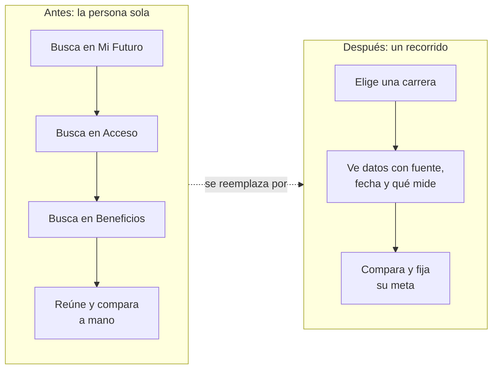

*Figura 11.1.* Proceso de información de la persona que egresa, antes y después.

**Tabla 11.10.** Cambios en estructuras.

| Aspecto | Antes | Después | Estado |
|---|---|---|---|
| Forma jurídica | Proyecto de título sin entidad: no puede facturar ni firmar contratos | Sociedad por acciones constituida en 2027 | Por constituir; sin trámite iniciado |
| Roles | Tres cargos: jefatura de proyecto y arquitectura (Rafael Jaque), datos oficiales y calidad de datos (Cristóbal Rojas), experiencia de uso y medición (Alejandro Tapia) | Los mismos, con funciones nuevas: verificación de avisos y atención de encargos. `[COMPLETAR: asignación de cada función; supuesto del equipo: Rafael Jaque]` | Por acordar en la reunión semanal |
| Profesional de psicología o psicopedagogía | No existe | Revisa los contenidos de orientación antes de que se publiquen, bajo contrato de honorarios | Por contratar; sin monto, por cotizar |
| Relación con AIEP | Docente tutor como contraparte académica, con reportes de avance | Termina el módulo; el proyecto continúa por la sociedad | Después de la entrega del 19 de diciembre de 2026 |
| Relación con los organismos fuente | Descarga y cita de archivos abiertos, sin convenio | Cita siempre con fuente y fecha; consulta previa antes de vender un análisis | Sin convenio |
| Competencias requeridas | Desarrollo de software y procesamiento de datos | Además, verificación de la vigencia de los datos, revisión de avisos y cotización de informes | Se adquieren con la práctica; sin capacitación formal |

**El cambio que puede generar resistencia.** Cuando un sistema hace visible lo que antes no se veía, cambia la estructura de control y no solo la del proceso. Aquí hay dos fuentes posibles. La primera es el equipo mismo: un tablero público de transparencia mostrará fechas y vigencia de cada dato, y también los errores propios. La segunda son los organismos fuente, a quienes un cotejo público puede incomodar. En ambos casos el plan de socialización (11.8) lo nombra y lo gestiona, en lugar de ignorarlo.

### 11.7 Evaluación del proyecto

Evaluar es emitir un juicio fundado, no describir de nuevo. Se usan los cinco criterios de la Organización para la Cooperación y el Desarrollo Económicos (OCDE, 2002).

**Tabla 11.11.** Evaluación por criterios.

| Criterio | Juicio | Evidencia que lo respalda |
|---|---|---|
| Pertinencia: ¿respondía a una necesidad real? | **Parcial.** La dispersión de la información oficial está verificada, y una de cada dos personas que egresan no ingresa al año siguiente (49,6 %; SIES, 2026a). Pero que la falta de información sea una de las causas del no ingreso es una hipótesis: la encuesta oficial de hogares registra sobre todo razones personales (60,7 %) y económicas (34,1 %) (Ministerio de Desarrollo Social y Familia, 2026). `[COMPLETAR: si en H3 hay personas que no identifican qué mide cada cifra ni con el prototipo, se agrega]` | Diagnóstico de la Parte I (punto 2) y validación de H3 (capítulo 10) |
| Eficacia: ¿logró los objetivos que se propuso? | `[COMPLETAR: logrado, parcial o no logrado, por objetivo]` | Indicadores I-OG, I-OE1a, I-OE1b, I-OE2, I-OE3a e I-OE3b, medidos (capítulo 10 y Tabla 11.1) |
| Eficiencia: ¿lo logró con un uso razonable de recursos? | **Por confirmar.** Si se confirma que no hubo gasto en proveedores, la eficiencia en dinero es alta; en horas se confirma con el registro. El prototipo no exigió gasto en proveedores, salvo `[COMPLETAR: lo pagado, si hubo]`; el recurso principal fueron las horas del equipo, que son 98 % del costo de la puesta en marcha. `[COMPLETAR: horas reales]` | Tabla 11.7 y registro de horas |
| Impacto: ¿qué cambió como consecuencia? | **Acotado a 10 personas y a una sesión.** `[COMPLETAR: lo observado en la Tabla 11.1]`. No se afirma impacto sobre el ingreso a la educación superior ni sobre la salud mental | Secciones 11.1 a 11.6 |
| Sostenibilidad: ¿puede mantenerse sin el equipo original? | **Frágil hoy.** El servicio depende de las horas de tres personas y de planes de proveedores que ya mostraron límites (riesgo R3). El costo en dinero es bajo ($29.491 al mes), pero ninguna fuente de ingresos está comprometida | Plan de sostenibilidad (11.10) y estrategia de transferencia (capítulo 10) |

**Lo que no funcionó, hasta ahora.** El consumo de la base de datos superó el plan gratuito antes de abrir el sitio al público (riesgo R3): el exceso se atribuyó a compilaciones que exportaban datos, y desde el arreglo del 24 de noviembre no hubo exportaciones. Cuánto resiste el plan gratuito con público real no se ha medido: es un supuesto. Y el modelo de ingresos no tiene respaldo de clientes. `[COMPLETAR: lo que la medición mostró que no funcionó].`

### 11.8 Plan de socialización

Socializar es dar a conocer el proyecto y sus resultados a quienes se ven afectados o tienen interés, de modo que puedan entenderlo y usarlo. No es publicidad: es gestión del cambio. Los públicos salen del mapa de actores de la Parte I (punto 1.1). La agencia no sale a vender: los clientes llegan por lo que se publica, y quien tenga interés escribe.

**Tabla 11.12.** Plan de socialización por público.

| Público (actor, Parte I) | Qué necesita saber | Qué se entrega | Canal y técnica | Cuándo | Responsable |
|---|---|---|---|---|---|
| Personas que egresan (1 a 4) | Que existe, que es gratis y sin cuenta, y qué mide cada cifra | Una comparación real de una carrera en dos sedes, con su fuente; guía de una página | **Demostración práctica** con un caso real (la misma carrera en dos sedes) y **material de apoyo breve**. Canal: publicaciones propias y gratuitas; oficinas municipales de juventud como difusión, si aceptan `[COMPLETAR: confirmar el acuerdo]`. Comunicación por etapas: anuncio, preparación, inicio y refuerzo | Etapa 3 de la estrategia de evolución (2027); anuncio previo | Alejandro Tapia |
| Familias (5) | Qué muestra cada dato y qué son los beneficios y sus plazos, en lenguaje claro y con las siglas explicadas | Guía de una página para familias | **Material de apoyo breve** con la técnica de explicar el dato con un ejemplo | Con la apertura al público | Alejandro Tapia |
| Organizaciones que necesitan análisis (6) | Cómo se procesa cada dato, qué se puede encargar y qué no, con qué método y a qué precio de referencia | Página del método, tablero de transparencia y primer informe de muestra | **Publicación abierta** y **vocería definida**: una sola persona responde las consultas y cotiza, para que no circulen versiones contradictorias. No se las busca | Cuando exista el informe de muestra | Rafael Jaque |
| Mineduc, SIES y DEMRE (7) | Cómo se citan sus datos, sin alterar valores, y qué se hará con ellos en informes pagados | Nota con la fuente y la fecha de cada conjunto; consulta antes de vender un análisis | **Reunión de retroalimentación**: escuchar objeciones antes de implementar | Antes del primer informe pagado | Cristóbal Rojas |
| Portales y organizaciones que ya informan (8) | Que el sitio los complementa y los cita como fuente | Descripción breve del sitio y de lo que no cubre | **Material de apoyo breve** y respuesta a quien consulte | Con la apertura al público | Rafael Jaque |
| AIEP y docente tutor (9) | Resultados, decisiones y proyección | Informe ejecutivo y Resumen Ejecutivo | **Presentación breve** y **reunión de retroalimentación** | 19 de diciembre de 2026 | Rafael Jaque |
| Preuniversitarios y servicios afines (10) | Reglas de los avisos, tarifa y espacios disponibles | Página con las reglas, la tarifa publicada y los espacios; conteo agregado de veces que se mostró cada aviso | **Publicación abierta**: el anunciante interesado escribe; sin venta directa | Cuando se publique el espacio | Rafael Jaque |

**Cómo se gestiona la resistencia.** Se nombra de antemano. Para los organismos fuente (7) se consulta antes de vender un análisis. Para el equipo, los errores propios se corrigen de forma visible y con fecha en el tablero, de modo que quedan como registro y no como falla, y el cambio de proceso se acuerda en la reunión semanal.

### 11.9 Forma de implementación del cambio

**Tabla 11.13.** Forma de implementación.

| Campo | Contenido |
|---|---|
| Forma elegida | **Piloto y expansión**, con marcha blanca implícita: el sitio no reemplaza a los portales oficiales, que siguen disponibles como fuente y alternativa |
| Por qué se eligió | El sitio es nuevo y su efecto no está probado en uso real. Un cambio directo no tiene sentido porque no hay un método anterior que reemplazar: los portales siguen funcionando. El piloto permite medir antes de ampliar, con criterios de éxito fijados de antemano (H1 a H4). Se evitó la implementación por etapas funcionales porque el valor está en el recorrido completo (carrera, comparación, meta y plazo), no en cada función suelta |
| Qué se hizo y qué es plan | **Plan inmediato (30 de noviembre al 4 de diciembre de 2026):** una prueba de usabilidad con 10 personas en un entorno controlado (TRL 4); aún no se aplica y no será un piloto de uso real. **Plan posterior:** piloto abierto con dos meses de operación en 2027 (TRL 6 y 7, etapa 3), y expansión con las funciones diseñadas (etapa 4) |
| Riesgo asociado | Que la apertura pública revele problemas que la prueba no vio, y que el consumo supere el plan contratado (R3) o un dato quede desactualizado (R2). Doble trabajo temporal del equipo: mantener los datos al día mientras se miden los resultados |
| Cómo se maneja | Medición de uso con las mismas tareas; registro mensual de vigencia (K4) y de defectos por versión (K2); plan de pago antes de atender público real; ampliar solo si se cumple la condición de la etapa |

### 11.10 Plan de sostenibilidad

La sostenibilidad es la capacidad del proyecto de seguir funcionando después de que el equipo se retire de la etapa académica, en cinco dimensiones. La prueba: si mañana el equipo desaparece, ¿qué pasa con el sistema? Hoy la respuesta es incompleta: el sitio seguiría desplegado, pero los datos dejarían de actualizarse y nadie más sabría operarlo. Por eso cada dimensión tiene un responsable con nombre.

**Tabla 11.14.** Plan de sostenibilidad.

| Dimensión | Quién responde (nombre y cargo) | Qué se requiere | Horizonte |
|---|---|---|---|
| Técnica | Rafael Jaque, jefatura de proyecto y arquitectura; Cristóbal Rojas, datos oficiales y calidad de datos | Manual de despliegue y manual de usuario (capítulo 13), accesos traspasados a la sociedad, respaldos de la base de datos `[COMPLETAR: política y lugar de respaldos]`, infraestructura portable para cambiar de proveedor, y vigencia de los datos en 100 % (K4) | Manuales al 19 de diciembre de 2026; accesos al constituir la sociedad en 2027 |
| Económica | Rafael Jaque | Costo en dinero de $29.491 al mes con plan de pago; fuente de financiamiento identificada (ver abajo); seguimiento de K5 | 2027 |
| Organizacional | Rafael Jaque, con Cristóbal Rojas | Sociedad por acciones constituida, con tres cláusulas en los estatutos que solo cambian por unanimidad (uso gratuito, independencia, no venta de datos personales); funciones nuevas asignadas (verificación de avisos y atención de encargos); procedimiento mensual de actualización de datos documentado | 2027 |
| Social | Alejandro Tapia, experiencia de uso y medición | Valor demostrado en la validación; plan de refuerzo de la adopción: ejemplos de uso, material breve y medición de uso con las mismas tareas | Etapa 3 |
| Ambiental | Alejandro Tapia, con la aprobación de Rafael Jaque | Primera carga de menos de 1 MB, medida con Lighthouse; guardar solo los datos necesarios | Revisión con cada despliegue |

**¿Quién paga en marzo?** La respuesta, con lo que hoy existe:

- **El primer financista son los tres socios, con recursos propios.** Los dos primeros meses de la puesta en marcha cuestan $75.777 en dinero: Cloudflare $9.500, Supabase $47.500, dominio $11.888 e imprevistos $6.889. Se pagan en tres partes iguales de $25.259 (Parte I, 10). Además aportan horas valorizadas en $3.673.600. La sociedad aún no está constituida, por lo que no hay entidad que pague. `[COMPLETAR: confirmar el compromiso de aporte de cada socio.]`
- **Después, $29.491 al mes.** Un solo espacio publicitario vendido ($200.000 + IVA al mes) lo cubre. Un informe de 24 horas ($632.000 + IVA) aporta $317.120 a los costos fijos. En el escenario medio, ocho informes al año y dos avisos durante ocho meses cubren los costos fijos anuales de $5.077.092 (Tabla 11.6).
- **Un fondo público es la alternativa.** Con la sociedad constituida, Semilla Inicia (Corporación de Fomento de la Producción, CORFO) podría cubrir hasta 75 % del costo total, con tope de $15.000.000. La convocatoria 2026 de la región de O'Higgins cerró el 16 de marzo de 2026 y no hay garantía de una en 2027 (Parte I, 8.4).
- **Lo que no está comprometido.** Ninguna de estas fuentes de ingreso lo está. Hoy ninguna organización ha encargado un informe ni ningún anunciante ha comprado un espacio. Si no llegan, el sitio sigue gratuito a costa de los socios: $353.892 al año en dinero, más las horas.

### 11.11 Preparación del Resumen Ejecutivo

El Resumen Ejecutivo se extrae del informe y no se vuelve a escribir. Su destinatario es un inversor o un socio, no el docente: se enfoca en la oportunidad y el valor. Se respetan las ocho láminas del formato oficial, su orden y el máximo de 20 minutos. La imagen corporativa es la definida en el capítulo 8.

**Tabla 11.15.** Preparación del Resumen Ejecutivo.

| Lámina | Contenido | De qué capítulo se extrae | Quién presenta | Tiempo máximo | Tiempo objetivo |
|---|---|---|---|---|---|
| 2. Información general | Nombres, carrera y escuela (Ingeniería de Ejecución en Informática, mención Desarrollo de Sistemas, AIEP San Fernando), marca personal de cada integrante y fotografía del equipo | Parte I (1.1) y capítulo 8 (equipo y roles). Escuela y marca personal: `[COMPLETAR]` | `[COMPLETAR]` | 1 min | 1:00 |
| 3. Desafío y objetivos | Una de cada dos personas no ingresa al año siguiente (49,6 %; SIES, 2026a). Objetivo general y tres objetivos específicos | Parte I, puntos 2 y 3 (3.2) | `[COMPLETAR]` | 3 min | 2:50 |
| 4. Solución y presupuesto | Lienzo de propuesta de valor y declaración de valor; presupuesto de $3.749.377, de los cuales $75.777 son dinero | Parte I, puntos 5, 6 y 10; sección 11.4 | `[COMPLETAR]` | 5 min | 4:50 |
| 5. Puesta en marcha | Supervisión de etapas, indicadores K1 a K5, monitoreo, retroalimentación y planes de contingencia para los riesgos R2, R6 y R8 | Capítulo 9 | `[COMPLETAR]` | 3 min | 2:50 |
| 6. Validación de resultados | Métodos aplicados, hipótesis H1 a H5 con su resultado y limitaciones | Capítulo 10 | `[COMPLETAR]` | 3 min | 2:50 |
| 7. Impacto y evaluación | Impacto social, económico y ambiental (Tabla 11.1) y cambios organizacionales (Tablas 11.9 y 11.10) | Este capítulo, 11.1 a 11.7 | `[COMPLETAR]` | 3 min | 2:50 |
| 8. Conclusiones | Tres reflexiones: importancia del proyecto, viabilidad y sostenibilidad | Parte I (2.1 y 9.2); capítulo 10 (10.10); este capítulo (11.7 y 11.10) | `[COMPLETAR]` | 2 min | 1:50 |
| **Total** | Ocho láminas con la portada | | `[COMPLETAR: un representante o todos; nadie solo de nexo]` | **20 min** | **19:00** |

**Tiempo ensayado:** `[COMPLETAR: por lámina, cronometrado y grabado con el celular].` El tiempo objetivo deja un minuto de margen en total, porque entre láminas no hay holgura.

**Cifras.** Solo van en las láminas las cifras que están en el informe. La cifra de la medición se toma de la Tabla 10.6.

**Tres preguntas que el docente puede hacer, con respuesta preparada.** (1) *¿Qué pasa si ninguna organización encarga un informe?* El sitio sigue gratuito con las horas de los socios y el costo en dinero ($29.491 al mes) se cubre con un solo espacio publicitario; sin ingresos, es un riesgo declarado (R4). (2) *¿Cómo se garantiza la independencia?* Con tres cláusulas en los estatutos que solo cambian por unanimidad y con reglas escritas para los avisos. (3) *¿Qué pasa si un organismo cambia sus archivos?* Se valida el esquema en cada carga, se cargan a mano de 5 a 10 carreras reales con su fuente, y la vigencia se vigila con K4 (Parte I, 3.9; riesgo R2).

### 11.12 Coherencia con el resto del informe

**Tabla 11.16.** Verificación de coherencia.

| Pregunta | Respuesta |
|---|---|
| ¿El impacto observado se puede rastrear hasta un dato de la prueba? | Cada fila de la Tabla 11.1 remite a una tabla del registro de la medición (capítulo 10). Lo que no se pueda rastrear se retira |
| ¿Los cambios organizacionales corresponden al proceso del capítulo 8? | La Tabla 11.9 toma como «antes» el flujo de cambios del capítulo 8. Figura 8.2 |
| ¿El Resumen Ejecutivo dice lo mismo que el informe? | Las cifras de las láminas están en las Tablas 10.6, 11.1, 11.4 y 11.6 y en la Parte I |
| ¿Se repite el impacto esperado de la Parte I? | No: la Tabla 11.1 lo contrasta con lo observado |

---

## 12. Requerimientos, metodología y diseño

Una de cada dos personas que egresan de 4.º medio no ingresa a la educación superior al año siguiente (SIES, 2026a), y las que buscan información deben reunirla ellas mismas desde sitios que publican por separado. Este capítulo convierte ese problema en un sistema especificado: qué debe hacer y cumplir (requerimientos), cómo se construye (metodología), cómo se organiza (arquitectura y modelos) y dónde corre (despliegue). Todo se describe tal como existe en el repositorio al 26 de noviembre de 2026 y, donde algo todavía no existe, se dice.

Convenciones del capítulo:

- **P-I** es el Entregable Parte I (noviembre de 2026). «P-I 3.7» remite a su punto 3.7.
- **Sistema real.** Los diagramas y tablas salen del código, las migraciones de la base de datos y la configuración de despliegue del repositorio (https://github.com/AE-SE/Agencia-de-Enlaces-y-Seguimiento-Estudiantil). El sitio desplegado está en https://agencia-de-enlace.rafajaqued.workers.dev/.
- **Lo que depende de la medición** con 10 personas (30 de noviembre al 4 de diciembre de 2026) se deja como `[COMPLETAR: …]`. Lo que es un supuesto del equipo se dice «supuesto del equipo».
- Los códigos de requerimiento son RU (de usuario), RF (funcionales), RNF (no funcionales) y RL (legales). Los casos de uso son CU y los casos de prueba CP. Los CP se definen y ejecutan en el capítulo 13 con estos mismos códigos.
- Siglas de este capítulo: MER (modelo entidad-relación), UML (lenguaje unificado de modelado), API (interfaz de programación de aplicaciones), RLS (seguridad a nivel de fila de la base de datos), CNED (Consejo Nacional de Educación) y MoSCoW (técnica de priorización: debe, debería, podría y no tendrá).

**Figura 12.1.** Secuencia del capítulo: cada artefacto se apoya en el anterior.

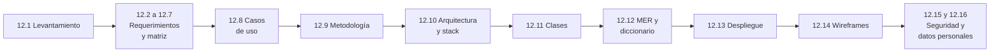

### 12.1 Levantamiento de requerimientos

Levantar requerimientos es averiguar qué necesita realmente quien usará el sistema (Sommerville, 2016). Aquí el levantamiento busca especificar el sistema; el diagnóstico de la Parte I (punto 2) buscaba entender el problema, y se reutiliza como material.

#### 12.1.1 Técnicas aplicadas

**Tabla 12.1.** Técnicas de levantamiento, qué produjeron y su estado al 26 de noviembre de 2026.

| Técnica | Cómo se aplicó | Qué produjo | Cuándo | Estado |
|---|---|---|---|---|
| Análisis de documentos | Lectura de las publicaciones oficiales que alimentan el sistema: informe de acceso del SIES (2026a), metodología del buscador de empleabilidad e ingresos (SIES, 2025), glosario de oferta académica (SIES, 2026b), calendario FUAS 2027 (Ministerio de Educación, 2026a), oferta definitiva del DEMRE para 2027 y las condiciones de uso de cada portal | Campos de datos reales y reglas implícitas: la empleabilidad al primer año solo considera a quienes tienen información de ingresos; el código SIES termina en la versión del plan de estudios; muchas carreras de institutos y centros de formación técnica no tienen código DEMRE; qué fuentes se pueden reutilizar y con qué cita | 3 al 24 de nov. | Hecho |
| Estudio de sistemas similares | Revisión de Mi Futuro, Acceso, Beneficios Estudiantiles, Elige Carrera (beta), Por Una Carrera y los informes del SIES (P-I 4.7) | Lo esperable en el rubro (buscador, simulador de puntajes, calendario) y el vacío: un recorrido único con la fuente y qué mide cada cifra | 6 al 13 de nov. | Hecho |
| Prototipo evolutivo | Sitio desplegado desde el 5 de noviembre y ampliado en cada pull request; revisado por el equipo con una pauta escrita | Correcciones tempranas que no estaban en el diagnóstico: separar sede y jornada de una misma carrera, mostrar la versión del plan cuando dos fichas se ven idénticas, explicar por qué una carrera no tiene puntaje de corte | 2 al 25 de nov. | Hecho, con el equipo. Aún sin personas externas |
| Entrevistas semiestructuradas (5) | Personas de 18 años o más y dos profesionales de organizaciones (P-I 2.3.4) | Requerimientos de usuario en palabras de la persona | 23 nov. al 4 dic. | `[COMPLETAR: requerimientos nuevos o cambiados que surjan de las 5 entrevistas; los trae Alejandro Tapia el 4 de diciembre]` |
| Observación con tarea cronometrada | Cuatro tareas centrales con 10 personas, primero en los sitios oficiales y después con el prototipo (P-I 2.3.2 y Anexo 3.A) | Pasos que hoy estorban, y datos para los requerimientos de usabilidad | 30 nov. al 4 dic. | `[COMPLETAR: tiempos, errores y observaciones por tarea; los trae Alejandro Tapia]` |
| Encuesta (EAEC) | Escala de autoeficacia para la elección de carrera (P-I 2.3.3) | Línea base de la confianza para obtener información | 23 nov. al 4 dic. | `[COMPLETAR: número de respuestas y subescala de información ocupacional; los traen Alejandro Tapia y Cristóbal Rojas, si los autores dieron el permiso]` |
| Taller con usuarios | No se aplicó | — | — | El segmento son personas individuales, sin organización con la que negociar. El único conflicto entre interesados (un anunciante frente a la independencia del sitio) se resolvió con reglas escritas el 25 de noviembre, a partir de una observación del docente tutor a la Parte I |

**Lo que esto significa.** Al 26 de noviembre, los requerimientos salen del diagnóstico con datos secundarios, de los documentos oficiales y del prototipo; la voz de las personas usuarias llega con la medición. Por eso los requerimientos de usuario (12.2) son hipótesis de necesidad que el capítulo 10 contrasta con las personas. Si la medición contradice alguno, la matriz (12.7) se corrige como versión 2 y el cambio queda registrado en un pull request.

#### 12.1.2 Reglas que se aplicaron

- **Fuente de cada requerimiento.** La matriz (Tabla 12.10) registra de dónde viene cada uno y su fecha. Sin fuente no hay cómo resolver un conflicto después.
- **Necesidad antes que solución.** Lo recogido no fue «un botón para comparar», sino «reunir y comparar los datos de una carrera en menos tiempo» (P-I 3.2, OE2). La solución (un comparador de hasta tres carreras) es una de varias posibles y se valida con la medición.
- **Excepciones.** Cada caso de uso (12.8) especifica qué pasa cuando algo sale mal: una fuente que no publica el valor, la base de datos caída, el almacenamiento del navegador bloqueado.
- **Validación con quien lo dijo.** Se hace en el capítulo 10, con las 10 personas de la medición.

#### 12.1.3 De lo recogido al requerimiento

**Tabla 12.2.** Ejemplos de sistematización (lo recogido, antes y después).

| Lo recogido | Fuente y fecha | Requerimiento resultante |
|---|---|---|
| «La información oficial de cada carrera está repartida entre varios organismos» | P-I 2.1 y 2.4 (causa 1), nov. 2026 | RU-02, RF-03 a RF-09 y RF-12: mostrar en una vista los cuatro datos centrales, cada uno con su fuente |
| La empleabilidad al primer año es un indicador aproximado que no cuenta a quienes no tienen información de ingresos | SIES (2025) | RF-13: indicar junto a cada cifra qué mide |
| La encuesta oficial no pregunta por información y las razones más declaradas son personales y económicas | P-I 2.1 (Ministerio de Desarrollo Social y Familia, 2026) | RNF-21: ningún texto atribuye el no ingreso a la desinformación |
| El tráfico de salida de la base de datos superó el límite del plan gratuito en noviembre de 2026 y se corrigió el 24 de noviembre | Riesgo R3 (Parte II, cap. 8) | RNF-09: consumo de la base de datos bajo el 80 % del límite del plan |
| Muchas carreras de institutos y centros de formación técnica no tienen código DEMRE y sus tarjetas quedaban vacías | Hallazgo al cargar datos, S2 (10 al 16 de nov.) | RF-18 y RF-32: decir que la carrera se postula directo en la institución y no suponer plazos |
| El docente tutor observó que los ingresos del proyecto debían considerar la publicidad en el sitio | Revisión de la Parte I, nov. 2026 | RF-43 a RF-50 y RL-03 a RL-05: aviso rotulado, sin terceros y solo en tres páginas |

### 12.2 Requerimientos de usuario

Se escriben en lenguaje natural, para quien usa el sistema y para la contraparte académica. Cada uno se descompone después en varios requerimientos de sistema (Tabla 12.4).

**Tabla 12.3.** Requerimientos de usuario.

| ID | Actor | Requerimiento de usuario | Fuente y fecha |
|---|---|---|---|
| RU-01 | Persona que egresa | Quiero encontrar una carrera por su nombre, la institución o la comuna sin saber cómo la nombra cada organismo | P-I 2.4 (causa 2) y Anexo 3.A (T1), nov. 2026 |
| RU-02 | Persona que egresa | Quiero ver en un solo lugar la empleabilidad, la duración, el arancel y lo que piden para entrar, y saber de dónde sale cada dato | P-I 3.2 (OE1), nov. 2026 |
| RU-03 | Persona que egresa | Quiero entender qué mide cada cifra, sin saber de estadística | P-I 2.4 (causa 3) y 3.3 (I-OE1b), nov. 2026 |
| RU-04 | Persona que egresa | Quiero poner dos o tres carreras lado a lado y saber cuál tiene mayor empleabilidad | P-I 3.2 (OE2) y Anexo 3.A (T3), nov. 2026 |
| RU-05 | Persona que egresa | Quiero guardar la carrera que más quiero y dos más, sin crear una cuenta ni dar mis datos | P-I 1.4 y 3.7, nov. 2026 |
| RU-06 | Persona que egresa | Quiero saber cuál es mi próximo plazo y qué otras carreras parecidas tengo si no alcanzo la primera | P-I 3.2 (OE3) y 3.3 (I-OE3a), nov. 2026 |
| RU-07 | Persona que egresa | Quiero revisar los plazos de admisión y de beneficios y saber cuáles ya pasaron | P-I 2.4 (causa 4), nov. 2026 |
| RU-08 | Persona que egresa | Quiero usar el sitio desde mi teléfono, con datos móviles limitados, sin que nadie me siga | P-I 3.5 (social) y 4.2, nov. 2026 |
| RU-09 | Persona que egresa | Quiero saber siempre cuándo algo es publicidad y que no cambie lo que el sitio me muestra | P-I 4.2, 25-nov-2026 |
| RU-10 | Servicio educativo que avisa | Quiero mostrar mi aviso a quienes preparan la PAES y saber cuántas veces se mostró, sin comprar posición ni trato distinto | P-I 4.2 y 9.1.3, 25-nov-2026 |
| RU-11 | Equipo de datos | Quiero saber de qué archivo, período y fecha viene cada dato y detectar cuándo uno quedó desactualizado | P-I 3.9 (suposiciones 1 y 2), nov. 2026 |
| RU-12 | Jefatura de proyecto | Quiero medir el avance, la calidad y el gasto sin armar planillas a mano | Parte II cap. 8 (KPI K1 a K5) |

RU-10 es una hipótesis comercial sin validar: ningún anunciante ha pedido un espacio (P-I 9.1.3).

**Tabla 12.4.** De cada requerimiento de usuario a los requerimientos de sistema que lo cumplen.

| RU | Requerimientos de sistema |
|---|---|
| RU-01 | RF-01, RF-02, RNF-01, RNF-06 |
| RU-02 | RF-03 a RF-12, RF-14 a RF-17 |
| RU-03 | RF-13, RF-39, RNF-19, RNF-21 |
| RU-04 | RF-16, RF-17, RF-19 a RF-23 |
| RU-05 | RF-27 a RF-30, RF-35, RL-01 |
| RU-06 | RF-31 a RF-34 |
| RU-07 | RF-36 a RF-38, RF-41 |
| RU-08 | RNF-01 a RNF-07, RNF-13, RL-01 |
| RU-09 | RF-43 a RF-47, RL-03, RL-05 |
| RU-10 | RF-43, RF-48, RF-49, RF-50, RL-04 |
| RU-11 | RF-51 a RF-54, RL-08, RL-10 |
| RU-12 | RF-55 a RF-58, RNF-16 |

### 12.3 Requerimientos funcionales

Se redactan como «El sistema debe + verbo de acción + objeto + condición», uno por función, para poder probarlos por separado (Pressman y Maxim, 2021). Dos excepciones declaradas: RF-11 enumera una lista cerrada de cinco datos de una misma tarjeta, y los requerimientos RF-55 a RF-58 hablan del «entorno de desarrollo» o del «equipo» porque su objeto es el registro de gestión que alimenta un KPI, no una pantalla.

**Tabla 12.5.** Grupos de requerimientos funcionales (el texto completo está en la matriz, Tabla 12.10).

| Grupo | IDs | Qué cubre |
|---|---|---|
| Buscar y ver una carrera | RF-01 a RF-18 | Búsqueda, filtros, los datos de la ficha con su fuente, comparaciones de empleabilidad y el aviso de carreras sin código DEMRE |
| Comparar carreras | RF-19 a RF-23 | Hasta tres carreras, mismas filas, fuente por dato, advertencia de períodos distintos y orden elegido por la persona |
| Hoja de decisión y simulador | RF-24 a RF-26 | Hoja imprimible y cálculo del puntaje ponderado |
| Meta, plazos y alternativas | RF-27 a RF-35 | Meta con dos preferencias en el dispositivo, próximo plazo, alternativas cercanas y borrado |
| Calendarios y orientación | RF-36 a RF-42 | Calendario de admisión, plazos de beneficios, preguntas frecuentes, «Quiénes somos», guía del FUAS, mapa y ocupaciones |
| Espacio publicitario | RF-43 a RF-50 | Páginas permitidas, rótulo, sin terceros, enlace sin datos, registro del anunciante |
| Operación de datos | RF-51 a RF-54 | Validación de cargas, fuente por fila, un solo período vigente y registro de cada archivo |
| Gestión para los KPI | RF-55 a RF-58 | Registro del dato de K1, K2, K3 y K5 |
| Diseñados, no construidos | RF-59 a RF-64 | Lo que queda para 2027 (12.6) |

**Reglas de negocio que atraviesan los requerimientos.**

- **Sin dato no es cero** (RF-14): si la fuente no publica un valor, la tarjeta dice «Sin datos suficientes» y explica por qué.
- **Máximo tres** (RF-19, RF-27, RF-28): se comparan hasta tres carreras y se guardan hasta tres elementos entre meta y preferencias.
- **Criterio explícito de cercanía** (RF-33): misma área del SIES, misma región y puntaje de corte del año anterior igual o menor. No hay puntaje único ni campo de cliente, de modo que la condición de cliente no puede influir.
- **Lo que ya pasó** (RF-31, RF-37): se calcula con la fecha de hoy en Chile; un hito sin fecha publicada nunca se supone.
- **Neutralidad** (RF-23, RF-44): el sitio no ordena ni destaca instituciones por ser clientes y no muestra avisos donde se compara o se decide.

**Comportamiento ante error** (se detalla en los flujos de excepción de 12.8): si falla la consulta a la base de datos, las páginas dicen que no pudieron cargar y no muestran datos inventados; si el navegador bloquea el almacenamiento, la meta dura solo mientras la página siga abierta y se avisa; si la ficha pedida no coincide con una carrera real, el sitio responde que no existe.

**Requerimientos de datos.** El sistema guarda solo datos públicos oficiales con su fuente y fecha, la meta y las preferencias en el dispositivo de la persona, y, para el equipo, el registro de alertas y de acceso que ya existe en la base. No guarda datos personales de quien usa el sitio (RL-01).

### 12.4 Requerimientos no funcionales

Todo requerimiento no funcional lleva un número o un criterio comprobable. La Tabla 12.6 dice de dónde sale cada número y cómo se medirá.

**Tabla 12.6.** Requerimientos no funcionales: valor, origen del número y método de medición.

| Categoría | ID | Valor exigido | Origen del número | Cómo se medirá |
|---|---|---|---|---|
| Compatibilidad | RNF-01 | 360 px de ancho sin desplazamiento horizontal | Teléfono básico como pantalla mínima (P-I 3.5) | Prueba automática con navegador a 360 px en las 14 rutas |
| Accesibilidad | RNF-02 | 0 incumplimientos de WCAG 2.2 AA detectables por axe, en 14 rutas y en dos temas | WCAG 2.2 (W3C, 2023) | Prueba automática en cada pull request. La accesibilidad con lector de pantalla se revisa a mano y aún no se mide (P-I 4.6) |
| Accesibilidad | RNF-03 | 100 % de las funciones con teclado y foco visible | WCAG 2.2, criterios de teclado y foco | Prueba automática del primer Tab y del contorno de foco |
| Accesibilidad | RNF-04 | Contraste ≥ 4,5:1 en texto y ≥ 3:1 en bordes y componentes | WCAG 1.4.3 y 1.4.11 | Verificador del archivo de colores del proyecto (corre en cada pull request): 44 de 44 pares cumplen en ambos temas, según el registro de diseño de noviembre de 2026 |
| Rendimiento | RNF-05 | Primera carga menor a 1 MB | Meta de P-I 3.5, que declara que aún no es un logro | `[COMPLETAR: peso medido de portada y ficha con Lighthouse; lo trae Rafael Jaque en el capítulo 13]` |
| Rendimiento | RNF-06 | Ficha en 3 s o menos con 4G lenta simulada | Supuesto del equipo. La prueba de arquitectura del 6 de nov. midió 1,81 a 1,87 s en una página de servidor de prueba, no en la ficha | `[COMPLETAR: tiempo de carga de la ficha con 4G lenta; lo trae Rafael Jaque]` |
| Privacidad | RNF-07 | 0 solicitudes a dominios de terceros al cargar una página | Fuentes tipográficas alojadas en el proyecto (51.236 bytes en total) y sin scripts de terceros | Prueba con registro de red del navegador |
| Disponibilidad | RNF-08 | ≥ 95 % del tiempo cada mes | Supuesto del equipo; no hay contrato de nivel de servicio | `[COMPLETAR: disponibilidad medida entre el 30 nov. y el 4 dic.; la trae Rafael Jaque]` |
| Capacidad | RNF-09 | Consumo de la base ≤ 80 % del límite del plan (≤ 4 GB de tráfico de salida con el plan gratuito de 5 GB) | Riesgo R3: ya ocurrió un exceso en noviembre de 2026 | Panel de consumo del proveedor, revisión semanal |
| Seguridad | RNF-10 | 100 % de las tablas con seguridad por filas; lectura sin sesión solo en una lista cerrada | Aislamiento por persona exigido por la base, no por la interfaz | Pruebas de la base de datos en cada pull request (PostgreSQL 16 efímero) |
| Seguridad | RNF-11 | 100 % de las solicitudes por HTTPS | Práctica mínima de seguridad (OWASP Foundation, 2021a) | Revisión de la configuración del dominio. Es la decisión de diseño; su cumplimiento se registra en el capítulo 13 (Tabla 13.19), donde `http://` responde 200 sin redirigir y por eso no cumple |
| Seguridad | RNF-12 | 0 secretos en el repositorio | OWASP Foundation (2021a) | Revisión de cada pull request y archivo `.env` fuera del control de versiones |
| Seguridad | RNF-13 | 0 datos personales en direcciones, registros y errores | Ley 19.628 mod. por Ley 21.719 | Revisión del código y de los registros del servidor |
| Respaldo | RNF-14 | Respaldo diario, 7 días de retención, restauración en menos de 4 h | Supuesto del equipo para la puesta en marcha de 2027 (plan Supabase Pro, P-I 10). Hoy el plan gratuito no tiene copias automáticas | `[COMPLETAR: prueba de restauración en 2027; la hace Rafael Jaque]` |
| Portabilidad | RNF-15 | Esquema reproducible desde 14 migraciones; datos públicos desde archivos registrados | Transferencia (P-I 4.1) | Reconstruir la base en un PostgreSQL local, lo que ya hace la integración continua |
| Mantenibilidad | RNF-16 | Siete trabajos de integración continua en verde (la detección de cambios y seis verificaciones) y confirmación del jefe de proyecto antes de fusionar | Control de versiones (P-I 3.6) | Reglas de la rama principal, que hoy exigen solo el contraste de colores y una aprobación (13.13), e historial de pull requests |
| Mantenibilidad | RNF-17 | 0 datos cambiantes dentro de la lógica | Los plazos y montos cambian cada año (P-I 2.4, causa 4) | Revisión de código con la lista de verificación del pull request |
| Usabilidad | RNF-18 | ≥ 32 de 40 tareas sin ayuda, ≤ 5 min por tarea | Indicador I-OG (P-I 3.3 y Anexo 3.A) | Medición del 30 nov. al 4 dic. `[COMPLETAR: resultado; lo trae Alejandro Tapia]` |
| Usabilidad | RNF-19 | 100 % de siglas explicadas en su primera aparición por página | Lenguaje claro (P-I 1.4, necesidad 5) | Revisión por muestra con la pauta de lenguaje claro |
| Compatibilidad | RNF-20 | Dos últimas versiones de Chrome, Edge, Firefox y Safari | Supuesto del equipo | Las pruebas automáticas corren solo en Chromium. `[COMPLETAR: prueba manual en Firefox y Safari; la hace Alejandro Tapia]` |
| Contenido | RNF-21 | 0 textos que atribuyan el no ingreso a la desinformación o que digan que quedar fuera causa problemas de salud mental | Límites de P-I 2.1 y 2.2 | Revisión de textos antes de cada fusión |

**Escalabilidad.** El sitio público es de lectura: consulta la base y no escribe en ella. Con la oferta cargada (11.364 carreras de pregrado procesadas, P-I 1.3) funciona con la arquitectura actual. Lo que cambia con el tráfico es el consumo de la base, no el diseño: por eso RNF-09 mide el consumo y no el número de visitas. Pasar las fichas a páginas con caché queda para antes de la admisión de enero de 2027 (supuesto del equipo).

### 12.5 Requerimientos legales y normativos

Son los que impone la ley o una norma externa. Se revisó su vigencia en la Biblioteca del Congreso Nacional (BCN) el 13 de noviembre de 2026, y la fecha de entrada en vigor de la ley de datos personales el 25 de noviembre. Esta lectura es del equipo y no reemplaza una asesoría legal, que está pendiente (P-I 9.2).

**Vigencia de la ley de datos personales.** La Ley 21.719 (2024) modifica la Ley 19.628 y rige desde el **15 de octubre de 2027**, fecha fijada por la Ley 21.855, publicada el 23 de noviembre de 2026. Hasta entonces sigue vigente el texto de la Ley 19.628 de 1999. El sistema se diseña desde ya para la ley nueva, de modo que su vigencia no obligue a rehacerlo.

**Tabla 12.7.** Requerimientos legales: norma, cómo condiciona el diseño y cómo se verifica.

| ID | Norma | Cómo condiciona el diseño | Cómo se verifica |
|---|---|---|---|
| RL-01 | Ley 19.628 modificada por la Ley 21.719: principios de finalidad y proporcionalidad | El sitio funciona sin cuenta y no pide nombre, edad, RUT, teléfono ni dirección. La meta se guarda en el dispositivo | Revisión de que ningún formulario ni solicitud envíe datos personales |
| RL-02 | Ley 21.719, art. 14 ter | Política de tratamiento con responsable, finalidades, base de licitud, derechos y plazo | Existe el texto publicado `[COMPLETAR: texto de la política; lo redacta Rafael Jaque y lo valida la asesoría legal]` |
| RL-03 | Ley 19.496, art. 28 (publicidad que induce a error) y circular del SERNAC (2022) sobre publicidad nativa | El aviso dice «Publicidad» antes de su contenido y no imita una ficha, una cifra ni un botón | Inspección de cada aviso antes de publicarlo; en la medición se registra si alguien lo confunde con contenido del sitio |
| RL-04 | Ley 19.496, art. 34 (identificación del anunciante en 48 horas) | Registro de quién compró cada aviso, fuera del sitio público | Existe el registro y se puede entregar en el plazo |
| RL-05 | Ley 21.719, art. 8, letra b (oposición al perfilamiento con fines de mercadotecnia) | El aviso depende de la página, no de la persona; sin scripts, cookies ni píxeles de terceros | Prueba de red sin solicitudes a terceros (RNF-07) |
| RL-06 | Ley 17.336, art. 3 n.° 16 (el software es obra protegida) | Cada dependencia declara su licencia: MIT, Apache-2.0 y las tipografías con licencia abierta OFL (P-I 4.3) | Revisión de licencias en cada dependencia nueva |
| RL-07 y RL-08 | Condiciones de uso de datos abiertos del DEMRE | Cita «Datos abiertos DEMRE» con el año; prohíbe identificar postulantes; los subgrupos de menos de 8 casos se eliminan | Revisión de cada cifra del DEMRE y de que ninguna carga use datos por postulante |
| RL-09 | Instrucciones de cita del SIES en Mi Futuro | Citar `www.mifuturo.cl` del Ministerio de Educación y rotular lo calculado como elaboración propia. El portal no publica una licencia de reutilización, así que el equipo escribe al SIES para pedir la confirmación | Revisión de cada cifra del SIES. `[COMPLETAR: respuesta escrita del SIES; la trae Cristóbal Rojas]` |
| RL-10 | Condiciones de uso del CNED | Prohíben fines comerciales: la base INDICES no se usa | Ninguna carga ni dato de ejemplo la contiene |
| RL-11 | Licencia CC BY 2.0 Chile enlazada por Beneficios Estudiantiles | Atribuir la fuente en cada contenido de beneficios | Revisión de cada contenido de beneficios |
| RL-12 | Ley 17.336, art. 8 (titularidad del software por dependencia o por encargo) | Cesión escrita de cada integrante a la sociedad, tras revisar el reglamento de titulación de AIEP | `[COMPLETAR: contrato de cesión firmado; lo gestiona Rafael Jaque en 2027]` |

**Normas revisadas que no aplican hoy.** La Ley 20.285, de transparencia, rige para organismos públicos: el proyecto no tiene cliente público. La rendición de fondos públicos tampoco aplica: el proyecto no administra transferencias públicas.

**Para 2027, con la cuenta.** RL-13 a RL-16 (consentimiento con registro, menores de 14 años, derechos del titular y datos sensibles) quedan diseñadas y se vuelven obligatorias de construir cuando se abra la cuenta. La base ya tiene funciones para exportar los datos de una persona y registrar solicitudes de derechos, pero su tabla de personas exige nombre y fecha de nacimiento, que la cuenta no debe guardar: hay que migrarla antes (12.12).

### 12.6 Priorización

La priorización decide qué entra en la versión 1, la entrega del 19 de diciembre de 2026, y qué queda declarado para después (Clegg y Barker, 1994). El criterio de corte: un requerimiento es **Must** si forma parte del camino mínimo para que una persona complete las cuatro tareas centrales (T1 a T4, P-I Anexo 3.A) o si lo exige una regla de independencia o de ley.

**Tabla 12.8.** Resultado del MoSCoW (conteo sobre la matriz, elaboración propia).

| Categoría | Criterio | Cantidad | Ejemplos |
|---|---|---|---|
| Must have | Camino mínimo de T1 a T4, independencia, ley y registro del dato de cada KPI | 71 | RF-01, RF-12, RF-19, RF-27, RF-31, RF-36, RF-45, RF-54 |
| Should have | Duele que falte, pero el sistema sirve sin ello | 16 | RF-10, RF-29, RF-38, RF-40, RNF-05, RNF-14 |
| Could have | Agrega valor si sobra tiempo; ya está construido o es barato | 4 | RF-11, RF-24, RF-41, RF-42 |
| Won't have | Fuera de la versión 1; se declara para que nadie lo espere | 10 | RF-59 a RF-64 y RL-13 a RL-16 |

**Tabla 12.9.** Lo que NO entra en la versión 1 (Won't have). Queda diseñado para 2027.

| Elemento | Por qué no entra | Qué existe hoy | Qué falta para 2027 |
|---|---|---|---|
| Cuenta con correo (RF-59, RL-13 a RL-16) | Exige validación legal antes de abrir cuentas al público y no es necesaria para ninguna de las cuatro tareas | Diseño de la lista cerrada de datos (correo, si estudia o estudió, institución, meta y preferencias, registro del consentimiento). Tablas y funciones de derechos del titular en la base | Migrar la tabla de personas, construir el ingreso por enlace al correo y el registro del consentimiento, y la asesoría legal |
| Asistente conversacional (RF-60) | Su apertura al público exige revisión profesional de contenidos y del protocolo de crisis, que aún no se contrata | Código del protocolo de crisis, quita de datos personales y alertas para el equipo, con pruebas automáticas. La ruta del asistente existe, sin apertura al público | Revisión por una persona profesional de psicología o psicopedagogía y decisión de apertura |
| Cuestionario de intereses vocacionales (RF-61) | No es necesario para T1 a T4 y requiere revisión profesional | Un explorador de ocupaciones afines (RF-42), que no es un cuestionario | Diseño del cuestionario y su revisión |
| Simulación de beneficios (RF-62) | Depende de datos socioeconómicos, que son sensibles y no se guardan | Catálogo de beneficios 2027 con sus plazos | Cálculo en el dispositivo, sin enviar ni guardar el tramo |
| Noticias de educación superior (RF-63) | No es necesario para T1 a T4 | Nada construido | Criterio de fuentes: la prensa solo sirve para llegar al documento original |
| Tablero de transparencia (RF-64) | Es la carta de presentación de la agencia, pero no afecta a las tareas | Propuesta escrita | Construirlo con los registros de carga ya existentes |

El primer informe de muestra y los informes y asesorías no son software: los presta el equipo con los mismos datos públicos (P-I 4.1). Esta lista es la misma de P-I 3.7 y es la base de la estrategia de evolución del capítulo 10.

### 12.7 Matriz de requerimientos

La matriz consolida la sistematización: todos los requerimientos, clasificados, con su fuente y trazados hacia un caso de uso (12.8) y un caso de prueba. La columna «Caso de prueba» ya trae el código CP-xx que usará el capítulo 13; allí se completan el procedimiento y el resultado. Los requerimientos «Won't» no tienen caso de uso ni de prueba en la versión 1. En la columna «Caso de uso», «—» significa que el requerimiento no pertenece a un flujo de una pantalla (es una propiedad del sistema o de la organización).

**Tabla 12.10.** Matriz de requerimientos: 64 funcionales (6 de ellos Won't), 21 no funcionales y 16 legales (4 de ellos Won't); 101 en total.

| ID | Tipo | Requerimiento | Fuente y fecha | Prioridad | Caso de uso | Caso de prueba |
|---|---|---|---|---|---|---|
| RF-01 | Funcional | El sistema debe buscar carreras por texto libre sobre el nombre de la carrera, la institución, la sede o la comuna, sin distinguir tildes ni mayúsculas | P-I 3.7 y Anexo 3.A (T1), nov. 2026 | Must | CU-01 | CP-01 |
| RF-02 | Funcional | El sistema debe filtrar los resultados por región, por tipo de institución y por jornada | P-I Anexo 3.A (T1), nov. 2026 | Must | CU-01 | CP-02 |
| RF-03 | Funcional | El sistema debe mostrar la empleabilidad al 1.er año de la carrera | P-I 3.2 (OE1), nov. 2026 | Must | CU-01 | CP-03 |
| RF-04 | Funcional | El sistema debe mostrar la duración formal de la carrera en semestres | P-I 3.7 (OE1), nov. 2026 | Must | CU-01 | CP-04 |
| RF-05 | Funcional | El sistema debe mostrar la duración real de la carrera en semestres | P-I 3.7 (OE1), nov. 2026 | Must | CU-01 | CP-05 |
| RF-06 | Funcional | El sistema debe mostrar el arancel anual de la carrera | P-I 3.2 (OE1), nov. 2026 | Must | CU-01 | CP-06 |
| RF-07 | Funcional | El sistema debe mostrar las ponderaciones de admisión de la carrera publicadas por el DEMRE | P-I 3.2 (OE1: requisitos), nov. 2026 | Must | CU-01 | CP-07 |
| RF-08 | Funcional | El sistema debe mostrar el puntaje de corte del año anterior de la carrera | P-I 3.2 (OE1: requisitos), nov. 2026 | Must | CU-01 | CP-08 |
| RF-09 | Funcional | El sistema debe mostrar las vacantes de la carrera | P-I 3.7 (OE1), nov. 2026 | Must | CU-01 | CP-09 |
| RF-10 | Funcional | El sistema debe mostrar la acreditación de la institución con la fecha de la situación informada | P-I 2.1 (causa 1), nov. 2026 | Should | CU-01 | CP-10 |
| RF-11 | Funcional | El sistema debe mostrar, cada uno en su propia tarjeta, el ingreso por tramo, la retención de primer año, la continuidad de estudios, la matrícula total y el costo del primer año (lista cerrada de cinco datos) | P-I 2.1 (causa 1), nov. 2026 | Could | CU-01 | CP-11 |
| RF-12 | Funcional | El sistema debe mostrar junto a cada dato el organismo fuente, el enlace, el período y la fecha de consulta | P-I 3.3 (I-OE1a), nov. 2026 | Must | CU-01 | CP-12 |
| RF-13 | Funcional | El sistema debe indicar junto a cada cifra qué mide | P-I 2.4 (causa 3) y 3.3 (I-OE1b), nov. 2026 | Must | CU-01 | CP-13 |
| RF-14 | Funcional | El sistema debe mostrar «Sin datos suficientes» y su motivo cuando la fuente no publica el valor, y nunca un cero | P-I 1.3 (calidad), nov. 2026 | Must | CU-01 | CP-14 |
| RF-15 | Funcional | El sistema debe rotular «elaboración propia», con los datos y la fórmula usados, toda cifra calculada por el equipo | P-I 1.3 y 3.7, nov. 2026 | Must | CU-01 | CP-15 |
| RF-16 | Funcional | El sistema debe comparar la empleabilidad de la carrera con la de la misma carrera en las demás instituciones, con mínimo, mediana y máximo | P-I 3.7 (OE1), nov. 2026 | Must | CU-01 | CP-16 |
| RF-17 | Funcional | El sistema debe comparar la empleabilidad de la carrera con el promedio de su área del SIES | P-I 3.7 (OE1), nov. 2026 | Must | CU-01 | CP-17 |
| RF-18 | Funcional | El sistema debe indicar que una carrera no se postula por el sistema de admisión centralizado cuando no tiene código DEMRE, y por eso no tiene ponderaciones ni puntaje de corte | Hallazgo al cargar datos, S2 (10-16 nov.), 2026 | Should | CU-01 | CP-18 |
| RF-19 | Funcional | El sistema debe permitir elegir hasta tres carreras para compararlas | P-I 3.7 (OE2), nov. 2026 | Must | CU-02 | CP-19 |
| RF-20 | Funcional | El sistema debe mostrar los datos de las carreras elegidas en columnas, con los mismos indicadores en las mismas filas | P-I Anexo 3.A (T3), nov. 2026 | Must | CU-02 | CP-20 |
| RF-21 | Funcional | El sistema debe mostrar la fuente y la fecha de cada dato comparado | P-I 3.7 (OE2), nov. 2026 | Must | CU-02 | CP-21 |
| RF-22 | Funcional | El sistema debe advertir cuando los períodos de un mismo indicador no son iguales entre las carreras comparadas | P-I 3.7 (OE2), nov. 2026 | Must | CU-02 | CP-22 |
| RF-23 | Funcional | El sistema debe presentar las carreras comparadas en el orden en que la persona las eligió, sin ordenarlas ni destacarlas | P-I 7 (marco estratégico), nov. 2026 | Must | CU-02 | CP-23 |
| RF-24 | Funcional | El sistema debe permitir armar una hoja de decisión imprimible con hasta tres opciones y un respaldo, con anotaciones que no salen del dispositivo | P-I 2.1 (causa 5), nov. 2026 | Could | CU-05 | CP-24 |
| RF-25 | Funcional | El sistema debe calcular el puntaje ponderado de una carrera con las ponderaciones oficiales y los puntajes que ingresa la persona | P-I 3.7 (OE1), nov. 2026 | Must | CU-04 | CP-25 |
| RF-26 | Funcional | El sistema debe rechazar un puntaje ingresado fuera del rango de 100 a 1.000 puntos | P-I 3.7 (OE1: cálculos verificados), nov. 2026 | Must | CU-04 | CP-26 |
| RF-27 | Funcional | El sistema debe permitir fijar una carrera como meta desde su ficha | P-I 3.7 (OE3), nov. 2026 | Must | CU-03 | CP-27 |
| RF-28 | Funcional | El sistema debe permitir agregar hasta dos preferencias además de la meta | P-I 3.7 (OE3), nov. 2026 | Must | CU-03 | CP-28 |
| RF-29 | Funcional | El sistema debe permitir subir, bajar y quitar los elementos de la lista de meta y preferencias | P-I 3.7 (OE3), nov. 2026 | Should | CU-03 | CP-29 |
| RF-30 | Funcional | El sistema debe guardar la meta y las preferencias solo en el dispositivo de la persona, sin enviarlas al servidor | P-I 1.4 y 3.7, nov. 2026 | Must | CU-03 | CP-30 |
| RF-31 | Funcional | El sistema debe mostrar el próximo plazo del calendario de admisión según la fecha de hoy en Chile | P-I 3.3 (I-OE3a), nov. 2026 | Must | CU-03 | CP-31 |
| RF-32 | Funcional | El sistema debe indicar que el calendario centralizado no aplica cuando la meta se postula directo en la institución, sin suponer ninguna fecha | P-I 3.3 (I-OE3b), nov. 2026 | Must | CU-03 | CP-32 |
| RF-33 | Funcional | El sistema debe mostrar alternativas cercanas a la meta: misma área del SIES, misma región y puntaje de corte igual o menor, de la más cercana a la más lejana | P-I 3.2 (OE3) y 3.7, nov. 2026 | Must | CU-03 | CP-33 |
| RF-34 | Funcional | El sistema debe enviar al servidor solo el área y la región de la meta para buscar alternativas | P-I 1.4, nov. 2026 | Must | CU-03 | CP-34 |
| RF-35 | Funcional | El sistema debe borrar la meta y las preferencias del dispositivo con una sola acción de la persona | P-I 1.4, nov. 2026 | Must | CU-03 | CP-35 |
| RF-36 | Funcional | El sistema debe mostrar el calendario de admisión 2027 con cada hito, su fuente y su fecha de vigencia | P-I 3.3 (I-OE3b), nov. 2026 | Must | CU-06 | CP-36 |
| RF-37 | Funcional | El sistema debe mostrar el calendario de plazos de beneficios 2027 y separar los hitos que ya pasaron según la fecha de hoy en Chile | P-I 2.4 (causa 4), nov. 2026 | Must | CU-06 | CP-37 |
| RF-38 | Funcional | El sistema debe buscar beneficios estudiantiles por texto | P-I 2.4 (causa 4), nov. 2026 | Should | CU-06 | CP-38 |
| RF-39 | Funcional | El sistema debe mostrar preguntas frecuentes y un glosario, cada respuesta con fuente y fecha de vigencia | P-I 3.7, nov. 2026 | Must | CU-07 | CP-39 |
| RF-40 | Funcional | El sistema debe explicar quiénes son la agencia, cómo se financia y qué datos trata | P-I 2.5 (D4) y 4.2, nov. 2026 | Should | CU-07 | CP-40 |
| RF-41 | Funcional | El sistema debe mostrar una guía de los pasos del FUAS, con las fechas del proceso 2027 y su fuente | P-I 2.4 (causa 4), nov. 2026 | Could | CU-06 | CP-41 |
| RF-42 | Funcional | El sistema debe mostrar un mapa de carreras por región y un explorador de ocupaciones afines a los intereses, ambos rotulados como elaboración propia | P-I 2.4 (causa 5), nov. 2026 | Could | CU-08 | CP-42 |
| RF-43 | Funcional | El sistema debe mostrar como máximo un aviso por página, solo en la portada, en beneficios y calendario, y en preguntas frecuentes | P-I 4.2 (regla 4), 25-nov-2026 | Must | CU-09 | CP-43 |
| RF-44 | Funcional | El sistema no debe mostrar avisos en el explorador, la ficha, el comparador, el simulador, la meta, el mapa, las ocupaciones, la guía del FUAS, la hoja de decisión ni «Quiénes somos» | P-I 4.2 (regla 4), 25-nov-2026 | Must | CU-09 | CP-44 |
| RF-45 | Funcional | El sistema debe mostrar la palabra «Publicidad» antes del contenido de cada aviso y distinguirlo del contenido del sitio por su forma, no solo por el color | P-I 4.2 (regla 3), 25-nov-2026 | Must | CU-09 | CP-45 |
| RF-46 | Funcional | El sistema debe servir cada aviso desde el propio sitio, sin scripts, cookies ni píxeles de terceros | P-I 4.2 (regla 2), 25-nov-2026 | Must | CU-09 | CP-46 |
| RF-47 | Funcional | El sistema debe construir el enlace al anunciante sin datos de la persona que lo abre | P-I 4.2 (regla 2), 25-nov-2026 | Must | CU-09 | CP-47 |
| RF-48 | Funcional | El sistema debe mostrar, cuando no hay anunciante, para qué sirve el espacio y cómo se eligen los avisos, sin simular un aviso | P-I 4.2, 25-nov-2026 | Should | CU-09 | CP-48 |
| RF-49 | Funcional | El sistema debe contar en forma agregada cuántas veces se mostró cada aviso, sin identificar a nadie ni registrar direcciones IP | P-I 9.1.3, 25-nov-2026 | Should | CU-09 | CP-49 |
| RF-50 | Funcional | El sistema debe registrar para cada aviso el anunciante, las páginas contratadas y las fechas de vigencia, en un registro que el sitio público no muestra | P-I 4.2 (regla 5), 25-nov-2026 | Must | CU-10 | CP-50 |
| RF-51 | Funcional | El sistema debe validar tipos, rangos y valores nulos de cada archivo oficial antes de escribir en la base, y la carga repetida debe dejar el mismo resultado | P-I 3.9 (suposición 1), nov. 2026 | Must | CU-11 | CP-51 |
| RF-52 | Funcional | El sistema debe guardar en cada fila cargada la fuente, el enlace exacto, el período y la fecha de consulta | P-I 3.3 (I-OE1a), nov. 2026 | Must | CU-11 | CP-52 |
| RF-53 | Funcional | El sistema debe impedir que el mismo dato de una carrera tenga dos períodos vigentes a la vez | P-I 3.9 (suposición 2), nov. 2026 | Must | CU-11 | CP-53 |
| RF-54 | Funcional | El sistema debe registrar, por cada archivo oficial descargado, la fuente, el período, la fecha y la huella SHA-256 del archivo (dato del KPI K4) | P-I 3.9 (suposición 1) y Parte II cap. 8 (K4) | Must | CU-12 | CP-54 |
| RF-55 | Funcional | El entorno de desarrollo debe registrar de cada tarea su fecha planificada y su fecha de cierre (dato del KPI K1) | Parte II cap. 8 (K1) | Must | CU-13 | CP-55 |
| RF-56 | Funcional | El entorno de desarrollo debe registrar cada defecto con la versión desplegada en que se detectó, y cada despliegue con su fecha (dato del KPI K2) | Parte II cap. 8 (K2) | Must | CU-13 | CP-56 |
| RF-57 | Funcional | El entorno de desarrollo debe registrar de cada pull request la fecha de apertura y la de fusión (dato del KPI K3) | Parte II cap. 8 (K3) | Must | CU-13 | CP-57 |
| RF-58 | Funcional | El equipo debe conservar la factura de cada proveedor con su período y su monto, para compararla con el presupuesto (dato del KPI K5) | Parte II cap. 8 (K5); P-I 10 | Must | CU-13 | CP-58 |
| RNF-01 | No funcional | El sistema debe operar en pantallas desde 360 px de ancho, sin desplazamiento horizontal | P-I 3.5 y 4.6, nov. 2026 | Must | — | CP-59 |
| RNF-02 | No funcional | El sistema debe cumplir WCAG 2.2 nivel AA: cero incumplimientos detectables por axe en las 14 rutas públicas revisadas, en tema claro y en tema oscuro | P-I 1.3 (calidad), nov. 2026 | Must | — | CP-60 |
| RNF-03 | No funcional | El sistema debe permitir operar el 100 % de las funciones con teclado, con foco visible y con «Ir al contenido» como primer elemento enfocable | P-I 1.3 (calidad), nov. 2026 | Must | — | CP-61 |
| RNF-04 | No funcional | El sistema debe usar solo pares de color con contraste de al menos 4,5:1 para texto y 3:1 para bordes y componentes, en ambos temas | P-I 1.3 (calidad), nov. 2026 | Must | — | CP-62 |
| RNF-05 | No funcional | El sistema debe pesar menos de 1 MB en la primera carga de la portada y de una ficha de carrera | P-I 3.5 (ambiental), nov. 2026 | Should | — | CP-63 |
| RNF-06 | No funcional | El sistema debe cargar una ficha de carrera en 3 segundos o menos con una conexión 4G lenta simulada | Supuesto del equipo, a partir de P-I 3.5 (datos móviles limitados) | Should | — | CP-64 |
| RNF-07 | No funcional | El navegador no debe hacer ninguna solicitud a dominios de terceros al cargar una página del sitio | P-I 4.2 (regla 2), nov. 2026 | Must | — | CP-65 |
| RNF-08 | No funcional | El sitio debe estar disponible al menos el 95 % del tiempo de cada mes | Supuesto del equipo | Should | — | CP-66 |
| RNF-09 | No funcional | El consumo mensual de la base de datos no debe superar el 80 % del límite del plan contratado | Riesgo R3 (Parte II cap. 8), nov. 2026 | Must | — | CP-67 |
| RNF-10 | No funcional | El sistema debe tener activada la seguridad por filas en el 100 % de sus tablas y permitir la lectura sin sesión solo en una lista cerrada de tablas públicas, verificado en cada pull request | P-I 3.5 (social) y 1.3 (factibilidad), nov. 2026 | Must | — | CP-68 |
| RNF-11 | No funcional | El sistema debe servir el 100 % de sus solicitudes por HTTPS | P-I 3.5 (social), nov. 2026 | Must | — | CP-69 |
| RNF-12 | No funcional | El repositorio no debe contener secretos: las claves van en variables de entorno del proveedor | P-I 3.5 (social), nov. 2026 | Must | — | CP-70 |
| RNF-13 | No funcional | El sistema no debe incluir datos personales en direcciones, registros de servidor ni mensajes de error | P-I 3.5 (social), nov. 2026 | Must | — | CP-71 |
| RNF-14 | No funcional | El sistema debe contar con un respaldo diario de la base de datos, con retención de 7 días y restauración en menos de 4 horas | Supuesto del equipo; P-I 10 (Supabase Pro) | Should | — | CP-72 |
| RNF-15 | No funcional | El esquema completo debe poder reproducirse desde las migraciones versionadas y los datos públicos desde los archivos oficiales registrados | P-I 4.1 (transferencia), nov. 2026 | Must | — | CP-73 |
| RNF-16 | No funcional | Todo cambio debe fusionarse mediante un pull request con los siete trabajos de la integración continua en verde (la detección de cambios y seis verificaciones) y la confirmación del jefe de proyecto | P-I 3.6 (control de versiones), nov. 2026 | Must | — | CP-74 |
| RNF-17 | No funcional | Los datos cambiantes (plazos, montos, ponderaciones, aranceles) deben vivir en la base o en archivos de datos versionados con su fecha de vigencia, y no dentro de la lógica del programa | P-I 1.4 (necesidad 4), nov. 2026 | Must | — | CP-75 |
| RNF-18 | No funcional | Al menos 32 de 40 tareas centrales (T1 a T4, 10 personas) deben completarse sin ayuda, en un máximo de 5 minutos por tarea | P-I 3.3 (I-OG) y Anexo 3.A, nov. 2026 | Must | — | CP-76 |
| RNF-19 | No funcional | El 100 % de las siglas debe explicarse la primera vez que aparecen en cada página, en español de Chile y con tuteo | P-I 1.4 (necesidad 5), nov. 2026 | Should | — | CP-77 |
| RNF-20 | No funcional | El sistema debe funcionar en las dos últimas versiones de Chrome, Edge, Firefox y Safari | Supuesto del equipo, P-I 3.5 (social) | Should | — | CP-78 |
| RNF-21 | No funcional | Ningún texto del sitio debe afirmar que el no ingreso se debe a la desinformación ni que quedar fuera cause problemas de salud mental | P-I 2.1 y 2.2 (lectura c y e), nov. 2026 | Must | — | CP-79 |
| RL-01 | Legal | El sitio público no debe pedir ni guardar datos personales de quien lo usa, y todo lo público debe funcionar sin cuenta | Ley 19.628 mod. por Ley 21.719, principios de finalidad y proporcionalidad (BCN, leída el 13-nov-2026); P-I 1.4 | Must | — | CP-80 |
| RL-02 | Legal | El sitio debe publicar una política de tratamiento de datos con responsable, categorías, finalidades, base de licitud, destinatarios, derechos y plazo de conservación | Ley 19.628 mod. por Ley 21.719, art. 14 ter (BCN, leída el 13-nov-2026) | Should | CU-07 | CP-81 |
| RL-03 | Legal | El sistema debe identificar cada aviso como publicidad de forma fácilmente reconocible | Ley 19.496, art. 28; SERNAC (2022), principio de autenticidad | Must | CU-09 | CP-82 |
| RL-04 | Legal | El equipo debe poder identificar al anunciante de cada aviso dentro de 48 horas desde que un tribunal lo exija | Ley 19.496, art. 34 | Must | CU-10 | CP-83 |
| RL-05 | Legal | El sistema no debe elaborar perfiles de quien navega con fines de mercadotecnia | Ley 19.628 mod. por Ley 21.719, art. 8, letra b (oposición a perfiles); P-I 4.2 | Must | CU-09 | CP-84 |
| RL-06 | Legal | El repositorio debe declarar la licencia de cada componente y usar solo licencias compatibles con un producto comercial (MIT, Apache-2.0, BSD, OFL) | Ley 17.336, art. 3 n.° 16; P-I 4.3 | Must | — | CP-85 |
| RL-07 | Legal | El sistema debe citar los datos del DEMRE como «Datos abiertos DEMRE» con el año del proceso, y no debe usarlos para identificar a postulantes | Condiciones de uso de datos abiertos del DEMRE (consultadas el 13-nov-2026) | Must | CU-01 | CP-86 |
| RL-08 | Legal | El sistema no debe publicar cifras de subgrupos de menos de 8 casos de las bases abiertas del DEMRE | Condiciones de uso de datos abiertos del DEMRE (consultadas el 13-nov-2026) | Must | CU-11 | CP-87 |
| RL-09 | Legal | El sistema debe citar los datos de Mi Futuro como del Ministerio de Educación en www.mifuturo.cl y rotular como elaboración propia lo que calcule | Instrucciones de cita del SIES (consultadas el 3-nov-2026) | Must | CU-01 | CP-88 |
| RL-10 | Legal | El sistema no debe cargar ni mostrar datos de la base INDICES del CNED mientras no exista autorización escrita | Condiciones de uso del CNED (revisadas el 3-nov-2026): prohíben fines comerciales | Must | CU-11 | CP-89 |
| RL-11 | Legal | El sistema debe atribuir la fuente de los contenidos del portal de Beneficios Estudiantiles | Licencia Creative Commons Atribución 2.0 Chile enlazada por el portal (revisada el 5-nov-2026) | Should | CU-06 | CP-90 |
| RL-12 | Legal | La sociedad debe documentar por escrito la cesión de los derechos del código de cada integrante antes de comercializar el sistema | Ley 17.336, art. 8; P-I 4.1 y 4.4 | Should | — | CP-91 |
| RF-59 | Funcional | El sistema debería crear una cuenta con correo mediante un enlace de un solo uso, sin contraseña | P-I 3.7, nov. 2026 | Won't | — | — |
| RF-60 | Funcional | El sistema debería responder preguntas con un asistente conversacional que cite su fuente y derive a una persona ante una señal de riesgo | P-I 3.7, nov. 2026 | Won't | — | — |
| RF-61 | Funcional | El sistema debería aplicar un cuestionario de intereses vocacionales | P-I 3.7, nov. 2026 | Won't | — | — |
| RF-62 | Funcional | El sistema debería simular los beneficios estudiantiles a que podría acceder una persona | P-I 3.7, nov. 2026 | Won't | — | — |
| RF-63 | Funcional | El sistema debería mostrar noticias de educación superior con su fuente | P-I 3.7, nov. 2026 | Won't | — | — |
| RF-64 | Funcional | El sistema debería publicar un tablero de transparencia con la fuente, los pasos y la fecha de procesamiento de cada dato | P-I 3.7, nov. 2026 | Won't | — | — |
| RL-13 | Legal | El sistema debería registrar el consentimiento de cada cuenta con fecha, hora y versión del texto, con casillas sin marcar y una por finalidad | Ley 19.628 mod. por Ley 21.719, art. 12 (BCN, leída el 13-nov-2026) | Won't | — | — |
| RL-14 | Legal | El sistema debería impedir la creación de cuentas a menores de 14 años mediante una declaración de edad, sin guardar la edad | Ley 19.628 mod. por Ley 21.719, art. 16 quáter (BCN, leída el 13-nov-2026) | Won't | — | — |
| RL-15 | Legal | El sistema debería permitir a la persona ejercer los derechos de acceso, rectificación, supresión, oposición, portabilidad y bloqueo, y borrar su cuenta desde una opción siempre visible | Ley 19.628 mod. por Ley 21.719, arts. 4 a 11 (BCN, leída el 13-nov-2026) | Won't | — | — |
| RL-16 | Legal | El sistema debería calcular en el dispositivo cualquier dato socioeconómico y no guardarlo ni enviarlo | Ley 19.628 mod. por Ley 21.719, art. 2, letra g (datos sensibles) | Won't | — | — |


**Tabla 12.11.** Un requerimiento por cada KPI de operación (Parte II, cap. 8): el sistema deja registrado el dato que lo alimenta.

| KPI | Dato que debe quedar registrado | Dónde se registra | Requerimiento | Estado al 26 de noviembre de 2026 |
|---|---|---|---|---|
| K1 Cumplimiento del cronograma | Fecha planificada y fecha de cierre de cada tarea | Tablero y pull requests fusionados | RF-55 | El cierre queda con fecha en cada pull request fusionado. `[COMPLETAR: captura del tablero con la fecha planificada de cada tarea; la trae Rafael Jaque]` |
| K2 Defectos por versión | Cada defecto con la versión en que se detectó; cada despliegue con su fecha | Incidencias del repositorio y registro de despliegues | RF-56 | Cada fusión a la rama principal se despliega sola y el proveedor registra las versiones. Los defectos corregidos se ven como pull requests «fix» (58 de 301 pull requests fusionados al 25-nov; 59 si se cuenta uno escrito «Fix»), pero no hay una etiqueta de incidencia que permita contarlos por versión. `[COMPLETAR: crear la etiqueta y definir qué cuenta como defecto; lo hace Rafael Jaque]` |
| K3 Tiempo de revisión de cambios | Fecha de apertura y de fusión de cada pull request | Historial de pull requests | RF-57 | Registrado por la plataforma: 301 pull requests fusionados entre el 3 y el 25 de noviembre (elaboración propia, consulta al repositorio) |
| K4 Vigencia de los datos | Fuente, período, fecha y huella SHA-256 de cada archivo cargado | Registro de cargas de datos | RF-54 | Parcial: el registro versionado de descargas tiene fuente, enlace, fecha y período, pero la huella SHA-256 figura en 1 de 12 entradas. Falta completarla en las demás y exigirla en cada carga nueva |
| K5 Ejecución presupuestaria | Factura de cada proveedor con período y monto | Facturación de los proveedores | RF-58 | Los servicios están en plan gratuito en esta etapa; el gasto en proveedores se registra desde la puesta en marcha de 2027 (P-I 10). `[COMPLETAR: confirmar el gasto real a la fecha; lo trae Rafael Jaque]` |

**Tabla 12.12.** Requerimientos que al 26 de noviembre de 2026 no están cumplidos o no se han medido. Es lo primero que debe resolver o medir el capítulo 13.

| Requerimientos | Estado | Qué falta | Quién lo trae |
|---|---|---|---|
| RF-43 a RF-47, RF-50, RL-03, RL-04 y RL-05 (espacio publicitario) | El espacio sin anunciante está construido y probado en una rama aparte (rótulo, tres páginas permitidas, sin terceros; prueba automatizada con 12 de 12 casos aprobados el 25 de nov.), pendiente de revisión y fusión. No hay anunciante, así que RF-47, RF-49, RF-50 y RL-04 aún no se pueden ejercer | Fusionar el espacio; construir el registro del anunciante y el conteo agregado cuando se firme el primer aviso. `[COMPLETAR: fecha de fusión]` | Rafael Jaque |
| RF-53 (un solo período vigente) | Parcial: hoy lo impone un freno en la carga: un lote se deshace si una carrera queda con dos períodos del mismo dato | La regla definitiva en la base de datos, con la fecha de fin de vigencia de cada fila, después del 19 de diciembre | Cristóbal Rojas y Rafael Jaque |
| RF-54 (K4) | Parcial: huella SHA-256 en 1 de 12 entradas | Completar y exigir en cada carga | Cristóbal Rojas |
| RF-55 (K1) | Parcial: el cierre queda con fecha en cada pull request fusionado, pero no hay captura del tablero con la fecha planificada | Adjuntar la captura fechada del tablero | Alejandro Tapia |
| RF-56 (K2) | Parcial: sin etiqueta de defecto | Crear la etiqueta | Rafael Jaque |
| RF-58 (K5) | Sin medir: el gasto en proveedores se registra desde la puesta en marcha de 2027 | Conservar las facturas y confirmar el gasto real de 2026 | Rafael Jaque |
| RNF-02 (lector de pantalla) | La detección automática funciona; el lector de pantalla no se ha medido | Revisión manual | Alejandro Tapia |
| RNF-05, RNF-06 y RNF-08 | Sin medir | Mediciones del capítulo 13 | Rafael Jaque |
| RNF-14 | El plan gratuito de la base de datos no tiene copias automáticas | Plan de pago con respaldo diario en 2027 | Rafael Jaque |
| RNF-20 | Solo se prueba en Chromium | Prueba manual en Firefox y Safari | Alejandro Tapia |
| RL-02 | Política de tratamiento sin redactar | Texto y validación legal | Rafael Jaque |
| RL-09 | Falta la respuesta escrita del SIES sobre reutilización | Esperar la respuesta o ajustar las cifras | Cristóbal Rojas |
| RL-12 | Sin cesión de derechos firmada | Contrato de cesión | Rafael Jaque |

Para el resto de las filas de la matriz el repositorio contiene una implementación; que cumpla lo exigido lo demuestran los casos de prueba del capítulo 13.

### 12.8 Casos de uso

Un caso de uso describe una interacción completa entre un actor y el sistema para lograr un objetivo (Sommerville, 2016). Los actores son roles, no personas.

#### 12.8.1 Actores

**Tabla 12.13.** Actores del sistema.

| Actor | Quién es | Cómo interactúa |
|---|---|---|
| Persona que egresa | Persona que egresó de 4.º medio y no ha ingresado a la educación superior, o está por egresar. Sin cuenta, sin sesión | Usa el sitio público desde un teléfono o un computador |
| Servicio educativo que avisa | Preuniversitario u otro servicio educativo que no es una institución de educación superior | Contrata un espacio por mes. No usa el sitio: su aviso lo publica el equipo |
| Equipo de datos | Cristóbal Rojas, con la jefatura de proyecto | Descarga archivos oficiales, los valida y los carga a la base de datos |
| Jefatura de proyecto | Rafael Jaque | Revisa y fusiona cambios, registra el gasto, atiende al anunciante |
| Fuentes oficiales | Mineduc, SIES y DEMRE (sistemas externos) | Publican los archivos y páginas de los que se alimenta el sistema. No interactúan en línea con él |

#### 12.8.2 Diagrama de casos de uso

**Figura 12.2.** Casos de uso del sistema. El rectángulo es el límite del sistema; «include» y «extend» se muestran con flechas punteadas.

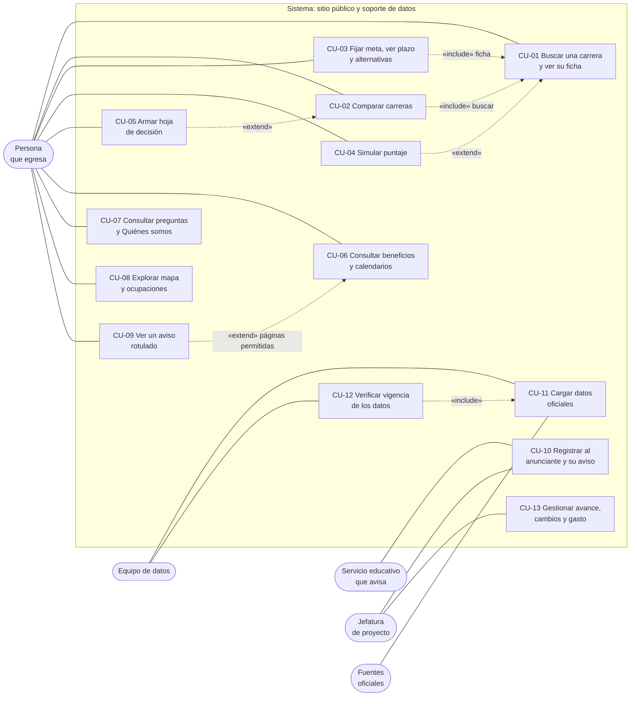

**Tabla 12.14.** Catálogo de casos de uso y requerimientos que cubren.

| Código | Caso de uso | Actor principal | Requerimientos | Especificación |
|---|---|---|---|---|
| CU-01 | Buscar una carrera y ver su ficha con sus fuentes | Persona que egresa | RF-01 a RF-18, RL-07, RL-09 | Tabla 12.15 |
| CU-02 | Comparar carreras | Persona que egresa | RF-19 a RF-23 | Tabla 12.16 |
| CU-03 | Fijar meta y ver próximo plazo y alternativas | Persona que egresa | RF-27 a RF-35 | Tabla 12.17 |
| CU-04 | Simular el puntaje ponderado | Persona que egresa | RF-25, RF-26 | Resumida |
| CU-05 | Armar e imprimir la hoja de decisión | Persona que egresa | RF-24 | Resumida |
| CU-06 | Consultar beneficios, plazos y calendario de admisión | Persona que egresa | RF-36 a RF-38, RF-41, RL-11 | Resumida |
| CU-07 | Consultar preguntas frecuentes, glosario y «Quiénes somos» | Persona que egresa | RF-39, RF-40, RL-02 | Resumida |
| CU-08 | Explorar el mapa de carreras y las ocupaciones | Persona que egresa | RF-42 | Resumida |
| CU-09 | Ver un aviso rotulado | Persona que egresa | RF-43 a RF-49, RL-03, RL-05 | Resumida |
| CU-10 | Registrar al anunciante y su aviso | Jefatura de proyecto | RF-50, RL-04 | Resumida |
| CU-11 | Cargar datos oficiales | Equipo de datos | RF-51 a RF-53, RL-08, RL-10 | Resumida |
| CU-12 | Verificar la vigencia de los datos | Equipo de datos | RF-54 | Resumida |
| CU-13 | Gestionar avance, cambios y gasto | Jefatura de proyecto | RF-55 a RF-58 | Resumida |

Los casos CU-04 a CU-13 siguen el mismo patrón que los tres especificados: un flujo principal, la excepción de fuente sin valor y la excepción de base de datos no disponible.

#### 12.8.3 Especificaciones de los tres casos principales

Corresponden a las tareas T1 a T4 de la medición (P-I Anexo 3.A), por lo que son el camino mínimo del sistema.

**Tabla 12.15.** Especificación de CU-01.

| Campo | Contenido |
|---|---|
| Código y nombre | CU-01 Buscar una carrera y ver su ficha con sus fuentes |
| Actor principal | Persona que egresa |
| Otros actores | Base de datos (sistema); fuentes oficiales, que solo aportan los datos |
| Requerimientos que cubre | RF-01 a RF-18, RL-07, RL-09, RNF-01, RNF-02 |
| Precondición | Ninguna: no hay cuenta ni sesión |
| Postcondición | La persona ve la ficha de una carrera con cada dato acompañado de su fuente, enlace, período, fecha de consulta y qué mide. El sistema no guarda ningún dato de la persona |
| Flujo principal | 1. La persona abre el explorador de carreras.<br>2. El sistema muestra el buscador y los filtros.<br>3. La persona escribe el nombre de una carrera, una institución, una sede o una comuna.<br>4. El sistema normaliza el texto (sin tildes ni mayúsculas), consulta la base de datos y muestra hasta 25 resultados por página, con el total encontrado.<br>5. La persona aplica, si quiere, filtros de región, tipo de institución y jornada.<br>6. El sistema actualiza los resultados.<br>7. La persona elige una carrera.<br>8. El sistema verifica que la dirección corresponde a una carrera real, consulta sus datos y abre la ficha con las tarjetas que tienen dato primero.<br>9. El sistema muestra en cada tarjeta el valor, qué mide, el período, la fuente con su enlace y la fecha de consulta, y las comparaciones de empleabilidad rotuladas como elaboración propia.<br>10. La persona lee la fuente y la fecha de un dato (T1) e identifica sus cuatro datos centrales (T2) |
| Flujos alternativos | 3a. La persona no escribe texto y usa solo los filtros: el sistema lista las carreras en orden alfabético.<br>5a. La persona quita un filtro con su enlace «Quitar»: el sistema recalcula la lista.<br>8a. La carrera no tiene código DEMRE: el sistema explica que se postula directo en la institución y por eso no tiene ponderaciones ni puntaje de corte.<br>9a. La fuente no publica un valor: la tarjeta dice «Sin datos suficientes» y el motivo.<br>9b. Dos ofertas se ven idénticas: el sistema agrega la versión del plan de estudios en cada una.<br>10a. La persona quiere revisar todas las fuentes: las encuentra juntas, sin repetir, en «¿De dónde salen estos datos?» |
| Flujos de excepción | 4a. No hay resultados: el sistema dice que no encontró carreras con ese texto y sugiere otra palabra o quitar filtros.<br>4b. La base de datos no responde: el sistema muestra un mensaje de error («No pudimos cargar las carreras en este momento») y no muestra datos inventados.<br>4c. La persona pide una página más allá del último resultado: el sistema muestra la página vacía con el total correcto, sin error.<br>8b. La dirección de la ficha no corresponde a una carrera: el sistema responde que la página no existe.<br>8c. La base de datos falla al abrir la ficha: no se muestra ningún dato inventado. `[COMPLETAR: comportamiento exacto verificado en el capítulo 13 junto con CP-01]` |
| Frecuencia estimada | 10 veces en la medición (una por persona en T1). En operación pública no hay estimación: el sitio no tiene analítica de uso; si se agrega, deberá cumplir RNF-13 y RL-01 |

**Tabla 12.16.** Especificación de CU-02.

| Campo | Contenido |
|---|---|
| Código y nombre | CU-02 Comparar carreras |
| Actor principal | Persona que egresa |
| Otros actores | Base de datos (sistema) |
| Requerimientos que cubre | RF-19 a RF-23, RNF-01 |
| Precondición | Ninguna. Puede venir desde la ficha de una carrera |
| Postcondición | La persona ve hasta tres carreras lado a lado, cada dato con su fuente y fecha, con una advertencia si los períodos no coinciden. La dirección de la página guarda solo los códigos de las carreras elegidas |
| Flujo principal | 1. La persona abre el comparador, desde el menú o desde «Comparar con otra carrera» en una ficha.<br>2. El sistema muestra las carreras ya elegidas y un buscador con filtros.<br>3. La persona busca una carrera y elige «Agregar».<br>4. El sistema agrega el código a la dirección de la página y recarga.<br>5. La persona repite los pasos 3 y 4 hasta tener dos o tres carreras.<br>6. El sistema muestra los datos en columnas, con los mismos indicadores en las mismas filas, agrupados en cuatro secciones, y en el teléfono un bloque por carrera. Cada dato lleva valor, unidad, qué mide, período, fuente y fecha, en el orden en que la persona eligió las carreras.<br>7. La persona identifica cuál de las carreras tiene mayor empleabilidad (T3) |
| Flujos alternativos | 3a. La persona llega con carreras ya elegidas desde la ficha o el explorador: se salta el paso 3.<br>6a. Los períodos de un mismo indicador no son iguales: el sistema muestra «Los períodos no son iguales. Revísalos antes de comparar».<br>6b. Dos carreras tienen igual nombre, institución, sede y jornada: el sistema muestra la versión del plan de cada una.<br>6c. La persona quita una carrera con «Quitar carrera»: el sistema recalcula la tabla.<br>7a. La persona usa «Usar estas carreras en mi hoja» o fija una como meta (CU-05 y CU-03) |
| Flujos de excepción | 3b. Ya hay tres carreras elegidas: el sistema oculta el buscador y dice «Ya elegiste tres carreras. Quita una para agregar otra».<br>4a. La dirección trae un código que no existe, un código repetido o más de tres códigos: el sistema los ignora, sin error.<br>6d. Una carrera no tiene valor para un indicador: la celda dice «Sin datos suficientes» con su motivo y no se compara contra cero.<br>6e. La base de datos no responde: el sistema muestra un mensaje de error y no muestra datos |
| Frecuencia estimada | 10 veces en la medición (una por persona en T3) |

**Tabla 12.17.** Especificación de CU-03.

| Campo | Contenido |
|---|---|
| Código y nombre | CU-03 Fijar meta y ver el próximo plazo y las alternativas |
| Actor principal | Persona que egresa |
| Otros actores | Almacenamiento local del navegador; base de datos (solo para buscar candidatas a alternativa) |
| Requerimientos que cubre | RF-27 a RF-35, RL-01, RNF-13 |
| Precondición | La persona está en la ficha de una carrera. No necesita cuenta |
| Postcondición | La carrera queda primera de una lista guardada solo en el dispositivo. En «Mi meta» la persona ve su próximo plazo y alternativas. Al servidor solo viajaron el área y la región de la meta |
| Flujo principal | 1. En la ficha, la persona elige «Fijar como mi meta».<br>2. El sistema guarda en el dispositivo una copia mínima de la carrera (código, nombre, institución, sede, región, ruta, área y puntaje de corte), la pone primera y confirma «fijaste tu meta».<br>3. La persona abre «Mi meta y mis preferencias».<br>4. El sistema lee la lista local y muestra la meta y hasta dos preferencias.<br>5. El sistema calcula el próximo plazo con el calendario de admisión 2027 y la fecha de hoy en Chile, y muestra los hitos en curso o los más próximos con su fuente y fecha.<br>6. El sistema pide al servidor las candidatas a alternativa enviando solo el área y la región de la meta.<br>7. En el dispositivo, el sistema compara el puntaje de corte de la meta con el de las candidatas y muestra las alternativas de la más cercana a la más lejana; aparte, las carreras que no piden puntaje centralizado, una por institución.<br>8. La persona identifica su próximo plazo y una alternativa (T4) |
| Flujos alternativos | 1a. La persona elige «Agregar a mis preferencias»: la carrera se guarda al final de la lista.<br>1b. La carrera ya es la meta: el botón dice «Esta es tu meta» y no hace nada.<br>4a. La persona usa «Subir», «Bajar» o «Quitar»: el sistema reordena, anuncia el cambio a los lectores de pantalla y, si una preferencia sube al primer lugar, pasa a ser la meta.<br>5a. La meta se postula directo en la institución: el sistema dice que los plazos los publica la institución y no muestra ninguna fecha.<br>5b. Ya pasaron todos los hitos con fecha: el sistema lo dice.<br>8a. La persona elige «Borrar mis datos de este dispositivo»: el sistema borra la lista de inmediato y lo confirma |
| Flujos de excepción | 1c. Ya hay tres elementos y la persona intenta agregar otra preferencia: el sistema dice «ya tienes tres preferencias» y no agrega.<br>1d. Ya hay tres elementos y la persona fija una meta nueva: la última preferencia sale de la lista y el sistema se lo informa.<br>2a. El navegador bloquea el almacenamiento: el sistema avisa que la lista dura solo mientras la página siga abierta.<br>4b. Lo guardado está dañado o fue modificado (texto ilegible o una ruta que no es de una ficha del sitio): el sistema descarta lo inválido, muestra lo válido y no se rompe.<br>6a. La búsqueda de alternativas falla: el sistema dice que puede ser un problema pasajero y que la meta sigue guardada.<br>6b. La meta no tiene área del SIES: el sistema dice que no puede sugerir carreras cercanas.<br>7a. Ninguna carrera cumple el criterio: el sistema lo dice y no muestra otras |
| Frecuencia estimada | 10 veces en la medición (una por persona en T4) |

### 12.9 Metodología de desarrollo

La metodología se decide después de levantar y sistematizar los requerimientos, porque depende de qué tan estables sean y de quién puede revisar el producto (Sommerville, 2016; Pressman y Maxim, 2021).

**Tabla 12.18.** Justificación de la metodología con las preguntas de decisión.

| Pregunta | Respuesta en este proyecto | Apunta hacia |
|---|---|---|
| ¿Los requerimientos están claros y estables? | En parte. El problema, los objetivos y las cuatro tareas centrales quedaron fijos desde la Parte I. El contenido de los datos se fue descubriendo al cargarlos: versiones del plan de estudios, sedes y jornadas de una misma carrera, carreras sin código DEMRE, períodos distintos de un mismo dato. Además, el alcance del producto cambió tres veces en noviembre: hacia la persona que egresa (11 de nov.), hacia una agencia independiente (13 de nov.) y hacia un espacio publicitario regulado (25 de nov.), tres decisiones registradas en el repositorio | Iterativa o ágil |
| ¿El usuario está disponible para revisar con frecuencia? | No. Las personas de 18 años o más participan solo en la medición (30 de nov. al 4 de dic.); el docente tutor, en los hitos de reporte; los organismos fuente no participan | Iterativa, con hitos |
| ¿El equipo trabaja de forma continua o por bloques? | Por bloques. Son tres integrantes con dedicación parcial. Entre el 2 y el 25 de noviembre hubo días con 1 commit y otros con 55 (elaboración propia con el historial del repositorio) | Kanban |
| ¿Hay fechas fijas comprometidas? | Sí: congelamiento de funciones el 27 de nov., medición del 30 de nov. al 4 de dic., correcciones del 7 al 17 de dic. y entrega el 19 de dic. de 2026 | Iterativa alineada a los hitos |
| ¿Qué tan grande es el equipo? | Tres personas: jefatura y arquitectura, datos oficiales y calidad de datos, experiencia de uso y medición | Marcos livianos |
| **Metodología elegida** | **Desarrollo iterativo e incremental, con Kanban como marco de flujo y revisión de cambios por pull request** | |

**Por qué no las otras.** Una metodología predictiva (cascada) exige requerimientos estables, y aquí el alcance cambió tres veces en el tercer mes. Scrum exige ceremonias regulares y una persona responsable del producto disponible; con tres integrantes por bloques y sin usuario disponible, sus ceremonias completas serían desproporcionadas. Kanban muestra el trabajo en un tablero y limita el trabajo en curso (Anderson, 2010). De Programación Extrema (XP) se adopta una práctica técnica: integración continua con pruebas automáticas en cada cambio. No se declara que se haya trabajado en pares ni con pruebas antes del código.

**Adaptaciones declaradas.**

1. **Iteraciones de una semana (S1 a S4)**, alineadas con la carta Gantt de la Parte I (Tabla 3.7). Cada una cierra con un incremento utilizable en el sitio desplegado. No hay sprints formales, backlog con puntos ni retrospectivas registradas.
2. **Tablero Kanban** con cuatro columnas: por hacer, en curso, en revisión y hecha (P-I 3.6). `[COMPLETAR: límite de trabajo en curso que se usó y captura del tablero con fechas; los trae Rafael Jaque]`.
3. **Flujo de cambios real**: rama por tarea, pull request, revisión con pauta escrita, confirmación del jefe de proyecto y fusión a la rama principal en un solo commit. Una reunión semanal del equipo y mensajes con encargo escrito.
4. **Despliegue automático** tras cada fusión, que se comprobó el 5 de noviembre: el sitio pasó a servir los cambios en unos dos minutos.
5. **Inteligencia artificial como apoyo declarado** (Claude y Codex). Cada pull request declara qué herramienta se usó y para qué, y quien lo sube responde por el código.

**Evidencia que deja la metodología.** Es verificable en el repositorio, sin documentos aparte.

**Tabla 12.19.** Evidencia de la forma de trabajo al 25 de noviembre de 2026 (elaboración propia con el repositorio).

| Evidencia | Valor | Dónde verla |
|---|---|---|
| Commits en la rama principal | 308, del 2 al 25 de noviembre | Historial del repositorio |
| Pull requests fusionados | 301, entre el 3 y el 25 de noviembre | Pestaña de pull requests |
| Integrantes que proponen cambios | Tres, cada uno con su rama y su copia del repositorio | Ramas remotas por integrante |
| Plantilla de pull request | Pregunta qué cambia, por qué, qué datos y fuentes, si hay datos personales, qué IA se usó y una lista de verificación de nueve puntos | Archivo de la plantilla |
| Aprobación obligatoria | Todo cambio requiere la aprobación de la jefatura (la de sus propios cambios no tiene un segundo revisor humano: riesgo R6); las zonas críticas (base de datos, cálculos, seguridad, diseño) están declaradas | Archivo de propietarios del código y reglas de la rama |
| Verificaciones automáticas | 7 trabajos en cada pull request (la detección de cambios y 6 verificaciones): compilación y lint, contraste de colores, reglas de seguridad de la base, pruebas de TypeScript, pruebas de los scripts de datos y accesibilidad | Flujo de trabajo de GitHub Actions |
| Registro de migraciones aplicadas | Fecha, quién y verificación de cada migración | Documento de la base de datos del repositorio |
| Tablero Kanban y reuniones semanales | `[COMPLETAR: captura del tablero y registro de reuniones; los trae Rafael Jaque]` | — |

**Tabla 12.20.** Iteraciones e incrementos.

| Iteración | Incremento utilizable | Evidencia en el repositorio |
|---|---|---|
| S1 (3 al 9 de nov.) | Esquema de base de datos con seguridad por filas y sus pruebas; carga de los primeros datos oficiales; despliegue en Cloudflare con despliegue automático; tipografías propias; explorador de carreras enlazado desde la portada | Migraciones del 3 al 5 de nov.; PR 28 y 38 |
| S2 (10 al 16 de nov.) | Explorador con filtros, ficha de carrera con indicadores y su fuente, identidad visual, cabecera con el recorrido, simulador de puntaje, ocupaciones y guía del FUAS | PR 104, 151 y 157, entre otros |
| S3 (17 al 23 de nov.) | Ponderaciones del DEMRE en la ficha, preguntas frecuentes y glosario, comparador con filas agrupadas, buscador por carrera, institución o comuna, «Quiénes somos», meta con alternativas cercanas y calendario de admisión 2027 | PR 245, 249, 263, 288, 298, 302 y 304 |
| S4 (24 al 30 de nov.) | Correcciones: versión del plan en ofertas gemelas, menor consumo de la base de datos al compilar, calendarios de beneficios con la fuente en una línea por hito; congelamiento de funciones el 27 y preparación de la medición | PR 319, 326 y 335 |

### 12.10 Arquitectura del sistema y justificación del stack

#### 12.10.1 Estilo arquitectónico

El sistema es una **aplicación web cliente-servidor en tres capas**, más un **proceso de carga de datos aparte**, y con **el estado de la persona en su propio dispositivo**:

- **Presentación:** páginas de Next.js que se ejecutan en el servidor (Cloudflare Workers) y en el navegador.
- **Lógica:** funciones de TypeScript sin dependencia de la red (cálculos, criterio de alternativas, manejo de la lista de meta), que se prueban solas y corren en el servidor o en el dispositivo.
- **Datos:** PostgreSQL en Supabase, con seguridad por filas, de lectura pública para los datos oficiales.
- **Carga de datos:** scripts de Python y Node que el equipo corre fuera del sitio. Descargan archivos oficiales, los validan y los escriben en lotes SQL, con las credenciales de administración de la base, que el equipo guarda fuera del repositorio.

Se eligió este estilo por tres razones que salen de los requerimientos: la lógica debe poder probarse sin red (RNF-16), la regla de acceso debe vivir en la base y no en la interfaz (RNF-10) y lo que la persona guarda no debe viajar al servidor (RF-30).

**Figura 12.3.** Componentes del sistema y cómo se comunican.

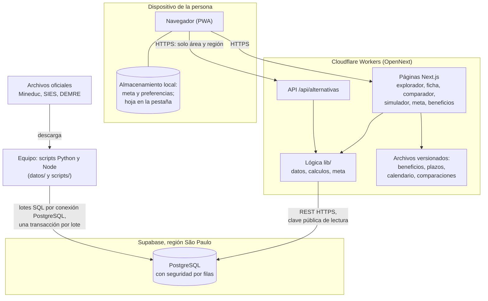

**Tabla 12.21.** Componentes, responsabilidad y comunicación.

| Componente | Responsabilidad | Se comunica con | Carpeta del repositorio |
|---|---|---|---|
| Navegador y almacenamiento local | Mostrar el sitio; guardar la meta y las preferencias (`localStorage`) y la hoja de decisión (`sessionStorage`) | Páginas y API, por HTTPS | — |
| Páginas | Armar cada pantalla con los datos y las reglas de lib | Lógica y base de datos | `app/` |
| API de alternativas | Devolver las candidatas de un área y una región; valida los parámetros y no los registra | Lógica y base de datos | `app/api/alternativas/` |
| Lógica | Buscar y normalizar texto, costo del primer año, comparaciones, puntaje ponderado, alternativas cercanas, lista de meta | — (funciones puras) | `lib/` |
| Archivos versionados | Beneficios, plazos, calendario de admisión, preguntas, glosario y comparaciones de empleabilidad, cada uno con fuente y fecha | Páginas | `datos/` y `lib/datos/` |
| Base de datos | Guardar los datos oficiales con su fuente; imponer quién lee qué | Páginas (lectura) y scripts (escritura) | `supabase/` |
| Carga de datos | Descargar, limpiar, validar y escribir los datos oficiales; generar los archivos derivados | Archivos oficiales y base de datos | `datos/`, `scripts/` |
| Integración continua | Compilar, revisar estilo, contraste, accesibilidad y seguridad de la base en cada pull request | Repositorio | `.github/workflows/` |

**Decisiones de arquitectura relevantes.** Cada una responde a un requerimiento.

1. **La meta y las preferencias viven en el dispositivo.** Alternativa descartada: guardarlas en una tabla de la base asociada a una cuenta. Razón: RF-30 y RL-01 (la cuenta es Won't).
2. **Las alternativas se comparan en el dispositivo.** El servidor solo recibe el área y la región. Alternativa descartada: enviar la carrera y su puntaje de corte para que el servidor compare. Razón: RF-34.
3. **Las páginas con datos de carreras consultan la base en cada visita**, con una caché en memoria por proceso. Alternativa descartada por ahora: páginas pre-generadas con caché. Costo: el consumo de la base creció hasta superar el límite del plan gratuito (riesgo R3). La corrección fue reducir consultas; pasar a páginas con caché queda para antes de la admisión de enero.
4. **Beneficios, plazos, calendario, preguntas y glosario se leen de archivos versionados**, sin consultar la base. Alternativa descartada: guardarlos en las tablas de beneficios y plazos que existen en la base. Razón: son pocos datos, cada cambio pasa por revisión con su fecha de vigencia y ninguna visita a esas páginas consume la base (RNF-09, RNF-17).
5. **Las comparaciones de empleabilidad se calculan antes, en la carga de datos**, y se guardan en un archivo. Alternativa descartada: calcularlas en cada visita. Razón: RNF-06 y RNF-09, y poder rotular la cifra como elaboración propia con su método (RF-15).
6. **La oferta completa no se incluye en el código del sitio.** Alternativa descartada: importarla como archivo. Razón: pesa decenas de MB y no cabe en el Worker.

#### 12.10.2 Justificación del stack

El stack se justifica contra criterios (Tabla 12.22): requerimientos no funcionales, competencias del equipo, costo, sostenibilidad y transferencia, y madurez y soporte.

**Tabla 12.22.** Justificación del stack.

| Componente | Tecnología elegida | Alternativa descartada | Criterio que decidió |
|---|---|---|---|
| Interfaz | Next.js 16 con React 19 y TypeScript 6, instalable como PWA | Aplicaciones nativas para dos sistemas operativos (alternativa B de P-I 1.3) | Costo y plazo (siete semanas); sin descarga obligatoria; competencias del equipo en desarrollo web (RNF-01, RNF-06) |
| Estilos y tipografía | CSS con variables generadas desde un único archivo de diseño (colores, espacios) y tipografías Atkinson Hyperlegible alojadas en el proyecto | Tipografías cargadas desde Google Fonts | Privacidad y peso: ninguna solicitud a terceros (RNF-07) y 51.236 bytes de fuentes; accesibilidad (RNF-04) |
| Lógica de negocio | Funciones puras de TypeScript en `lib/`, ejecutables en servidor y en dispositivo | Lógica en funciones de la base de datos o en un servicio aparte | Probarla sin red (RNF-16); que la meta no viaje (RF-30); portabilidad (RNF-15) |
| Base de datos | Supabase (PostgreSQL) en la región São Paulo, con seguridad por filas | Una base por institución; filtrar por institución en el código de la página | El aislamiento lo impone la base y no el código (RNF-10); costo; región cercana a Chile |
| Procesamiento de datos | Python con biblioteca estándar y un cargador en Node | Extraer datos leyendo páginas web de los organismos | Datos abiertos descargables y términos de uso (RL-07 a RL-10); verificabilidad (RF-51) |
| Alojamiento | Cloudflare Workers con el adaptador OpenNext | Vercel gratuito (restringido a uso no comercial) y Netlify gratuito (tope duro que pausa la cuenta) | Permite uso comercial, costo cero hoy y red en Sudamérica; riesgo declarado: 10 ms de CPU por solicitud en el plan gratuito |
| Integración y despliegue | GitHub Actions y despliegue automático desde la rama principal | Despliegue manual con la línea de comandos | Trazabilidad de cada versión (K2) y menos error humano; el flujo se salta cuando solo cambia documentación para ahorrar minutos |
| Pruebas | `node:test` para TypeScript, `unittest` para Python, Playwright con axe-core, pruebas SQL de la seguridad por filas | Solo pruebas manuales | RNF-02, RNF-10 y RNF-16; casi sin dependencias nuevas |
| Servicios de terceros | Supabase, Cloudflare y GitHub. El valor de la UF se escribe a mano con su fecha | Descargar la UF con un script | Los términos de reutilización del SII no se han revisado: no se automatiza |
| Asistente (diseñado) | Gemini en nivel pagado, solo a través de una interfaz propia | Planes gratuitos que usan el contenido para entrenar | Privacidad. Cambiar de proveedor es cambiar un archivo |

**Qué puede mantener quien reciba el sistema.** Todo el stack usa tecnologías de uso general (TypeScript, PostgreSQL, Python) con licencias compatibles con un producto comercial (P-I 4.3). El proveedor de alojamiento y el de la base de datos son intercambiables porque el acceso a la base pasa por una sola capa de consultas y la lógica no depende de ellos. Es lo que hace viable la transferencia a la sociedad en 2027.

### 12.11 Diagrama de clases

El diagrama representa la estructura estática del sistema, con la notación de UML 2.5.1 (Object Management Group, 2017): las clases que salen de los sustantivos de los casos de uso (carrera, indicador, fuente, plazo, meta, aviso) y sus operaciones, de los verbos de los flujos (buscar, comparar, fijar, calcular). Los atributos se escriben `nombre: tipo`; `+` es público y `-` es privado. Las clases con estereotipo `«dispositivo»`, `«derivada»` y `«propuesta»` no tienen tabla propia en la base: la Tabla 12.23 dice dónde vive cada una.

**Figura 12.4.** Diagrama de clases.

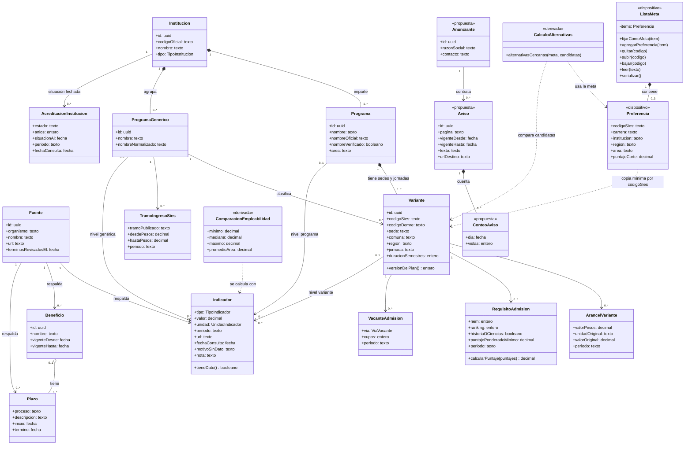

Toda clase de datos oficiales apunta a su `Fuente` (el diagrama muestra las flechas de `Indicador`, `Beneficio` y `Plazo`; las demás tablas traen el mismo vínculo, ver diccionario). Cada `Indicador` pertenece a exactamente uno de tres niveles: variante, programa o carrera genérica (regla del esquema). `Programa` y `ProgramaGenerico` se relacionan de muchos a muchos y `Variante` es la clase que lo resuelve (12.12).

**Tabla 12.23.** Coherencia entre las clases y el modelo de datos: dónde vive cada clase.

| Clase | Tabla o almacén | Observación |
|---|---|---|
| Fuente | `fuente` | |
| Institucion | `institucion` | |
| AcreditacionInstitucion | `acreditacion_institucion` | Situación fechada |
| ProgramaGenerico | `programa_generico` | |
| Programa | `programa` | Carrera más institución |
| Variante | `programa_variante` | Sede y jornada; resuelve la relación N:M. `versionDelPlan()` lee el final del código SIES, sin tabla |
| Indicador | `indicador` | |
| ArancelVariante | `arancel_variante` | |
| TramoIngresoSies | `tramo_ingreso_sies` | |
| RequisitoAdmision | `requisito_admision` | `calcularPuntaje()` es la lógica de `lib/calculos/2027/` |
| VacanteAdmision | `vacante_admision` | |
| Beneficio y Plazo | `beneficio` y `plazo` en la base; el sitio lee los mismos datos de archivos versionados | Dos fuentes que deben coincidir. `[COMPLETAR: confirmar con Cristóbal Rojas que la base y los archivos tienen el mismo contenido o decidir cuál es la fuente única]` |
| ListaMeta y Preferencia | Almacenamiento local del navegador, clave `agencia:preferencias:v1` | No existe en el servidor (RF-30) |
| CalculoAlternativas | Sin datos propios | Función pura de `lib/calculos/alternativas.ts` |
| ComparacionEmpleabilidad | Archivo generado en la carga de datos | Elaboración propia; no es una tabla |
| Aviso, Anunciante y ConteoAviso | Tablas propuestas `aviso`, `anunciante` y `conteo_aviso`, sin migración | Ver Tabla 12.27 |

### 12.12 Modelo entidad-relación y diccionario de datos

El modelo físico sale de las 14 migraciones de la carpeta `supabase/migrations/` (al 25 de noviembre de 2026: 25 tablas y una vista, 14 + 1 + 6 + 3 + 1 por migración; elaboración propia). Se presenta en dos diagramas para que se lean impresos: los **datos públicos oficiales**, que usa el sitio, y los **datos de soporte**, que son del equipo o están reservados para la cuenta de 2027.

**Figura 12.5.** MER de los datos públicos oficiales (atributos clave; el detalle está en la Tabla 12.25).

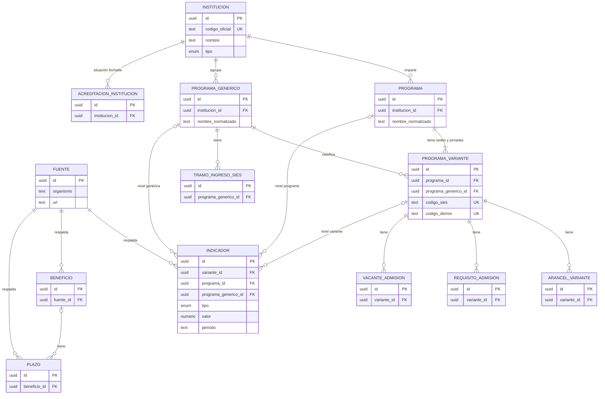

**Figura 12.6.** MER de los datos de soporte (equipo y cuenta de 2027). Las tablas marcadas «sin uso» siguen en la base, con sus políticas y pruebas, y se retiran en una migración que aún no existe.

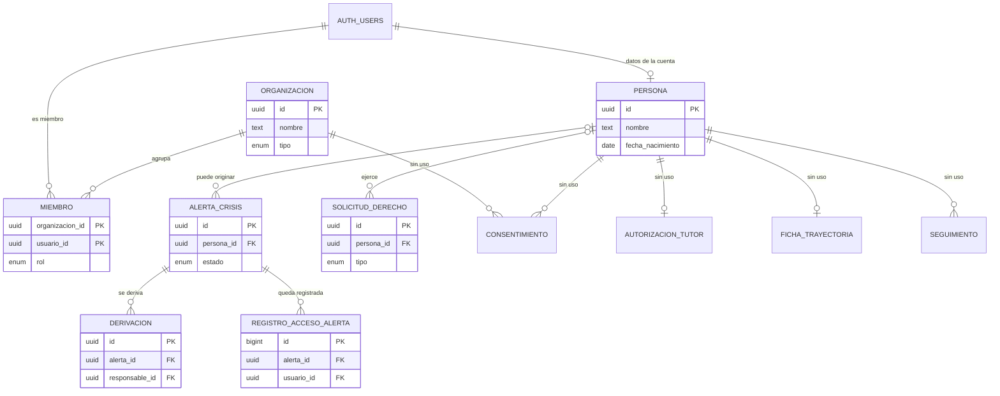

**Relaciones N:M y su resolución.**

- **Carrera (Programa) y carrera genérica del SIES.** Un título de una institución puede aparecer en más de una carrera genérica, y una genérica agrupa varios títulos. La tabla `programa_variante` lo resuelve: cada fila es una sede y jornada con su código SIES y guarda las dos claves foráneas (`programa_id` y `programa_generico_id`, ambas obligatorias).
- **Usuarios y organizaciones.** Un integrante del equipo puede pertenecer a varias organizaciones y una organización tiene varios integrantes. La tabla `miembro` lo resuelve, con la clave compuesta (`organizacion_id`, `usuario_id`) y el rol.
- **Persona y carreras de su meta** (2027, con cuenta). Una persona guarda hasta tres carreras y una carrera la guardan muchas personas. Hoy la lista vive en el dispositivo; con la cuenta se resolvería con una tabla intermedia `preferencia` (persona, variante, posición), que no se construye en la versión 1.
- **Nivel de un indicador.** No es una N:M: cada indicador pertenece a exactamente uno de tres niveles (carrera genérica, programa o variante). La base lo exige con una restricción de nivel válido y por eso las tres claves foráneas de `indicador` aceptan nulos.

**Normalización.** Los datos públicos llegan a **tercera forma normal** con las seis excepciones de la Tabla 12.24, todas declaradas y justificadas (Codd, 1970).

**Tabla 12.24.** Normalización y desnormalizaciones declaradas.

| Forma normal | Cumplimiento | Excepciones declaradas y por qué |
|---|---|---|
| 1FN: valores atómicos | Sí, en las tablas de datos oficiales | `alerta_crisis.senales` guarda una lista de señales (`suicidio` y `autolesion`) en una sola columna, para espejar el código del protocolo de crisis sin una tabla intermedia. Si la lista de señales crece, se pasa a tabla. La tabla `ficha_trayectoria` (sin uso) guarda tres listas en formato JSON |
| 2FN: sin dependencias parciales | Sí. Las tablas usan una clave artificial (`uuid`); la única clave compuesta es la de `miembro`, y sus atributos dependen de toda la clave | — |
| 3FN: sin dependencias transitivas | Sí, salvo lo siguiente | (a) `url`, `periodo` y `fecha_consulta` se repiten en cada fila de dato, además de `fuente_id`: cada cifra puede venir de un archivo distinto y la regla del proyecto exige el enlace exacto y la fecha por cifra. (b) `programa.nombre`, `nombre_normalizado` y `nombre_oficial`: se guarda el texto publicado, el que se muestra y el que se usa para buscar. (c) `arancel_variante.valor_pesos` se deriva de `valor_original` y `uf_valor`: se guardan ambos para conservar lo publicado y lo calculado. (d) `institucion.anios_acreditacion`, `acreditada_hasta` y `fuente_acreditacion_id` duplican la tabla fechada `acreditacion_institucion`, que es la que lee el sitio: son campos heredados del esquema base y pendientes de retiro. (e) `region` y `comuna` se repiten en cada variante, porque el código SIES ya identifica institución, sede, carrera y jornada y una tabla de sedes duplicaría esa clave (supuesto del equipo). (f) La vista `variante_busqueda` agrega texto normalizado para el buscador: es una vista, no guarda datos nuevos |

#### Diccionario de datos

Las cinco columnas de trazabilidad se repiten en las tablas de datos oficiales y se describen una sola vez.

**Tabla 12.25a.** Campos comunes de trazabilidad (en `indicador`, `arancel_variante`, `tramo_ingreso_sies`, `requisito_admision`, `vacante_admision`, `acreditacion_institucion`; `beneficio` y `plazo` traen los suyos).

| Campo | Tipo | Nulo | Clave | Descripción | Valores permitidos | ¿Dato personal? |
|---|---|---|---|---|---|---|
| `periodo` | texto | No | — | Período que dice la fuente, copiado tal cual (por ejemplo «titulados 2021 a 2023») | Texto libre | No |
| `fuente_id` | uuid | No | FK | Organismo y archivo de origen | Referencia a `fuente.id` | No |
| `url` | texto | No | — | Enlace exacto al archivo o página | URL | No |
| `fecha_consulta` | fecha | No | — | Día en que se consultó la fuente | Fecha | No |
| `motivo_sin_dato` | texto | Sí | — | Por qué no hay valor; nulo si hay valor | Obligatorio si el valor es nulo, y prohibido si hay valor | No |

**Tabla 12.25.** Diccionario de datos: tablas públicas oficiales (solo los campos propios de cada tabla).

| Tabla | Campo | Tipo | Nulo | Clave | Descripción | Valores permitidos | ¿Dato personal? |
|---|---|---|---|---|---|---|---|
| `fuente` | `id` | uuid | No | PK | Identificador de la fuente | Generado | No |
| `fuente` | `organismo` | texto | No | UK con `nombre` | Organismo que publica | Texto | No |
| `fuente` | `nombre` | texto | No | UK con `organismo` | Nombre del archivo o servicio | Texto | No |
| `fuente` | `url` | texto | No | — | Dirección de la fuente | URL | No |
| `fuente` | `terminos_de_uso` | texto | Sí | — | Resumen de las condiciones de reutilización | Texto | No |
| `fuente` | `terminos_revisados_el` | fecha | Sí | — | Día en que el equipo revisó los términos | Fecha | No |
| `fuente` | `creada_el` | fecha y hora | No | — | Registro de la fila | Automático | No |
| `institucion` | `id` | uuid | No | PK | Identificador | Generado | No |
| `institucion` | `codigo_oficial` | texto | No | UK | Código oficial; texto para conservar ceros | Texto | No |
| `institucion` | `nombre` | texto | No | — | Nombre oficial | Texto | No |
| `institucion` | `tipo` | enumeración | No | — | Tipo de institución | `universidad`, `instituto_profesional`, `centro_formacion_tecnica` | No |
| `institucion` | `anios_acreditacion`, `acreditada_hasta`, `fuente_acreditacion_id` | entero, fecha, uuid | Sí | FK (la tercera) | Campos heredados; el sitio lee `acreditacion_institucion` | 0 a 7 años | No |
| `acreditacion_institucion` | `institucion_id` | uuid | No | FK | Institución | Referencia a `institucion.id` | No |
| `acreditacion_institucion` | `estado` | texto | No | — | Situación de acreditación | `acreditada`, `no_acreditada`, `bajo_tutela` | No |
| `acreditacion_institucion` | `anios`, `desde`, `hasta` | entero, fechas | Sí | — | Años y vigencia; los años son obligatorios solo si está acreditada | 1 a 7 años | No |
| `acreditacion_institucion` | `situacion_al` | fecha | No | UK con `institucion_id` | Fecha de la situación informada: es una foto, no una promesa de vigencia | Fecha | No |
| `programa_generico` | `id` | uuid | No | PK | Carrera genérica del SIES dentro de una institución | Generado | No |
| `programa_generico` | `institucion_id` | uuid | No | FK | Institución | Referencia a `institucion.id` | No |
| `programa_generico` | `nombre`, `nombre_normalizado` | texto | No | UK (institución y nombre normalizado) | Nombre y su forma normalizada | Texto | No |
| `programa` | `id` | uuid | No | PK | Carrera en una institución (título) | Generado | No |
| `programa` | `institucion_id` | uuid | No | FK | Institución | Referencia a `institucion.id` | No |
| `programa` | `nombre`, `nombre_oficial` | texto | No | — | Nombre que ve la persona y nombre publicado por Mineduc | Texto | No |
| `programa` | `nombre_normalizado` | texto | No | UK con `institucion_id` | Para buscar y para identificar el título | Texto | No |
| `programa` | `nombre_verificado`, `nombre_fuente_id`, `nombre_verificado_el` | booleano, uuid, fecha | No, Sí, Sí | FK (el segundo) | Una corrección de ortografía solo se marca verificada si otra fuente oficial la respalda | Los tres van juntos o los tres vacíos | No |
| `programa` | `area` | texto | Sí | — | Área de conocimiento del SIES | Texto | No |
| `programa_variante` | `id` | uuid | No | PK | Una sede y jornada de una carrera | Generado | No |
| `programa_variante` | `programa_id` | uuid | No | FK | Carrera | Referencia a `programa.id` | No |
| `programa_variante` | `programa_generico_id` | uuid | No | FK | Carrera genérica | Referencia a `programa_generico.id` | No |
| `programa_variante` | `codigo_sies` | texto | No | UK | Código único de carrera, sede, jornada y versión del plan | Texto, termina en la versión | No |
| `programa_variante` | `codigo_demre` | texto | Sí | UK | Código DEMRE; vacío si la carrera no se postula por el sistema centralizado | Texto | No |
| `programa_variante` | `carrera_codigo_mineduc` | texto | Sí | — | Código de carrera de Mineduc | Texto | No |
| `programa_variante` | `sede`, `comuna`, `region`, `jornada` | texto | Sí | — | Ubicación y jornada; nulos si la fuente no los distingue (no se inventan) | Texto | No |
| `programa_variante` | `direccion` | texto | Sí | — | Dirección de la sede (dato institucional) | Texto | No |
| `programa_variante` | `duracion_semestres` | entero | Sí | — | Duración formal | Mayor que 0 | No |
| `indicador` | `id` | uuid | No | PK | Un valor medido | Generado | No |
| `indicador` | `variante_id`, `programa_id`, `programa_generico_id` | uuid | Sí | FK | Nivel al que pertenece la cifra: exactamente uno de los tres niveles | Referencias | No |
| `indicador` | `tipo` | enumeración | No | UK con nivel y período | Qué mide | `empleabilidad_1er_anio`, `empleabilidad_2do_anio`, `ingreso_promedio_4to_anio`, `arancel_anual`, `matricula`, `vacantes`, `puntaje_corte`, `retencion_1er_anio`, `duracion_real_semestres`, `continuidad_estudios`, `matricula_inscripcion` | No |
| `indicador` | `valor` | decimal | Sí | — | Valor; nulo si no hay dato (nunca cero) | No negativo; si es porcentaje, de 0 a 100 | No |
| `indicador` | `unidad` | enumeración | No | — | Unidad del valor | `porcentaje`, `pesos`, `puntos`, `semestres`, `cupos`, `estudiantes` | No |
| `indicador` | `nota` | texto | Sí | — | Algo que la persona debe saber para leer la cifra (por ejemplo, que es de la institución anterior) | Texto | No |
| `arancel_variante` | `variante_id` | uuid | No | FK, UK con período | Variante | Referencia a `programa_variante.id` | No |
| `arancel_variante` | `valor_pesos` | decimal | Sí | — | Arancel anual en pesos | Mayor que 0 | No |
| `arancel_variante` | `unidad_original`, `valor_original`, `uf_valor`, `uf_fecha` | texto, decimales, fecha | Sí | — | Cómo lo publicó la fuente y el valor de la UF usado para convertir | `pesos` o `uf`; UF y fecha solo si está en UF | No |
| `tramo_ingreso_sies` | `programa_generico_id` | uuid | No | FK, UK con período | Carrera genérica | Referencia a `programa_generico.id` | No |
| `tramo_ingreso_sies` | `tramo_publicado`, `desde_pesos`, `hasta_pesos` | texto, decimales | Sí | — | Tramo de ingreso en palabras y sus límites; puede no tener techo | `hasta` mayor que `desde` | No |
| `tramo_ingreso_sies` | `nota` | texto | Sí | — | Nota visible junto al tramo | Texto | No |
| `requisito_admision` | `variante_id` | uuid | No | FK, UK con período | Variante | Referencia a `programa_variante.id` | No |
| `requisito_admision` | `nem`, `ranking`, `competencia_lectora`, `matematica_1`, `matematica_2`, `historia_cs_sociales`, `ciencias`, `prueba_especial`, `asignacion_especial_pedagogia` | entero | Sí | — | Ponderación de cada factor | 0 a 100; deben sumar 100 | No |
| `requisito_admision` | `historia_o_ciencias` | booleano | No | — | Si se cuenta el mejor de los dos puntajes electivos | Verdadero o falso | No |
| `requisito_admision` | `puntaje_ponderado_minimo`, `puntaje_promedio_minimo` | decimal | Sí | — | Mínimos de postulación | 150 a 1.000 | No |
| `requisito_admision` | `pagina_pdf` | entero | Sí | — | Página del PDF oficial de donde sale la fila | Mayor que 0 | No |
| `vacante_admision` | `variante_id`, `via` | uuid, enumeración | No | FK, UK con vía y período | Variante y vía de ingreso | `regular`, `regular_2do_semestre`, `mc`, `bea`, `pace` | No |
| `vacante_admision` | `cupos` | entero | Sí | — | Cupos | Mayor o igual a 0 | No |
| `beneficio` | `id` | uuid | No | PK | Beneficio estudiantil | Generado | No |
| `beneficio` | `nombre`, `explicacion_simple` | texto | No | — | Nombre y explicación en lenguaje claro | Texto | No |
| `beneficio` | `requisitos_simples`, `requisitos_oficiales` | texto | Sí | — | Requisitos en lenguaje claro y texto de la fuente sin reinterpretar | Texto | No |
| `beneficio` | `vigente_desde`, `vigente_hasta` | fechas | No, Sí | — | Vigencia | `hasta` no menor que `desde` | No |
| `plazo` | `id` | uuid | No | PK | Hito de un proceso | Generado | No |
| `plazo` | `beneficio_id` | uuid | Sí | FK | Beneficio al que pertenece; nulo si es un hito de admisión | Referencia a `beneficio.id` | No |
| `plazo` | `proceso`, `descripcion` | texto | No | — | Proceso (por ejemplo, «Admisión 2027») y qué ocurre | Texto | No |
| `plazo` | `inicio`, `termino` | fechas | No | — | Fechas del hito | `termino` no menor que `inicio` | No |

**Tabla 12.26.** Diccionario de datos: tablas de soporte, con la marca de dato personal.

| Tabla | Campo | Tipo | Nulo | Clave | Descripción | Valores permitidos | ¿Dato personal? |
|---|---|---|---|---|---|---|---|
| `organizacion` | `id`, `nombre`, `tipo` | uuid, texto, enumeración | No | PK (`id`) | La agencia y, en el diseño anterior, instituciones clientes | `agencia`, `institucion` | No |
| `miembro` | `organizacion_id`, `usuario_id` | uuid | No | PK compuesta, FK | Integrante del equipo y su organización | Referencias | **Sí**: identifica a un integrante del equipo |
| `miembro` | `rol` | enumeración | No | — | Rol del integrante | `administrador`, `acompanante`, `lector` | No |
| `persona` | `id` | uuid | No | PK, FK a `auth.users` | Cuenta de una persona | Igual al usuario | **Sí** (identificador de cuenta) |
| `persona` | `nombre` | texto | No | — | **Sin uso.** Se pedía en el diseño anterior; la cuenta de 2027 no lo guardará | Texto | **Sí** |
| `persona` | `fecha_nacimiento` | fecha | No | — | **Sin uso.** La cuenta de 2027 no guardará la edad | Fecha | **Sí** |
| `persona` | `region` | texto | Sí | — | Región | Texto | **Sí** |
| `alerta_crisis` | `id`, `estado`, `creada_el` | uuid, enumeración, fecha y hora | No | PK (`id`) | Alerta del protocolo de crisis, sin el texto del mensaje | `pendiente`, `en_revision`, `derivada`, `cerrada` | No |
| `alerta_crisis` | `senales` | lista de enumeración | No | — | Tipo de señal detectada | `suicidio`, `autolesion` | **Sí** (dato sensible) |
| `alerta_crisis` | `persona_id` | uuid | Sí | FK | Persona con sesión, si la había; vacío si no | Referencia a `persona.id` | **Sí** (dato sensible) |
| `alerta_crisis` | `detectada_el`, `revisada_por`, `revisada_el` | fecha y hora, uuid, fecha y hora | No, Sí, Sí | FK (`revisada_por`) | Cuándo se detectó y quién la revisó | Revisor y fecha van juntos | **Sí** (el revisor es del equipo) |
| `derivacion` | `alerta_id` | uuid | No | FK | Alerta de origen | Referencia a `alerta_crisis.id` | **Sí** (sensible) |
| `derivacion` | `tipo`, `estado` | enumeraciones | No | — | Tipo y estado de la derivación | `red_de_apoyo`, `persona_de_confianza`, `urgencia`, `otro`; `abierta`, `cerrada` | No |
| `derivacion` | `responsable_id` | uuid | No | FK | Integrante que la sigue | Referencia a `auth.users` | **Sí** (equipo) |
| `derivacion` | `detalle`, `nota_cierre` | texto | No, Sí | — | Lo mínimo para seguir el caso, sin el relato de la persona | 1 a 1.000 caracteres | **Sí** (sensible) |
| `registro_acceso_alerta` | `id`, `alerta_id`, `usuario_id`, `accion`, `ocurrido_el` | entero, uuid, uuid, texto, fecha y hora | No | PK (`id`), FK | Quién vio o cambió una alerta y cuándo; solo se agrega | `lectura`, `revision`, `derivacion`, `cierre` | **Sí** (equipo) |
| `solicitud_derecho` | `persona_id` | uuid | Sí | FK | Quien ejerce el derecho; vacío si la cuenta se eliminó | Referencia a `persona.id` | **Sí** |
| `solicitud_derecho` | `tipo`, `estado` | enumeraciones | No | — | Derecho ejercido y su estado | `acceso`, `rectificacion`, `supresion`, `oposicion`, `portabilidad`; `recibida`, `en_proceso`, `resuelta`, `rechazada` | No |
| `solicitud_derecho` | `respuesta`, `resuelta_por`, `resuelta_el` | texto, uuid, fecha y hora | Sí | FK | Respuesta del equipo | Hasta 1.000 caracteres | **Sí** |
| Sin uso: `consentimiento`, `autorizacion_tutor`, `ficha_trayectoria`, `seguimiento`, `registro_acceso` | (varios) | — | — | — | Del diseño anterior del panel para instituciones. `autorizacion_tutor` guarda nombre y contacto de un adulto; `seguimiento.contenido` guarda notas sensibles | — | **Sí**: se retiran en una migración que aún no existe. Hoy están vacías |

**Desajuste declarado.** La tabla `persona` exige nombre y fecha de nacimiento, que la cuenta de 2027 no debe guardar (RL-14 y minimización). Antes de abrir cuentas hay que migrarla, retirar las tablas sin uso y ajustar la función que exporta los datos de una persona. Hasta entonces, el sitio no escribe en ellas.

**Tabla 12.27.** Entidades propuestas para el espacio publicitario (sin migración al 26 de noviembre).

| Tabla propuesta | Campo | Tipo | Nulo | Clave | Descripción | ¿Dato personal? |
|---|---|---|---|---|---|---|
| `anunciante` | `id` | uuid | No | PK | Servicio educativo que contrata | No |
| `anunciante` | `razon_social`, `rut_empresa` | texto | No | UK (`rut_empresa`) | Identificación de la empresa (RL-04) | No (persona jurídica) |
| `anunciante` | `contacto_nombre`, `contacto_correo` | texto | No | — | Persona de contacto comercial | **Sí** |
| `aviso` | `id` | uuid | No | PK | Aviso contratado | No |
| `aviso` | `anunciante_id` | uuid | No | FK | Quién lo compró (RF-50) | No |
| `aviso` | `pagina` | enumeración | No | — | Una de las tres páginas permitidas | `portada`, `beneficios`, `preguntas` |
| `aviso` | `vigente_desde`, `vigente_hasta` | fechas | No | — | Meses contratados; un solo aviso vigente por página (índice único parcial) | No |
| `aviso` | `texto`, `url_destino` | texto | No | — | Contenido y enlace sin datos de la persona | No |
| `conteo_aviso` | `aviso_id`, `dia`, `vistas` | uuid, fecha, entero | No | PK (`aviso_id`, `dia`), FK | Veces que se mostró cada día, en conjunto: sin IP ni identificador (RF-49) | No |

**Datos que no están en la base.** El registro de descargas de archivos oficiales (K4) es un documento versionado en el repositorio, no una tabla. El calendario, los beneficios, las preguntas y el glosario son archivos versionados con su fecha. La meta y las preferencias están en el dispositivo de la persona.

### 12.13 Diagrama de despliegue

**Figura 12.7.** Despliegue: dónde corre cada parte y cómo se comunican.

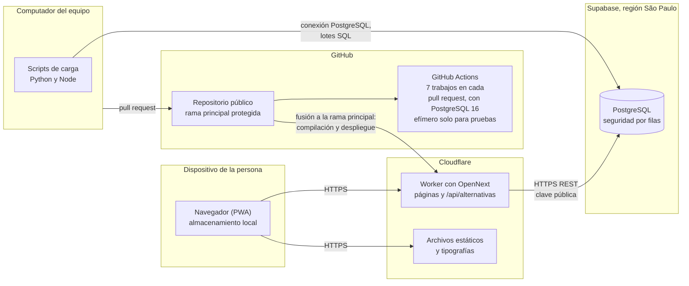

**Tabla 12.28.** Entornos de despliegue (diseño).

| Entorno | Dónde corre | Qué datos usa | Para qué |
|---|---|---|---|
| Desarrollo | Computador de cada integrante (`next dev`) | Muestra local de ejemplo, sin tocar producción | Construir y probar cambios |
| Integración continua | GitHub Actions, en cada pull request | Muestra local y una base PostgreSQL 16 efímera, sin datos reales ni claves | Verificar compilación, contraste, accesibilidad, seguridad de la base y pruebas |
| Producción | Cloudflare Workers y Supabase (São Paulo), un solo proyecto | Datos oficiales reales | Sitio público |

No hay un entorno de pruebas desplegado aparte. Motivo: costo y tamaño del equipo (tres personas). Riesgo: un cambio llega a producción tras la fusión. Mitigación: pull request con los siete trabajos de la integración continua, revisión con pauta escrita y vista previa local antes de fusionar.

**Tabla 12.29.** Proveedores, plan y costo.

| Servicio | Plan hoy | Plan y costo de la puesta en marcha de 2027 (P-I 10) | Límite relevante |
|---|---|---|---|
| Cloudflare Workers | Gratuito | De pago: US$ 5 al mes, $4.750 | En el plan gratuito, 100.000 solicitudes diarias y 10 ms de CPU por solicitud. La medición de CPU quedó abierta |
| Supabase | Gratuito | Pro: US$ 25 al mes, $23.750 | El tráfico de salida superó el límite del plan gratuito en noviembre de 2026 (riesgo R3) |
| Dominio .cl | Dirección `workers.dev` | $11.888 al año | — |
| GitHub | Repositorio público | No incluido en el presupuesto (supuesto del equipo: costo cero) | — |

**Dominio y certificado.** Hoy el sitio se sirve en una dirección `workers.dev`, con el certificado HTTPS que entrega Cloudflare. Con el dominio .cl de 2027, el certificado se emite por el mismo proveedor.

**Respaldos.** El plan gratuito de la base de datos no tiene copias automáticas; así se declaró al aplicar la migración del 7 de noviembre. Lo que protege hoy es que los datos públicos se pueden reconstruir: el esquema sale de las migraciones, los datos de los archivos oficiales registrados y los scripts de carga. Desde 2027, el plan Pro entrega respaldo diario (RNF-14). Quien puede restaurar es la jefatura de proyecto.

**Tabla 12.30.** Qué pasa si un nodo falla.

| Nodo | Efecto | Contingencia |
|---|---|---|
| Supabase | Explorador, ficha, comparador, simulador y alternativas muestran un mensaje de error y ningún dato. Portada, beneficios, calendario, preguntas, «Quiénes somos» y la lista de meta siguen funcionando, porque no consultan la base | Caché en memoria de las consultas repetidas; demostración grabada para la defensa (plan B, Tabla 3.12 de la Parte I) |
| Cloudflare | El sitio no está disponible. No hay redundancia | Demostración grabada; el código es portable a otro proveedor de Workers |
| GitHub | No se pueden fusionar cambios ni desplegar; el sitio sigue sirviendo la última versión | Esperar; el repositorio tiene copias locales en cada integrante |
| Archivo oficial con otra estructura (riesgo R2) | La validación detiene la carga y el dato queda con la última versión | Cargar a mano de 5 a 10 carreras reales con su fuente (plan B, Tabla 3.12 de la Parte I) |
| Almacenamiento del navegador bloqueado | La meta se guarda solo mientras la página siga abierta | Aviso a la persona y botón para reintentar al abrir la página |

### 12.14 Wireframes de las pantallas principales

Los wireframes son esquemas sin diseño gráfico: muestran qué hay y dónde, no cómo se ve. Corresponden a las pantallas reales del sitio, en el ancho de 360 px, que es el de diseño (RNF-01). Cada pantalla se asocia a un caso de uso. Se dibujan en texto para que se lean impresos. Los nombres y las cifras de los esquemas son marcadores, no datos.

**Figura 12.8.** Mapa de navegación de las pantallas principales.

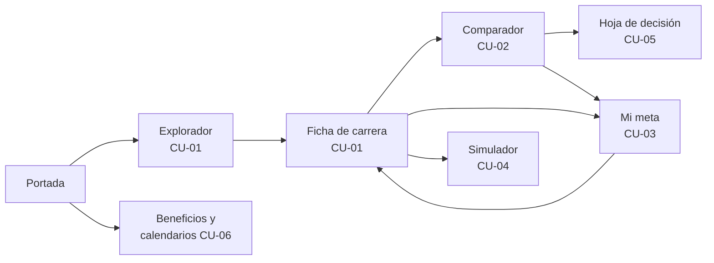

**Pantalla 1. Portada (`/`).**

```text
+--------------------------------------------+
| [Logo]    Inicio Carreras Comparador Benef.|  cabecera azul marino
+--------------------------------------------+
| Tu camino a la educación superior          |  titular
| Información oficial y apoyo para elegir,   |
| postular y avanzar.                        |
| [ Explorar carreras  -> ]                  |  acción principal (coral)
|  Revisar mi próximo paso (FUAS)            |  enlaces secundarios
|  Ver ocupaciones afines a tus intereses    |
|  Ver dónde estudian, por región            |
| ( carrusel del recorrido )                 |
| Datos de Mineduc, SIES y DEMRE.            |
| Consulta las fuentes y sus fechas.         |
| [!] Atención al plazo: FUAS ya cerró...    |  aviso con ícono y texto
+--------------------------------------------+
| Comparar carreras                          |
| Tus opciones. Frente a frente.             |
| [ Abrir el comparador ]                    |
+--------------------------------------------+
| Beneficios y plazos  (sección de fondo     |
| coral, única excepción de color)           |
| [ Revisar beneficios ]                     |
+--------------------------------------------+
| PUBLICIDAD  [espacio de aviso, uno máximo] |  posición por definir
+--------------------------------------------+
| Datos oficiales y fuentes (3 enlaces)      |
+--------------------------------------------+
```

**Pantalla 2. Explorador de carreras (`/carreras`).**

```text
+--------------------------------------------+
| [Logo]    Inicio Carreras Comparador Benef.|
| Explorador de carreras                     |
+--------------------------------------------+
| Busca una carrera, institución o comuna    |
| [____________________________] [ Buscar ]  |
| > Filtros: Región | Tipo | Jornada         |  se pliegan
| 3.124 carreras encontradas                 |
+--------------------------------------------+
| ENFERMERÍA                                 |
| Universidad de Chile                       |
| Santiago · Región Metropolitana · Diurna   |
| [ Ver ficha ]   [ Comparar ]               |
+--------------------------------------------+
| ... 25 resultados por página ...           |
| [ Anterior ]  Página 1 de 125  [ Siguiente]|
+--------------------------------------------+
```

**Pantalla 3. Ficha de carrera (`/carreras/[institución]/[carrera]`).**

```text
+--------------------------------------------+
| [Logo]    Inicio Carreras Comparador Benef.|
| ENFERMERÍA                                 |
| Universidad de Chile                       |
| Santiago · Región: Metropolitana           |
+--------------------------------------------+
| Datos para comparar                        |
| +----------------------------------------+ |
| | Empleabilidad al 1.er año              | |
| |   87,3 %        (cifra en Mono)        | |
| | Qué mide: porcentaje de personas       | |
| | tituladas que ganaron al menos el      | |
| | sueldo mínimo en su primer año...      | |
| | Período: titulados 2021 a 2023         | |
| | Fuente: Mi Futuro (SIES) · consultada  | |
| | el 3 de noviembre de 2026              | |
| +----------------------------------------+ |
| | Comparación (elaboración propia) ...   | |
| | Duración · Arancel · Vacantes ·        | |
| | Corte · Ponderaciones · Acreditación   | |
| | (una tarjeta por dato, las que tienen  | |
| |  dato primero; si no: «Sin datos       | |
| |  suficientes» y por qué)               | |
| +----------------------------------------+ |
| [ Comparar con otra carrera ]  (coral)     |
| [ Simular mi puntaje ]                     |
| [ Fijar como mi meta ]                     |
| [ Agregar a mis preferencias ]             |
| ¿De dónde salen estos datos?               |
|  - Mi Futuro (SIES) · consultada el ...    |
+--------------------------------------------+
```

**Pantalla 4. Comparador (`/comparador`).**

```text
+--------------------------------------------+
| Compara carreras                           |
| Revisa los datos de hasta tres opciones.   |
+--------------------------------------------+
| Elige hasta tres carreras                  |
| 1. ENFERMERÍA · U. de Chile    [Quitar]    |
| 2. ENFERMERÍA · U. X           [Quitar]    |
| [ Usar estas carreras en mi hoja ]         |
| Busca una carrera para agregar             |
| [__________________] [ Buscar ]            |
+--------------------------------------------+
| Datos comparados   (en el teléfono: un     |
|                     bloque por carrera)    |
|                 | Carrera 1 | Carrera 2 |  |
| Empleabilidad   |  .. %     |  .. %     |  |
| Arancel anual   | $ ...     | $ ...     |  |
| Cada celda: qué mide, período, fuente.     |
| [!] Aviso: los períodos no son iguales.    |
+--------------------------------------------+
```

**Pantalla 5. Mi meta y mis preferencias (`/meta`).**

```text
+--------------------------------------------+
| Mi meta y mis preferencias                 |
| Se guardan solo en este teléfono o         |
| computador. No las vemos nosotros.         |
+--------------------------------------------+
| Tu meta y tus preferencias                 |
| 1. Tu meta                                 |
|    ENFERMERÍA · U. de Chile · Santiago     |
|    [ Bajar ] [ Quitar ]                    |
| 2. 2.ª preferencia ...  [Subir][Bajar][..] |
+--------------------------------------------+
| Tus próximos plazos                        |
|  Postulación ... Del .. al .. · Fuente ... |
+--------------------------------------------+
| Alternativas cercanas a tu meta            |
|  Carreras de la misma área y región, con   |
|  puntaje de corte igual o menor            |
|  Se postula directo en la institución: ... |
+--------------------------------------------+
| Tus datos en este dispositivo              |
| [ Borrar mis datos de este dispositivo ]   |
+--------------------------------------------+
```

**Pantalla 6. Beneficios y calendarios (`/beneficios`).**

```text
+--------------------------------------------+
| Beneficios y plazos 2027                   |
+--------------------------------------------+
| Busca beneficios                           |
| [____________________________]             |
| (tarjetas de beneficios con fuente)        |
+--------------------------------------------+
| PUBLICIDAD  [espacio de aviso, uno máximo] |  posición por definir
+--------------------------------------------+
| Calendario de plazos                       |
|  hitos que ya pasaron, separados           |
+--------------------------------------------+
| Calendario de admisión universitaria 2027  |
|  hito · fechas · fuente · consulta         |
+--------------------------------------------+
```

**Tabla 12.31.** Elementos de cada pantalla y requerimientos que cumplen.

| Pantalla | Elementos principales | Requerimientos | Caso de uso |
|---|---|---|---|
| Portada | Titular, acción principal única, enlaces a FUAS, ocupaciones y mapa, nota de fuentes, aviso de plazo con ícono y texto, secciones de comparador, beneficios y fuentes, espacio de aviso permitido | RF-41, RF-42, RF-43, RF-45, RNF-01 | CU-06, CU-08, CU-09 |
| Explorador | Buscador, filtros plegables, total, tarjetas de 25 por página | RF-01, RF-02 | CU-01 |
| Ficha | Datos con fuente, período, qué mide y comparaciones; sin datos con motivo; acciones de comparar, simular y fijar como meta; lista de fuentes | RF-03 a RF-18, RF-27, RF-28 | CU-01, CU-03 |
| Comparador | Carreras elegidas con «Quitar», buscador, tabla de hasta tres columnas, advertencia de períodos | RF-19 a RF-23 | CU-02 |
| Mi meta | Lista numerada con rótulo, subir, bajar y quitar; próximo plazo; alternativas; borrar | RF-27 a RF-35 | CU-03 |
| Beneficios | Buscador, calendarios de plazos y de admisión, espacio de aviso permitido | RF-36 a RF-38, RF-43 | CU-06, CU-09 |

**Coherencia con la imagen corporativa.** La interfaz aplica los colores del logo, medidos sobre el archivo original, y una sola familia tipográfica.

**Tabla 12.32.** Imagen corporativa aplicada a la interfaz.

| Elemento | Valor | Dónde se ve |
|---|---|---|
| Azul marino del logo | `#0D325F` | Cabecera, enlaces, la línea del recorrido |
| Coral del logo | `#F46E52` | La acción principal, una por pantalla, y la sección de beneficios de la portada |
| Fondo y texto | `#FFFFFF` y `#1C1B19`; en tema oscuro, `#0A1D33` de fondo | Todas las pantallas |
| Tipografía | Atkinson Hyperlegible Next para el texto y Atkinson Hyperlegible Mono para las cifras, alojadas en el proyecto | Todas las pantallas |
| Reglas | Esquinas de 4 px, sin degradados ni sombras decorativas, nunca información solo con color | Todas las pantallas |

`[COMPLETAR: contrastar esta tabla con la sección de imagen corporativa del capítulo 8; si algún valor difiere, uno de los dos documentos está desactualizado. Lo hace Rafael Jaque]`.

Un prototipo navegable con personas externas no se hizo: la validación con personas es la medición del 30 de noviembre al 4 de diciembre, sobre el sitio ya construido (capítulo 10).

### 12.15 Seguridad en el diseño

La seguridad es una decisión de diseño y no una función que se agrega al final. Se toman como referencia las diez categorías de riesgo de OWASP (OWASP Foundation, 2021a) y, como guía de verificación y no como certificación, el nivel 2 del estándar de verificación de seguridad de aplicaciones (OWASP Foundation, 2021b).

**Tabla 12.33.** Decisiones de seguridad.

| Aspecto | Decisión tomada | Requerimiento asociado |
|---|---|---|
| Autenticación | El sitio público no tiene inicio de sesión. Las personas usan el sitio sin cuenta. El equipo entra a Supabase, Cloudflare y GitHub con las cuentas de cada proveedor. La cuenta de 2027 será por enlace de un solo uso enviado al correo, sin contraseña, así que el sistema no guardará contraseñas | RL-01, RF-59 (Won't) |
| Autorización por roles | **Visitante** (sin sesión): solo lectura de 13 tablas públicas y una vista, lista cerrada que se prueba en cada pull request. **Persona con sesión** (2027): solo lo suyo, impuesto por la seguridad por filas de la base. **Equipo** (administrador, acompañante, lector): alertas y derivaciones solo mediante funciones que verifican el rol y dejan registro. **Carga**: credenciales de administración de la base, fuera del repositorio. Quien intenta algo que no le corresponde recibe un error de autorización o ninguna fila, nunca los datos | RNF-10 |
| Manejo de sesión | Sin sesión en el sitio público: no hay nada que expire. Con la cuenta de 2027, la sesión la administra el proveedor de autenticación. `[COMPLETAR: duración configurada de la sesión y cierre manual visible; lo define Rafael Jaque al construir la cuenta]` | RF-59 (Won't) |
| Validación de entradas | En el servidor, no solo en el navegador: los parámetros de la API de alternativas se validan antes de consultar; el código de la ficha se verifica contra la ruta; lo guardado en el dispositivo se lee con un análisis defensivo que descarta lo inválido y solo acepta rutas de ficha del propio sitio; la base impone rangos (porcentajes de 0 a 100, ponderaciones que suman 100, valor o motivo); los lotes de datos se validan antes de escribir; el puntaje ingresado se rechaza fuera de 100 a 1.000 | RF-26, RF-51, RNF-10 |
| Comunicación cifrada | HTTPS en todas las solicitudes: del navegador a Cloudflare y de Cloudflare a Supabase. Es la decisión de diseño; el hallazgo de que `http://` responde 200 sin redirigir está en el capítulo 13 (Tabla 13.19) | RNF-11 |
| Cifrado en reposo | Lo gestionan los proveedores de la base. `[COMPLETAR: confirmar en las condiciones de Supabase; lo trae Rafael Jaque]`. El cifrado de columna de las notas de seguimiento está pendiente; esa tabla no tiene uso y la cuenta de 2027 no guarda datos sensibles | RNF-10 |
| Registro de auditoría | Cada acción sobre una alerta de crisis queda en una tabla que solo se agrega, con usuario y fecha. Los cambios al código y a la base quedan en el historial de pull requests y en el registro de migraciones aplicadas. Las descargas de archivos oficiales, en su registro | RF-54, RNF-16 |
| Respaldos | Hoy no hay copias automáticas (plan gratuito); lo protege la reconstrucción desde migraciones, archivos registrados y scripts. En 2027, respaldo diario con 7 días de retención; restaura la jefatura | RNF-14, RNF-15 |
| Secretos | Las claves van en variables de entorno de Cloudflare; los archivos `.env` están fuera del control de versiones; la cadena de conexión de carga nunca se pega en chats ni en el repositorio | RNF-12 |
| Dependencias | Versiones exactas en el archivo del proyecto, solo librerías mantenidas con licencia compatible, y cada una nueva se justifica en su pull request. Una advertencia de seguridad del adaptador de Cloudflare se corrigió el 23 de noviembre | RL-06 |
| Revisión de cambios | Rama principal protegida: una aprobación obligatoria (el archivo de propietarios nombra a la jefatura, pero la regla no obliga la revisión del propietario), contraste de colores como verificación obligatoria y siete trabajos de integración continua | RNF-16 |
| Incidentes | Si se sospecha un acceso indebido: avisar a la jefatura, registrar qué pasó y cuándo, contener (rotar claves, revocar accesos) y notificar según exija la ley. `[COMPLETAR: procedimiento detallado; lo redacta Rafael Jaque]` | RNF-12, RL-02 |

### 12.16 Tratamiento de datos personales

La decisión de diseño más barata y efectiva es la **minimización**: el sitio público no guarda ningún dato personal. La persona no entrega nada para buscar, comparar, simular ni fijar su meta, que se guarda en su propio dispositivo (RL-01).

**Decisiones de diseño.**

- **Minimización.** No se pide ni se guarda la edad, el nombre, el RUT, el teléfono, la dirección ni el género. La cuenta de 2027 guardaría solo una lista cerrada: correo, si la persona estudia o ya estudió, institución elegida de una lista oficial, meta y tres preferencias, y el registro de su consentimiento. Agregar un campo exige una decisión escrita.
- **Sin datos sensibles.** El tramo socioeconómico se calcularía en el dispositivo y no se guardaría ni se enviaría (RL-16).
- **Finalidad declarada.** Cada dato tiene una sola finalidad, dicha a la persona antes de pedirlo.
- **Consentimiento registrado.** Casillas sin marcar, una por finalidad, con fecha, hora y versión del texto aceptado (RL-13).
- **Derechos.** Acceso, rectificación, supresión, oposición, portabilidad y bloqueo; borrar la cuenta siempre a la vista (RL-15).
- **Anonimización para análisis.** Los informes para clientes se hacen solo con datos oficiales públicos: ningún dato de una cuenta se entrega a un cliente. El conteo de avisos es agregado y sin IP.
- **Ubicación.** Base de datos en São Paulo; el alojamiento de las páginas es de red global.

**Tabla 12.34.** Tratamiento de datos personales.

| Dato | Finalidad declarada | Base de licitud | Plazo de conservación | Cómo se ejerce el derecho a eliminación |
|---|---|---|---|---|
| Sitio público v1: ningún dato personal; la meta y las preferencias están en el dispositivo | Conservar la meta y las preferencias para la persona | No hay tratamiento por parte del sistema: los datos no salen del dispositivo | Hasta que la persona los borre o borre los datos del navegador | Botón «Borrar mis datos de este dispositivo», inmediato y sin confirmación (RF-35) |
| Anotaciones de la hoja de decisión | Que la persona prepare su decisión | Igual: quedan en la pestaña | Hasta cerrar la pestaña | Se borran al cerrarla |
| Dirección IP y registros técnicos de las solicitudes | Operar y proteger el sitio | `[COMPLETAR: base de licitud; la define la asesoría legal]`. El sistema no los lee ni los guarda: los trata el proveedor de alojamiento | `[COMPLETAR: plazo del proveedor; lo trae Rafael Jaque al revisar las condiciones de Cloudflare y Supabase]` | Solicitud al equipo; depende del proveedor |
| Consentimiento informado de la medición (fuera del sistema) | Validar el uso del prototipo con 10 personas de 18 años o más | Consentimiento | `[COMPLETAR: plazo y qué datos contiene el formulario; lo trae Alejandro Tapia]` | Solicitud a la jefatura. `[COMPLETAR: procedimiento]` |
| Cuenta de 2027: correo, si estudia o estudió, institución, meta y preferencias | Conservar la meta y las preferencias entre dispositivos | Consentimiento (Ley 21.719, art. 12) | Mientras la cuenta esté activa. Propuesta del equipo: 24 meses de inactividad, con aviso previo; sujeta a asesoría legal | Botón siempre visible, inmediato; el servidor borra la cuenta de autenticación; exportación en JSON antes de borrar |
| Cuenta de 2027: registro del consentimiento | Probar que hubo consentimiento | Obligación de probarlo (art. 12) | Mientras dure la cuenta y el plazo de prueba que fije la asesoría legal | Se suprime con la cuenta, salvo lo que la ley exija conservar `[COMPLETAR: asesoría legal]` |
| Alertas de crisis (2027, asistente): tipo de señal y hora, sin el texto del mensaje | Derivar a una persona cuando hay riesgo | `[COMPLETAR: asesoría legal]` | `[COMPLETAR: asesoría legal]` | Solicitud de supresión, con las excepciones de conservación por definir |
| Contacto del anunciante: razón social, RUT de la empresa, nombre y correo de contacto | Contrato del aviso e identificación del anunciante ante un tribunal (Ley 19.496, art. 34) | Ejecución del contrato y obligación legal `[COMPLETAR: validar con asesoría legal]` | `[COMPLETAR: plazo contable y legal]` | Solicitud a la jefatura al término del contrato, salvo lo que la ley obligue a conservar |
| Correo y rol de los integrantes del equipo | Controlar el acceso a las funciones del equipo | Relación del equipo con el proyecto | Mientras el integrante tenga un rol | La jefatura retira al integrante |

**Datos de menores.** El sitio público no distingue edades y no pide datos. La medición se hace solo con personas de 18 años o más. La cuenta de 2027 exigirá una declaración de 14 años o más y no guardará la edad (RL-14). Si la declaración basta como diligencia es una consulta pendiente a un abogado.

### 12.17 Las cuatro preguntas de coherencia

**1. ¿Cada KPI del capítulo 8 tiene un requerimiento que garantice el registro de su dato?**
Sí. K1 con RF-55, K2 con RF-56, K3 con RF-57, K4 con RF-54 y K5 con RF-58 (Tabla 12.11). Su estado no es parejo: K3 ya está cumplido por la plataforma; K1, K2, K4 y K5 tienen el registro parcial o pendiente y se listan en la Tabla 12.12.

**2. ¿El diagrama de clases y el MER describen lo mismo?**
Sí, con cuatro diferencias declaradas. Cada atributo de cada clase persistente tiene su campo en el diccionario (Tabla 12.23). Las diferencias son: (a) las clases `«propuesta»` (aviso, anunciante, conteo) aún no tienen tabla; (b) beneficios y plazos viven en la base y en archivos versionados, y falta decidir cuál es la fuente única; (c) la tabla `persona` pide datos que la cuenta de 2027 no debe guardar; (d) cuatro campos heredados de `institucion` duplican la tabla fechada de acreditación.

**3. ¿Los requerimientos legales corresponden a las decisiones de seguridad y datos personales?**
Sí. La Tabla 12.35 lo muestra: cada decisión de las secciones 12.15 y 12.16 remite a un requerimiento legal o de seguridad.

**Tabla 12.35.** Decisiones y requerimientos que las respaldan.

| Decisión de diseño | Requerimiento |
|---|---|
| Sitio sin cuenta ni datos personales; meta en el dispositivo | RL-01, RF-30 |
| Política de tratamiento publicada | RL-02 |
| Aviso rotulado, sin terceros, con enlace sin datos | RL-03, RL-05, RF-45 a RF-47 |
| Registro del anunciante | RL-04, RF-50 |
| Cita y límites de uso de las fuentes oficiales | RL-07 a RL-11 |
| Licencias de las dependencias | RL-06 |
| Consentimiento, menores, derechos y datos sensibles de la cuenta | RL-13 a RL-16 (Won't, 2027) |
| Seguridad por filas, HTTPS, secretos y revisión de cambios | RNF-10 a RNF-13, RNF-16 |

**4. ¿Lo que quedó fuera de la versión 1 es lo mismo que aparece en la estrategia de evolución del capítulo 10?**
La lista de Won't (cuenta con correo, cuestionario de intereses vocacionales, simulación de beneficios, asistente conversacional, noticias de educación superior y tablero de transparencia) es la de la Parte I, punto 3.7, y es la que el capítulo 10 debe nombrar como etapa siguiente. Hay una precisión que el capítulo 10 debe respetar: la guía del FUAS, el mapa de carreras por región y el explorador de ocupaciones sí están construidos (Could) y no figuran en el punto 3.7; no deben presentarse como pendientes ni como logros de las cuatro tareas centrales. `[COMPLETAR: verificar que el capítulo 10 repita esta lista y esta precisión; lo revisa Rafael Jaque al integrar los capítulos]`.

**Supuestos y límites de este capítulo.** Las prioridades, los valores de los requerimientos no funcionales marcados como «supuesto del equipo» y la lectura de las normas son del equipo y no tienen validación externa. Los resultados de la medición con 10 personas, de las mediciones de rendimiento y de las pruebas se incorporan en los capítulos 10 y 13.

---

## 13. Construcción, pruebas y despliegue

Este capítulo lleva el sistema diseñado en el capítulo 12 hasta estar construido, probado, desplegado y documentado. La evidencia es el repositorio público del proyecto (https://github.com/AE-SE/Agencia-de-Enlaces-y-Seguimiento-Estudiantil), su historial, sus pull requests, sus pruebas automáticas y el sitio desplegado (https://agencia-de-enlace.rafajaqued.workers.dev/). Los cortes de datos de este capítulo son del 26 de noviembre de 2026, a las 15:30 horas de Chile. Lo que depende de la medición con 10 personas (30 de noviembre a 4 de diciembre), de una firma o de una prueba que aún no se hace queda como `[COMPLETAR]`, con el dato, su origen y quién lo trae.

**Problema primero.** Las personas que egresan de 4.º medio deciden con información dispersa y difícil de comparar. Si el sitio que se les ofrece muestra una cifra mal calculada, un plazo vencido o un dato sin fuente, el sitio repite el problema que quiere resolver. Por eso este capítulo trata las pruebas y el control de cambios como parte del producto: la verificación evita que un error de construcción llegue a una persona que decide su estudio con esa cifra.

**Tabla 13.1.** Qué demuestra este capítulo y con qué evidencia.

| Bloque | Qué demuestra | Evidencia que queda | Dónde |
|---|---|---|---|
| Construcción y versionado | Desarrollo ordenado, trazable y compartido | Historial, pull requests, versiones reconstruidas, incidencias | 13.1 a 13.6 |
| Pruebas | Verificación con método | Plan, casos diseñados, registro de ejecución del 26 de noviembre, defectos | 13.7 a 13.14 |
| Despliegue | El sistema opera fuera del computador del equipo | Sitio público, diagrama, procedimiento y reversa | 13.15 a 13.17 |
| Documentación técnica | Un tercero puede instalar, operar y mantener | README, guías, estado de los manuales | 13.18 |

**Relación con otros capítulos.** Las pruebas de aceptación (13.14) alimentan el reporte de validación del capítulo 10 (hipótesis H1 a H4). El registro de defectos (13.5 y 13.11) y el historial (13.6) alimentan los KPI K2 y K3 que el capítulo 9 monitorea. Los manuales (13.18) sostienen la transferencia del capítulo 10 y la sostenibilidad del capítulo 11.

---

### 13.1 Acuerdos de construcción

Los acuerdos se fijaron en la primera semana (2 al 9 de noviembre de 2026), antes de que el código creciera, y están escritos en las directrices del repositorio, que el equipo y las herramientas de IA declaradas como apoyo (Claude y Codex) deben leer antes de trabajar.

**Tabla 13.2.** Acuerdos de construcción.

| Acuerdo | Decisión del equipo | Evidencia verificable |
|---|---|---|
| Estructura de carpetas | `app/` (páginas y rutas de Next.js), `lib/` (lógica compartida: `calculos/`, `datos/`, `meta/`, `ia/`), `datos/` (scripts Python de carga y verificación de datos oficiales), `supabase/` (migraciones y pruebas de seguridad), `tests/` (pruebas), `diseno/` (valores de diseño), `scripts/` (utilitarios) y una carpeta de documentación | Árbol del repositorio; coherente con los componentes del capítulo 12 |
| Convención de nombres e idioma | Código, comentarios, textos de interfaz y mensajes de commit en español. Nombres de funciones y variables en español o inglés, pero consistentes dentro de cada módulo. Archivos en minúsculas con guiones (`puntaje-ponderado.ts`) | Revisión de cada pull request |
| Estilo y formateador | ESLint 10 con las reglas de Next.js; TypeScript en modo estricto. Los valores de diseño (colores, tamaños, espacios) solo se usan a través de variables CSS generadas desde un archivo único; escribirlos «a mano» está prohibido y la integración continua lo verifica (44 contrastes de color comprobados) | `npm run lint` sin errores y `tokens.py --check` con 44 de 44 en orden el 26 de noviembre |
| Separación de responsabilidades | La lógica de cálculo vive en `lib/` como funciones puras con pruebas; la capa de presentación (`app/`) no calcula puntajes ni ordena resultados. La protección de datos vive en la base de datos (Row Level Security, RLS: cada cuenta ve solo lo suyo), no en la página. Toda llamada a un proveedor de IA pasa por un único archivo (`lib/ia/proveedor.ts`) | Estructura de `lib/` y `supabase/tests/pruebas_rls.sql` (111 verificaciones) |
| Configuración y credenciales | Claves y direcciones en variables de entorno; `.env` y `.env.*` excluidos del control de versiones, con un archivo de ejemplo sin valores (`.env.example`) | `.gitignore`; búsqueda en el historial (párrafo siguiente) |
| Manejo de errores | El dato que falta se muestra con su motivo, nunca como cero. Los mensajes al usuario están en español claro y sin datos personales; las alertas del protocolo de crisis guardan solo el tipo de señal y la hora, nunca el texto del mensaje | Pruebas de `tests/datos/` y `tests/ia/` |
| Datos cambiantes | Montos, plazos, ponderaciones y aranceles no se escriben en el código: viven en la base de datos o en archivos de datos versionados, con fecha de vigencia | Revisión de cada pull request |
| Dependencias | Solo librerías mantenidas, con licencia compatible, y cada una nueva se justifica en su pull request | Plantilla del pull request |

**Credenciales.** No se encontraron claves en el historial con una búsqueda por patrones (claves de servicio de Supabase y de Google, `eyJhbGci`) sobre todas las ramas del repositorio, con resultado vacío el 26 de noviembre de 2026. Es una búsqueda por patrones y no una auditoría exhaustiva; la regla del equipo es que, si se sube una clave por error, se rota y no solo se borra el archivo.

---

### 13.2 Control de versiones y repositorio

El control de versiones es Git, alojado en GitHub, en una organización cuyo repositorio es público. El repositorio contiene:

- El código fuente completo, organizado según la Tabla 13.2.
- Un README con qué es el proyecto, comandos de instalación y ejecución (`npm ci`, `npm run dev`, `npm run build`, `npm test`), cómo correr las pruebas de accesibilidad y quiénes lo desarrollan.
- Un archivo de exclusiones (`.gitignore`) que deja fuera secretos, dependencias, compilados y los archivos oficiales descargados (se regeneran con los scripts de `datos/`).
- Un archivo de configuración de ejemplo, sin valores reales (`.env.example`). **Observación detectada al redactar:** ese archivo lista `NEXT_PUBLIC_SUPABASE_URL` y `NEXT_PUBLIC_SUPABASE_ANON_KEY`, pero el código lee `SUPABASE_URL` y `SUPABASE_ANON_KEY` (13.16). Debe corregirse antes de entregar el manual de despliegue.
- Los scripts de base de datos: 14 migraciones versionadas por fecha en `supabase/migrations/` (de `20261103000000_esquema_base.sql` a `20261120210000_vista_busqueda_largo_institucion.sql`) y los lotes de carga de datos oficiales generados por `datos/generar_lotes*.py`.
- La licencia: software propietario de la agencia, con todos los derechos reservados. Es coherente con el mecanismo de transferencia del capítulo 4 de la Parte I (el código es de la sociedad, y quien encarga un informe no recibe el código; accede al servicio por contrato).
- La documentación técnica, en una carpeta propia del repositorio.

---

### 13.3 Estrategia de ramas y convención de commits

**Esquema elegido.** El equipo no usa una rama `desarrollo` intermedia. Trabaja con ramas por tarea que salen de `main` actualizado y vuelven a `main` por pull request. Se justifica con el tamaño del equipo (tres integrantes) y con que `main` está protegida (la estrategia de ramas por tarea sigue lo descrito por Chacon y Straub, 2014): una rama de integración intermedia añadiría una fusión más sin añadir control.

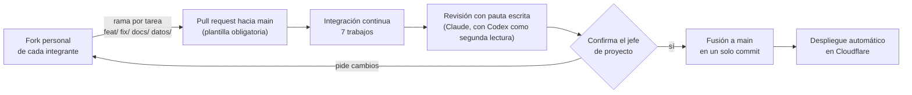

*Figura 13.1.* Flujo de ramas y revisión de un cambio (elaboración propia).

**Tabla 13.3.** Estrategia de ramas.

| Rama | Para qué | Regla |
|---|---|---|
| `main` | Versión estable, la que se despliega | Nadie escribe directo: solo recibe pull requests. Historial lineal; el único método de fusión permitido es el de un commit por pull request («squash»). Exige una aprobación y la comprobación de contraste de colores |
| `feat/nombre` | Funcionalidad nueva | Sale de `main` actualizado; una tarea, una rama, un pull request |
| `fix/nombre` | Corrección de un defecto | Igual que `feat`, asociada a la tarea o al hallazgo |
| `docs/nombre` | Documentación | Idem |
| `datos/nombre` | Carga o actualización de datos oficiales | Idem; exige fuente, URL y fecha |
| `feat/aese-*` | Pila de ramas del rediseño visual (noviembre) | Los pull requests con base en estas ramas también pasan la integración continua |

Los integrantes que no son jefe de proyecto trabajan en una copia personal (fork) del repositorio y proponen cambios por pull request; su permiso en el repositorio principal es de lectura. Así, un envío por error a `main` es imposible. La regla de protección de `main` (consultada en GitHub el 26 de noviembre de 2026) exige historial lineal, fusión por «squash», no borrar ni reescribir la rama, una aprobación con las conversaciones resueltas y la comprobación de contraste de colores. El jefe de proyecto tiene permiso de omitir la regla; el equipo lo usa solo para fusionar cambios que ya revisó con la pauta escrita y para tareas urgentes, y se registra en el pull request.

**Quién autoriza la fusión.** El jefe de proyecto. Ningún cambio llega a `main` sin una revisión hecha con la pauta de revisión escrita (datos personales y seguridad, datos oficiales, alcance y promesas, neutralidad, diseño, accesibilidad, pruebas) y confirmada por él. La revisión es por pauta escrita y con apoyo de herramientas de IA (Claude y Codex). Hay revisión humana independiente solo en los pull requests de Cristóbal y de Alejandro, que revisa y fusiona la jefatura; los de la jefatura no tienen un segundo revisor humano (riesgo R6 del capítulo 9).

**Qué debe cumplirse antes de fusionar.** La lista de la plantilla del pull request: compila y pasa lint y pruebas; los cálculos tienen pruebas verificadas contra la fuente oficial; todo dato nuevo tiene fuente, URL y fecha; se probó a 360 px de ancho y con teclado; solo se usan los valores de diseño; los textos están en español claro; la documentación está al día; y quien escribe declara qué IA usó y que leyó y entiende todo el código. Además, la plantilla pide separar los cambios: un pull request, una cosa, idealmente bajo 400 líneas. Cumplido: 247 de 301 pull requests fusionados (82,1 %) cambian 400 líneas o menos (elaboración propia, con el listado de GitHub).

**Integración continua** (`.github/workflows/verificar.yml`). En cada pull request hacia `main` corren siete trabajos (la detección de cambios y seis verificaciones, que son las del requerimiento RNF-16): detección de cambios (si solo se tocó documentación, los demás se saltan para ahorrar minutos), compilación y lint de la aplicación, contraste de colores WCAG 2.2 y fuentes, reglas de privacidad de la base de datos (migraciones sobre un PostgreSQL 16 efímero y 111 verificaciones de RLS), pruebas de TypeScript, pruebas de los scripts de datos en Python y accesibilidad con axe y Playwright. De las últimas 200 ejecuciones del flujo, 191 terminaron en éxito y 9 en fallo (elaboración propia con la API de GitHub el 26 de noviembre de 2026); no se verificó cuántos de esos fallos fueron luego corregidos dentro del mismo pull request.

**Convención de commits.** Conventional Commits (Conventional Commits, s. f.), en español: `tipo: descripción en presente`. Se usan `feat`, `fix`, `docs`, `datos`, `test`, `ci`, `chore` y `perf`. De 308 commits en `main`, 307 (99,7 %) siguen el formato; la excepción es una edición del README hecha desde la web de GitHub, con el mensaje «Update README…» (elaboración propia). 301 de los 308 commits terminan con el número del pull request que los fusionó. Ejemplos reales:

| Mensaje (extracto del historial de `main`) | Fecha |
|---|---|
| `feat: protocolo de crisis del asistente con pruebas automatizadas (#8)` | 3 nov |
| `feat: agrega comparador de carreras (#57)` | 7 nov |
| `fix: las fichas consultan Supabase en vivo (#103)` | 10 nov |
| `ci: no correr Verificar en cambios que solo tocan documentación (#130)` | 10 nov |
| `feat: muestra las ponderaciones del DEMRE en la ficha de carrera (#245)` | 17 nov |
| `datos: lleva el área del SIES a cada carrera de la oferta (#277)` | 19 nov |
| `feat: alternativas cercanas a la meta en /meta (N10, parte 2) (#302)` | 23 nov |
| `fix: la compilación ya no exporta la oferta completa de Supabase (#319)` | 24 nov |
| `datos: los lotes se deshacen si una carrera queda con dos períodos del mismo dato (#329)` | 25 nov |
| `fix: los calendarios de beneficios citan la fuente en una línea por hito (#335)` | 25 nov |

**Trazabilidad por mensaje.** El equipo enlaza los commits con los códigos de tarea del plan de trabajo (N1, N9, N10, C7b, A5, entre otros; 34 mensajes) y con los registros de decisión (44 mensajes), pero **no con los códigos RF-xx**, que se fijaron en el capítulo 12 después de empezar a construir. La matriz de la Tabla 13.17 se armó por lo tanto de forma retroactiva, asociando cada requerimiento a los pull requests que lo construyeron. Es una limitación: la guía recomienda enlazar el requerimiento en el mensaje, y desde el próximo pull request se hará (`RF-xx` en el título).

---

### 13.4 Versionado del producto

El producto cambia cuando se despliega una versión identificable. Cada fusión a `main` despliega sola el sitio en Cloudflare en unos dos a cuatro minutos (13.16): no hay un paso manual de «publicar versión». El repositorio **no tiene etiquetas (tags) ni versiones publicadas** (`git tag` devuelve vacío el 26 de noviembre) y el archivo `package.json` conserva el número `0.1.0` desde el inicio.

Por eso la tabla siguiente es una **reconstrucción hecha el 26 de noviembre de 2026** a partir de hitos reales del historial: se agruparon los pull requests fusionados por ventanas de fechas que coinciden con cambios de contenido del sitio y se propuso la numeración MAYOR.MENOR.PARCHE (Preston-Werner, s. f.): se sube el número menor cuando se agrega funcionalidad visible, y el parche cuando solo hubo correcciones. Como el sitio se publica directo a producción con cada fusión, todas las versiones estuvieron en producción; no existió una etapa piloto separada. `[COMPLETAR: Rafael crea las etiquetas Git 0.1.0 a 0.6.0 sobre los commits indicados y actualiza package.json, para que la tabla deje de ser reconstrucción]`.

**Tabla 13.4.** Versiones del producto (reconstrucción). Es el denominador del KPI K2 (defectos por versión).

| Versión | Ventana (2026) | Última fusión de la ventana | Contenido | Pull requests fusionados (fix) | Estado |
|---|---|---|---|---|---|
| 0.1.0 | 2 al 6 nov | #51 | Base del proyecto, esquema de base de datos con reglas de privacidad, protocolo de crisis con pruebas, aplicación web instalable, despliegue en Cloudflare, ficha de carrera y explorador con datos de ejemplo | 44 (5) | En producción (muestra) |
| 0.2.0 | 7 al 9 nov | #95 | Comparador de hasta 3 carreras, beneficios y calendario, corpus del asistente, ruta del asistente con registro de alertas | 44 (6) | En producción |
| 0.3.0 | 10 al 13 nov | #171 | El portal lee la oferta real de Supabase, hoja de decisión, medida comparativa, simulador de puntaje, identidad visual «Andén urbano», giro del proyecto a agencia independiente | 53 (16) | En producción |
| 0.4.0 | 14 al 18 nov | #273 | Explorador de ocupaciones, mapa de carreras por región, portada nueva, ficha con ponderaciones, acreditación, puntaje de corte, costo, ingreso, retención y duración real, preguntas frecuentes y glosario | 102 (14) | En producción |
| 0.5.0 | 19 al 23 nov | #312 | Buscador por carrera, institución o comuna, página «Quiénes somos», comparaciones de empleabilidad en la ficha, meta con tres preferencias, alternativas cercanas, calendario de admisión 2027, caché de consultas, `robots.txt` | 37 (10) | En producción |
| 0.6.0 | 24 al 26 nov | #335 | Corrección del consumo de base de datos (13.6), ofertas gemelas con versión del plan, revisión general del sitio, tildes de nombres de instituciones, corrección del tren del recorrido en teléfono, calendarios de beneficios con una fuente por hito | 21 (8) | En producción (versión actual, commit `275093b`) |
| 0.7.0 | 30 nov al 4 dic | — | Versión congelada (congelamiento de funciones el 27 de noviembre) que se usa en la medición con 10 personas. Incluirá el espacio publicitario sin anunciante (RF-43 a RF-46, RF-48), hoy en la rama `feat/espacio-publicitario` (commits d46157e y 486aab4, del 25 de noviembre), pendiente de pull request y fusión | — | Plan |
| 1.0.0 | 19 dic | — | Versión de entrega, con las correcciones leves del 7 al 17 de diciembre | — | Plan |

Los pull requests suman 301 (la columna agrupa también los de documentación). La columna «fix» cuenta pull requests cuyo título comienza con `fix`, y es un indicador aproximado de defectos corregidos por ventana (13.5 y Tabla 13.8).

---

### 13.5 Gestión de incidencias

**Qué hay y qué falta (declarado).** El equipo registró el trabajo, y los defectos, en tres lugares: (1) pull requests con título `fix:` (58 de 301 fusionados, 19,3 %, o 59 si se cuenta uno escrito «Fix»); (2) el tablero Kanban y los mensajes con encargo escrito, que no son parte del repositorio; (3) incidencias de GitHub, que se empezaron a usar solo el 25 de noviembre: hay 2, ambas abiertas (#331 y #332), y son listas de pendientes de dos integrantes para el congelamiento y la medición, no defectos. **No hay etiquetas de severidad ni un registro INC-xx con pasos para reproducir.** Esto significa que el KPI K2 (defectos por versión), cuyo dato se registra en «incidencias del repositorio y registro de despliegues», hoy solo puede estimarse con los pull requests `fix` de la Tabla 13.4 y con las notas de trabajo, y que no hay registro de despliegues propio: la fuente es el historial de despliegues del proveedor (Cloudflare). Es un hallazgo de este capítulo y se corrige así:

- A partir del 27 de noviembre, todo defecto encontrado en la medición o en las pruebas se abre como incidencia de GitHub con etiquetas de tipo y severidad y con la plantilla de la Tabla 13.5. `[COMPLETAR: Rafael o Alejandro crean las etiquetas y la plantilla de incidencia]`.
- Los defectos ya corregidos y documentados se listan en 13.11 con su pull request de corrección.

**Tabla 13.5.** Plantilla de incidencia y regla de severidad.

| Campo | Contenido |
|---|---|
| Título | Qué ocurre, en una línea |
| Tipo | Defecto, mejora, tarea, documentación |
| Descripción | Qué se esperaba y qué ocurrió |
| Pasos para reproducir | Secuencia exacta, con la página, el dispositivo y los datos usados |
| Severidad | Crítica: impide usar el sitio, muestra un dato oficial erróneo sin que se note o expone datos personales (se corrige antes de cualquier despliegue). Alta: una función principal no opera, con forma de rodearla (antes de la siguiente versión). Media: función secundaria o comportamiento incorrecto no bloqueante (se planifica). Baja: detalle de presentación |
| Requerimiento o caso | RF-xx, CP-xx |
| Responsable y estado | Abierta, en curso, resuelta, verificada, cerrada |

**Regla de control.** No se despliega una versión con incidencias críticas abiertas. En este proyecto la regla se refuerza con las dos reglas que el sitio no puede romper: un dato mostrado sin fuente, URL y fecha, o una cifra publicada que no se pueda verificar en una fuente oficial, se considera defecto crítico.

---

### 13.6 Historial del repositorio como evidencia

**Cómo se lee el historial.** El 26 de noviembre de 2026 el repositorio tiene 308 commits en `main` y 301 pull requests fusionados (hay más pull requests abiertos o cerrados sin fusionar; no se contabilizan). Las fusiones se hacen en un solo commit por pull request, y GitHub conserva como autor al autor del pull request; por eso el reparto del trabajo se lee por autor de pull request. Lo que sigue es un dato de transparencia, no una defensa.

**Tabla 13.6.** Pull requests fusionados por autor y semana (elaboración propia, con el listado de GitHub; semana 1 desde el 3 de noviembre).

| Autor (cuenta) | Rol | S1 | S2 | S3 | S4 (24 y 25 nov) | Total | % de pull requests | % de líneas cambiadas |
|---|---|---|---|---|---|---|---|---|
| Rafael Jaque (rafajaque) | Jefatura de proyecto y arquitectura | 69 | 110 | 53 | 21 | 253 | 84,1 % | 81,9 % |
| Cristóbal Rojas (RedKris0) | Datos oficiales y calidad de datos | 10 | 9 | 7 | 0 | 26 | 8,6 % | 6,9 % |
| Alejandro Tapia (JovenGit) | Experiencia de uso y medición | 9 | 5 | 8 | 0 | 22 | 7,3 % | 11,2 % |
| **Total** | | 88 | 124 | 68 | 21 | 301 | 100 % | 100 % |

Las líneas cambiadas son suma de adiciones y eliminaciones: 88.755 líneas en total (72.692, 6.131 y 9.932). La mediana de tamaño de un pull request es 53 líneas para la jefatura, 212 para Cristóbal y 47 para Alejandro.

**Lectura honesta.** El 84 % de los pull requests, y el 82 % de las líneas, salen de la cuenta de la jefatura. La guía advierte que un repositorio con casi todo el trabajo en un autor dice algo que el informe no puede desmentir, y el historial lo muestra. Para leerlo bien conviene decir tres cosas verificables: (1) los pull requests de la jefatura incluyen la mayor parte de la documentación (143 de los commits que tocan documentación salen de esa cuenta), las migraciones de base de datos, el código de `app/` y `lib/` (88 commits) y las revisiones; (2) muchos de ellos los redactó Claude Code a pedido del jefe de proyecto y bajo su cuenta, lo que cada pull request declara en la sección «IA utilizada» de su plantilla, y las directrices piden que, si la IA es autora de una rama, el informe lo diga; (3) los otros dos integrantes aportan en los frentes que les corresponden: Cristóbal en los datos (12 commits que tocan `datos/`) y en las verificaciones de fuentes y de pruebas (16 commits que tocan `tests/`), Alejandro en la interfaz (16 commits que tocan `app/` y `lib/`) y en la medición. Esta distribución es parte de los riesgos del proyecto y se declara; no se puede cambiar hacia atrás, y es una de las razones por las que la revisión de datos y la medición con personas quedan a cargo de los otros dos integrantes.

**Ritmo de trabajo.** Hubo commits en 23 de los 24 días entre el 2 y el 25 de noviembre (solo el 21 de noviembre sin commits).

**Tabla 13.7.** Commits en `main` por semana.

| Período | Commits | Pull requests fusionados |
|---|---|---|
| 2 nov (antes de la semana 1) | 10 | — |
| Semana 1 (3 al 9 nov) | 86 | 88 |
| Semana 2 (10 al 16 nov) | 123 | 124 |
| Semana 3 (17 al 23 nov) | 75 | 68 |
| Semana 4 (24 y 25 nov, parcial) | 14 | 21 |
| **Total** | **308** | **301** |

Los 10 commits del 2 de noviembre son anteriores a la semana 1; entre ellos están los 6 commits con autoría de la herramienta Claude, hechos antes de que el equipo adoptara el flujo con forks. Las pequeñas diferencias entre commits y pull requests de una misma semana se deben a que los pull requests se contaron en hora universal (UTC) y los commits en hora de Chile y a que un commit se fecha cuando se crea. El ritmo no está concentrado en los últimos días: la mayor parte del trabajo se hizo entre el 3 y el 17 de noviembre, y a partir del 24 de noviembre los cambios son de corrección, datos y verificación.

**Tipos de cambio** (308 commits): documentación 136, funcionalidad 75, corrección 61, datos 27, integración continua 3, mantenimiento 3, rendimiento 1, prueba 1 (el mensaje restante es una edición del README hecha desde la web de GitHub). Que `docs` sea el tipo más frecuente refleja que el proyecto documenta cada decisión, y que la verificación de fuentes oficiales se escribe como documento.

**Tabla 13.8.** Indicadores de operación calculados con el historial (KPI K1 a K3 del capítulo 8; el dato es del 26 de noviembre).

| KPI | Cálculo con el historial | Resultado | Meta | Lectura |
|---|---|---|---|---|
| K3 Tiempo de revisión de cambios | Promedio de días entre apertura y fusión de los pull requests | 0,25 días en total (301); 0,07 días para la jefatura; 1,18 días para los otros dos integrantes (48). Semanal, solo los otros dos integrantes: S1 0,99; S2 1,51; S3 1,11 | ≤ 2 días | Cumple en promedio. 10 pull requests (3,3 %) superaron los 2 días y el máximo fue 5,06; 8 de ellos son de los otros dos integrantes |
| K2 Defectos por versión | Pull requests `fix` por versión de la Tabla 13.4 (aproximación) | 5, 6, 16, 14, 10 y 8 (0.1.0 a 0.6.0) | ≤ 3 | **No cumple con esta aproximación.** Los `fix` incluyen correcciones de diseño y de redacción, no solo defectos de comportamiento, y la versión se despliega por fusión, no por lote; el dato exacto requiere las incidencias etiquetadas de 13.5 |
| K1 Cumplimiento del cronograma | (tareas cerradas en plazo ÷ planificadas) × 100 | 75 % acumulado (9 de 12 tareas con vencimiento del 17 al 26 de noviembre, plan N1 a N19; Tabla 9.12 del capítulo 9). `[COMPLETAR: captura fechada del tablero; la trae Alejandro Tapia]` | ≥ 90 % | No cumple en el acumulado (rojo); el tablero Kanban no es parte del repositorio |

---

### 13.7 Plan de pruebas

**Alcance.** Se prueba lo que el capítulo 12 define como versión 1 del 19 de diciembre (CP-01 a CP-91): la vista de carrera con sus datos y comparaciones, el comparador, la hoja de decisión, el cálculo del puntaje ponderado, la meta y las preferencias (tres elementos como máximo) con sus alternativas cercanas, los calendarios, las preguntas frecuentes, el espacio publicitario, la operación de datos, los registros de gestión de los KPI, los requerimientos no funcionales y los legales; además, las reglas de privacidad de la base de datos, la accesibilidad y la integridad de los datos cargados.

**Exclusiones declaradas.**

- No se prueba la cuenta con correo, el asistente, el cuestionario vocacional, la simulación de beneficios, las noticias ni el tablero de transparencia (RF-59 a RF-64 y RL-13 a RL-16, «Won't»): están diseñados y no construidos (Parte I, punto 3.7).
- El espacio publicitario (RF-43 a RF-50) se prueba solo en la rama `feat/espacio-publicitario`, que no está fusionada; el conteo de visualizaciones, el enlace del anunciante y el registro del anunciante no están construidos y no hay anunciante.
- El asistente conversacional (RF-60) y su protocolo de crisis tienen código y 47 pruebas automáticas (12 de crisis, 19 del flujo del asistente, 7 de la ruta, 6 de búsqueda de fragmentos y 3 del registro de alertas), pero **no se abre al público antes del 19 de diciembre**, por lo que no se incluyen en la aceptación; su revisión por una persona profesional de psicología sigue pendiente.
- No se hicieron pruebas de carga (usuarios simultáneos): no se dispuso de una herramienta de carga ni de un entorno de pruebas separado de producción.
- No se probó en navegadores anteriores a las versiones vigentes ni en lector de pantalla en todas las páginas: la verificación con TalkBack y zoom al 200 % la declara una persona del equipo y está registrada como no confirmada.
- No se verificaron los datos de cada una de las 11.364 variantes de carrera una por una: se verifican por muestra y por reglas automáticas (13.13).

**Estrategia.** Niveles: unitaria (funciones puras de cálculo y de datos), integración (consulta de datos con la base, rutas de la aplicación), sistema (recorridos de navegación completos con Playwright) y aceptación (medición con 10 personas, 13.14). Tipos: caja negra como base (entradas y salidas esperadas), caja blanca en los cálculos críticos, regresión en cada pull request (la integración continua reejecuta todo) y una revisión exploratoria a 360 px hecha por la jefatura antes de la medición. Los niveles y tipos de prueba siguen el vocabulario del programa de formación del International Software Testing Qualifications Board (ISTQB, 2018). Técnicas de diseño de casos: partición de equivalencia y valores frontera (13.8; Myers et al., 2011).

**Entorno de pruebas.** Hay tres entornos reales (Tabla 13.24). Las pruebas unitarias corren en Node.js 24 sin dependencias ni base de datos (`node --test`); las de seguridad de la base corren en un PostgreSQL 16 efímero creado en cada ejecución de la integración continua, con datos inventados; las de accesibilidad y navegación corren contra la aplicación compilada con la muestra local de 10 carreras (`OFERTA_LOCAL=1`, sin claves de Supabase). No existe un entorno de pruebas con una copia de producción y no se copian datos de producción a desarrollo (la base no guarda datos personales hoy).

**Criterios de entrada.** Rama actualizada con `main`; compila; lint sin errores; el pull request tiene plantilla completa.

**Criterios de salida (para fusionar y para desplegar la versión de la medición).** Los 7 trabajos de la integración continua en verde; 100 % de las pruebas unitarias aprobadas; cero incidencias críticas abiertas; los cálculos con casos verificados contra la fuente oficial aprobados; todo dato nuevo con fuente, URL y fecha.

**Equipo de pruebas y sesgo del que construye.** Los cálculos los programó la jefatura con apoyo de Claude y los revisa un segundo lector (Codex, en solo lectura) y la integración continua. Para reducir el sesgo del que programa, Cristóbal revisa y contrasta los cálculos y los datos con la fuente oficial (su pull request abierto #336, «verifica cinco casos de puntaje ponderado», no está fusionado y no se cuenta como ejecutado), y la medición con personas la aplican Alejandro y Cristóbal.

---

### 13.8 Diseño de casos: partición de equivalencia y valores frontera

Cada caso del capítulo 12 se ejecuta con uno o más subcasos. Aquí se aplican las dos técnicas (Myers et al., 2011) a los casos CP-25 (RF-25, puntaje ponderado) y CP-26 (RF-26, rango del puntaje) sobre dos funciones reales del cálculo de puntajes, porque un error de uno en un límite cambia a quién se le dice que cumple un requisito de admisión. En ambos casos, cada clase inválida se prueba por separado, y las clases son excluyentes y cubren todo el espacio.

**Función 1: validación del Puntaje Ranking** (`validarPuntajeRanking`, archivo `lib/calculos/2027/puntaje-ranking.ts`). La persona ingresa el puntaje oficial que recibió, y la plataforma no lo calcula. **Regla del DEMRE (Admisión 2027):** el puntaje es un número entre 100 y 1.000 (Departamento de Evaluación, Medición y Registro Educacional [DEMRE], s. f.). Requerimiento verificado: RF-26 (caso CP-26 del capítulo 12). Los subcasos se numeran CP-26.1 a CP-26.11.

**Tabla 13.9.** Partición de equivalencia: Puntaje Ranking.

| Clase | Tipo | Descripción | Valor representativo | Resultado esperado | Caso |
|---|---|---|---|---|---|
| CE-1 | Válida | Número entre 100 y 1.000 | 550 | Se acepta y devuelve 550 | CP-26.1 |
| CE-2 | Inválida | Número menor que 100 | 50 | Rechaza: «El Puntaje Ranking debe ser un número entre 100 y 1000» | CP-26.2 |
| CE-3 | Inválida | Número mayor que 1.000 | 1.200 | Rechaza con el mismo mensaje | CP-26.3 |
| CE-4 | Inválida | No es número (texto) | «700» (texto) | Rechaza con el mismo mensaje | CP-26.4 |
| CE-5 | Inválida | Número no finito | NaN | Rechaza con el mismo mensaje | CP-26.5 |

**Tabla 13.10.** Valores frontera: Puntaje Ranking.

| Frontera | Justo antes | Exacto | Justo después | Resultados esperados | Casos |
|---|---|---|---|---|---|
| Límite inferior (100) | 99 | 100 | 101 | Rechaza; acepta; acepta | CP-26.6, CP-26.7, CP-26.8 |
| Límite superior (1.000) | 999 | 1.000 | 1.001 | Acepta; acepta; rechaza | CP-26.9, CP-26.10, CP-26.11 |

**Cobertura por las pruebas ya incluidas en el repositorio** (archivo `tests/calculos/2027/puntaje-ranking.test.ts`, 3 pruebas): cubren CP-26.1 (con 824, el ejemplo de Mineduc, y con 700), CP-26.4, CP-26.5, CP-26.6 (99), CP-26.7 (100), CP-26.10 (1.000) y CP-26.11 (1.001): 7 de 11. **No cubren** CP-26.8 (101), CP-26.9 (999) ni los valores alejados de las clases inválidas, 50 y 1.200 (CP-26.2 y CP-26.3), ni un número negativo.

**Función 2: cálculo del puntaje ponderado** (`calcularPuntajePonderado`, archivo `lib/calculos/2027/puntaje-ponderado.ts`). Suma los factores de selección de una carrera (cada factor es un puntaje y una ponderación). **Reglas (DEMRE, s. f.):** cada puntaje está entre 100 y 1.000; cada ponderación es un porcentaje entero de 0 a 100; las ponderaciones de la carrera suman exactamente 100; hay al menos un factor. Requerimiento verificado: RF-25 (caso CP-25 del capítulo 12). Los subcasos se numeran CP-25.1 a CP-25.19.

**Tabla 13.11.** Partición de equivalencia: puntaje ponderado.

| Clase | Tipo | Descripción | Valor representativo | Resultado esperado | Caso |
|---|---|---|---|---|---|
| CE-1 | Válida | Factores válidos con ponderaciones que suman 100 | Ejemplo del DEMRE: (825, 15 %), (870, 20 %), (700, 10 %), (900, 35 %), (820, 10 %), (840, 10 %) | Devuelve 848,75 | CP-25.1 |
| CE-2 | Inválida | Ponderaciones que suman menos de 100 | (700, 60 %), (700, 39 %) | Rechaza: «Las ponderaciones deben sumar 100; suman 99» | CP-25.2 |
| CE-3 | Inválida | Ponderaciones que suman más de 100 | (700, 60 %), (700, 41 %) | Rechaza: «…suman 101» | CP-25.3 |
| CE-4 | Inválida | Ningún factor | Lista vacía | Rechaza: «Debes indicar al menos un factor de selección» | CP-25.4 |
| CE-5 | Inválida | Ponderación individual negativa | (700, −1), (700, 60), (700, 41) | Rechaza: «Cada ponderación debe ser un porcentaje entero entre 0 y 100» | CP-25.5 |
| CE-6 | Inválida | Ponderación no entera | (700, 33,5), (700, 66,5) | Rechaza con el mismo mensaje | CP-25.6 |
| CE-7 | Inválida | Puntaje fuera de 100 a 1.000 | (1001, 100 %) | Rechaza: «Cada puntaje debe estar entre 100 y 1000» | CP-25.7 |

**Tabla 13.12.** Valores frontera: puntaje ponderado.

| Frontera | Justo antes | Exacto | Justo después | Resultados esperados | Casos |
|---|---|---|---|---|---|
| Suma de ponderaciones (100) | suma 99 | suma 100 [(700, 60 %), (800, 40 %)] | suma 101 | Rechaza; acepta y devuelve 740; rechaza | CP-25.2, CP-25.8, CP-25.3 |
| Ponderación individual, inferior (0) | −1 | 0 [(700, 0 %), (800, 100 %)] | — | Rechaza; acepta y devuelve 800 | CP-25.5, CP-25.9 |
| Ponderación individual, superior (100) | — | 100 [(700, 100 %)] | 101 [(700, 101 %)] | Acepta y devuelve 700; rechaza | CP-25.10, CP-25.11 |
| Puntaje, inferior (100) | 99 | 100 | — | Rechaza; acepta | CP-25.12, CP-25.13 |
| Puntaje, superior (1.000) | — | 1.000 | 1.001 | Acepta; rechaza (CP-25.7) | CP-25.14, CP-25.7 |

**Cobertura por las pruebas ya incluidas en el repositorio** (archivo `tests/calculos/2027/puntaje-ponderado.test.ts`, 4 pruebas): cubren CP-25.1 (el ejemplo oficial) y CP-25.2 (suma 99, con un solo factor `(700, 99 %)`). **No cubren** ninguna otra clase ni frontera de las Tablas 13.11 y 13.12. El mismo archivo prueba además los mínimos de postulación en su frontera (puntaje ponderado 649 contra 650, `cumpleRequisitosMinimos`) que se incluye abajo como CP-25.15 y CP-25.16.

**Tabla 13.12b.** Frontera de los mínimos de postulación (misma función `cumpleRequisitosMinimos`; regla: se cumple si el puntaje es igual o mayor que el mínimo publicado): con promedio de Competencia Lectora y Matemática 1 de 600.

| Caso | Entrada | Resultado esperado | Técnica | Cobertura existente |
|---|---|---|---|---|
| CP-25.15 | Mínimo ponderado 650; puntaje 649 | No cumple | Valor frontera (justo antes) | Cubierto por `puntaje-ponderado.test.ts`, prueba «evalúa los mínimos ponderado y promedio…» |
| CP-25.16 | Mínimo ponderado 650; puntaje 650 | Cumple | Valor frontera (exacto): detecta el error de usar `>` en vez de `>=` | Cubierto por la misma prueba |
| CP-25.17 | Mínimo ponderado 650; puntaje 651 | Cumple | Valor frontera (justo después) | No cubierto |
| CP-25.18 | Mínimo promedio 600; Competencia Lectora 600 y Matemática 1 599 (promedio 599,5) | No cumple | Valor frontera del promedio | No cubierto |
| CP-25.19 | Mínimo promedio 600; promedio exacto 600 | Cumple | Valor frontera exacto | No cubierto (la prueba existente usa 600 con mínimo ponderado 650, no aísla el promedio) |

**Estado de los casos no cubiertos.** Los resultados esperados de las Tablas 13.9 a 13.12 y de los casos CP-25.17 a CP-25.19 se derivaron de las reglas de cada función. El 26 de noviembre de 2026 la persona que redactó este capítulo los ejecutó con un script del equipo que aún no está en el repositorio y que importa las funciones reales: los 30 casos dieron el resultado esperado (13.9). **Limitación:** esos casos no están incorporados como pruebas automáticas del repositorio y los ejecutó quien redactó el capítulo, no un tercero. `[COMPLETAR: incorporar los casos al repositorio y reejecutarlos con otra persona]`. `[COMPLETAR: Cristóbal incorpora los casos CP-26.2, CP-26.3, CP-26.8, CP-26.9, CP-25.3 a CP-25.14 y CP-25.17 a CP-25.19 como pruebas en tests/calculos/2027/ en un pull request (su pull request abierto #336 ya propone cinco casos de puntaje ponderado y puede ampliarse), y los reejecuta Alejandro o Cristóbal para que la ejecución no sea del autor]`.

---

### 13.9 Casos de prueba y su ejecución

**Ficha de un caso completo** (la plantilla se aplica a todos los casos de la Tabla 13.13).

**Tabla 13.13.** Ficha del subcaso CP-25.16 (RF-25).

| Campo | Contenido |
|---|---|
| Identificador | CP-25.16 |
| Requerimiento | RF-25: cálculo del puntaje ponderado (incluye los mínimos de postulación) |
| Caso de uso | CU-04 |
| Técnica | Caja negra, valor frontera exacto |
| Precondición | Carrera cuyo requisito publicado es un puntaje ponderado mínimo de 650 |
| Datos de entrada | Puntaje ponderado 650; Competencia Lectora 650 y Matemática 1 550 |
| Pasos | 1. Llamar a `cumpleRequisitosMinimos(650, {competenciaLectora: 650, matematica1: 550}, {puntajePonderadoMinimo: 650})`. 2. Leer el resultado |
| Resultado esperado | `true` (el puntaje es igual al mínimo; se cumple) |
| Resultado obtenido | `true` |
| Estado | Aprobado |
| Incidencia | Ninguna |
| Fecha y ejecutor | 26 de noviembre de 2026, ejecución automática con `npm test` (la prueba existe en el repositorio) |

**Tabla 13.14.** Resumen de los 30 subcasos CP-25.1 a CP-25.19 y CP-26.1 a CP-26.11 y su ejecución (26 de noviembre de 2026).

| Casos | Función | Origen de la ejecución | Resultado |
|---|---|---|---|
| CP-26.1, CP-26.4, CP-26.5, CP-26.6, CP-26.7, CP-26.10, CP-26.11 | `validarPuntajeRanking` | Prueba automática del repositorio (`npm test`) y script del equipo | 7 con el resultado esperado |
| CP-26.2, CP-26.3, CP-26.8, CP-26.9 | Ídem | Solo script del equipo (aún fuera del repositorio) | 4 con el resultado esperado |
| CP-25.1, CP-25.2 | `calcularPuntajePonderado` | Prueba automática del repositorio y script del equipo | 2 con el resultado esperado (CP-25.1 devuelve 848,75) |
| CP-25.3 a CP-25.14 | Ídem | Solo script del equipo (aún fuera del repositorio) | 12 con el resultado esperado |
| CP-25.15, CP-25.16 | `cumpleRequisitosMinimos` | Prueba automática del repositorio y script del equipo | 2 con el resultado esperado |
| CP-25.17, CP-25.18, CP-25.19 | Ídem | Solo script del equipo (aún fuera del repositorio) | 3 con el resultado esperado |
| **Total** | | 11 con prueba en el repositorio; 19 solo con el script | **30 ejecutados; 30 con el resultado esperado; 0 distintos de lo esperado** |

Los valores de algunas pruebas del repositorio no son idénticos a los del caso (por ejemplo, 824 y 700 en lugar de 550 para CP-26.1), pero pertenecen a la misma clase. **Cero defectos encontrados en estas dos funciones no demuestra que no existan** (la prueba muestra presencia de defectos, no su ausencia): se probó la regla publicada por el DEMRE, no la integración con la ficha ni con la medición. Un hallazgo menor del ejercicio, que no es un defecto: el orden de las validaciones hace que una ponderación mayor que 100 se rechace con el mensaje de ponderación y no con el de suma, de modo que el límite superior de 100 solo se aísla de la regla de suma con un factor único (CP-25.10 y CP-25.11).

---

### 13.10 Registro de ejecución

**Ejecución real del 26 de noviembre de 2026** (rama `docs/avisos-educativos`, commit base `275093b`, con cambios locales solo de documentación; equipo de la jefatura; Node.js 24.22.1, Python 3).

**Tabla 13.15.** Registro de ejecución del 26 de noviembre de 2026 (versión 0.6.0).

| Conjunto | Comando | Casos ejecutados | Aprobados | Fallidos | Omitidos | Observación |
|---|---|---|---|---|---|---|
| Pruebas de TypeScript (cálculos, datos, meta, mapa, asistente) | `npm test` | 372 | 372 | 0 | 0 | 1,06 s; 36 archivos de prueba |
| Pruebas de los scripts de datos (Python) | `python3 -m unittest discover -s tests/datos -p "test_*.py"` | 268 | 257 | 0 | 11 | 27 archivos; las 11 omitidas requieren los archivos oficiales originales (DEMRE, SIES, Mineduc) y no se corren en la integración continua |
| Lint de TypeScript | `npm run lint` | — | Sin errores | — | — | — |
| Tipos de TypeScript | `npx tsc --noEmit` | — | Sin errores | — | — | — |
| Contraste de colores y tokens | `python3 scripts/tokens.py --check` | 44 | 44 | 0 | 0 | Mínimo AA de WCAG 2.2 |
| Compilación | `npm run build` (con `OFERTA_LOCAL=1`) | 20 rutas | Compila | — | — | Advertencia de la herramienta sobre lectura de archivos en tiempo de ejecución en dos rutas (`/simulador` y `/api/alternativas`); no impide compilar ni se considera defecto |
| Seguridad de la base (RLS) | `bash supabase/tests/correr_pruebas.sh` | 111 verificaciones | **No se ejecutó localmente** (no hay `psql` en este equipo) | — | — | Corre en la integración continua en cada pull request; el último flujo de los pull requests abiertos terminó en éxito |
| Accesibilidad y navegación (Playwright + axe) | `npm run test:a11y` | 70 pruebas declaradas en 15 archivos | **No se ejecutó hoy** | — | — | La última ejecución completa registrada fue el 24 de noviembre, 130 de 130 aprobadas (cada prueba se repite sobre varias páginas y tamaños); corre en la integración continua |

**Registro por versión.** La guía pide un registro de ejecución por versión (casos ejecutados, aprobados, fallidos, defectos críticos abiertos, ¿se despliega?). Como el sitio se despliega con cada fusión, el mecanismo de control que el equipo tiene hoy es la integración continua en verde para fusionar, no un registro por versión. Para la versión 0.6.0, el registro es la Tabla 13.15 (0 defectos críticos abiertos conocidos; despliegue: sí). **No hay registro por versión para 0.1.0 a 0.5.0.** `[COMPLETAR: para 0.7.0, congelada el 27 de noviembre, Alejandro ejecuta el conjunto completo (npm test, npm run test:a11y y la integración continua) el 28 de noviembre y completa una fila con fecha, casos, aprobados, fallidos y la decisión de desplegar para la medición]`.

**Registro de ejecución con fecha, última versión del conjunto en la integración continua:** 191 ejecuciones exitosas y 9 fallidas sobre las últimas 200 (95,5 %).

---

### 13.11 Defectos encontrados y corregidos

Hasta el 25 de noviembre se fusionaron 58 pull requests `fix:` (59 contando uno escrito «Fix»). No hay etiquetas de severidad (13.5), así que se clasifican aquí por su efecto, con criterio del equipo y con la regla de severidad de la Tabla 13.5. Se listan los que afectaban a datos, cálculos, seguridad o disponibilidad; el resto son ajustes de presentación.

**Tabla 13.16.** Defectos relevantes, corregidos (selección hecha por el equipo; la mayoría son pull requests `fix`).

| Pull request | Fecha | Descripción | Severidad (criterio del equipo) | Estado |
|---|---|---|---|---|
| #142, #146 | 11 nov | El calendario del primer período del FUAS (Formulario Único de Acreditación Socioeconómica) estaba mal: la portada no avisaba que el período ya había cerrado | Alta (plazo erróneo en un dato oficial) | Corregido, fusionado |
| #275 | 20 nov | Lectura incorrecta de los hitos del FUAS | Alta | Corregido, fusionado |
| #279 | 19 nov | La búsqueda no encontraba carreras escritas con tilde («enfermería» daba 0 resultados y «enfermeria» daba 455) y los textos prometían buscar por institución y comuna sin que funcionara | Alta (función principal) | Corregido, fusionado |
| #303, #305 | 23 nov | Las alternativas cercanas fallaban en áreas grandes (Tecnología respondía error 502) y filtraban por el nombre equivocado | Alta | Corregido, fusionado |
| #313, #243, #311 | 17 y 23 nov | Avisos de seguridad de dependencias (Next.js, el adaptador de Cloudflare y 11 vulnerabilidades moderadas de `npm audit`) | Alta (seguridad) | Corregido, fusionado |
| #319 | 24 nov | La compilación exportaba la oferta completa de la base de datos en cada despliegue y gastaba el tráfico de salida del plan gratuito de Supabase (R3 de la matriz de riesgos) | Alta (disponibilidad) | Corregido, fusionado; se ajustó el comando de compilación en Cloudflare |
| #329 | 25 nov | Riesgo de que cargar un período nuevo dejara dos períodos del mismo dato y el sitio mostrara uno al azar | Alta (datos) | Corregido con un freno en la carga; el arreglo de fondo es una decisión posterior al 19 de diciembre |
| #333 | 25 nov | En el teléfono, el tren del recorrido tapaba la etiqueta «Inicio» o «Carreras» en las páginas de la segunda fila | Media (presentación en 360 px) | Corregido, con una prueba de navegación que falla sin el arreglo |

**Sobre la verificación.** La guía exige que el defecto lo cierre una persona distinta de quien lo corrigió, y que se reejecute el caso que falló. En este proyecto la revisión es por pauta escrita y con apoyo de herramientas de IA (Claude y Codex). Hay revisión humana independiente solo en los pull requests de Cristóbal y de Alejandro, que revisa y fusiona la jefatura; los pull requests de la jefatura (253 de 301) no tienen un segundo revisor humano, lo que es el riesgo R6 del capítulo 9. Tampoco hay un estado «verificado» registrado por una tercera persona en cada defecto. Es una brecha declarada. La regresión sí se ejecuta: la integración continua reejecuta todas las pruebas en cada pull request, y la corrección #333 llegó con una prueba de navegación que falla sin el arreglo.

**Defectos abiertos al 26 de noviembre.** Hay siete pull requests abiertos de Cristóbal (#336 a #342, verificaciones de cifras y datos) y uno de Alejandro (#327, comparaciones de carrera); ninguno corrige un defecto crítico. No hay defectos críticos abiertos conocidos. `[COMPLETAR: lista de incidencias abiertas con severidad al terminar la medición, el 4 de diciembre, con su estado]`.

---

### 13.12 Matriz de trazabilidad

La matriz usa los códigos del capítulo 12: requerimientos funcionales (RF-01 a RF-58 construibles y RF-59 a RF-64 diseñados), no funcionales (RNF-01 a RNF-21) y legales (RL-01 a RL-12 construibles; RL-13 a RL-16 diseñados), casos de uso CU-01 a CU-13 y un caso de prueba CP-xx por cada requerimiento que no es «Won't» (CP-01 a CP-91, el mismo número en el mismo orden de la Tabla 12.10). Los 10 requerimientos «Won't» (RF-59 a RF-64 y RL-13 a RL-16) no tienen caso: están fuera de la versión 1. Por tamaño (91 casos), la matriz se resume por grupos de filas consecutivas; ninguna fila del capítulo 12 queda fuera de algún grupo, y cada grupo declara su caso y su resultado.

**Qué significa cada resultado.** «Aprobado» es una prueba automática aprobada el 26 de noviembre de 2026 (o su última ejecución registrada). «Parcial» es una prueba que cubre parte del requerimiento. «Sin medir» y «No cumple» son los de la Tabla 13.18. La construcción se indica con el pull request que la entregó; los números de pull request son de la rama principal, salvo `feat/espacio-publicitario`, que aún no tiene.

**Tabla 13.17.** Matriz de trazabilidad por grupos (requerimiento, caso de uso, caso de prueba, construcción y resultado).

| Requerimientos | Casos de uso | Casos de prueba | Pull requests que lo construyeron | Pruebas automáticas (archivo, número de pruebas) | Resultado al 26 nov | Validado con usuario |
|---|---|---|---|---|---|---|
| RF-01, RF-02 (búsqueda y filtros) | CU-01 | CP-01, CP-02 | #36, #279, #288, #289, #290, #317 | `tests/datos/buscar.test.ts` (8), `consultas.test.ts` (22), `paginar.test.ts` (5), `cache-consultas.test.ts` (6), `slug.test.ts` (2); `tests/accesibilidad/carreras.spec.ts` (5) | Aprobado | `[COMPLETAR: T1]` |
| RF-03 a RF-11 (datos de la ficha) | CU-01 | CP-03 a CP-11 | #35, #103, #245, #247, #248, #252, #258 | `ponderaciones.test.ts` (7), `puntaje-corte.test.ts` (4), `acreditacion.test.ts` (9), `costo.test.ts` (5), `indicadores-vista.test.ts` (7), `carreras.test.ts` (5), `exportar-oferta.test.ts` (23) | Aprobado | `[COMPLETAR: T2]` |
| RF-12 a RF-15 (fuente, qué mide, sin dato no es cero, elaboración propia) | CU-01 | CP-12 a CP-15 | Los mismos y #282, #299 | `fuentes.test.ts` (2), `hoja.test.ts` (9), `comparaciones.test.ts` (11, incluye «sin datos suficientes»), `ayuda.test.ts` (9) | Aprobado; «qué mide» y el rótulo «elaboración propia» se revisan a mano en cada pull request (parcial) | `[COMPLETAR: T2, H3]` |
| RF-16, RF-17 (comparaciones de empleabilidad) | CU-01 | CP-16, CP-17 | #282, #299 | `comparaciones.test.ts` (11) | Aprobado | `[COMPLETAR: H3]` |
| RF-18 (carrera sin código DEMRE) | CU-01 | CP-18 | #277 y la carga de datos | Cubierto de forma indirecta por `indicadores-vista.test.ts` y las pruebas de carga de DEMRE en Python | Parcial: `[COMPLETAR: Cristóbal identifica o escribe la prueba que verifica el aviso en pantalla]` | — |
| RF-19 a RF-23 (comparador) | CU-02 | CP-19 a CP-23 | #57, #244, #259, #262, #263 | `comparador.test.ts` (5), `comparaciones.test.ts`; `accesibilidad/comparador.spec.ts` (7) y `comparador-zoom.spec.ts` (1) | Aprobado | `[COMPLETAR: T3, H2]` |
| RF-24 (hoja de decisión) | CU-05 | CP-24 | #150, #264, #274 | `hoja.test.ts` (9), `accesibilidad/hoja-decision.spec.ts` (1) | Aprobado | — |
| RF-25 (puntaje ponderado) | CU-04 | CP-25 (subcasos CP-25.1 a CP-25.19) | #61, #169 | `puntaje-ponderado.test.ts` (4), `simulador.test.ts` (2) | 19 de 19 subcasos con el resultado esperado (4 con prueba del repositorio; 15 con el script del equipo, aún fuera del repositorio) | `[COMPLETAR: T2, si lo incluye]` |
| RF-26 (rango del puntaje) | CU-04 | CP-26 (subcasos CP-26.1 a CP-26.11) | #61 | `puntaje-ranking.test.ts` (3) | 11 de 11 subcasos con el resultado esperado (7 con prueba del repositorio; 4 con el script del equipo) | — |
| RF-27 a RF-30 y RF-35 (meta, preferencias, almacenamiento y borrado) | CU-03 | CP-27 a CP-30, CP-35 | #300 | `tests/meta/preferencias.test.ts` (10); `accesibilidad/meta.spec.ts` (11) | Aprobado | `[COMPLETAR: T4, H4]` |
| RF-31, RF-32 (próximo plazo) | CU-03 | CP-31, CP-32 | #304 | `tests/meta/proximo-plazo.test.ts` (5), `beneficios.test.ts` (13) | Aprobado | `[COMPLETAR: T4, H4]` |
| RF-33, RF-34 (alternativas cercanas) | CU-03 | CP-33, CP-34 | #276, #302, #303, #305 | `tests/calculos/alternativas.test.ts` (16), `tests/meta/alternativas.test.ts` (4) | Aprobado | `[COMPLETAR: T4, H4]` |
| RF-36 a RF-38 y RF-41 (calendarios, beneficios y FUAS) | CU-06 | CP-36 a CP-38, CP-41 | #69, #284, #304, #335 | `beneficios.test.ts` (13), `proximo-plazo.test.ts` (5), `accesibilidad/beneficios.spec.ts` (5) | Aprobado | `[COMPLETAR: T4]` |
| RF-39, RF-40 (preguntas frecuentes y «Quiénes somos») | CU-07 | CP-39, CP-40 | #249, #291, #298 | `ayuda.test.ts` (9) cubre RF-39; «Quiénes somos» no tiene prueba propia | Aprobado RF-39; parcial RF-40 | — |
| RF-42 (mapa y ocupaciones) | CU-08 | CP-42 | #185, #220, #228 | `mapa-carreras.test.ts` (10), `datos-publicados.test.ts` (3), `calculos/ocupaciones.test.ts` (5), `accesibilidad/mapa-zoom.spec.ts` (1) | Aprobado | — |
| RF-43 a RF-46 y RF-48 (espacio publicitario: páginas, rótulo, sin terceros, sin anunciante) | CU-09 | CP-43 a CP-46, CP-48 | Rama `feat/espacio-publicitario` (commits d46157e y 486aab4), **sin pull request ni fusión** | `tests/accesibilidad/publicidad.spec.ts` (12 ejecuciones aprobadas el 25 nov: 3 páginas permitidas, 8 prohibidas y el enlace «Cómo elegimos los avisos») | Aprobado en la rama, no en producción. RF-46 y RNF-07 (sin solicitudes a terceros) no tienen prueba de red: `[COMPLETAR]`. RF-48: el espacio dice para qué sirve y cómo se eligen los avisos; no dice literalmente «Espacio disponible» (diferencia con el texto del capítulo 12) | `[COMPLETAR: medición, si alguien lo confunde con contenido, R5]` |
| RF-47, RF-49, RF-50 (enlace sin datos, conteo agregado, registro del anunciante) | CU-09, CU-10 | CP-47, CP-49, CP-50 | No construidos | Ninguna | No cumple: no hay anunciante, el espacio no tiene enlace ni conteo, y el registro es un documento externo `[COMPLETAR: Rafael, Tabla 13.18]` | — |
| RF-51 a RF-53 (validación de cargas, fuente por fila, un período vigente) | CU-11 | CP-51 a CP-53 | #271, #329 y los de datos (27 `datos:`) | 268 pruebas de Python (257 aprobadas, 11 omitidas): entre otras `test_cargar_*`, `test_generar_lotes*` y la prueba del freno de períodos | RF-51 y RF-52 aprobados; RF-53 parcial (el freno en la carga, no la regla definitiva en la base) | — |
| RF-54 (registro de cada archivo con SHA-256) | CU-12 | CP-54 | Registro de descargas | Ninguna prueba automática | Parcial: huella en 1 de 12 entradas, según el capítulo 12 | — |
| RF-55 a RF-58 (registros de gestión para K1, K2, K3, K5) | CU-13 | CP-55 a CP-58 | — | No son pruebas de código: se verifican con el historial y los paneles (13.6) | RF-57 aprobado (historial de pull requests); RF-55, RF-56 y RF-58 parciales o sin dato (13.6 y 13.5) | — |
| RNF-01 a RNF-21 | — | CP-59 a CP-79 | Ver Tabla 13.19 | Ver Tabla 13.19 | Ver Tabla 13.19 | — |
| RL-01 (sin datos personales ni cuenta) | — | CP-80 | #300 y la revisión de cada pull request | Pruebas de enlaces sin datos personales (`comparador.test.ts`, `hoja.test.ts`, `preferencias.test.ts`) | Aprobado | — |
| RL-02 (política de tratamiento) | CU-07 | CP-81 | — | — | No cumple: política sin redactar | — |
| RL-03 a RL-05 (publicidad: autenticidad, anunciante, sin perfiles) | CU-09, CU-10 | CP-82 a CP-84 | Rama `feat/espacio-publicitario` | `publicidad.spec.ts` (rótulo «Publicidad» visible); sin prueba de red | RL-03 aprobado en la rama; RL-04 no cumple (sin registro); RL-05 por diseño y sin prueba de red | — |
| RL-06 (licencias) | — | CP-85 | — | — | Revisión en cada pull request; licencias de los componentes en la Parte I, 4.3 | — |
| RL-07 a RL-11 (condiciones de uso de datos oficiales) | CU-01, CU-06, CU-11 | CP-86 a CP-90 | Cargas de datos | Pruebas de carga en Python y revisión de cada cifra | Parcial: RL-09 espera la respuesta escrita del SIES | — |
| RL-12 (cesión de derechos) | — | CP-91 | — | — | No cumple: sin cesión firmada | — |

**Qué revela la matriz.** (1) **Ninguna fila del capítulo 12 queda sin caso de prueba**: el caso existe en la matriz (CP-01 a CP-91, uno por fila). Que el caso esté definido no quiere decir que se haya ejecutado: hay filas con resultado «Parcial», «Sin medir» o «No cumple», todas listadas en la Tabla 13.18. (2) **Filas sin construcción en pull request**: los requerimientos del espacio publicitario viven en una rama sin fusionar, y RF-47, RF-49 y RF-50 no están construidos. (3) **Pruebas sin requerimiento**: las 47 pruebas del asistente y del protocolo de crisis responden a RF-60, que es «Won't» en la versión 1; se declaran en las exclusiones de 13.7.

**Tabla 13.18.** Respuesta del capítulo 13 a la Tabla 12.12 (requerimientos no cumplidos o sin medir al 26 de noviembre de 2026).

| Requerimientos | Qué mide o hace el capítulo 13 | Resultado al 26 de noviembre | Qué queda `[COMPLETAR]` |
|---|---|---|---|
| RF-43 a RF-47, RF-50, RL-03, RL-04, RL-05 (espacio publicitario) | La construcción es parcial: `feat/espacio-publicitario` (d46157e y 486aab4) agrega el espacio sin anunciante en la portada, en beneficios y en preguntas frecuentes, con el rótulo «Publicidad» y el enlace a las reglas de avisos; su prueba `publicidad.spec.ts` pasó 12 de 12 el 25 de noviembre. No tiene pull request. RF-47 (enlace sin datos), RF-49 (conteo) y RF-50 (registro) no están construidos, porque no hay anunciante | RF-43, RF-44, RF-45 y RL-03: aprobados en la rama. RF-46, RL-05 y RNF-07: sin prueba de red. RF-47, RF-49, RF-50, RL-04: no cumplen | `[COMPLETAR: Rafael abre el pull request y lo fusiona antes del congelamiento del 27 de noviembre, o declara que queda para 2027]`; `[COMPLETAR: prueba de red con el navegador sobre las tres páginas]`; `[COMPLETAR: registro del anunciante, fuera del sitio]` |
| RF-53 | Freno de carga probado en la integración continua; el arreglo de fondo es posterior al 19 de diciembre | Parcial | `[COMPLETAR: regla definitiva con fecha de fin de vigencia; Cristóbal y Rafael]` |
| RF-54 (K4) | Se contó el registro: la huella existe en 1 de 12 entradas (cifra del capítulo 12, no recontada aquí) | Parcial | `[COMPLETAR: Cristóbal completa las huellas y exige una por carga]` |
| RF-56 (K2) | El capítulo 13 propone la plantilla de incidencia y la regla de severidad (Tabla 13.5) y cuenta los pull requests `fix` (13.4 y 13.6) | Parcial | `[COMPLETAR: Rafael crea la etiqueta y define qué cuenta como defecto]` |
| RNF-02 (lector de pantalla) | Axe automatizado aprobado; lector de pantalla no medido | Parcial | `[COMPLETAR: Alejandro, revisión manual con TalkBack y NVDA]` |
| RNF-05 | Medido para la portada y siete páginas con la muestra local (13.13). La ficha de carrera no se midió | Cumple en la estimación; Lighthouse pendiente | `[COMPLETAR: Lighthouse sobre la portada y una ficha real]` |
| RNF-06, RNF-08 | Sin medición propia; solo la prueba de despliegue del 5 y 6 de noviembre | Sin medir | `[COMPLETAR: Rafael, panel de Cloudflare y 10 solicitudes a una ficha real, del 30 de noviembre al 4 de diciembre]` |
| RNF-14 | No cumple: el plan gratuito no tiene copias; no hay restauración probada (13.17) | No cumple | `[COMPLETAR: plan de pago en 2027 y prueba de restauración]` |
| RNF-20 | Solo Chromium | Parcial | `[COMPLETAR: Alejandro, prueba manual en Firefox y Safari]` |
| RL-02, RL-09, RL-12 | No son pruebas de código | No cumplen o esperan respuesta | `[COMPLETAR: Rafael y Cristóbal, según la Tabla 12.12]` |

### 13.13 Pruebas no funcionales

**Tabla 13.19.** Pruebas no funcionales con los códigos del capítulo 12: valor exigido, medición y resultado.

| Requerimiento (caso) | Valor exigido (capítulo 12) | Cómo se midió | Valor obtenido | ¿Cumple? |
|---|---|---|---|---|
| RNF-01 (CP-59) 360 px | Sin desplazamiento horizontal desde 360 px | Pruebas de Playwright (`tests/navegacion/`, 12; y las de accesibilidad) y revisión a ojo de la jefatura en 360 px, 24 y 25 de noviembre (15 páginas) | Sin desborde ni errores de consola en lo revisado; se corrigió un defecto del recorrido (#333) | Cumple en lo revisado. `[COMPLETAR: teléfono físico]` |
| RNF-02 (CP-60) axe | 0 incumplimientos en 14 rutas y 2 temas | Axe en cada pull request | Última ejecución completa registrada el 24 de noviembre: 130 de 130 | Cumple lo automatizable; lector de pantalla pendiente |
| RNF-03 (CP-61) teclado | 100 % con teclado y foco visible | Pruebas de primer Tab y de foco (por ejemplo `cabecera-interior.spec.ts`, `meta.spec.ts`) | Aprobadas en la integración continua; no se ejecutaron hoy | Cumple lo automatizable |
| RNF-04 (CP-62) contraste | ≥ 4,5:1 y ≥ 3:1 | `python3 scripts/tokens.py --check` | 44 de 44 el 26 de noviembre | Cumple |
| RNF-05 (CP-63) peso | < 1 MB en portada y ficha | `next build` y `next start` con la muestra local, archivos comprimidos con gzip (elaboración propia, 26 nov) | Portada: HTML 9.054 + JavaScript 199.238 + CSS 14.450 + fuente 17.704 = **240.446 bytes**. Otras siete páginas entre 207 y 230 KB más la fuente (Tabla 13.20). La ficha no se midió | Cumple en la estimación de la portada. `[COMPLETAR: Alejandro, Lighthouse móvil, 4G lenta, 360 px sobre la portada y una ficha real; incluye imágenes]` |
| RNF-06 (CP-64) carga de la ficha | ≤ 3 s en 4G lenta | Solo la prueba de despliegue del 5 y 6 de noviembre en una página de servidor de prueba: 1,81 a 1,87 s | No medido en la ficha | Sin medir. `[COMPLETAR: Rafael]` |
| RNF-07 (CP-65) terceros | 0 solicitudes a terceros | Sin registro de red del navegador; las tipografías están en el proyecto y la compilación no incluye scripts de terceros (supuesto a verificar) | — | Sin medir. `[COMPLETAR: Alejandro, pestaña Red del navegador en las tres páginas con aviso y en la ficha]` |
| RNF-08 (CP-66) disponibilidad | ≥ 95 % mensual | No hay monitoreo propio. Sí consta, en el panel de Cloudflare, 0 errores en 7 días al 9 de noviembre | — | Sin medir. `[COMPLETAR: Rafael, 30 nov a 4 dic]` |
| RNF-09 (CP-67) consumo de la base | ≤ 80 % del límite del plan | Panel de consumo de Supabase | Tráfico de salida del ciclo 3 nov a 3 dic: 7,665 GB de 5 GB (153 %) al 25 de noviembre, por el comando de compilación que exportaba la base (corregido en #319); el tamaño de la base era 60 MB (13 %) | **No cumple en el ciclo actual** (ya ocurrió, riesgo R3). `[COMPLETAR: Rafael mide la barra del 25 y 26 de noviembre; el ciclo que parte el 3 de diciembre debe quedar en 4 GB o menos, el 80 % de 5 GB]` |
| RNF-10 (CP-68) seguridad por filas | 100 % de tablas con RLS; lectura sin sesión solo en lista cerrada | 111 verificaciones de RLS sobre PostgreSQL 16 efímero en cada pull request | Aprobado en la integración continua; no se ejecutó localmente | Cumple |
| RNF-11 (CP-69) HTTPS | 100 % por HTTPS | Se consultó la dirección pública con `curl` el 26 de noviembre | `https://` responde 200. **`http://` también responde 200, sin redirigir a `https://`** | **No cumple en el acceso por `http://`.** `[COMPLETAR: Rafael activa la redirección a HTTPS en el panel de Cloudflare, o declara que el dominio definitivo de 2027 la traerá, y repite la prueba]` |
| RNF-12 (CP-70) secretos | 0 secretos en el repositorio | Búsqueda por patrones sobre todo el historial; `.gitignore` | Sin coincidencias; no es auditoría exhaustiva | Cumple en lo revisado |
| RNF-13 (CP-71) sin datos personales en URL, registros y errores | 0 | Pruebas de que los enlaces del comparador y de la hoja guardan solo códigos y de que las preferencias descartan rutas con `..`, `?` o `#` | Aprobado en el código; los registros del servidor no se revisaron | Parcial. `[COMPLETAR: Rafael revisa los registros del Worker]` |
| RNF-14 (CP-72) respaldo | Diario, 7 días, restauración < 4 h | Ver 13.17 | Plan gratuito sin copias; sin restauración | No cumple (queda para 2027) |
| RNF-15 (CP-73) reproducibilidad | Esquema desde migraciones y datos desde archivos registrados | La integración continua aplica las 14 migraciones en un PostgreSQL vacío en cada pull request | Esquema: aprobado. Datos: parcial por la huella SHA-256 (RF-54) | Parcial |
| RNF-16 (CP-74) fusión con verificaciones | 7 trabajos en verde (la detección de cambios y seis verificaciones) y confirmación | Regla de la rama principal consultada el 26 de noviembre | La integración continua corre siete trabajos (la detección de cambios y seis verificaciones), pero **la regla solo exige como obligatoria la de contraste de colores** y una aprobación; el jefe de proyecto puede omitirla | Parcial: el hábito del equipo cumple, la regla es más débil que lo exigido. `[COMPLETAR: Rafael agrega las demás verificaciones como obligatorias]` |
| RNF-17 (CP-75) datos fuera de la lógica | 0 datos cambiantes en el código | Revisión del código en cada pull request (la ponderación y los plazos vienen de los datos); comentarios del código | Sin prueba automática | Cumple por revisión |
| RNF-18 (CP-76) usabilidad | ≥ 32 de 40 tareas sin ayuda | Medición con 10 personas | Pendiente | `[COMPLETAR: Alejandro, 4 de diciembre]` |
| RNF-19 (CP-77) siglas | 100 % explicadas en su primera aparición | `ayuda.test.ts` («cada sigla se explica con su nombre completo la primera vez»), que cubre preguntas y glosario | Aprobado para esas páginas; el resto, por revisión | Parcial |
| RNF-20 (CP-78) navegadores | Dos últimas versiones de cuatro navegadores | Solo Chromium | — | Parcial. `[COMPLETAR: Alejandro, Firefox y Safari]` |
| RNF-21 (CP-79) contenido | 0 afirmaciones de causa | `ayuda.test.ts` («ningún texto usa el vocabulario que el proyecto prohíbe») y revisión en cada pull request | Aprobado en preguntas y glosario; el resto, por revisión | Cumple por revisión |

**Tabla 13.20.** Peso de la primera carga por página, estimado (bytes comprimidos con gzip; elaboración propia, 26 de noviembre de 2026, muestra local de 10 carreras).

| Página | HTML | JavaScript | CSS | Total sin fuentes ni imágenes |
|---|---|---|---|---|
| `/` (portada) | 9.054 | 199.238 | 14.450 | 222.742 (más 17.704 de fuente = 240.446) |
| `/carreras` | 13.024 | 185.876 | 14.450 | 213.350 |
| `/comparador` | 6.818 | 190.104 | 14.450 | 211.372 |
| `/beneficios` | 15.168 | 200.776 | 14.450 | 230.394 |
| `/meta` | 5.219 | 197.089 | 14.450 | 216.758 |
| `/simulador` | 4.889 | 202.529 | 14.450 | 221.868 |
| `/preguntas` | 24.551 | 185.191 | 14.450 | 224.192 |
| `/quienes-somos` | 6.962 | 185.191 | 14.450 | 206.603 |

El HTML de `/carreras` y de `/comparador` crece con los datos reales (el explorador pagina el resultado). El sitio en Cloudflare comprime con un algoritmo (Brotli) que suele ser menor que gzip; por eso la cifra es una estimación prudente. Además, la ficha de carrera no se midió porque no existe en la compilación de ejemplo con la misma ruta que en producción. `[COMPLETAR: Lighthouse sobre la ficha de una carrera real]`.

**Portabilidad.** No es un requerimiento del capítulo 12 en la versión 1: sin cuenta, el sitio no guarda datos de una persona que exportar. El derecho de exportación (`exportar_mis_datos()`) existe en la base, está diseñado para la cuenta y se prueba en las 111 verificaciones, pero no se usa hasta que se construya la cuenta (2027).

---

### 13.14 Pruebas de aceptación con el usuario

La aceptación es la medición con 10 personas de 18 años o más que egresaron de 4.º medio en los últimos cinco años, entre el 30 de noviembre y el 4 de diciembre de 2026. El método, el consentimiento informado y la protección de la identidad están en el capítulo 10 (prueba de usabilidad con tareas y cronómetro, diseño intra-sujeto contrabalanceado). Este capítulo fija los **criterios de aceptación por tarea**, acordados antes de la sesión y antes de ver resultados:

**Tabla 13.21.** Criterios de aceptación fijados antes de medir (fecha de definición: noviembre de 2026, Parte I, Anexo 3.A).

| Tarea | Qué hace la persona | Criterio de «completó sin ayuda» | Hipótesis |
|---|---|---|---|
| T1 | Encuentra una carrera y lee la fuente y la fecha de uno de sus datos | Lo logra en 5 minutos o menos y sin intervención del equipo | H1 |
| T2 | Identifica empleabilidad, duración, arancel y requisito de ingreso, y explica qué mide la empleabilidad | Ídem, y la explicación es correcta según la clave | H1, H3 |
| T3 | Compara la carrera con la misma en otra institución y dice cuál tiene mayor empleabilidad | Ídem, con la respuesta correcta según la clave | H1 |
| T4 | Fija la carrera como meta e identifica el próximo plazo y una alternativa | Ídem, con plazo y alternativa correctos según la clave | H1, H4 |

**Preparación de la medición** (estado al 26 de noviembre): existe el protocolo con el texto del consentimiento aprobado por el jefe de proyecto el 24 de noviembre (la aprobación se registró fuera del repositorio), la hoja de registro con la condición de participación, y la lista fija de pares carrera-institución con su clave (dos pares de comparación, A y B, de cuatro carreras en total). Falta `[COMPLETAR: Alejandro, antes del 27 de noviembre: ensayo con una persona que no participa, 10 personas confirmadas (supuesto R1, exposición 12), y entorno con la versión 0.7.0]`.

**Tabla 13.22.** Registro de la sesión de aceptación (a completar el 4 de diciembre de 2026).

| Criterio | Ejecutor (código) | ¿Completó? | Tiempo | Observaciones | Resultado |
|---|---|---|---|---|---|
| T1 | P1 a P10 | `[COMPLETAR: hoja de registro, Alejandro]` | `[COMPLETAR]` | `[COMPLETAR]` | `[COMPLETAR]` |
| T2 | P1 a P10 | `[COMPLETAR]` | `[COMPLETAR]` | `[COMPLETAR]` | `[COMPLETAR]` |
| T3 | P1 a P10 | `[COMPLETAR]` | `[COMPLETAR]` | `[COMPLETAR]` | `[COMPLETAR]` |
| T4 | P1 a P10 | `[COMPLETAR]` | `[COMPLETAR]` | `[COMPLETAR]` | `[COMPLETAR]` |

La suma de «completó sin ayuda» se compara con el criterio de H1 (32 de 40 tareas); H2 no se mide con los tiempos de T3, sino con la tarea cronometrada de 10.2.3 (dos pares carrera-institución, máximo 20 minutos), cuya mediana en el sitio se compara con la de los sitios oficiales. Esos resultados se informan en el capítulo 10 y no se repiten aquí: es el mismo trabajo, documentado una vez.

**Acta de aceptación** (plantilla lista; se completa con la contraparte tras la medición).

**Tabla 13.23.** Acta de aceptación.

| Campo | Contenido |
|---|---|
| Fecha y lugar | `[COMPLETAR: fecha de la sesión de cierre y sede]` |
| Participantes (rol) | Jefe de proyecto; integrantes del equipo; contraparte académica (docente tutor, AIEP). Las personas que participaron en la medición no firman: su participación consta en el registro con códigos P1 a P10 y su consentimiento queda fuera del repositorio |
| Versión probada | 0.7.0, commit `[COMPLETAR]` |
| Criterios evaluados | T1 a T4 (Tabla 13.21) y los criterios de datos (100 % de datos con fuente, enlace y fecha; 100 % de plazos con respaldo) |
| Resultado por criterio | `[COMPLETAR: remitir a la Tabla 13.22]` |
| Observaciones | `[COMPLETAR]` |
| Declaración | `[COMPLETAR: acepta / acepta con observaciones / rechaza]` |
| Firma de la contraparte | `[COMPLETAR: firma del docente tutor o de quien designe el instituto; no se firma antes de la medición]` |

---

### 13.15 Entornos y configuración

**Tabla 13.24.** Entornos de desarrollo, integración y producción (estado real).

| Entorno | Para qué | Quién accede | Datos |
|---|---|---|---|
| Desarrollo local | Programar y probar con `npm run dev` o `npm test` | Cada integrante | Muestra de 10 carreras (`datos/ejemplos/`); con `OFERTA_LOCAL=1` no usa Supabase |
| Integración continua (GitHub Actions) | Compilar, probar y revisar cada pull request | Automático | Muestra de ejemplo y una base PostgreSQL efímera con datos inventados |
| Producción | El sitio que usan las personas y que se mide | Público; administración solo de la jefatura | Datos oficiales cargados en Supabase (región São Paulo); no hay datos personales de personas usuarias |

**Declaración.** No existe un entorno de pruebas separado de producción: el sitio publicado es también el de la medición. Se mitiga porque (1) la base solo contiene datos oficiales públicos, así que probar en producción no expone datos de personas; (2) los datos que las personas escriben (puntajes del simulador, meta y preferencias) se guardan en su dispositivo y no llegan al servidor, y en la medición se usan datos inventados; (3) cada cambio pasa por la integración continua antes de llegar a `main`; y (4) el 27 de noviembre se congelan las funciones. Lo que no corresponde es probar en producción sin decirlo, y aquí se dice.

**Variables de entorno** (nombres, sin valores; el archivo `.env.example` está desalineado y debe corregirse):

| Variable | Dónde se usa | Obligatoria en producción |
|---|---|---|
| `SUPABASE_URL` | Lectura de la oferta desde el servidor (`lib/datos/oferta-remota.ts`); ruta del asistente | Sí |
| `SUPABASE_ANON_KEY` | Clave pública de solo lectura de datos oficiales | Sí |
| `SUPABASE_SERVICE_ROLE_KEY` | Solo servidor; registro de alertas de crisis (ruta del asistente) | Solo si se abre el asistente |
| `GEMINI_API_KEY`, `GEMINI_MODELO` | Solo servidor; proveedor de IA | Solo si se abre el asistente |
| `SUPABASE_DB_URL` | Cadena de conexión que usa el script de carga de lotes en el computador de la jefatura | No (no va en el servidor) |
| `OFERTA_LOCAL`, `OFERTA_RUTA` | Desarrollo y pruebas: leen la muestra local | No (nunca en producción) |

Las claves reales las entrega la jefatura por un canal privado y se configuran en el panel de Cloudflare (Workers, variables); nunca se escriben en el repositorio. Los datos de producción no se copian a desarrollo.

---

### 13.16 Despliegue

**Dónde está desplegado.** Cloudflare Workers, plan gratuito (costo mensual $0), con el adaptador OpenNext para Cloudflare (`@opennextjs/cloudflare`), y la base de datos en Supabase, plan gratuito, región São Paulo (costo mensual $0). El sitio está en https://agencia-de-enlace.rafajaqued.workers.dev/. Los costos con plan de pago desde la puesta en marcha están en la Parte I, punto 9.1. Los términos del plan gratuito de Cloudflare no prohíben el uso comercial, pero prohíben procesar datos de tarjetas y permiten terminar el servicio gratuito; por eso, antes de atender público real, se evalúa el plan de pago (Parte I, 4.3). La elección se justificó con los criterios del stack: costo cero, uso comercial permitido, competencias del equipo (TypeScript) y que la organización que reciba el sistema pueda mantenerlo.

**Diagrama de despliegue.**

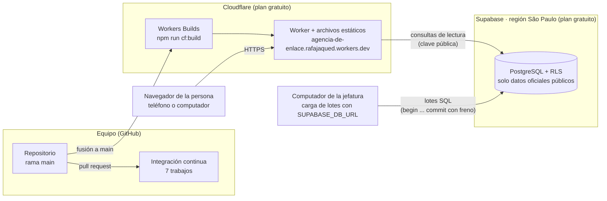

*Figura 13.2.* Diagrama de despliegue: del repositorio a producción (elaboración propia).

**Cómo se accede.** Dirección pública, sin cuenta ni credenciales de demostración, porque todo lo público funciona sin cuenta.

**Procedimiento de despliegue.** El despliegue es automático con cada fusión a `main` (Cloudflare Workers Builds conectado al repositorio). El procedimiento reproducible es:

**Tabla 13.25.** Procedimiento de despliegue.

| Paso | Acción | Comando o detalle | Verificación |
|---|---|---|---|
| 1 | Verificar que el pull request pasó la integración continua y que el jefe de proyecto confirmó la revisión | Pestaña «Checks» del pull request | 7 trabajos en verde (la regla de la rama principal exige como obligatorios solo el contraste de colores y una aprobación) |
| 2 | Fusionar a `main` en un solo commit (squash) | Botón de GitHub, con el título en formato `tipo: descripción (#N)` | `main` apunta al nuevo commit |
| 3 | Cloudflare compila | Comando de compilación configurado en el panel: `npm run cf:build` (equivale a `opennextjs-cloudflare build`; antes del 24 de noviembre incluía además `npm run datos:exportar`, que se retiró porque gastaba tráfico de la base; PR #319) | Registro de la compilación sin errores; la etapa dura unos 17 segundos |
| 4 | Cloudflare publica la nueva versión del Worker | Publicación automática (`[COMPLETAR: Rafael confirma en el panel el comando de despliegue, por ejemplo npx wrangler deploy]`). Alternativa manual desde un computador con sesión iniciada en Wrangler: `npm run cf:deploy` | La versión nueva aparece como activa en el panel |
| 5 | Verificación posterior | Abrir la portada, `/carreras`, la ficha de una carrera, `/comparador`, `/beneficios` y `/meta`; ver que responden 200 y que una ficha trae fuente y fecha | Las páginas cargan en 360 px sin errores de consola; la revisión del 25 de noviembre cubrió 15 páginas |
| 6 | Registro del despliegue | Fecha, número del pull request, responsable y resultado de la verificación posterior | `[COMPLETAR: Rafael abre una tabla de registro de despliegues en el repositorio (para el dato del KPI K2) y la llena en cada fusión desde el 27 de noviembre]` |

**Configuración requerida.** Las variables de 13.15 en el panel de Cloudflare; el archivo `wrangler.jsonc` define el nombre del Worker (`agencia-de-enlace`), la fecha de compatibilidad (`2025-05-05`) y el indicador `nodejs_compat`, que el adaptador exige.

**Base de datos.** La estructura se crea aplicando en orden las 14 migraciones de `supabase/migrations/` (cada una se aplica una vez y nunca se edita una migración ya aplicada), y los datos iniciales se cargan con los lotes SQL que genera `datos/generar_lotes*.py` desde los archivos oficiales procesados; el cargador `scripts/cargar-lotes.mjs` los aplica con `SUPABASE_DB_URL`. Cada lote con período corre dentro de una transacción con un freno que la deshace si una carrera quedara con dos períodos del mismo dato. Hay 11.364 variantes de carrera cargadas.

**Procedimiento de reversa.** Hay tres niveles, del más rápido al más lento. Ninguno se ha ensayado todavía como simulacro; la evidencia de que los dos primeros existen es la configuración del proveedor y el historial de `main`.

1. **Versión anterior del Worker.** Cloudflare conserva las versiones publicadas del Worker (supuesto a confirmar en el panel); en el panel (Workers, versiones) se puede volver a activar la anterior, o con `npx wrangler rollback` desde un computador con sesión iniciada. Tarda del orden de minutos. `[COMPLETAR: Rafael ensaya una reversa a la versión inmediatamente anterior antes del 4 de diciembre y anota el tiempo]`.
2. **Revertir el cambio en `main`.** Como cada pull request es un solo commit, se revierte con `git revert <commit>` en una rama, un pull request y fusión; Cloudflare republica solo en unos dos a cuatro minutos.
3. **Datos.** Si una carga dejó datos incorrectos, se vuelve a cargar el lote anterior; los lotes y sus huellas de archivo están registrados (13.17).

**Evidencia del despliegue para el informe anillado.** `[COMPLETAR: capturas de pantalla de la portada, la ficha de una carrera, el comparador y /meta con fecha visible (Alejandro); enlace al video de demostración con código QR (Alejandro); y el registro de despliegue de la versión 0.7.0 con fecha, responsable y resultado (Rafael)]`. La dirección de acceso está en el primer párrafo de este capítulo y en el README del repositorio.

---

### 13.17 Respaldo y recuperación

**Tabla 13.26.** Plan de respaldo (estado real y propuesta).

| Decisión | Estado real el 26 de noviembre de 2026 |
|---|---|
| Qué se respalda | La base de datos contiene solo datos oficiales públicos y la tabla de alertas de crisis (solo tipo de señal y hora); no hay cuentas ni datos personales de personas usuarias. El resto del sistema (código, migraciones, scripts, lotes) está en el repositorio, que es público y está replicado en GitHub y en las copias locales de los integrantes |
| Frecuencia | **La base no tiene respaldo automático.** El plan gratuito de Supabase no lo incluye, según lo que el equipo registró en noviembre (supuesto del equipo, a confirmar en los términos del proveedor); el jefe de proyecto decidió aplicarlo así |
| Dónde se almacena | Código y scripts: GitHub. Datos: se reconstruyen desde los archivos oficiales con los scripts; los archivos descargados no se versionan (están excluidos) y se registra cada descarga con su fuente, fecha y huella SHA-256 (insumo del KPI K4; hoy la huella figura solo en 1 de 12 entradas) |
| Retención | Del código, el historial completo de Git. De los datos descargados: `[COMPLETAR: Cristóbal indica dónde se guardan los archivos oficiales originales fuera del repositorio y por cuánto tiempo]` |
| Quién puede restaurar | Jefe de proyecto (acceso a Supabase y a Cloudflare) |
| Tiempo objetivo de recuperación | `[COMPLETAR: definir con el jefe de proyecto; propuesta: 24 horas para volver a tener la base con los datos oficiales cargados, porque son reproducibles]` |
| Última restauración verificada | **Ninguna registrada.** `[COMPLETAR: fecha, quién y tiempo de la restauración de prueba; ver procedimiento abajo]` |

**Qué sí hay como evidencia parcial.** En cada pull request, la integración continua crea un PostgreSQL vacío, aplica las 14 migraciones en orden y ejecuta las 111 verificaciones de seguridad. Eso demuestra que el esquema puede reconstruirse desde cero en un entorno limpio. No demuestra que los datos se recuperen. Los lotes 12 a 15 se probaron contra Postgres antes de cargarse en producción.

**Procedimiento de restauración de prueba** (a ejecutar y registrar antes del 11 de diciembre): `[COMPLETAR: Rafael o Cristóbal, con un proyecto de Supabase nuevo y vacío: (1) aplicar las migraciones en orden; (2) generar los lotes con datos/generar_lotes.py desde datos/procesados/carga.csv; (3) cargarlos con scripts/cargar-lotes.mjs; (4) comprobar los conteos (11.364 variantes) y abrir una ficha; (5) anotar el tiempo total y borrar el proyecto de prueba]`.

**Datos personales y respaldo.** Hoy no hay datos personales en la base, así que el plazo de conservación de datos personales no aplica a las copias. Si se abre la cuenta con correo (2027), las copias de seguridad contendrán datos personales y el plazo de conservación declarado en el capítulo 12 deberá aplicarse también a ellas; antes de abrir cuentas hay que resolver el respaldo, porque el plan gratuito no lo tiene (riesgo R3 de la matriz, relacionado). `[COMPLETAR: alinear con el capítulo 12, plazo de conservación declarado]`.

---

### 13.18 Manuales y entregables técnicos

**Tabla 13.27.** Estado de los documentos técnicos.

| Documento | Para quién | Qué hay hoy | Qué falta |
|---|---|---|---|
| Manual de despliegue e instalación | Quien administre el sistema | El README tiene requisitos (Node.js 24), instalación y comandos (`npm ci`, `dev`, `build`, `start`, `lint`, `test`, `test:a11y`); la guía de carga de lotes explica paso a paso cómo generar, probar y cargar la oferta (siete pasos con verificación); el README de `supabase/` explica qué protege el esquema y cómo se prueba; el despliegue está descrito en 13.16 | Un manual único que una todo en orden (crear proyecto de Supabase, aplicar migraciones, cargar lotes, configurar Cloudflare, variables, verificación); corregir `.env.example`; **la prueba del manual: que una persona que no lo escribió lo siga sin preguntar** `[COMPLETAR: Alejandro lo intenta en un computador limpio y anota dónde se detiene]` |
| Manual de usuario | La persona que egresa | El propio sitio es el manual: preguntas frecuentes y glosario con fuente y fecha, guía del FUAS, explicaciones «qué mide» junto a cada cifra y la página «Quiénes somos» | Un manual con capturas por tarea (T1 a T4) para quien lo necesite impreso. `[COMPLETAR: Alejandro, con las capturas de 13.16]` |
| Manual de administración | Quien gestione datos y parámetros | Procedimientos de carga y de actualización de datos (guía de lotes); registro de descargas oficiales con huellas; guías por integrante en el repositorio | Procedimiento de actualización mensual de datos (K4), de revisión de alertas de crisis y de respaldo/restauración (13.17). No hay usuarios ni roles de administración en la aplicación hoy: la administración se hace en los paneles de Supabase y Cloudflare |
| Documentación del código | Quien lo mantenga | README, descripción de la arquitectura con diagramas, más de 30 registros de decisión con contexto, opciones y justificación, guía de componentes del sistema visual en `/componentes`, comentarios que explican el porqué | Mantener actualizada la descripción de la arquitectura al 26 de noviembre; `[COMPLETAR: Rafael]` |
| Diccionario de datos | Quien trabaje con la base | Existe un diccionario de las tablas y campos de la oferta | Se incorpora por referencia desde el capítulo 12 (diccionario de datos del diseño) |

---

### 13.19 Conclusión del plan de pruebas y riesgo residual

*(Redacción provisoria al 26 de noviembre de 2026; se actualiza con los resultados de la medición y con el registro de la versión 0.7.0.)*

Se ejecutaron 372 pruebas automáticas de TypeScript y 257 de Python sobre la versión 0.6.0, todas aprobadas, más las 111 verificaciones de seguridad de la base y las pruebas de accesibilidad que corren en la integración continua. Sobre dos casos del capítulo 12 (CP-25 y CP-26: puntaje ponderado y rango del puntaje) se aplicó partición de equivalencia y valores frontera con 30 subcasos, todos con el resultado esperado; 11 de esos casos ya estaban cubiertos por pruebas del repositorio y los 19 restantes se propusieron y ejecutaron el 26 de noviembre con un script del equipo que aún no está en el repositorio. Las pruebas mostraron presencia de defectos en la historia del proyecto (58 pull requests de corrección) y ninguna demuestra que no queden más.

**Qué quedó verificado.** Las reglas de cálculo del puntaje con sus fronteras, el comportamiento de las comparaciones sin datos suficientes, la meta y las preferencias en el dispositivo, las alternativas cercanas sin influencia de clientes, los calendarios con vigencia y el aislamiento por persona en la base.

**Qué no.** El espacio publicitario en producción (la rama no está fusionada), el acceso por HTTPS en el 100 % de las solicitudes (`http://` no redirige), el consumo de la base dentro del 80 % del plan, la integración de extremo a extremo con los datos reales de producción en cada ficha (se verifica por muestra), la compatibilidad en lector de pantalla y en teléfono físico, el rendimiento con muchas personas a la vez, la restauración de un respaldo, el uso real por personas (la medición no se ha hecho) y la firma del acta.

**Riesgo residual (alimenta el capítulo 9).**

| Riesgo residual | Relación con la matriz | Mitigación |
|---|---|---|
| Un dato oficial cambia de estructura o de fecha y la carga deja una cifra desactualizada | R2 | Las pruebas de carga validan tipos y rangos; el freno de períodos evita dos períodos; la vigencia mensual (K4) se revisa cada mes |
| El tráfico de la base supera el plan gratuito en una visita masiva de admisión | R3 | Caché de consultas (PR #309); corrección de la compilación (PR #319); revisión del uso antes de la medición; pasar las páginas a caché antes de enero; evaluar el plan de pago |
| El rendimiento en uso masivo es desconocido | R3 | Sin prueba de carga; la CPU por solicitud no se ha medido (el plan gratuito limita a 10 ms por solicitud). `[COMPLETAR: medición de CPU en el panel de Cloudflare; la trae Rafael Jaque]` |
| No se consiguen las 10 personas | R1 | Plan B: mínimo de 6, declarado |
| Pérdida de la base sin respaldo | Nueva: no está en la matriz del capítulo 8 | Los datos son reproducibles; la restauración de prueba está pendiente. `[COMPLETAR: proponer al capítulo 9 agregarlo como riesgo]` |

---

### 13.20 Autoevaluación y preguntas de cierre

**Tabla 13.28.** Autoevaluación del capítulo 13 (estado al 26 de noviembre de 2026).

| Bloque | Qué se verifica | ¿Está? |
|---|---|---|
| Código | Estructura, convenciones y configuración documentados | Sí (13.1) |
| | Ninguna credencial en el repositorio ni en su historial | Sin hallazgos en una búsqueda por patrones; no es auditoría exhaustiva |
| Repositorio | README, exclusiones, configuración de ejemplo, scripts de base y licencia | Sí; el archivo de ejemplo está desalineado con el código y debe corregirse |
| | Estrategia de ramas declarada y respetada | Sí, con un esquema sin rama `desarrollo` (13.3) |
| | Commits con convención y enlazados a requerimientos | La convención sí (99,7 %); el enlace a RF-xx no, solo a códigos de tarea |
| | Historial con trabajo sostenido y distribuido | Sostenido sí (23 de 24 días); distribuido no: 84 % de los pull requests en una cuenta (13.6) |
| Versionado | Tabla de versiones con contenido y estado | Sí, como reconstrucción; sin etiquetas Git |
| Incidencias | Registradas con pasos, severidad y estado | No: no hay registro estructurado hasta el 25 de noviembre |
| Pruebas | Plan con alcance, exclusiones, estrategia, entrada y salida | Sí (13.7) |
| | Casos con resultado esperado escrito antes de ejecutar | Parcial: los esperados se derivaron de la regla antes de comparar, pero los ejecutó quien los redactó |
| | Partición de equivalencia con clases válidas e inválidas | Sí, para dos funciones |
| | Valores frontera con límites exactos | Sí, para dos funciones |
| | Registro de ejecución por versión | Solo de la versión 0.6.0 |
| | Defectos con ciclo resuelto/verificado por personas distintas | No registrado por defecto; sí a nivel de pull request |
| | Regresión tras cada corrección | Sí, la integración continua |
| Trazabilidad | Ningún requerimiento sin caso de prueba | Sí: CP-01 a CP-91 cubren todas las filas que no son «Won't». Con resultado pendiente o negativo: las de la Tabla 13.18 |
| No funcionales | Cada requerimiento con número tiene su medición | Parcial: peso de página estimado; Lighthouse, lector de pantalla y tiempos pendientes |
| | Respaldo restaurado al menos una vez | No |
| Aceptación | Acta firmada por la contraparte | No: plantilla lista; se firma después de la medición |
| Despliegue | Sistema accesible, procedimiento reproducible, reversa definida, evidencia en el informe | Accesible y procedimiento sí; reversa definida pero no ensayada; evidencia en el informe pendiente |
| Manuales | Despliegue, usuario y administración entregados; manual probado por un tercero | Parcial; la prueba del manual está pendiente |

**Las cuatro preguntas de cierre.**

1. **¿Hay algún requerimiento sin caso de prueba?** No: la matriz del capítulo 12 asigna un caso (CP-01 a CP-91) a cada requerimiento que no es «Won't». Distinto es el resultado: no cumplen RF-47, RF-49, RF-50, RL-02, RL-04, RL-12, RNF-09 en el ciclo actual, RNF-11 por `http://` y RNF-14; no se han medido RNF-06, RNF-07, RNF-08, RNF-18 y RNF-20 (Tabla 13.18 y Tabla 13.19). Los resultados de la medición con personas siguen pendientes. Además, la matriz se armó después de construir, no durante, y puede esconder huecos.
2. **¿El historial del repositorio respalda la metodología declarada en el capítulo 12?** En parte. Respalda el trabajo sostenido y por tareas pequeñas (23 de 24 días con cambios, ramas por tarea, pull request por cambio, mediana de tamaño de 53 líneas para la jefatura, 212 para Cristóbal y 47 para Alejandro (Tabla 13.6), 99,7 % de mensajes con convención) y la revisión con pauta escrita antes de fusionar. No respalda un reparto equilibrado del trabajo de construcción: el 84 % de los pull requests y el 82 % de las líneas están en la cuenta de la jefatura, con apoyo de herramientas de IA declaradas, y la contribución de los otros dos integrantes está sobre todo en datos, verificación y medición. Si el capítulo 12 dice «tres integrantes que construyen en partes iguales», no es lo que muestra el historial, y conviene corregir la redacción. `[COMPLETAR: alinear con el capítulo 12 la descripción de la metodología]`.
3. **¿Las pruebas de aceptación están citadas en el reporte de validación del capítulo 10?** Están definidas aquí (Tablas 13.21 a 13.23) con los mismos criterios de las hipótesis H1 a H4, fijados antes de medir. Los resultados no existen todavía; el capítulo 10 debe citar la Tabla 13.22 y esta acta como la misma evidencia, `[COMPLETAR: se completa el 4 de diciembre con la hoja de registro]`.
4. **¿Podría otra persona instalar y operar el sistema solo con lo que entregamos?** Todavía no con certeza. Una persona con experiencia en Node.js puede levantar el sitio en local con el README y correr las pruebas (se hizo el 26 de noviembre sin consultar al equipo). Para desplegar necesita el panel de Cloudflare, el proyecto de Supabase y las claves, y el procedimiento está repartido entre el README, la guía de lotes y este capítulo; además, el archivo de ejemplo tiene los nombres de variables desalineados y no se ensayaron la reversa ni la restauración. Mientras no se pruebe el manual con alguien que no lo escribió, la transferencia (capítulo 10) y la sostenibilidad (capítulo 11) son declaraciones con respaldo parcial.

---

---

## Referencias nuevas de la Parte II

Se suman a las referencias de la Parte I, que no se repiten.

- Anderson, D. J. (2010). *Kanban: Successful evolutionary change for your technology business*. Blue Hole Press.
- Braille Institute. (s. f.). *Atkinson Hyperlegible Next y Atkinson Hyperlegible Mono* [Tipografías]. https://www.brailleinstitute.org/freefont/
- Chacon, S., y Straub, B. (2014). *Pro Git* (2.ª ed.). Apress.
- Clegg, D., y Barker, R. (1994). *Case method fast-track: A RAD approach*. Addison-Wesley.
- Codd, E. F. (1970). A relational model of data for large shared data banks. *Communications of the ACM, 13*(6), 377-387.
- Conventional Commits. (s. f.). *Conventional Commits 1.0.0*. https://www.conventionalcommits.org/es/v1.0.0/
- Departamento de Evaluación, Medición y Registro Educacional. (s. f.). *Factores de selección: Admisión 2027*. Universidad de Chile. https://portaldemre.demre.cl/paes/factores-seleccion/
- Elliot, A. J. (2015). Color and psychological functioning: A review of theoretical and empirical work. *Frontiers in Psychology, 6*, Artículo 368. https://doi.org/10.3389/fpsyg.2015.00368
- Instituto Nacional de Estadísticas [INE]. (2026, 6 de noviembre). *Índice de Precios al Consumidor (IPC) de octubre presentó una variación mensual de 0,5 %* [Comunicado de prensa; variación a doce meses de 4,5 %] (consultado el 26 de noviembre de 2026). https://www.ine.gob.cl/prensa/detalle-prensa/2026/11/06/%C3%ADndice-de-precios-al-consumidor-%28ipc%29-de-octubre-present%C3%B3-una-variaci%C3%B3n-mensual-de-0-5
- Instituto Profesional AIEP. (2025). *Pauta de evaluación Entregable II: Proyecto de especialidad*. Dirección Nacional de Currículum y Evaluación.
- International Energy Agency [IEA]. (2025). *Energy and AI*. IEA. https://www.iea.org/reports/energy-and-ai
- International Software Testing Qualifications Board. (2018). *Certified tester foundation level syllabus* (Versión 2018). ISTQB.
- Kaplan, R. S., y Norton, D. P. (1996). *The balanced scorecard: Translating strategy into action*. Harvard Business School Press.
- Machado, G. M., Oliveira, M. M., y Fernandes, L. A. F. (2009). A physiologically-based model for simulation of color vision deficiency. *IEEE Transactions on Visualization and Computer Graphics, 15*(6), 1291-1298. https://doi.org/10.1109/TVCG.2009.113
- Myers, G. J., Sandler, C., y Badgett, T. (2011). *The art of software testing* (3.ª ed.). John Wiley & Sons.
- Nielsen, J., y Landauer, T. K. (1993). A mathematical model of the finding of usability problems. En *Proceedings of the SIGCHI Conference on Human Factors in Computing Systems (CHI '93)* (pp. 206-213). ACM. https://doi.org/10.1145/169059.169166
- Object Management Group. (2017). *OMG Unified Modeling Language (OMG UML), Version 2.5.1*. https://www.omg.org/spec/UML
- Organización para la Cooperación y el Desarrollo Económicos. (2002). *Glosario de los principales términos sobre evaluación y gestión basada en resultados*. OCDE.
- OWASP Foundation. (2021a). *OWASP Top 10:2021*. https://owasp.org/Top10/2021/
- OWASP Foundation. (2021b). *Application Security Verification Standard 4.0.3*. https://github.com/OWASP/ASVS/tree/v4.0.3
- Porter, M. E. (2008). The five competitive forces that shape strategy. *Harvard Business Review, 86*(1), 78-93.
- Pressman, R. S., y Maxim, B. R. (2021). *Ingeniería del software: Un enfoque práctico* (9.ª ed.). McGraw-Hill.
- Preston-Werner, T. (s. f.). *Versionado semántico 2.0.0*. https://semver.org/lang/es/
- Project Management Institute. (2021). *A guide to the project management body of knowledge (PMBOK guide)* (7.ª ed.). Project Management Institute.
- Ries, E. (2011). *The lean startup: How today's entrepreneurs use continuous innovation to create radically successful businesses*. Crown Business.
- Sommerville, I. (2016). *Software engineering* (10.ª ed.). Pearson.
