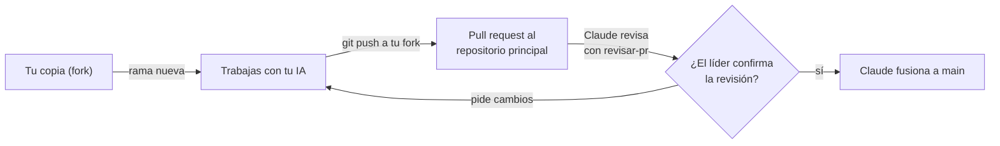

# Equipo y forma de trabajo

Este documento es común para todo el equipo. Cada integrante tiene además su guía personal con sus tareas, paso a paso:

| Persona | Rol | Guía |
|---|---|---|
| Líder ([@rafajaque](https://github.com/rafajaque)) | Líder de arquitectura: base de datos, privacidad, criterio de alternativas cercanas, «Quiénes somos», encuesta, informe final, decisiones finales | [`guia-rafael.md`](guia-rafael.md) |
| Alejandro | Interfaz y medición con personas: vista de carrera con comparaciones, meta con alternativas, portada, páginas «Quiénes somos» y «Preguntas frecuentes», accesibilidad, hoja de registro y aplicación de la medición | [`guia-alejandro.md`](guia-alejandro.md) |
| Cristóbal | Datos, contenido e identidad visual: fuentes oficiales, empleabilidad y duración con sus comparaciones, vacantes y arancel, calendario, preguntas frecuentes, puntaje ponderado, textos, aplicación de la medición | [`guia-cristobal.md`](guia-cristobal.md) |
| Claude | Revisión de cada cambio, documentación, verificación de fuentes, fusión a `main` | — |

**Entrega final: 19 de diciembre de 2026.**

**Qué entregamos:** un sitio gratuito y sin cuenta para toda persona que egresa de 4.º medio y no ha ingresado a la educación superior (alcance nacional), con las comparaciones de cada carrera, meta con tres preferencias y alternativas cercanas, calendario y preguntas frecuentes; y una medición con 10 personas de 18 años o más entre el 30 de noviembre y el 4 de diciembre ([ADR 0032](../decisiones/0032-agencia-independiente-y-publico-egresado.md); [`docs/plan.md`](../plan.md); [Entregable Parte I](../entregable/Entregable_Parte_I.md), puntos 2.3 y 3). Hasta el 19 de diciembre es un proyecto de título sin entidad; la sociedad por acciones (SpA) se constituye en 2027. **Queda diseñado, sin construir:** cuenta con correo, cuestionario vocacional, simulación de beneficios, asistente conversacional, noticias, tablero de transparencia e informes. **Fuera del alcance (proyección):** permanencia en educación superior, pulso de check-in y predicción de deserción. Ya no hay panel para colegios ni nada que dependa de colegios, tutores o una fundación. Cada guía personal parte de las Tablas 3.7 (Gantt), 3.8 (RACI) y 3.10 (entregables) y de `docs/plan.md`.

> **¿Primera vez con GitHub?** Empieza por [`primeros-pasos-github.md`](primeros-pasos-github.md): instalación, conexión de tu IA, el ciclo de cada tarea comando por comando y tu semana 1 día por día.

---

## 1. Cómo se trabaja: el camino de un cambio



1. **Nunca trabajas directo en el repositorio principal.** Trabajas en tu copia personal (fork) y desde ahí propones cambios.
2. **Una tarea = una rama = un pull request (PR).** Nada de mezclar dos tareas.
3. **Abres el PR** desde tu fork hacia `AE-SE/Agencia-de-Enlaces-y-Seguimiento-Estudiantil`, rama `main`, completando la plantilla.
4. **Avisas en el grupo del equipo** con el enlace del PR.
5. **Claude revisa** con la pauta [`revisar-pr`](../../.claude/skills/revisar-pr/SKILL.md) y el líder confirma o pide cambios.
6. **Si hay cambios pedidos:** los haces en la misma rama y vuelves a subir. El PR se actualiza solo.
7. **Claude fusiona** a `main` como un solo commit. El líder cierra el PR.
8. **Actualizas tu fork** antes de empezar la siguiente tarea (sección 3).

Tiempo esperado de revisión: dentro del mismo día si avisas antes de las 20:00.

---

## 2. Preparación (una sola vez)

### 2.1 Programas

| Programa | Versión | Para qué |
|---|---|---|
| Git | La más reciente | Control de versiones |
| Node.js | Versión LTS vigente | La aplicación web (Next.js) |
| Python | 3.12 o superior | Scripts de datos y de diseño |
| Editor | VS Code u otro | Escribir código |

### 2.2 Acceso al repositorio

1. Acepta la invitación de GitHub que te llegó por correo. Tu permiso en el repositorio principal es de **lectura**: puedes hacer fork y abrir PR desde él, pero no puedes escribir directo en el principal. Así un push por error a `main` es imposible.
2. Entra a https://github.com/AE-SE/Agencia-de-Enlaces-y-Seguimiento-Estudiantil y haz clic en **Fork** (arriba a la derecha). Se crea tu copia en tu cuenta.
3. Clona **tu fork** (no el principal) y conéctalo con el principal:

```bash
git clone https://github.com/TU_USUARIO/Agencia-de-Enlaces-y-Seguimiento-Estudiantil.git
cd Agencia-de-Enlaces-y-Seguimiento-Estudiantil
git remote add principal https://github.com/AE-SE/Agencia-de-Enlaces-y-Seguimiento-Estudiantil.git
git remote -v   # debe mostrar "origin" (tu fork) y "principal"
```

4. Configura tu nombre y correo para que tus commits queden a tu nombre:

```bash
git config user.name "Tu Nombre"
git config user.email "tu-correo@ejemplo.cl"
```

5. Instala las dependencias de los scripts y verifica que todo funcione:

```bash
pip install -r scripts/requirements.txt
python3 scripts/tokens.py --check   # todas las líneas deben decir [ok] (44 al 11 de noviembre)
```

### 2.3 Tu IA de confianza

Al empezar **cada conversación** con tu IA, entrégale en este orden:

1. [`AGENTS.md`](../../AGENTS.md) completo.
2. Este archivo.
3. Tu guía personal.
4. La skill de [`.claude/skills/`](../../.claude/skills/) de la tarea.
5. La tarea concreta (cada tarea de tu guía trae un texto listo para copiar).

Si usas Claude Code, los pasos 1 y 4 los hace solo.

---

## 3. Comandos del día a día

```bash
# Antes de empezar una tarea: traer lo último del principal
git checkout main
git pull principal main
git push origin main

# Crear la rama de la tarea
git checkout -b feat/explorador-de-carreras

# Guardar avances (todas las veces que quieras)
git add -A
git commit -m "feat: agrega filtros por región al explorador"

# Subir a tu fork
git push -u origin feat/explorador-de-carreras
# GitHub te muestra un enlace para crear el pull request: ábrelo
```

**Nombres de rama:** `feat/` funcionalidad, `fix/` corrección, `docs/` documentación, `datos/` carga de datos.
**Mensajes de commit:** en español, empezando con `feat:`, `fix:`, `docs:`, `datos:`, `test:` o `chore:`.

---

## 4. Calendario hasta el 19 de diciembre

Es el Gantt de la Tabla 3.7. El detalle por persona, con criterios de aceptación, está en cada guía.

| Fase | Fechas | Líder | Alejandro | Cristóbal | Hito |
|---|---|---|---|---|---|
| Cimientos y primera carga oficial | 3 al 9 nov | Base de datos y RLS; aprobar | Ficha, explorador, comparador | Cargas oficiales, fórmula del ranking | **Hecho** |
| Explorar y simular | 10 al 16 nov | Aprobar; entregable reescrito | Pruebas a 360 px de lo existente | Cerrar el PR 96 | Entregable listo para el martes 17 |
| Datos de las comparaciones y criterio | 17 al 23 nov | N6 criterio de alternativas y N7 «Quiénes somos» (vie 20), N8 permiso y encuesta (lun 23) | Portada y hoja de registro en borrador | N1 empleabilidad y duración y N3 calendario (vie 20), N2 vacantes, arancel y postulaciones (lun 23) | Una carrera real con sus cuatro comparaciones y fuente |
| Pantallas y congelamiento | 24 al 27 nov | N14: 10 personas confirmadas (vie 27) | N9 y N11 (mié 25), N10 (jue 26), N12 y N13 (vie 27) | N4 preguntas frecuentes (mié 25), N5 lista fija de pares (vie 27) | **Vie 27 nov: congelamiento de funciones.** Recorrido completo en el teléfono |
| Todo fusionado y medición | **Mar 1 dic**; 30 nov al 4 dic | Fusionar todo a `main`; atender cualquier señal de riesgo | N15: aplicar la medición | N15: aplicar la medición y contrastar los datos con la clave | Registro de la medición completo el vie 4 dic |
| Correcciones y mejoras leves | 7 al 11 dic | Revisión de PR; revisión de privacidad | Corregir hallazgos; auditoría de accesibilidad | Corregir hallazgos; verificación de datos con fuente | Cada hallazgo con estado; 100 % de datos con fuente |
| Informes y presentación | 14 al 17 dic (último PR de código: mar 15) | N16 informe final | Informe de la medición | Informe de datos | Informes sin marcas `[COMPLETAR]` |
| Cierre | 18 y 19 dic | Revisión final | Presentación | Presentación | **Entrega el 19 dic** |

**Ritmo de las próximas semanas:** el desarrollo de funciones termina el **viernes 27 de noviembre**; el **martes 1 de diciembre** todo debe estar fusionado a `main`. La ventana del 1 al 17 de diciembre es para medir, pulir y probar (medición, correcciones, accesibilidad, verificación de datos, mejoras leves, documentación e informe), no para terminar lo pendiente. Una mejora leve no agrega pantallas, tablas ni dependencias y cabe en un PR de menos de 150 líneas; lo demás pasa a proyección. **Revisión de PR: martes (24 nov, 1, 8 y 15 dic) y viernes (27 nov, 4 y 11 dic).**

**Hito al cierre de cada semana** (lunes 16 y 23, viernes 27 de noviembre y viernes 4 y 11 de diciembre): algo que se pueda mostrar en un teléfono.

---

## 5. Dependencias entre nosotros

| Quién necesita | Qué | De quién | Para cuándo |
|---|---|---|---|
| Alejandro | Empleabilidad y duración con sus comparaciones (N1) | Cristóbal | Vie 20 nov |
| Alejandro | Vacantes y arancel (N2) | Cristóbal | Lun 23 nov |
| Alejandro | Criterio de alternativas cercanas (N6) | Rafael | Vie 20 nov |
| Alejandro | Texto de «Quiénes somos» (N7) | Rafael | Vie 20 nov |
| Alejandro | Preguntas frecuentes con fuente (N4) | Cristóbal | Mié 25 nov |
| Alejandro | Lista fija de pares y clave de respuestas (N5) | Cristóbal | Vie 27 nov |
| Alejandro y Cristóbal | 10 personas confirmadas con día y hora (N14) | Rafael | Vie 27 nov |
| Rafael | Revisión de los PR de datos y de pantallas, en las ventanas | Cristóbal y Alejandro | Mar 24 y vie 27 nov |
| Todos | Todo lo comprometido, fusionado a `main` y publicado | Todos | Mar 1 dic |
| Rafael | Lista de hallazgos de la medición, con gravedad y arreglo propuesto | Alejandro y Cristóbal | Vie 4 dic |
| Alejandro | Datos y textos verificados de cada pantalla para el informe | Cristóbal | Vie 11 dic |

Si una dependencia no llega en la fecha, **trabaja con datos de ejemplo** y avisa en el grupo ese mismo día. Nunca te quedes esperando sin decir nada.

---

## 6. Reglas que no se negocian (resumen de AGENTS.md)

- Ningún dato sin fuente oficial, URL y fecha. Si no lo puedes verificar, no se publica. Solo fuentes oficiales, primarias o académicas: nunca prensa.
- Ningún color, tamaño ni espacio escrito a mano: solo tokens de diseño.
- Ningún dato personal de quienes participan en la medición o en la encuesta, ni archivos a nivel de persona, en una IA externa ni en el repositorio. Datos de prueba siempre ficticios. Solo participan personas de 18 años o más, con consentimiento informado guardado fuera del repositorio.
- Ninguna etiqueta «en riesgo» ni promesa de predicción en pantallas o textos (AGENTS.md 2.4). Ningún texto dice que la gente no ingresa *por* desinformación ni que quedar fuera *causa* problemas de salud mental.
- Toda cifra que calcula el equipo se rotula «elaboración propia». El sitio nunca ordena ni destaca instituciones por ser clientes.
- Ninguna clave en el código. Las claves las entrega el líder por un canal privado.
- Ningún "estilo de aprendizaje" (visual/auditivo/kinestésico) en contenidos ni recomendaciones.
- Tú eres responsable del código que subes, aunque lo haya escrito tu IA: léelo y entiéndelo.

---

## 7. Cuando tengas dudas

1. Busca en `AGENTS.md`, `docs/` y tu guía.
2. Pregúntale a tu IA, pasándole esos archivos.
3. Si sigue la duda, **pregunta en el grupo** antes de inventar. Una pregunta de 1 minuto ahorra un PR rechazado.
4. Si tu IA te propone algo que contradice `AGENTS.md`, gana `AGENTS.md`.
